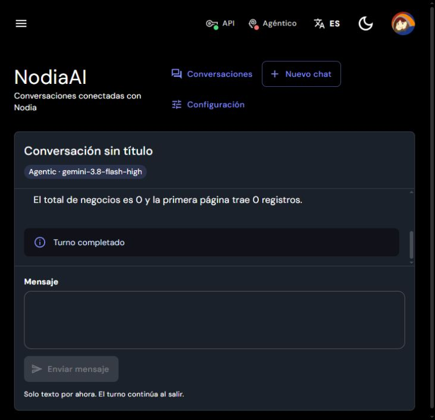

# AI-15 — investigación de tiempos de espera, 2026-10-16

Estado: Web conversacional y Agentic con lectura de negocio completados en laboratorio mediante la conexión configurada. No aprobación documental ni aceptación de producción. Los fallos históricos se conservan y no se reenvían.

## Resultados confirmados

- [Infraestructura](nodia-ai-ai15-timeout-infrastructure.json): VM sin saturación, OOM ni throttling; PostgreSQL, Redis, API, worker y bridge activos. Doce comprobaciones HTTPS sin autenticación verifican DNS/TCP/TLS desde host, contenedor y entorno filtrado del CLI. No prueban RPC autenticado ni inferencia. El reloj de VM/contenedor está sincronizado por NTP; el reloj Windows estaba unos 372 segundos atrasado y no se modificó.
- [Bridge instrumentado](nodia-ai-ai15-timeout-bridge-activation.json): 266/266 pruebas Linux sin red ni perfiles montados; Windows 264 correctas y dos omisiones históricas. Una activación del bridge, sin reiniciar API/worker, cambiar credenciales, modelo, esfuerzo, permisos o presupuestos. El primer guard comparaba arrays sin persistir el estado anterior y abortó después del recreate; la validación independiente contrasta todos los campos actuales de mounts y variables únicas con Compose sin modificar y los defaults de la imagen. No atribuir retrospectivamente el fallo del guard sólo al orden.
- [Agentic, selección configurada](nodia-ai-ai15-timeout-agentic-instrumented.json): un dispatch real recuperó el nonce mediante callback MCP, verificó el cierre y acusó su prueba terminal. `supports_mcp` quedó acreditado para esa selección exacta; sin pendientes, modificación de configuración ni replay. Esta prueba técnica no sustituye una lectura de producto por worker/Gateway.
- [Web desde la página](nodia-ai-ai15-timeout-web-success.json): un mensaje nuevo completado y persistido, un dispatch, cero herramientas/delegaciones y cero pendientes. HTTP200/primer bloque a 1.858 ms; primer candidato a 64.871 ms y cierre a 66.377 ms. Quince bloques de bytes, siete candidatos, cero recuperaciones, cierres concurrentes o errores del sink. Los bloques de bytes no equivalen a frames JSON.
- [Elegibilidad pública](nodia-ai-ai15-timeout-public-eligibility.json): las selecciones de BD exactas resultaron disponibles en ambos modos; sólo Agentic declara MCP. La sesión/autenticación por sí sola no generó esa prueba.
- [Observación TCP del CLI](nodia-ai-ai15-timeout-socket-observer.json): metadatos acotados de procesos y estados de sockets, sin direcciones, argumentos o contenido. TCP establecido no acredita respuesta HTTP ni causa del tiempo de espera.

## Alcance del diagnóstico

Web registra fases del SDK, contadores y tiempos, sin copiar su parser ni alterar requests, opciones, timeout o reintentos. La respuesta se considera abierta cuando curl_cffi entrega su primer callback de cuerpo; no se presenta como timestamp de cabeceras. Actividad y refresh en segundo plano se distinguen de la generación.

Agentic proyecta su log nativo exclusivamente a indicadores cerrados de transporte, códigos HTTP permitidos y categorías de proveedor. Es texto no confiable: una coincidencia no demuestra la causa. La lectura es acotada, rechaza enlaces/archivos inseguros y nunca exporta líneas crudas, prompts, herramientas, tokens o credenciales. Fallar la observabilidad no cambia el resultado ni impide limpieza/cuarentena.

Los lectores de evidencia limitan bytes/filas y validan shapes cerrados. Al recoger Docker logs se debe seleccionar la ventana del ensayo con `--since`, `--until` y `--tail`; una ventana histórica demasiado amplia agotó el límite del lector y ocultó inicialmente eventos ya existentes. No fue ausencia de instrumentación. Éxitos Agentic emitidos mediante `logging.INFO` no estaban en el sink del contenedor; no se inventa un tiempo nativo exacto para esa atestación.

Regresiones reproducibles, sin proveedor:

```powershell
$env:NODIA_TEST_PYTHON = (Resolve-Path nodia-gemini-microservice/.venv/Scripts/python.exe).Path
node docs/evidence/scripts/validate-nodia-ai-native-diagnostic-reader.mjs
node docs/evidence/scripts/validate-nodia-ai-web-diagnostic-reader.mjs
```

Son 16 y 19 comprobaciones respectivamente, incluidas salidas históricas y rechazo de campos/textos no permitidos. El runner Python habitual verifica los adaptadores y su cancelación/limpieza.

## Lo que todavía no está demostrado

El timeout histórico de 119 segundos no se reprodujo en estas dos pruebas nuevas. La espera principal observada en Web fue entre primeros bytes y primer candidato; no permite separar cómputo, cola o frames de control del proveedor. No se declara una causa externa comprobada ni una mejora de latencia por añadir diagnósticos.

La posible interferencia del mantenimiento del cliente SDK, descrita en [el issue primario del proveedor de la biblioteca](https://github.com/HanaokaYuzu/Gemini-API/issues/356), permanece como hipótesis; esta generación no observó cierres concurrentes. Tampoco se atribuye el timeout histórico al límite de cuatro segundos de `/engines/status`: esa ruta corresponde a estado agregado, no al plazo de generación.

La descarga binaria real de facturas sigue pendiente por ausencia de R2. No se publican nuevas capacidades, escrituras, permisos o documentos de conocimiento en esta investigación; el catálogo conserva 67 capacidades y 27 fragmentos. AI-16 no se inicia.

## Comprobación de producto e interfaz

La consulta Agentic de negocios activos no completó: el bridge fue cancelado a los 62.057 ms en `awaiting_server_callback`, tras un callback y siete mensajes RPC. Server contabilizó una solicitud de herramienta, pero no persistió ningún recibo; no hay resultado de negocio para comparar ni respuesta sellada. El log CLI no aportó indicadores clasificados de error de red/proveedor/HTTP. Esto localiza el corte en el procesamiento del callback en Server y no acredita que esta ejecución agotara los 119 segundos en Gemini. El worker conservó `outcome_unknown`; la conciliación oficial resolvió una operación y dejó cero pendientes, sin replay. El código original de la excepción no estaba registrado: se añade diagnóstico cerrado del worker/Gateway antes de una nueva comprobación independiente. Los resultados históricos y el fallo nuevo se conservan.

Evaluación de impacto del drawer: incorporar reconsulta explícita para una observación válida con `available:false` recupera la selección sin recargar ni perder borrador. No habilita ejecución desde un resultado desconocido, no cambia el modo y no amplía permisos o herramientas; la elegibilidad se vuelve a consultar al backend.

Verificación del drawer: 13 pruebas focales, suite Client completa de 1.250 pruebas/196 archivos, tipado y lint correctos. Desde la página real se comprobó `false → Volver a comprobar → consulta en curso → disponible`, conservando conexión/modelo/intensidad sin recargar ni aplicar automáticamente.

El diagnóstico Server registra sólo fase propia, clase/código cerrado y SQLSTATE permitido; el worker añade flags de dispatch/cancelación/lease. Los tres marcadores usan JSON en una línea. Nunca se serializan excepciones, argumentos o SQL; el wrapper vuelve a lanzar la misma excepción. Las fallas de logging no cambian el estado `unknown`, los presupuestos o la recuperación. Verificación: 50 pruebas focales de dos casos de uso, **1.516 pruebas/156 archivos** en la suite Server completa; build y lint correctos. El build conserva el pin de conocimiento `5b27b4a3873037c8e850df90a801d84c561545414a8b27de415a3c8ab1f66c96` y los 67 contratos/27 fragmentos publicados.

La preparación del despliegue rechazó antes de modificar el runtime un primer paquete sin `dist/nodia-ai-tools/config/common-schema.json`: ejecutar `nest build` aisladamente después del build completo había borrado ese asset postbuild. Se repitió **`npm run build` completo**, se verificaron pin/contratos/fragmentos sin cambios y se reempaquetó. El packager ahora exige que el contrato compartido compilado exista y coincida byte a byte con la fuente. No atribuir este problema de empaquetado al fallo del callback anterior: el runtime anterior sí contenía el archivo.

## Causa concreta observada en el segundo turno de producto

Una consulta nueva sobre categorías financieras, sin reenviar el run anterior, produjo cuatro callbacks y tres recibos antes de interrumpirse. El diagnóstico del Server registró **`EntityMetadataNotFoundError` en `native_read`**; el worker confirmó `dispatched:true`, `signal_aborted:false` y `lost_lease:false`. El bridge fue cancelado a los 48.565 ms mientras esperaba el cuarto callback. No fue un vencimiento de 119 segundos en Gemini ni un rechazo de argumentos en ese punto.

La [evidencia del turno y su conciliación](nodia-ai-ai15-timeout-finance-worker-failure.json) conserva una operación reconocida y cero jobs, intentos abiertos o slots pendientes. Los tres recibos previos no se presentan como una respuesta final del asistente ni permiten acreditar todas las capacidades. Tampoco se afirma que fallara `FinanceCategory`: esa entidad sí estaba registrada; el diagnóstico original no serializa nombres de targets o argumentos del callback.

La causa de composición quedó reproducida sin Gemini: `autoLoadEntities` recoge registros `forFeature`, pero las familias manuales de Negocios y Ajustes IA no los declaraban. [Antes del cambio](nodia-ai-ai15-worker-metadata-before.json), un proceso nuevo del worker con publicación real y PostgreSQL desechable sólo registró 37 entidades; los lectores de Negocios y Ajustes IA reprodujeron `EntityMetadataNotFoundError`, mientras Finanzas recuperó su nonce correctamente. No se importó AppModule, no se inyectó una lista global de entidades y no se inicializaron consumidores.

La composición declara ahora los diez repositorios de Negocios y los cinco de Ajustes IA, deduplicados y condicionados por sus capacidades publicadas y los consumidores de artefactos/observaciones. El grafo existente completa las relaciones de usuario, roles y módulos. No importa módulos que arranquen consumidores legacy; publicación vacía mantiene su salida sin readers ni Redis. [Después del cambio](nodia-ai-ai15-worker-metadata-after.json), otro proceso nuevo registra 48 entidades, valida los 15 repositorios y todas sus relaciones, y cinco lectores nativos —Negocios, Finanzas, Reservas, Core y Ajustes IA— recuperan cinco nonces sintéticos desde SQL. Se conserva el aislamiento declarado por herramienta, PostgreSQL sólo lectura y limpieza de la BD antes de emitir la evidencia. Ningún perfil o proveedor participa en esta regresión.

## Aceptación real posterior a la corrección

La [activación del ajuste](nodia-ai-ai15-timeout-worker-metadata-fix-activation.json) conserva imagen/proceso/sesión/prueba MCP del bridge, pin, fragmentos, contratos, dependencias, credenciales y las 20 migraciones existentes. Sólo cambia el JS de composición de lectores. Dos scripts de pruebas locales de `package.json` se validan como única diferencia del payload y no se copian al runtime; no se instala ninguna dependencia.

Un chat nuevo, configurado con la misma conexión Gemini, modelo y esfuerzo, consultó únicamente **mis negocios inactivos**, sin nombres/contactos ni cambios. [La auditoría real](nodia-ai-ai15-ui-agentic-mcp-business-inactive-success.json) comprueba UI → worker → Agentic → MCP → Gateway → SQL → respuesta: run `completed`, asistente sellado, un dispatch, una llamada, siete mensajes RPC y un recibo `nodia_businesses_list` completado. Contrato congelado, grant, módulos y autoridad actual válidos. `activity:inactive`, `page:1`, `limit:25`, `all_businesses:false`; total SQL **0**, total del recibo **0** y primera página **0**, sin filtros adicionales. No se amplió el ámbito por ser super_admin. Jobs, intentos y slots pendientes: **0**. La auditoría no llamó al proveedor ni modificó la BD; el dispatch pertenece al mensaje real enviado desde la página.

El primer clic de envío del chat nuevo mostró un error antes de admisión: SQL verificó cero mensajes, runs, jobs e intentos, sin dispatch. No se atribuye su causa al proveedor o a una renovación de sesión sólo por el toast. Tras comprobar ausencia de efectos y disponibilidad, el siguiente envío creó el único mensaje/run de esta prueba. Ninguna inferencia incierta fue reenviada.



La regresión queda integrada en `npm run test:nodia-ai:worker-metadata` y al final de `npm run test:nodia-ai:products`; usar `npm run build` completo para regenerar todos los assets. El conjunto de verificación final conserva 1.516 pruebas Server, 1.250 Client y 266 Python Linux, más los ensayos SQL/lectores de evidencia separados. VM y servicios permanecen encendidos. AI-15 sigue con sus gates independientes de R2 binario y aceptación externa/routing completa; AI-16 no iniciado. No afirmar que este arreglo explica también los timeouts históricos de 119 segundos sin callbacks: su causa no se reprodujo.
