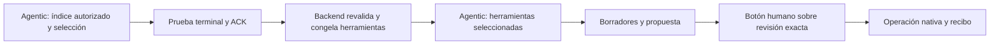

# AI36-C05 — publicación selectiva y aceptación por capacidad

Fecha de continuidad: 2026-10-19. La [entrega82](../mvp/82-nodia-ai-ai36-integral-coverage.md#continuación-ai36-c05--publicación-selectiva-y-descubrimiento-por-etapas) mantiene AI-36 abierto. Esta nota distingue publicación en el candidato, pruebas aisladas, proveedor real y activación operativa; no aprueba documentos ni declara aceptación productiva.

## Alcance del candidato

La [autorización y matriz de publicación](nodia-ai-ai36-c05-publication-validation.json) incorpora siete capacidades a las67 lecturas anteriores:

- `nodia_finance_movements_prepare_create`.
- `nodia_proposals_get` y `nodia_operations_get`.
- `nodia_attachments_describe`.
- `nodia_preferences_list` y `nodia_preferences_prepare`.
- `nodia_workflows_prepare`.

El catálogo global del candidato contiene74 capacidades y31 fragmentos. Las77 candidatas restantes no se publican. Se conservan exactamente los hashes de las67 lecturas y los contenidos aprobados anteriores. `catalog_release` sigue siendo el identificador opaco compatible `nodia-ai-ai15-reads/1`; el nuevo contenido/bindings fija `release_id` `bde4090377b15d8519c9e001a758cf24e70ee3d54bff93ea67fb5dce1fb0a134`.

## Descubrimiento automático

El usuario eligió «Descubrimiento automático por etapas». El [ADR-063 propuesto](../architecture/decisions/ADR-063-nodia-ai-bounded-staged-discovery.md) describe sus alternativas y límites.

Cada generación de descubrimiento expone ocho herramientas técnicas, incluida `nodia_capabilities_select`. La siguiente recibe únicamente entre1y67 capacidades seleccionadas más los siete técnicos anteriores. Los descriptores no cambian dentro de una generación en vuelo. La etapa local `tool_selection` verifica el recibo, cierre y ACK, reautoriza y sustituye la allowlist del grant sin exceder los módulos congelados y permisos vigentes. La selección no confirma cambios ni acepta preferencias.

Web conserva conversación y delegación opt-in hacia Agentic de la misma conexión. Su contexto no recibe instrucciones ni el índice para ejecutar MCP. Los perfiles explícitos permanecen internos al backend; no se añade un parámetro HTTP ni un selector de perfiles a la UI.

Se mantienen74 herramientas/131072bytes de catálogo, contexto262144bytes, cardinalidad JSON128 y grant SQL128. El turno comparte12 callbacks y tres generaciones, incluida la compactación. Agentic con selección utiliza dos generaciones; Web delegado puede usar tres. Si una respuesta no necesita seleccionar capacidades, puede terminar en una. Un resultado incierto no se vuelve a inferir para adivinar su efecto.

## Hallazgos y correcciones conservados

Los dos primeros ensayos SQL se preservan. El segundo acreditó un error de precedencia de operadores PostgreSQL en la comparación de IDs JSON de la continuación delegada. Se añadieron paréntesis a ambos operandos antes de repetir la prueba sobre un compilado nuevo. No se alteraron permisos ni presupuestos para obtener una ejecución correcta.

El [primer ensayo Gemini](nodia-ai-ai36-c05-live-attempt01.json) verificó selección, cierre y ACK reales, pero consumió11 callbacks durante descubrimiento. Preparó un movimiento; la petición posterior agotó el techo compartido de12. El turno quedó incierto, se concilió mediante el protocolo nativo y completó sus dos ACK. No hubo confirmación ni cambios comerciales. Ese callback aislado no constituye aceptación completa del turno ni de la capacidad.

La corrección incorpora al contexto inicial Agentic un índice completo y compacto de las capacidades publicadas y autorizadas, agrupado por módulo/recurso. Incluye IDs, nombres, clase y descripción; no contiene schemas, handlers, datos comerciales ni concesiones de ejecución. Cada colección conserva su límite, no se trunca, y su autoridad/hash se revalidan antes de enviar. Su tamaño real participa en la medición del contexto. Esto permite seleccionar directamente y reservar callbacks para las operaciones. La [ficha del gateway](../nodia-ai/knowledge/nodia-ai/features/capability-registry-gateway.md) conserva estado draft/unregistered y aprobación nula.

La [segunda cohorte](nodia-ai-ai36-c05-live-attempt02.json) utiliza los mismos textos de prueba con referencias de fixtures nuevos. Su descubrimiento completó una única selección, cierre y ACK. La generación siguiente persistió un recibo de preparación financiera, pero no entregó respuesta terminal antes de la cancelación por plazo: quedó `unknown` y se concilió con su prueba nativa y ACK. Consumió dos de los12 callbacks del turno, por lo que no repitió el agotamiento del primer ensayo. Las dos cohortes suman cuatro generaciones nativas aceptadas; ninguna alcanzó confirmación humana ni efectos financieros o preferencias aceptadas. No se reenviaron resultados inciertos.

La [interpretación corregida de la traza](nodia-ai-ai36-c05-live-attempt02-interpretation.json) distingue eventos de progreso e invocaciones: `call_mcp_tool=2` y `completed=1` son compatibles con un inicio y un fin de una sola llamada. Se retira la interpretación preliminar de una segunda llamada bloqueada. El CLI quedó en `awaiting_cli_terminal`, sin evento de resultado, tras108276ms nativos; el plazo de etapa120s también incluye la preparación previa. No hay evidencia suficiente para atribuirlo a JSON inválido, cuota del proveedor, tamaño del resultado o espera de confirmación humana. Los tiempos individuales no quedaron retenidos tras ACK; no se reconstruyen a partir de datos ausentes.

El [control offline reproducible](nodia-ai-ai36-c05-native-bridge-control.json), con el bridge y supervisor Python reales, CLI y respuestas sintéticos, completó dos callbacks consecutivos, incluido un resultado serializado de96156bytes y otro con estado de confirmación pendiente. No reproduce el timeout real ni acredita funcionamiento del proveedor; descarta que ese camino local se bloquee necesariamente por ese estado o tamaño. El arnés de futuras cohortes conserva tiempos monotónicos y contadores por solicitud sin argumentos, prompts ni resultados. No se ejecutó otra inferencia para obtener esa instrumentación.

## Verificación y continuidad

El compilado con el índice supera40 comprobaciones SQL en siete escenarios: Web delegado, ACK fallido y reanudación de limpieza, incertidumbre conciliada, revocación, catálogo obsoleto, presupuesto agotado y origen delegado alterado. Usa aplicación/worker/gateway/PostgreSQL reales con transporte y pruebas nativas simulados; no es inferencia de proveedor. El [ensayo SQL04](nodia-ai-ai36-c05-selection-attempt04.json) conserva su paquete y manifiesto.

La [consolidación reproducible](nodia-ai-ai36-c05-validation.json) registra4159 pruebas correctas en232 archivos Server, build y tipado de producción correctos y lint sin errores. Los192 diagnósticos históricos del tipado de fixtures conservan contenido y códigos, con variaciones únicamente en coordenadas de línea. Las110 pruebas de proceso/runtime y75 del índice/selección son subconjuntos focales; no se suman a la suite completa. Los ensayos anteriores permanecen enlazados con sus compilados y alcances originales.

Las siete nuevas capacidades superan el recorrido SQL aislado. Cero capacidades tienen aún aceptación real de extremo a extremo en C05: el callback financiero observado pertenece a un turno sin respuesta terminal. El siguiente pendiente es localizar el consumo del plazo con la instrumentación temporal nueva y completar la cohorte real de siete capacidades; después corresponde evaluar activación. Las77 candidatas restantes y AI-36 permanecen abiertos. La [salud posterior](nodia-ai-ai36-c05-live-attempt02-quiescence.json) acredita cero trabajos pendientes, intentos abiertos y slots retenidos, con el chat R05 conservado.

No hay nuevas tablas, migraciones, rutas o campos HTTP, cambios de cliente, Python de la aplicación o acceso R2. Los servicios operativos y el Gemini activo conservan su compilado/imagen/sesiones durante estas pruebas. La activación del candidato, la aceptación física en UI, otros modos/modelos, calidad de lenguaje natural sin nombres/IDs dirigidos y el resto de capacidades conservan sus gates independientes.
