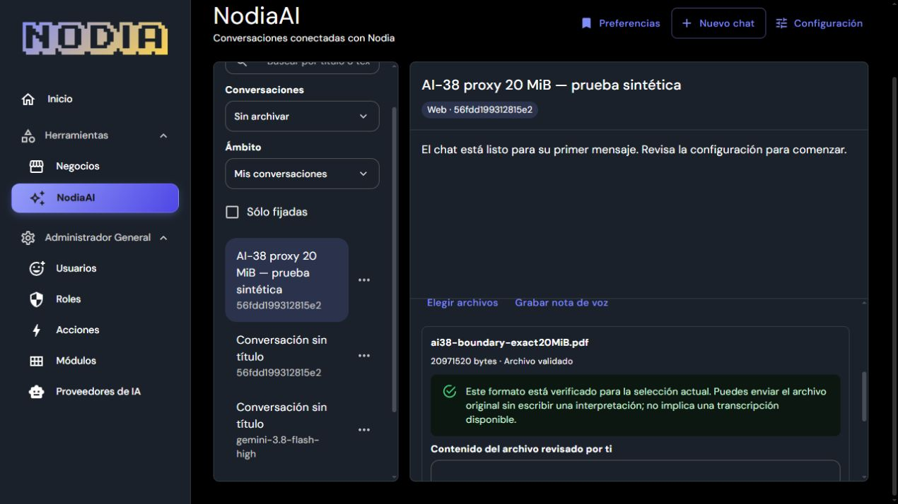

# AI-38 — Proxy de 20 MiB y adjuntos reales en la VM Linux local

Fecha: 2026-10-20. Alcance: transporte de un adjunto PDF sintético de tamaño máximo desde la UI autenticada, integridad R2 y descarte del objeto propio. AI-38 sigue parcial; no autoriza una entrega pública ni nuevas capacidades MCP.

## Cambio durable y reversión

El [snippet nginx](../../ops/nginx/nodia-ai-attachment-content.conf) eleva a `20m` únicamente la ruta UUIDv4 de contenido de adjuntos de NodiaAI. El upload usa `PUT application/octet-stream`: 20 MiB son exactamente **20.971.520 bytes**, sin multipart. El límite global de `11m` se conserva para las demás rutas; los 40 MiB permitidos por mensaje son la suma de sus archivos, no un único cuerpo de esa longitud. No se cambian los límites funcionales del backend, Node o Client.

Las fases [aplicar](nodia-ai-ai38-proxy-apply-r01.json), [revertir](nodia-ai-ai38-proxy-revert-r01.json) y [aplicar de forma final](nodia-ai-ai38-proxy-final-r01.json) superan `nginx -t` y reload, conservando los mismos procesos de los cuatro servicios. La cadena SHA-256 del descriptor es `73ba1329…` → `2f96d9f0…` → `73ba1329…` → `2f96d9f0…`: la reversión recupera los bytes anteriores y la configuración final conserva el ajuste. No se restaura la BD ni se reinicia Gemini, API o worker.

La [prueba HTTP del proxy](nodia-ai-ai38-proxy-probe-final-r01.json) sólo envía encabezados `Expect`: el tamaño exacto recibe dos observaciones consecutivas `100 Continue`; un byte más recibe `413`. Una ruta ajena y un UUID incompatible siguen rechazando cuerpos por encima de 11 MiB. Esa prueba es anónima, envía cero bytes de cuerpo y no demuestra por sí sola una carga completa o autenticación.

## Archivo real desde la aplicación

El [manifiesto sintético](nodia-ai-ai38-attachment-fixtures-r01.json) identifica un PDF válido de una página de 20.971.520 bytes, SHA-256 `14a57764f731612d59a5c43beee356428f4428a59f473bc414801d4d86ed595e`, y otro de 20.971.521 bytes. No contienen datos personales o comerciales.

En la sesión humana de Nodia, el archivo superior al máximo genera el error correspondiente y conserva el borrador. La [consulta SQL de sólo lectura](nodia-ai-ai38-attachment-over-limit-sql-r01.json), realizada antes de seleccionar el archivo válido, confirma cero adjuntos/intenciones en el chat sintético: el rechazo frontend no crea un registro. Este caso es distinto del `413` anónimo del proxy.

El archivo exacto se carga desde la UI y queda listo como PDF de una página. El [observador HTTP acotado](nodia-ai-ai38-attachment-observer-end-r01.json) registra una reserva `POST 201`, un upload `PUT 200` y un descarte `DELETE 200`, sin conservar cuerpos, tokens o logs completos. Los metadatos HTTP se correlacionan con la ventana UI y los IDs propios; por sí solos no identifican al navegador.

La [observación R2 del estado listo](nodia-ai-ai38-attachment-r2-ready-r01.json) comprueba SQL, `HEAD 200` y `GET 200` del objeto propio. El stream descargado contiene exactamente 20.971.520 bytes y su SHA-256 coincide con el fixture. El observador usa credenciales del operador en el servidor, sólo lectura y sin listar el bucket, crear URL firmada o publicar clave/bucket/secreto.

Después de pulsar **Quitar** en la app, el [observador de ausencia](nodia-ai-ai38-attachment-r2-absent-r01.json) confirma `HEAD 404` y `GET 404` de la misma clave propia, metadatos ya no listos y cero trabajos de limpieza del objeto. No se borra por prefijo ni se intervienen objetos ajenos. La ausencia del objeto vivo no demuestra borrado físico ni un SLA continuo de retención.

## Estado operativo y límites de la aceptación

El [inspector final](nodia-ai-ai38-proxy-runtime-final-r01.json) mantiene los cuatro servicios originales activos, los 932 outputs de Node intactos y la misma época/configuración Gemini. API y worker conservan los procesos y entrypoints originales; esquema, selección de proveedor y migraciones permanecen iguales. Cero trabajos, intentos, slots o recursos nativos pendientes. La raíz original sigue `404`; esta ventana no adopta permanentemente el shell candidato.

El [cierre](nodia-ai-ai38-attachment-closure-r01.json) acredita el retiro del túnel/pestaña y override de viewport propios. La [limpieza del ledger privado](nodia-ai-ai38-attachment-ledger-cleanup-r01.json) se ejecuta únicamente después del recibo de ausencia R2; no realiza operaciones nuevas sobre R2 o SQL. El chat queda vacío y archivado mediante la UI ordinaria, sin hard delete: el [snapshot SQL final](nodia-ai-ai38-attachment-chat-final-r01.json) contiene cero mensajes, partes, runs, jobs e intentos. Sus metadatos archivados y los del adjunto expirado conservan la retención habitual, sin crear otra copia de datos.

La [prueba de acceso anónimo](nodia-ai-ai38-proxy-auth-r01.json), posterior al descarte, devuelve `401` para reserva, PUT y GET sin credenciales. Sólo acredita el rechazo de esas peticiones anónimas; no una nueva descarga autenticada. Durante la configuración inicial se observó renovación de sesión y fue necesario reabrir el drawer sin aplicar; no se demostró la causa de su cierre. La carga y el rechazo de tamaño se comprobaron posteriormente con la sesión legítima restaurada.

El borrador de adjuntos ofrece subir, revisar y quitar; no ofrece descargar. Por ello esta aceptación combina carga/descarte en la UI con lectura de integridad privada R2 del operador. **No acredita una descarga de 20 MiB mediante UI/API de la aplicación**, OCR, transcripción ni una nueva generación del proveedor. Tampoco envía mensajes o crea efectos comerciales. La aceptación histórica de descarga de AI-32-R05 conserva su alcance propio.

Se preservan los recibos históricos de AI-32 y AI-38, los paquetes congelados, las 31 fichas aprobadas y el plan45. Este ajuste cierra el bloqueo concreto del proxy para la carga máxima comprobada. TLS/origen público, infraestructura externa de copias/restore y retención, y publicación restante de AI-36 mantienen AI-38 parcial. El [contrato del ensayo](nodia-ai-ai38-proxy-attachments-contract-r01.md) distingue los canales y fronteras comprobados; la [validación consolidada](nodia-ai-ai38-proxy-attachments-validation.json) comprueba procedencia, integridad y recibos de cierre.
