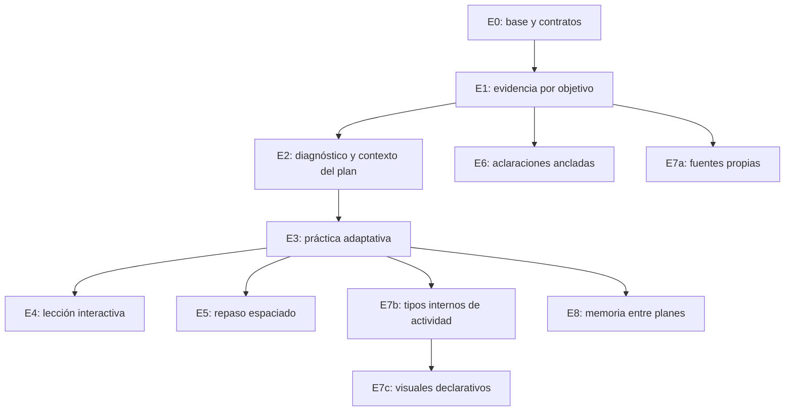

# Upgrade de Nodia Teacher: diagnóstico, evidencia y práctica adaptativa

> Estado actual: R05 del2026-11-11. Construcción F0–F9 y55TU cerrados para el alcance R02 Windows/API key exacta; continuidad funcional VM sobre ServerR14/ClientR41 comprobada por recibos propios. Respaldo/restauración final comprobados; estado operativo y UI tras reanudar servicios comprobados. [Matriz R02](../evidence/teacher-upgrade-acceptance-20261111-r02.md) y [recibo VM](../evidence/teacher-upgrade-development-vm-20261111-r01.json) separan resultados, selección y entorno. Sin eficacia humana, aprobación documental, publicación o promoción a master.
> Continuidad R05: ServerR14/ClientR41 adoptados en la VM de development, con autenticación Google normal y recorrido SQL desde la UI comprobados para la selección OpenAI Agentic configurada. Diagnóstico, evidencia por objetivo, propuesta/material, ayuda anclada, práctica y final quedaron registrados; el respaldo final posterior al QA pasó restauración de DB/configuración; la comprobación operativa y recarga de UI tras reanudar servicios pasaron. [Recibo VM](../evidence/teacher-upgrade-development-vm-20261111-r01.json). El cierre55/55 R02 conserva su alcance Windows/API key; este recorrido no representa55pruebas nuevas en VM ni eficacia educativa humana. Sin promoción a master, aprobación documental o publicación. Los cortes R01–R04 inferiores conservan su alcance histórico.
> Método confirmado: implementación continua por fases, comprobaciones técnicas pertinentes, QA integral y correcciones por lotes. No hay una aprobación rutinaria por funcionalidad.

## 1. Propósito y fuentes de autoridad

Teacher debe utilizar evidencia del aprendizaje para explicar qué actividad recomienda, adaptar el apoyo y comprobar aplicación independiente y recuperación posterior. El primer resultado útil es conectar diagnóstico, objetivos y práctica; el mapa visual y la memoria transversal se construyen después de esa base.

Este plan amplía [producto95](95-studies-adaptive-learning.md), [ejecución96](96-nodia-teacher-implementation-plan.md), [contratos97](97-nodia-teacher-technical-contracts.md) y [traspaso98](98-nodia-teacher-start-handoff.md). Conserva sus garantías y los estados de implementación/aceptación registrados en96 y [progreso](00-progress.md). El [ADR098 propuesto](../architecture/decisions/ADR-098-teacher-learning-evidence-and-adaptive-progression.md) registra la separación de contenido, evidencia y verificación y la autoridad de la adaptación. No reemplaza ADR089, ADR092 ni los contratos históricos.

Dependencias transversales: [privacidad89](89-module-access-and-user-data-scope.md), [proveedores y regresiones](ai-provider-feature-contract.md), [calificación91](91-ai-provider-onboarding-verification.md), [runtime92](92-nodia-ai-api-chat-parity.md), [rendimiento37](37-web-performance-implementation-plan.md), [diseño Client](../../nodia-client/DESIGN.md) y [estándar de conocimiento](../nodia-ai/knowledge/README.md). Las ventas NodiaAI conservan sólo lectura según94 R17.

Las [fichas Teacher](../nodia-ai/knowledge/studies/README.md) describen la implementación, sus comprobaciones locales/VM y pendientes sin habilitar herramientas. Conservan draft/partial/unregistered/approval:null. Las verificaciones históricas de la base no califican automáticamente los propósitos o prompts modificados.

## 2. Baseline y brechas contrastadas

Baseline histórico del análisis R01, anterior a la implementación local descrita en §19. Inspección estática del checkout y de LearnHarness en el commit [a63664767ebdd7e5af08f7f501b720e02b2ddc32](https://github.com/amosblomqvist/learnharness/commit/a63664767ebdd7e5af08f7f501b720e02b2ddc32), realizada el 2026-11-11. No se ejecutó la aplicación externa, sus tests o inferencias; no se consultó el entorno desplegado para este análisis. Los ejemplos son sintéticos y no representan un diagnóstico del usuario. Las referencias a «actual» en esta tabla corresponden a ese baseline, no al código posterior.

| Área | Hecho o requisito existente | Brecha y efecto sobre el upgrade |
|---|---|---|
| Diagnóstico | 95§4 ya exige banco con ítems/respuestas revisados, objetivos y versión | [El comando actual](../../nodia-server/src/teacher/use-case/execute-teacher-command.use-case.ts) crea cuatro UUID sin dimensiones descriptivas y admite el diagnóstico sin outline/guide. E2 concreta el requisito y corrige esa brecha; no presenta toda la idea como nueva |
| Personalización | 96§3.3 ya prevé un snapshot acotado de evidencia | La propuesta de plan consume definición/mensajes/resumen; el input de material no incorpora resultados previos como evidencia pedagógica estructurada. E1/E2 hacen trazable y utilizable ese snapshot |
| Respuestas | [TeacherAnswer](../../nodia-server/src/teacher/types/teacher.types.ts) admite selección, completar/texto y dont_know | Faltan explicación separada, confianza declarada y procedencia pedagógica de ayuda. No reconstruirlas desde históricos |
| Refuerzo | [Política actual](../../nodia-server/src/teacher/policies/teacher-reinforcement.ts) valida puntos/cobertura y proyecta objetivos fallados hacia unidades | Es navegación focal; E3 añade actividad sobre el error y comprobación en otro contexto |
| Evaluación | Claves privadas, política versionada, final directa, independencia y ≥90% exacto | Son garantías que debe conservar cada etapa; el upgrade no rebaja la final para conseguir aprobación |
| Repaso | 95 delimita V1 sin calendario de repasos ni notificaciones | E5 es ampliación explícita, no una capacidad ya implementada |
| Opciones | [QuestionCard](../../nodia-client/src/modules/teacher/components/QuestionCard/QuestionCard.tsx) presenta el orden recibido;96§30 conserva una muestra con respuestas correctas en primera posición | E0 incorpora orden estable por intento sin alterar opciones cuyo orden tenga significado |
| Operación | 96§32 mantiene feedback Gemini unknown y generación posterior reply_framing; mejoras de UI llegan a§41 | No hay cierre V1 integral acreditado. Cada alcance futuro necesita baseline y aceptación propios, sin extrapolar ni repetir esos trabajos |

LearnHarness aporta diagnóstico por prerrequisitos, autoexplicación/confianza, predicción/comprobación, práctica variada, hilos contextuales, flashcards y memoria de contenido. Su grafo excluye resultados de quizzes y no es un modelo de dominio del alumno. Parte de la adaptación vive en prompts; sus tests y teoría del autor no demuestran eficacia educativa medida. El detalle y los límites están en las fuentes de§16.

## 3. Garantías comunes de todas las etapas

1. Mantener dominio Teacher, `/nodia-teacher`, autoridad por destino canónico y recursos privados. Agrupar o mover el módulo no concede acceso; compartir runtime no exige conceder el módulo NodiaAI. No compartir datos entre usuarios por añadir memoria.
2. Final independiente con ≥90% exacto;90 aprueba y89,6 no. No sumar/promediar intentos. Pending/needs_review y correcciones inciertas no se convierten en cero. Final directa conserva prerrequisitos Server y no exige generar/leer todas las unidades.
3. Claves, puntos y explicaciones de la final permanecen privados hasta entregar todo el intento. Ningún helper, mapa, fuente o recomendación puede revelar su solución o eludir la política de ayuda.
4. Aceptación humana y revisión/hash explícitos para cambiar objetivos, cobertura o prerrequisitos. Una reparación puntual puede ser apoyo dentro del plan; no replanificación silenciosa. No sobrescribir material, respuestas, notas o intentos activos/históricos.
5. Mantener CAS, idempotencia, recibos, borradores, cursor, pausa/reanudación y conciliación de HTTP perdido. Abrir, navegar, consultar o retomar no dispara generación. Un resultado tardío conserva procedencia y no reemplaza una revisión posterior.
6. Reutilizar ownership y runtime común: selección exacta Agentic/API key, modelos dinámicos, reserva antes de cada POST, límites compartidos, leases/fences, prueba de cierre y ACK. Ningún unknown vuelve a queued por reinicio, TTL, botón de reintento o etapa nueva. Nueva intención no es replay de respuestas inciertas.
7. Separar trabajo calculado, guardado y entrega visible. Un stream o HTTP aceptado no acredita persistencia. Reintentar un guardado/lectura conciliable no vuelve a llamar al proveedor. No prometer cancelación remota.
8. No introducir herramientas comerciales, SQL libre, shell, filesystem arbitrario, plugins descargables o acceso general a red por añadir funciones educativas. Las fronteras nuevas se diseñan y califican explícitamente.
9. Conservar archivo reversible y retención vigente de97. Scheduler, deduplicación o extracción no autorizan borrado, purga o cambio de políticas de datos. Credenciales permanecen cifradas en su infraestructura existente, fuera de prompts, fuentes y logs.
10. ES/EN, accesibilidad y móvil son parte de cada entrega. Aplicar skills locales al implementar, carga inicial/soft loading, error/estado vacío y feedback sileo según AGENTS. Los borradores y modales sobreviven a fallos; mapa, editor y paneles secundarios cargan por intención con retry local y foco intacto.

## 4. Modelo conceptual propuesto y autoridad

Este esquema conserva el alcance conceptual de R01. Los contratos efectivos posteriores de tablas, endpoints, DTOs y políticas se registran en [97](97-nodia-teacher-technical-contracts.md); una hipótesis conceptual no se presenta como una capacidad automática implementada.

| Elemento | Identidad/procedencia mínima propuesta | Significado y límite |
|---|---|---|
| Objetivo y dimensión diagnóstica | Propietario, sesión, contenedor/versiones, ID y descripción; blueprint propio antes del plan | Una dimensión previa no requiere plan_revision_id. Su mapeo posterior al objetivo es explícito y revisable; un título parecido no establece equivalencia |
| Contenido/concepto | Afirmación/competencia, condiciones, versión y fuentes; primero dentro del plan | Presencia significa registrado. Relaciones de prerrequisito, apoyo y derivación tienen semánticas distintas; sólo dependencias de avance requieren DAG |
| Observación del alumno | Objetivo/dimensión, intento, ítem/respuesta inmutable, fecha, modalidad y versiones de contenido/evaluación | Distingue respuesta, corrección, primer intento, asistencia y aplicación independiente. Datos ausentes conservan desconocido |
| Declaración del alumno | Base declarada, autoexplicación opcional y confianza explícita; vínculo a respuesta | No equivale a observación ni nota. Confianza sin intervención=null; cero declarado es válido. No inferir dominio desde seguridad o extensión del texto |
| Hipótesis pedagógica | Interpretación versionada, evidencia que la apoya/contradice, estado revisable y procedencia del intérprete | Una posible confusión no es hecho ni diagnóstico personal; revisarla no modifica la nota original |
| Verificación de sección | Contrato existente de intento/final, política, revisión y condiciones de independencia | Mantener separada del repaso y de las estimaciones pedagógicas. No revocar automáticamente al olvidar |
| Snapshot de evidencia | IDs/versiones/hash, política de selección, corte temporal, ámbito y exclusiones relevantes | Reproduce lo usado por una propuesta/material. Se congela al admitir; no incorpora en silencio resultados que llegaron después |
| Recomendación | Actividad/objetivo, motivo, evidencia válida, versión de política y alternativas | La política Server decide admisibilidad y explica selección. La IA puede proponer interpretación/contenido dentro del contrato; no concede verificaciones o permisos |

No producir inicialmente un porcentaje global de dominio. Mostrar señales separadas: material visitado, comprobación inmediata, aplicación independiente, recuperación posterior y sección verificada. Un resumen/compactación ayuda al contexto, pero no sustituye respuestas o recibos originales como evidencia.

## 5. Etapas y dependencias

Prioridad es orden del upgrade, no severidad de seguridad. La construcción F0–F9 y los55TU están cerrados para el alcance R02 de §20. La continuación de VM en §21 registra su propio recorrido funcional y respaldo/restauración final comprobados; la comprobación operativa tras reanudar servicios también pasó; no extiende las aceptaciones entre entornos. Las dependencias de construcción son contratos/código integrados, no aprobaciones o recorridos completos de las etapas anteriores. [102](102-nodia-teacher-phased-implementation-and-final-qa.md) registra construcción, QA y correcciones por separado. El uso real de cada selección sigue sujeto a91/92 y E0; el desarrollo aislado no constituye calificación. No exigir modalidades o proveedores ajenos al alcance.

| Etapa | Prioridad | Resultado | Dependencias de contrato y condiciones de uso |
|---|---|---|---|
| E0 | Primera | Baseline, contratos compatibles, integridad y calificación por alcance | Base95–98 para construir; gates relevantes de96 y calificación91/92 se comprueban para uso real en QA final |
| E1 | Primera | Evidencia por objetivo, autoexplicación/confianza y snapshot | Contratos/base E0; aceptación operativa en campaña final |
| E2 | Primera | Diagnóstico acotado conectado a propuesta de plan y material | E1; blueprint/banco y política versionados. Revisión pedagógica del banco antes de usarlo como revisado, dentro de QA final |
| E3 | Primera | Práctica adaptativa, refuerzo del error y transferencia | E1 y snapshot de E2; diagnóstico realizado es opcional |
| E4 | Segunda | Lecciones con predicción, comprobación y reparación | E3; contenido/cursores versionados |
| E5 | Segunda | Repaso espaciado y recuperación diferida | E1 y eventos/actividades de E3; política temporal y motor revisados |
| E6 | Segunda | Aclaraciones ancladas al material | E1 y anclas de contenido existentes; calificación del propósito para uso real en QA final. No depende de E4/E5 ni del grafo |
| E7a | Posterior | Fuentes propias con procedencia y citas | E1 y contrato de uploads/extracción/autorización; modalidades se califican antes de habilitarse, en QA final |
| E7b | Posterior | Registro interno de tipos de actividad | E3; contratos de respuesta/corrección versionados |
| E7c | Posterior | Visuales y simulaciones declarativas | E7b; política de render/recursos. E7a sólo si usa fuentes propias |
| E8 | Posterior | Conceptos entre planes y mapa focal | E1–E3; política de identidad/equivalencias. E5 sólo para mostrar estado de repaso y E7a sólo para fuentes propias |

El primer bloque útil comprende E0–E3. No depende de FSRS, adjuntos, un grafo global, nuevas bases de datos o ejecución de código; su integración permite continuar construyendo las ampliaciones sin exigir una campaña de aceptación intermedia. E5/E6 y las ramas E7 pueden evolucionar por separado una vez satisfechos sus contratos. El alcance completo continúa hasta la integración y QA final definidos en102.

## 6. E0 — Base, compatibilidad y puertas de operación

Reconciliar código/documentación/entorno de destino y registrar selección exacta y funciones incluidas. Investigar los fallos pertinentes de96§32 sin asumir causa del reply_framing ni reejecutar unknown. Si una selección no está disponible, declararlo y delimitar la entrega; no sustituirla por otra en silencio.

Definir versiones/migraciones futuras compatibles con lectores e intentos existentes, sin reinterpretar respuestas antiguas. Añadir orden persistido de opciones sólo donde sea semánticamente válido. Banco, generador y presentación deben detectar referencias como «A», «la primera», «la anterior» u opciones numéricas/cronológicas cuyo orden sea parte del problema.

| ID | Criterio de aceptación futuro |
|---|---|
| TU-E0-01 | Informe de baseline identifica funciones/selecciones/entorno, gates resueltos o excluidos con motivo y evidencia; no declara cierre V1 global por una prueba puntual |
| TU-E0-02 | Lectores históricos, CAS, pausa/cursor, final directa,90 exacto/89,6, claves privadas y pending≠0 conservan comportamiento en regresiones apropiadas |
| TU-E0-03 | El mismo intento recupera el mismo orden e IDs de opciones en recarga/dos pestañas. Ítems con orden significativo se preservan o rechazan antes de publicar; no se altera significado por barajar |
| TU-E0-04 | Pérdida HTTP, cierre incierto y resultado tardío recuperan recibos/estado sin otro POST; selección/propósito nuevo obtiene su aceptación91/92 propia antes de habilitarse |

## 7. E1 — Evidencia por objetivo y contexto reproducible

Priorizar la fundación: observaciones inmutables ligadas al origen y proyecciones versionadas que se puedan corregir sin reescribir respuestas. Autoexplicación y confianza son opcionales. El futuro contrato debe diferenciar una confianza elegida de un control sin tocar y guardar sus borradores/envío bajo la misma frontera de consistencia de la respuesta.

La política de selección de contexto usa ámbito/objetivo/versiones/modalidad, asistencia y antigüedad pertinente. No establece una caducidad universal ni traslada evidencia automáticamente entre revisiones. El histórico queda accesible; que no sea pertinente para una nueva recomendación no lo borra. Rechazar evidencia ajena, inexistente o incompatible; ante evidencia insuficiente mostrar desconocido y ofrecer alternativas.

| ID | Criterio de aceptación futuro |
|---|---|
| TU-E1-01 | Cada observación resuelve propietario, objetivo/dimensión y origen real con versiones; referencias cruzadas entre sesiones/usuarios se rechazan conforme a autoridad y privacidad89 |
| TU-E1-02 | Omitir explicación/confianza no impide responder ni resta puntos. Confianza intacta=null y cero elegido permanece cero; inválidos/fuera de contrato se rechazan sin perder borrador |
| TU-E1-03 | Una respuesta correcta con explicación incoherente conserva su corrección; registra la observación/hipótesis diferenciada sin convertirla automáticamente en dominio o cambiar la nota |
| TU-E1-04 | Primer intento, ayuda vista y nueva comprobación independiente son distinguibles. Un evento repetido o recuperado tras HTTP perdido no duplica evidencia |
| TU-E1-05 | La generación conserva IDs/versiones/hash y versión de política de su evidencia; nueva información posterior no cambia el snapshot de una candidata o material ya admitidos |
| TU-E1-06 | Ausencia, antigüedad no resuelta, dato inválido, corrección pendiente o hipótesis contradictorias producen estado explícito y recomendación prudente; nunca nivel o porcentaje inventado |
| TU-E1-07 | Selección y proyección evitan consultas N+1, tienen paginación y cotas de contexto/filas definidas. Medición por volumen/ruta compara baseline y resultado; no cargar todo el historial en cada turno |

## 8. E2 — Diagnóstico conectado al plan y al material

Concretar95§4: blueprint diagnóstico propio, dimensiones con descripción y preguntas/respuestas revisadas/versionadas antes de usarse. La IA puede preparar candidatos; generarlos no acredita revisión, calibración o validez. Si falta banco apto para un tema, declarar el alcance no evaluado y permitir continuar desde la base declarada; no usar ítems sin revisar como si fueran validados.

El diagnóstico es opcional, acotado por una política de preguntas/tiempo/dispatches y parada. Puede registrar suelo observado e incertidumbre por dimensión; no prometer psicometría o nivel oficial. «No sé», abandono, proveedor caído y pendiente son situaciones distintas. Una respuesta ambigua no significa incapacidad.

Tras diagnosticar, proponer correspondencias explícitas entre dimensiones y objetivos de la candidata. Mostrar base declarada, evidencia observada, aspectos sin evaluar y motivo de los apoyos recomendados. Conservar revisión humana; editar una declaración no crea observación. El ensamblador de evidencia atiende también la generación de material futuro, sin modificar contenido ya guardado.

| ID | Criterio de aceptación futuro |
|---|---|
| TU-E2-01 | Antes de tener plan se puede guardar/retomar un diagnóstico con blueprint/versiones/dimensiones descriptivas válidas; ningún UUID sin significado define por sí solo una habilidad |
| TU-E2-02 | Sólo se presentan ítems de banco revisado y vigente para ese alcance; si no hay banco, queda visible «sin evaluar» y se conserva la creación/revisión manual del plan |
| TU-E2-03 | Omitir, pausar o agotar la política de parada no bloquea indefinidamente ni fabrica nivel. Se conserva lo observado y se ofrecen continuar/salir con estado correcto |
| TU-E2-04 | Cada conclusión observada enlaza respuestas aptas; supuestos e hipótesis se distinguen. Mapeos a objetivos son explícitos/versionados y se revisan cuando cambia la candidata |
| TU-E2-05 | Con mismo objetivo y evidencia sintética distinta, la propuesta/material usa apoyos diferentes explicables por el snapshot. Sin evidencia mantiene la incertidumbre; no prueba eficacia educativa por esta comparación |
| TU-E2-06 | Cambiar objetivo, declarar otro nivel o recibir un resultado tardío no reemplaza el plan aceptado. Candidata, diff, revisión/hash y aceptación se conservan |
| TU-E2-07 | Proveedor caído, JSON inválido, presupuesto agotado y resultado unknown conservan respuestas/plan y muestran recuperación sin replay. El diagnóstico no crea verificación de sección ni sustituye la final directa |

## 9. E3 — Práctica adaptativa y refuerzo focal

Evolucionar el refuerzo actual a una actividad sobre el error concreto. Una política Server selecciona objetivo/tipo/ayuda usando evidencia válida y explica por qué. La IA puede preparar la actividad o interpretar una respuesta abierta, siempre bajo contrato, presupuesto y recuperación comunes. No permitir que un agente decida por sí solo requisitos de avance o apruebe una sección.

Combinar recuperación, discriminación entre técnicas y composición de conocimientos. Intercalar objetivos pertinentes y cambiar contexto sin anunciar siempre la técnica. Un error puede corresponder a recuperación, selección de estrategia, ejecución o descuido; estas clasificaciones son hipótesis revisables, no etiquetas personales.

Registrar cada nivel de ayuda y la solución vista. Tras ayuda fuerte, ofrecer otra comprobación con contexto distinto antes de mostrar aplicación independiente. Reordenar opciones o cambiar nombres no acredita transferencia. Mantener opciones para ejemplo resuelto, volver a fundamentos, saltar, pausar o terminar; no exigir éxito infinito. No reducir cobertura/dificultad de la final para elevar la tasa de aprobación.

| ID | Criterio de aceptación futuro |
|---|---|
| TU-E3-01 | La siguiente actividad aporta objetivo, motivo, evidencias y versión de política. Datos insuficientes ofrecen una actividad base/elección explícita sin fingir personalización |
| TU-E3-02 | Un error repetido genera refuerzo del concepto pertinente; un acierto asistido no elimina esa condición. Una comprobación posterior guarda su propia evidencia sin reescribir intentos |
| TU-E3-03 | Una muestra revisada distingue recuperación/discriminación/composición y transferencia mediante cambio real de contexto; no cuenta una paráfrasis o permutación como transferencia |
| TU-E3-04 | Pistas/ejemplo/solución vistos quedan ligados al momento de cada respuesta. Sólo una comprobación apta posterior sustenta aplicación independiente; no concede verificación de sección |
| TU-E3-05 | Saltar, solicitar ejemplo, pausar y terminar conservan historial/borrador/cursor y no marcan comprensión o abandono como nota cero |
| TU-E3-06 | Práctica/refuerzo no cambia claves, cobertura, umbral o prerrequisitos de una final existente. Mantiene claves ocultas hasta entrega, pendientes nulos y notas por intento |
| TU-E3-07 | Leer/elegir actividad existente/corregir determinísticamente no llama al modelo. Generar una actividad nueva exige intención visible y reserva; repetir un resultado incierto nunca es recuperación automática |
| TU-E3-08 | Dos pestañas, autosave tardío y publicación sobre revisión antigua no duplican actividades/evidencia ni cambian el intento vigente; contratos se verifican con integración aislada cuando la unidad no basta |

## 10. E4 — Lecciones con predicción, comprobación y reparación

Extender paquetes/bloques por versión para incluir predicciones y comprobaciones en puntos pedagógicos útiles. La predicción explora una idea antes de explicarla y no puntúa como final. Resolver explícitamente lo predicho y aplicar después en otro caso. Mantener lectura continua y navegación libre de teoría; la interacción no tiene que ocurrir tras cada oración ni consumir una llamada por paso.

| ID | Criterio de aceptación futuro |
|---|---|
| TU-E4-01 | Una unidad combina lectura y puntos de predicción/check identificados sin obligar a contestar para leer ni registrar lectura como aprobación |
| TU-E4-02 | Cada interacción y su cursor conservan bloque/versión/orden al pausar/recargar; versiones nuevas no migran respuestas activas silenciosamente |
| TU-E4-03 | Predicción inicial y comprobación aplicada posterior producen evidencias distintas; una reparación se apoya en el error sin replanificar ni sobrescribir el plan aceptado |
| TU-E4-04 | Lectura y casos deterministas reutilizan el paquete guardado. Comparación por ruta/perfil mide latencia, peticiones y fricción respecto al lector previo; se descartan variantes regresivas sin beneficio comprobado |

## 11. E5 — Repaso espaciado y recuperación diferida

Añadir cola de repaso sobre conocimiento apto, historial y planificación temporal. Generar tarjetas y revisarlas son operaciones separadas. Contenido ya guardado puede repasarse sin IA. El motor y su versión, parámetros, unidad de scheduling y política de zona horaria/día de estudio deben ser explícitos y reproducibles.

Evaluar FSRS desde su proyecto original y licencia; no importar el port de LearnHarness ni asumir que la versión de la librería equivale a la del modelo de scheduling. Una intención de retención, incluso90%, no es garantía observada ni umbral de final. Distinguir recuerdo de hechos de resolución compleja; una autoevaluación no acredita sección. Evaluar si múltiples pistas de un concepto comparten calendario sin ocultar fallos por pista.

| ID | Criterio de aceptación futuro |
|---|---|
| TU-E5-01 | Cola distingue nuevo/aprendizaje/repaso y vencimiento según política versionada; muestra fechas reales y no predicciones de dominio |
| TU-E5-02 | Respuesta/rating y actualización del calendario se aplican una vez con recibo y concurrencia; recarga/HTTP perdido conserva la misma revisión sin duplicar repaso |
| TU-E5-03 | Zona horaria del usuario, cambio de zona, horario de verano y límite de día tienen casos definidos y resultados reproducibles; no usar sin querer la zona del servidor |
| TU-E5-04 | Practicar fuera de la cola, cambiar parámetros o usar otra pista tiene efectos explícitos/versionados; no reajusta historial ni calendario pendiente silenciosamente |
| TU-E5-05 | Olvido posterior recomienda refuerzo y conserva la verificación histórica. Interfaz diferencia retención objetivo, autoevaluación y final≥90%; nunca mezcla sus porcentajes |
| TU-E5-06 | Revisar contenido existente no usa modelo. Nuevas tarjetas requieren intención y calidad revisada, sin cuota de tarjetas inventada, notificaciones, generación periódica o automatizaciones implícitas |

## 12. E6 — Aclaraciones sobre el material

Seleccionar un fragmento para preguntar sin abandonar la unidad. Hilo privado anclado a content_version_id, block_id y selector exacto verificado; si cambió/no se encuentra el texto, no trasladar la pregunta a otro bloque por similitud. Panel lateral escritorio/presentación móvil accesible, con foco y borrador recuperables. La inferencia usa contenido visible pertinente; nunca guía/clave privada o contexto completo de otras sesiones.

El nuevo ayudante queda bloqueado por Server durante una final. Las ayudas ya previstas por97 conservan su contrato; ampliar este ayudante a finales requeriría una decisión posterior y asistencia explícita. Ocultar la clave del contexto no evita que un modelo pueda resolver la pregunta. Leer una aclaración registra asistencia/contexto, no comprensión.

| ID | Criterio de aceptación futuro |
|---|---|
| TU-E6-01 | La consulta y sus respuestas reabren en la misma versión/selección; avanzar de paso no cambia silenciosamente el hilo. Ancla inválida pide seleccionar de nuevo |
| TU-E6-02 | Cerrar/cambiar de panel conserva borrador/foco y distingue separación de vista de cancelación explícita; respuesta tardía no se inserta en otro hilo |
| TU-E6-03 | La comprobación Server rechaza el nuevo helper durante final aun manipulando Client; historial/contexto público no expone claves o soluciones privadas |
| TU-E6-04 | Ver la ayuda no crea evidencia de dominio. La siguiente respuesta conserva la procedencia de asistencia relevante según política de E1/E3 |
| TU-E6-05 | Propósito nuevo conserva selección exacta, presupuesto, cierre/ACK y no replay. Dos consultas concurrentes y pérdida de stream/guardado se concilian por hilo sin otra inferencia implícita |

## 13. E7 — Fuentes propias, actividades y visuales

### E7a — Material del usuario y procedencia

Uploads privados, snapshots/versiones y extracción acotada. Cada afirmación apoyada en una fuente enlaza documento/versión/página o fragmento comprobables; distinguir cita de explicación complementaria e incertidumbre. Una ruta enviada por el navegador nunca autoriza leer el host. Documento/web es dato externo, no autoridad sobre permisos o instrucciones de Teacher.

Comenzar por formatos y modalidades efectivamente soportados y calificados. Imagen, PDF escaneado, OCR o voz no heredan éxito de texto. Sin navegación autónoma por URLs en esta etapa; una futura investigación web necesita contrato, filtro de destinos/red y decisión de coste propios. Aplicar límites de archivo/páginas/salida, CPU/memoria/concurrencia y cancelación por proceso, no sólo un límite de bytes. No publicar apuntes privados en el corpus NodiaAI ni importar/sincronizar Obsidian automáticamente.

| ID | Criterio de aceptación futuro |
|---|---|
| TU-E7A-01 | Lectura/descarga/extracción exige ownership y versión; rutas del host, archivos ajenos y redirecciones de identidad se rechazan sin exponer contenido |
| TU-E7A-02 | Las citas resuelven una página/fragmento real del snapshot. Una fuente reemplazada mantiene referencias históricas; falta/contradicción de fuente se declara sin cita fabricada |
| TU-E7A-03 | PDF corrupto, sin texto, parcialmente extraído, formato no admitido y exceso de recursos muestran límites explícitos; no inventan OCR ni completan huecos silenciosamente |
| TU-E7A-04 | Instrucciones incrustadas en documentos no cambian herramientas/autoridad. Navegar/desconectar no duplica extracción/inferencia, y cada modalidad habilitada aporta su propia evidencia91/92 |

### E7b — Tipos internos de actividad

Registro interno con esquemas discriminados, tipo/versión, snapshot, capacidades de corrección y renderer aprobados. Primeros candidatos: ordenar pasos, clasificar ejemplos, localizar error y completar una estructura. Cada respuesta sigue autoridad, borradores y corrección Server; distinguir observaciones de ejecución de calificación final. Sin marketplace, código remoto, modificación de herramientas o permisos implícitos.

| ID | Criterio de aceptación futuro |
|---|---|
| TU-E7B-01 | Tipos/esquemas no soportados permanecen legibles y explícitamente no disponibles; no sustituyen otra actividad, califican ni ejecutan históricos automáticamente |
| TU-E7B-02 | Cada tipo declara objetivos, respuesta, ayuda y criterio de corrección. Contratos inválidos se rechazan y múltiples objetivos no reciben evidencia desagregada inventada |
| TU-E7B-03 | Renderer conserva teclado/lectores de pantalla/móvil, borradores y autoridad de ocurrencia exacta; montaje/remontaje o plugin ausente no envían respuestas ni pierden el trabajo |

### E7c — Visuales declarativos

Gráficos parametrizables, líneas temporales, diagramas y simulaciones de plantillas controladas. Parámetros y componentes permitidos, cotas de recursos y alternativas textuales. Medios/imágenes propios sólo con E7a cuando corresponda. No ejecutar HTML/JS arbitrario ni compilar código de alumno/modelo en el proceso de la app. Una ejecución futura necesita ADR y aislamiento de proceso/red/recursos propios, incluyendo efectos de reintento; timeout o directorio temporal no son sandbox.

| ID | Criterio de aceptación futuro |
|---|---|
| TU-E7C-01 | Parámetros/render desconocidos o maliciosos no ejecutan código ni consultan red libre; producen fallback textual/error recuperable sin romper la lección |
| TU-E7C-02 | Visual guardado mantiene versión y procedencia, se carga por intención y conserva alternativa accesible; medir memoria/bundle/fluidez en perfiles móvil/escritorio antes de adoptar |

## 14. E8 — Conceptos entre planes y mapa focal

Validar primero el beneficio sobre una sesión. Después añadir conceptos privados con equivalencias explícitas/versionadas/reversibles entre planes autorizados del mismo usuario. La similitud de etiquetas/embeddings puede sugerir candidatos, nunca fusionar identidades o transferir verificación por sí sola. Conservar condiciones, idioma, fuentes contradictorias y procedencia; un cambio de equivalencia no reescribe intentos históricos.

Empezar con relaciones en PostgreSQL; no introducir una base de grafos, vector store o servicio adicional por la visualización. Un mapa focal muestra objetivo actual, prerrequisitos y señales separadas; estados de retención sólo si E5 existe. Cadenas «A y B implican C» no se aplanan como si cada premisa bastara por separado. Extracción/aparición en un nodo no prueba verdad ni comprensión; la auditoría de identidad no es verificación factual.

| ID | Criterio de aceptación futuro |
|---|---|
| TU-E8-01 | Dos conceptos con mismo nombre y condiciones distintas conservan identidad; equivalencias propuestas necesitan revisión y reversión sin borrar procedencia |
| TU-E8-02 | Reutilizar evidencia entre planes exige mapeo apto, modalidad/versión/antigüedad pertinentes y autoridad; nunca transfiere notas o verificaciones ni cruza usuarios |
| TU-E8-03 | Mapa distingue visitado, comprobación inmediata, aplicación independiente, retención y aprobación. Sin evidencia muestra desconocido, sin porcentaje global ficticio |
| TU-E8-04 | Relación, fuente y evidencia se pueden inspeccionar hasta su origen; contradicciones y cadenas conjuntas conservan su significado |
| TU-E8-05 | Foco/búsqueda/teclado/móvil y cotas de nodos/peticiones evitan cargar todo el grafo. Comparación medida acredita utilidad y coste antes de ampliar a un lienzo global o extracción automática |

## 15. Verificación, costes, decisiones pendientes y continuidad

### Momentos de verificación y aceptación

La preferencia de ejecución del usuario cambia el momento de estas comprobaciones: D/T se realizan de forma autónoma y acotada al construir; P/O se concentran en la campaña final de102. No se requiere cerrar todas las puertas de cada etapa antes de programar la siguiente. Una calificación pendiente condiciona uso real, no el desarrollo con fixtures. H conserva su autorización independiente de publicación.

| Momento | Evidencia requerida | Lo que no acredita |
|---|---|---|
| D — Durante construcción | Concretar fuentes, DTO/estado/esquema, políticas numéricas y compatibilidad antes de consumir el contrato; decisiones rutinarias sin otra aprobación | Aprobación humana o disponibilidad por escribir documentos |
| T — Durante construcción y consolidación final | Pruebas atómicas pertinentes y comprobación aislada de migraciones/autoridad/no-replay antes de exponer datos o tráfico; regresión integrada al final | Proveedor real, pedagogía o despliegue |
| P — QA final | Muestra revisada de objetivos/preguntas/feedback en tema lingüístico escrito y otro no lingüístico; errores, asistencia y transferencia examinados antes del uso como contenido revisado | Nivel oficial, eficacia causal, pronunciación o todas las materias |
| O — QA final, antes de habilitar | Selección exacta y propósito/modalidad/entorno calificados según91/92, cierre y ACK; UI real por alcance, conservación/recovery y compatibilidad | Otras selecciones, costes desconocidos, aceptación productiva universal |
| H — Documental/publicación | Fuentes/fichas coherentes y aprobación específica cuando corresponda; publicación separada y controlada | Autoridad, ejecución o publicación por haber aprobado otro alcance |

No generar tests espejo, suites de páginas completas o metas por conteo. Priorizar políticas puras, selectores, validadores, reducers de actividad/scheduling y hooks/componentes atómicos. Los recorridos integrados se justifican por una garantía entre unidades. Cada TU identifica comportamiento esperado; un fallo deja la etapa/capa abierta. Pruebas sintéticas quedan rotuladas y no se usan como inferencia o aprendizaje real.

Medir por actividad y ruta: llamadas/dispatches, uso real reportado, coste estimable conocido, espera, tamaño de contexto, trabajo repetido, memoria/bundle y errores. Desconocido=null, no cero. Caching solicitado, catálogo o login no prueban ahorro ni inferencia. No activar extractor+auditor+visual por cada respuesta. Si se añade trabajo auxiliar, la admisión común debe limitar peticiones sin sostener un permiso durante espera de hijos; no copiar un pool en memoria como control global multiworker ni crear otro supervisor.

Comparar antes/después con alcance y perfiles equivalentes y casos de evidencia ausente, servicio caído, respuesta inválida y configuración histórica. Los indicadores pedagógicos distinguen desempeño independiente inmediato, transferencia y recuperación diferida. No fijar mejora porcentual, tasa de acierto ideal, horas de desarrollo o ahorro económico sin datos. La prueba de eficacia a largo plazo requiere un protocolo y observaciones posteriores propios; el cierre técnico no la simula.

### Decisiones que deben cerrarse al preparar cada etapa

La tabla conserva las decisiones de diseño identificadas en R01. Los contratos ya adoptados se detallan en97 y §19; la revisión pedagógica, pertinencia avanzada y calificación operativa pendientes permanecen en la matriz de aceptación. No se reabre una decisión técnica ya resuelta sólo por conservar su registro de entrada.

| Decisión | Responsable funcional/técnico | Antes de | Criterio para resolver |
|---|---|---|---|
| Modelo de observación, confianza y ayuda; migración/lectura legacy | Teacher Server/Client | E1-D | Campos/versiones/cotas finitas definidos; null explícito; sin backfill inventado ni cambio de nota |
| Parada del diagnóstico y revisión del banco | Producto Teacher + contenido/Server | E2-D | Fijar máximos positivos de preguntas/tiempo/dispatches dentro del presupuesto97; declarar cobertura y proceso de revisión. No presentarlos como cuota del proveedor |
| Pertinencia temporal, objetivos múltiples y mapeo a revisiones | Producto Teacher + Server | E2/E3-D | Política versionada con motivo de inclusión/exclusión; ninguna duración universal o distribución de puntos supuesta |
| Escalera de ayuda y comparación de transferencia | Producto Teacher + contenido | E3-D | Acciones visibles, independencia y rúbricas revisadas; no sustituir la política final vigente |
| Motor/versión/licencia y unidad de scheduling; zona horaria | Teacher Server/Client | E5-D | Evaluar upstream, parámetros y calendario reproducibles con DST; definir efecto de cambios sin promesas de retención |
| Propósito y alcance de contexto del nuevo helper | Runtime común + Teacher | E6-D/O | Presupuesto/calificación por selección, control Server de final y anclas exactas |
| Formatos, almacenamiento/retención y recursos de extracción | Teacher + plataforma/seguridad | E7a-D | Contrato owner-scoped, cotas de CPU/memoria/tiempo/concurrencia y modalidades reales; cualquier cambio de retención se decide por separado |
| Esquemas de actividad/render y aislamiento adicional | Teacher Server/Client | E7b/E7c-D | Tipos declarativos permitidos; ejecución arbitraria fuera de alcance y sujeta a ADR propio |
| Equivalencias entre planes y coste de extracción | Producto Teacher + arquitectura | E8-D | Revisables/reversibles, sin fusión por texto ni transferencia de verificación; utilidad medida antes de nueva infraestructura |
| Reutilización literal de código/prompts y licencias | Mantenedores de producto/arquitectura | Cualquier incorporación literal | Resolver compatibilidad de AGPL-3.0-only y dependencias. Esta propuesta se basa en diseño propio; no autoriza copiar material externo |

### Seguimiento de construcción y QA final

| Etapa | Construcción local integrada; límites en §19 | Comprobación en campaña final102 |
|---|---|---|
| E0 | [x] F0 | [x] TU-E0-01..04, Q1/Q9, alcance R02 |
| E1 | [x] F1 | [x] TU-E1-01..07, Q2, alcance R02 |
| E2 | [x] F2 | [x] TU-E2-01..07, Q2, alcance R02 |
| E3 | [x] F3 | [x] TU-E3-01..08, Q3, alcance R02 |
| E4 | [x] F4 | [x] TU-E4-01..04, Q3, alcance R02 |
| E5 | [x] F5 | [x] TU-E5-01..06, Q4, alcance R02 |
| E6 | [x] F6 | [x] TU-E6-01..05, Q5, alcance R02 |
| E7a | [x] F7a | [x] TU-E7A-01..04, Q6, alcance R02 |
| E7b | [x] F7b | [x] TU-E7B-01..03, Q7, alcance R02 |
| E7c | [x] F7c | [x] TU-E7C-01..02, Q7, alcance R02 |
| E8 | [x] F8 | [x] TU-E8-01..05, Q8, alcance R02 |

Las fases y los55TU están verificados para el alcance R02 de la matriz vigente; F9/QA y correcciones se consolidan en102. Publicación, adopción y aprobación permanecen separadas. La autorización posterior sustituyó el límite documental inicial, sin habilitar despliegue o inferencias sobre selecciones no calificadas.

## 16. Fuentes de LearnHarness y decisión de adaptación

Todas las rutas externas siguientes apuntan al snapshot inspeccionado; no a main mutable. Son referencias de análisis y no fuentes de autoridad sobre contratos, permisos o capacidades de Nodia.

| Fuente | Aporte y límite relevante |
|---|---|
| [Teoría de enseñanza](https://github.com/amosblomqvist/learnharness/blob/a63664767ebdd7e5af08f7f501b720e02b2ddc32/docs/teaching-methodology.md) y [alcance documental](https://github.com/amosblomqvist/learnharness/blob/a63664767ebdd7e5af08f7f501b720e02b2ddc32/docs/README.md) | Diagnóstico y pasos; teoría del autor, sin eficacia educativa medida acreditada por esos textos |
| [Prober](https://github.com/amosblomqvist/learnharness/blob/a63664767ebdd7e5af08f7f501b720e02b2ddc32/src/agent/prompts/prober/10-probe-doctrine.md) y [contrato](https://github.com/amosblomqvist/learnharness/blob/a63664767ebdd7e5af08f7f501b720e02b2ddc32/src/core/contracts/probe.ts) | Explorar prerrequisitos; doctrina no equivale a algoritmo calibrado ni evidencia estructurada obligatoria |
| [Preguntas/confianza](https://github.com/amosblomqvist/learnharness/blob/a63664767ebdd7e5af08f7f501b720e02b2ddc32/src/core/question-core.ts) | Autoexplicación y confianza; mejorar el default50 no declarado y conservar corrección Server privada de Teacher |
| [Predicciones](https://github.com/amosblomqvist/learnharness/blob/a63664767ebdd7e5af08f7f501b720e02b2ddc32/src/agent/prompts/teacher/28-predictions.md) y [práctica](https://github.com/amosblomqvist/learnharness/blob/a63664767ebdd7e5af08f7f501b720e02b2ddc32/src/agent/prompts/practice/10-doctrine.md) | Recuperación/discriminación/composición; no adoptar cadencia obligatoria o tasa de acierto sugerida como garantía |
| [Grafo](https://github.com/amosblomqvist/learnharness/blob/a63664767ebdd7e5af08f7f501b720e02b2ddc32/src/core/contracts/graph.ts) y [plan](https://github.com/amosblomqvist/learnharness/blob/a63664767ebdd7e5af08f7f501b720e02b2ddc32/src/core/contracts/plan.ts) | Memoria de contenido; visited deriva de llamadas, no de resultados. No transferirlo como dominio demostrado |
| [Hilos laterales](https://github.com/amosblomqvist/learnharness/blob/a63664767ebdd7e5af08f7f501b720e02b2ddc32/src/server/side-chat.ts) | Contexto vinculado al paso; ocultar claves no garantiza independencia del alumno |
| [Flashcards](https://github.com/amosblomqvist/learnharness/blob/a63664767ebdd7e5af08f7f501b720e02b2ddc32/plugins/flashcards/README.md) | Scheduling y repaso sin inferencia por tarjeta; evaluar motor original/licencia y política propia |
| [Lectura PDF](https://github.com/amosblomqvist/learnharness/blob/a63664767ebdd7e5af08f7f501b720e02b2ddc32/src/agent/subagents/pdf-reader.ts) | Triaje y páginas citadas; adaptar a recursos autorizados, sin paths del host |
| [Jobs](https://github.com/amosblomqvist/learnharness/blob/a63664767ebdd7e5af08f7f501b720e02b2ddc32/src/server/jobs.ts) y [admisión](https://github.com/amosblomqvist/learnharness/blob/a63664767ebdd7e5af08f7f501b720e02b2ddc32/src/agent/worker-request-admission.ts) | Separar resultado/entrega y limitar peticiones; su respawn de workers huérfanos y pool de proceso no sustituyen no-replay/coordinación Nodia |
| [Actividades de programación](https://github.com/amosblomqvist/learnharness/blob/a63664767ebdd7e5af08f7f501b720e02b2ddc32/plugins/coding-questions/README.md), [plugins](https://github.com/amosblomqvist/learnharness/blob/a63664767ebdd7e5af08f7f501b720e02b2ddc32/docs/plugin-architecture.md) y [licencia](https://github.com/amosblomqvist/learnharness/blob/a63664767ebdd7e5af08f7f501b720e02b2ddc32/package.json) | Contratos extensibles; ejecución local no aislada y AGPL-3.0-only requieren tratamiento propio, sin importar runtime o código |

## 17. Registro de revisión documental

| Revisión | Fecha | Estado y alcance |
|---|---|---|
| R01 | 2026-11-11 | Solicitud de documentación atendida: etapas/dependencias/criterios y fichas candidatas. Plan en revisión, ADR propuesto; implementación, aceptación real y publicación pendientes |
| R02 | 2026-11-11 | Método de ejecución confirmado en102: construir de forma continua por fases con controles técnicos mínimos; agrupar QA integral y correcciones al final. Se conservan los55TU y el estado documental, sin iniciar implementación |
| R03 | 2026-11-11 | Tras autorización de todas las fases: construcción local F0–F9 integrada, contratos efectivos en97 y matriz durable de55TU con QA parcial, límites funcionales y aceptación pendiente; sin aprobación de ADR ni publicación |
| R04 | 2026-11-11 | Cierre55/55TU para Windows/API key exacta, según §20 y matriz R02; sin transferencia a otros entornos |
| R05 | 2026-11-11 | Continuidad VM R14/R41 y recorrido SQL real documentados en §21/102§13; respaldo/restauración final comprobados, estado operativo y UI tras reanudar servicios comprobados; sin aprobación/publicación o promoción a master |

## 18. Comprobación documental de R01

Registro histórico del corte documental R01, anterior a la implementación y QA de R03:

- 55 criterios TU definidos; todos pendientes de comprobación funcional. Revisión cruzada de dependencias y archivo/acceso corregida en las fichas, sin cambiar contratos V1.
- Validación de21archivos de esta entrega: UTF-8/LF sin BOM, caracteres de sustitución o espacios finales; frontmatters JSON y estados draft/unregistered/approval:null coherentes.1055referencias locales de archivo resueltas, incluidas referencias históricas de los documentos editados; no es una comprobación de disponibilidad web o de todos los anchors.
- `npm run knowledge:check` pasó en modo check:87fuentes/43excluidas,44documentos/46fragmentos aprobados conservados. Se añadieron únicamente seis source_paths de borradores al registro; capabilities, bindings y el resto del registro permanecen idénticos al baseline de esta entrega. Los44archivos aprobados conservaron sus bytes.
- `git diff --check` de los documentos/registro afectados pasó. El check de conocimiento no emitió bundle ni actualizó pins/runtime; no hubo publicación, migración, pruebas funcionales, inferencias o despliegue. Los cambios ajenos ya presentes en el checkout conservan su ámbito.

## 19. Corte histórico R03: construcción local y aceptación parcial

Los pendientes de este corte fueron sucedidos por el cierre R04 de §20 para el alcance R02; los resultados y límites originales se conservan aquí como historia.

Tras la solicitud posterior de implementar todas las fases, se integraron F0–F9 en Server/Client con migraciones, controladores/DTOs, políticas, runtime compartido, paneles y traducciones. [97](97-nodia-teacher-technical-contracts.md) describe los contratos efectivos y [102§11](102-nodia-teacher-phased-implementation-and-final-qa.md#11-construcción-local-integrada-y-qa-parcial--2026-11-11) registra resultado por fase. No es ya una entrega sólo documental, pero tampoco un upgrade integralmente aceptado.

La [matriz durable](../evidence/teacher-upgrade-acceptance-20261111.md) registra los55TU individualmente, su bloque Q, evidencia técnica y comprobaciones pendientes. El [recibo JSON](../evidence/teacher-upgrade-local-20261111-r01.json) es la consolidación de comandos/resultados; no se reescribe evidencia histórica. Resumen observado: Server133tests/25suites, Client174/29, coreSQL8checks, enriquecimientoSQL10incluido restore aislado, dominio14, runtime29con3POSTs locales sintéticos y HTTP nuevo9; ambos builds pasados. knowledge:check conserva87fuentes/43excluidas,44documentos/46fragmentos aprobados y release sin cambio. Ningún conteo acredita55TU pasados, proveedor real o eficacia pedagógica.

El snapshot de evidencia y las recomendaciones dan prioridad al objetivo, error/respuesta original, asistencia y versiones. Diagnóstico usa blueprint descriptivo previo al plan, banco manual con revisión declarada por actor y mapeo explícito a candidata/plan; sin banco no se inventa uno validado. El material puede consumir foco de práctica e interacciones prediction/check sin inferencia por pantalla. La calidad de adaptación y transferencia sigue pendiente de muestra pedagógica de dos temas y salida real calificada.

Los límites frente al diseño completo permanecen explícitos: no hay hipótesis pedagógicas estructuradas automáticas; los ítems/actividades que el propio actor escribió se consideran asistidos. Repaso usa teacher-intervals/1, no FSRS ni retención estimada. Fuentes privadas limitan texto/PDF y extracción local, sin OCR; visuales limitan barras/timeline declarativas. Conceptos/equivalencias son manuales, revisables/reversibles y sólo de planes propios; reutilizar evidencia referenciada no transfiere notas o verificaciones. Las fichas reflejan implementación parcial, sin publicación.

Backup/restore del conjunto pasó en PostgreSQL descartable con igualdad SHA256 del JSON ordenado de todas las tablas public, incluidos recibos y operación unknown sintética; sin workers ni POST al restaurar. No acredita backup operativo, retención real o aceptación productiva. Al registrar este corte quedan por consolidar navegador320/1280px y revalidación de dos P2 de cita respecto al snapshot admitido y Date/ISO en evidencia equivalente. También siguen pendientes proveedor real91/92, muestra pedagógica y baseline comparativo de rendimiento. El QA final y las correcciones continúan por lotes, sin aprobación por funcionalidad, sin despliegue ni publicación automáticos.

## 20. Cierre del upgrade por alcance — R04

Cierre técnico del upgrade2026-11-11:55/55TU verificados para Windows y la selección API key exacta configurada.18POST reales, revisión de47ítems, QA HTTP/JWT/SQL y rendimiento comparado, correcciones y restore final comprobados. Alcance y límites en la [matriz R02](../evidence/teacher-upgrade-acceptance-20261111-r02.md) y el [recibo R02](../evidence/teacher-upgrade-local-20261111-r02.json). No adopta otros proveedores/entornos, no acredita eficacia humana ni despliega/publica o aprueba ADR/fichas.

La matriz conserva los55TU originales. Se corrigieron anclas/fechas/independencia repetida, contexto truncado antes de filtrar, rondas SQL, CAS previo al PDF, errores de extracción, tipos desconocidos, refuerzo por olvido, estados/relaciones/orígenes, foco/CAS/archivo, timezone y la cascada de historial que causaba CLS. El canary real fallido quedó cerrado y conservado; el protocolo interno corregido obtuvo prueba nueva ligada al manifiesto actual.

## 21. Continuidad funcional en development — R05

ServerR14/ClientR41 adoptados en la VM de development, con autenticación Google normal y recorrido SQL desde la UI comprobados para la selección OpenAI Agentic configurada. Diagnóstico, evidencia por objetivo, propuesta/material, ayuda anclada, práctica y final quedaron registrados; el respaldo final posterior al QA pasó restauración de DB/configuración; la comprobación operativa y recarga de UI tras reanudar servicios pasaron. [102§13](102-nodia-teacher-phased-implementation-and-final-qa.md#13-cierre-pendiente-en-development--2026-11-11) y el [recibo VM](../evidence/teacher-upgrade-development-vm-20261111-r01.json) conservan versiones, selección y recibos. Se leyó también la sesión histórica DNS desde la UI, sin convertir sus40/40 o sus12dispatches anteriores en inferencias de esta campaña.

El diagnóstico manual revisado terminó2/4 con confianza0 y observaciones asistidas; dos mapeos explícitos conectaron dimensiones y objetivos. El material generado incluyó ese snapshot y una fuente admitida por hash, con discriminación/composición y un check aplicado en otro contexto. La muestra contiene0bloques prediction y0citas estructuradas: su soporte contractual no se presenta como ejercitado aquí. La práctica obtuvo12/14, incluida corrección escrita6/6, conservando asistencia por respuesta. La final entregada obtuvo40/40, incluidos24/24escritos, y el modelo persistió passed/assisted=false; fue una prueba técnica con respuestas del agente, no una evaluación de un estudiante humano o eficacia pedagógica.

R14 corrigió la comparación de la respuesta publicada con la selección recortada del probe contextual, conservando el ancla original y completando su operación sin redispatch. R40/R41 evitaron observaciones innecesarias del proveedor y bloquearon el ajuste IA con selección no disponible o cambios sin guardar. El ajuste real posterior produjo una candidata que cambió sólo el título; objetivos/política y plan aceptado permanecieron iguales, sin activar la candidata. Las operaciones ready revisadas cerraron con resultado remoto conocido y ambos ACK. Permanecen intactos los13unknown históricos cerrados.

El cierre55/55 R02 conserva su alcance Windows/API key; este recorrido no representa55pruebas nuevas en VM ni eficacia educativa humana. Sin promoción a master, aprobación documental o publicación. No se acredita transferencia humana, retención longitudinal, otros proveedores/modelos/esfuerzos o aceptación productiva. ADR098 sigue propuesto y las fichas draft/partial/unregistered/approval:null. El respaldo/restauración final y la comprobación operativa tras reanudar servicios están comprobados. Sólo queda revisión/versionado Git como seguimiento editorial, separado del cierre funcional.
