# Nodia Teacher — implementación directa por fases y QA final

> Continuación funcional2026-11-14: el usuario permite el primer intento con la
> IA elegida sin calificación generativa previa. [96§43](96-nodia-teacher-implementation-plan.md#43-alta-de-estudio-razonamiento-recuperable-y-menú-persistente--2026-11-14)
> y [ADR100 propuesto](../architecture/decisions/ADR-100-teacher-first-generation-with-explicit-ai-selection.md)
> describen la nueva política, metadata de razonamiento recuperable y alta/menu.
> Los55TU/recibosR02 inferiores acreditan su política y entorno originales;
> no constituyen aceptación de este cambio ni lo despliegan. Las referencias a
> calificación previa quedan históricas sólo para Teacher, sin transferir
> success entre modelos/esfuerzos o retirar garantías de ejecución y cierre.

> Estado actual: R04 del2026-11-11. Construcción F0–F9 y55TU cerrados para el alcance R02 Windows/API key exacta; continuidad funcional VM sobre ServerR14/ClientR41 comprobada por recibos propios. Respaldo/restauración final comprobados; estado operativo y UI tras reanudar servicios comprobados. [Matriz R02](../evidence/teacher-upgrade-acceptance-20261111-r02.md) y [recibo VM](../evidence/teacher-upgrade-development-vm-20261111-r01.json) separan resultados, selección y entorno. Sin eficacia humana, aprobación documental, publicación o promoción a master.
> Continuidad R04: ServerR14/ClientR41 adoptados en la VM de development, con autenticación Google normal y recorrido SQL desde la UI comprobados para la selección OpenAI Agentic configurada. Diagnóstico, evidencia por objetivo, propuesta/material, ayuda anclada, práctica y final quedaron registrados; el respaldo final posterior al QA pasó restauración de DB/configuración; la comprobación operativa y recarga de UI tras reanudar servicios pasaron. [Recibo VM](../evidence/teacher-upgrade-development-vm-20261111-r01.json). El cierre55/55 R02 conserva su alcance Windows/API key; este recorrido no representa55pruebas nuevas en VM ni eficacia educativa humana. Sin promoción a master, aprobación documental o publicación.
> Criterio de trabajo confirmado por el usuario: construir por fases sobre el diseño acordado, sin detenerse a probar/aprobar cada funcionalidad; realizar una campaña de QA integral al terminar, corregir y revalidar los cambios afectados.
> No se extiende este cierre a producción, otras selecciones o eficacia educativa. ADR098/fichas conservan su aprobación independiente; las notas inferiores son cortes históricos.

## 1. Qué cambia en la forma de ejecutar

[101](101-nodia-teacher-adaptive-upgrade-plan.md) conserva alcance, dependencias conceptuales y55criterios TU. Este102 define el orden de construcción y cuándo se comprueban. No crear una aprobación humana, QA de navegador, recorrido completo o prueba real de proveedor como requisito para pasar de cada fase a la siguiente.

Usar95–98/101 y las decisiones confirmadas como base de trabajo. Resolver detalles técnicos rutinarios de forma autónoma, registrar el contrato adoptado y continuar. No reabrir la entrevista o pedir aprobación función por función. Un conflicto material con reglas confirmadas se señala y se aísla; no se oculta ni se sustituye por un supuesto incompatible.

«Dar por hecho que está bien» expresa confianza en el diseño como punto de partida. El estado correcto al terminar una fase es **implementada, QA integral pendiente**; no «aceptada», «calificada» o «probada» si falta evidencia. Los55TU son condiciones de cierre del upgrade, no55paradas durante la construcción.

Se mantienen tres momentos:

| Momento | Trabajo | Regla de avance |
|---|---|---|
| Construcción F0–F9 | Implementación continua y comprobaciones técnicas breves pertinentes | Avanzar al estar integrado el contrato/código necesario; sin QA funcional exhaustivo por fase |
| QA final Q0–Q11 | Campaña sobre una versión integrada identificada; cobertura de55TU y revisión transversal | Registrar resultados y defectos por lote; no reconstruir un entorno por cada función |
| Correcciones C1–Cn | Corregir por causa/riesgo, revalidar afectados y cerrar regresiones | Repetir sólo lo invalidado por el cambio; cierre final con pendientes explícitos |

No se despliega ni publica automáticamente al acabar de programar. La aceptación operativa y la habilitación de una selección requieren las pruebas91/92 aplicables, concentradas en QA final cuando sea posible.

## 2. Dependencias de construcción frente a habilitación

Las etapas E de101 describen capacidades; las fases F de este plan ordenan su desarrollo. Una dependencia de contrato no exige que toda la función anterior esté aceptada por un usuario o proveedor real.

E0 se descompone en baseline/compatibilidad necesarios para construir, y aceptación operativa del entorno/selección en QA final. Puede implementarse diagnóstico, práctica, helper o fuentes con fixtures/puertos controlados mientras una selección real está pendiente. No presentar fixtures como banco diagnóstico revisado o inferencia exitosa, ni usar esa selección para tráfico real sin sus garantías.

E3 necesita la infraestructura de evidencia/contexto de E1/E2; no obliga al alumno a realizar diagnóstico. E6 no necesita E4/E5 o un grafo global. E7a, E7b y E8 pueden desarrollarse en paralelo después de sus contratos comunes; E7c consume el registro de actividades y requiere E7a sólo si usa archivos propios. E8 usa estado de repaso únicamente si E5 está integrado.

```mermaid
flowchart LR
    F0["F0: base y contratos"] --> F1["F1: evidencia"]
    F1 --> F2["F2: diagnóstico y plan"]
    F2 --> F3["F3: práctica adaptativa"]
    F3 --> REST["F4–F8: ampliaciones según dependencias"]
    REST --> F9["F9: integración y versión de QA"]
    F9 --> QA["QA final agrupado"]
    QA --> FIX["Correcciones por lotes"]
    FIX --> RETEST["Revalidación afectada y cierre"]
```

## 3. Comprobaciones mínimas durante la construcción

El objetivo es descubrir pronto roturas que bloquean la integración o dañan datos, sin repetir toda la experiencia por funcionalidad. Aprovechar suites/resultados existentes, ejecutar sólo lo afectado y registrar una vez el resultado por revisión. No usar conteos de tests como objetivo ni crear suites espejo/de páginas para cada fase.

| Cambio realizado | Comprobación durante desarrollo | Lo que se reserva para QA final |
|---|---|---|
| DTO/tipos/esquemas/consumidores | Tipado/compilación y validación del contrato pertinente; lint afectado | Recorridos integrados y combinaciones completas |
| Política, parser, selector, reducer o hook con lógica nueva/modificada | Pruebas atómicas de reglas reales, errores y límites con contexto mínimo | Calidad pedagógica y experiencia de principio a fin |
| Migración/constraints/persistencia | Ensayo aislado antes de que otras fases dependan del esquema; conservación/lectura histórica, idempotencia y rollback cuando aplique | Recuperación integral sobre la versión final y entorno autorizado |
| Autoridad o proyección pública | Denegación y separación de propietarios; claves privadas excluidas antes de exponer el acceso | Matriz transversal de usuarios/rutas y regresión completa |
| Admisión, generación o recuperación | Reserva antes del POST, deduplicación/no-replay y recibos antes de permitir tráfico real | Calificación por selección/propósito/entorno y recorridos reales |
| UI y componentes | Integración del contrato, compilación y pruebas atómicas necesarias; skills locales y componentes Nodia | Responsive/accesibilidad/navegador completos y QA humano consolidado |

No introducir una nueva inferencia sólo para demostrar cada botón o fase. Preparar fixtures sintéticos, adaptadores simulados y escenarios reusables para el QA final. Si una comprobación pertinente ya existe y pasó para la misma revisión, no repetirla sin cambios, fallos o una preocupación concreta.

No aplazar una pérdida/corrupción de datos, fuga de claves/datos ajenos, ruptura de autoridad, replay de unknown o incompatibilidad de contratos que impida integrar. Corregir/aislar ese ámbito y continuar las fases independientes. Un proveedor no disponible o un ajuste visual no bloquea por sí solo todo el desarrollo; registrar el pendiente sin fallback ni falsa aceptación.

## 4. Fases de implementación y dependencias

En todas las fases, mantener Server/Client, traducciones, metadatos de conocimiento y documentación coherentes con el código construido. No pedir aprobación rutinaria entre fases. Si se usa paralelismo autorizado, asignar archivos/contratos y realizar la integración de cambios compartidos secuencialmente.

| Fase | Etapas101 | Trabajo concreto | Dependencias y salida de construcción |
|---|---|---|---|
| F0 — Base y contratos compartidos | E0 y diseño común | Contrastar95–98 con checkout; inventariar datos/jobs/selecciones/gates; concretar contratos/versiones y migraciones compatibles. Resolver detalles rutinarios de101§15 en su fase, sin exigir un diseño exhaustivo de todo E8 antes de empezar. Definir fixtures y orden persistido de opciones semánticamente aptas | Base compilable y plan de migraciones/autoridad; gates operativos pendientes identificados, no supuestamente resueltos |
| F1 — Evidencia por objetivo | E1 | Persistencia/procedencia e interpretación separadas; razón/confianza opcionales, ayuda/primer intento, consulta por objetivo y snapshot acotado/versionado; API y controles Client conectados | Contratos F0 integrados. Escritores/lectores compatibles; evidencia ausente sigue desconocida y claves permanecen privadas |
| F2 — Diagnóstico y personalización | E2 | Blueprint previo al plan, dimensiones descriptivas, banco versionado, política finita de parada; mapeo explícito a objetivos y consumo del snapshot por propuesta/material, con revisión/diff | F1. Contrato Server/Client y fixtures completos; banco candidato queda pendiente de revisión pedagógica antes de presentarlo como revisado |
| F3 — Práctica adaptativa | E3 | Política explicable de siguiente actividad, refuerzo del error, ayudas/solución vista, recuperación/discriminación/composición y transferencia; salidas saltar/pausar/terminar | F1 y ensamblador F2. Primera parte prioritaria integrada, sin ejecutar todavía una campaña de aceptación E0–E3 como peaje para seguir |
| F4 — Enseñanza interactiva | E4 | Bloques versionados de predicción/explicación/check/reparación, lectura continua, cursor/retorno y uso de evidencia sin inferencia por pantalla | F3 y lector existente. Flujo conectado y compatible con paquetes anteriores |
| F5 — Repaso espaciado | E5 | Elegir/versionar motor y política temporal, modelar colas/intervalos/eventos, UI e historial; tratar zona/DST y diferenciar práctica libre, autoevaluación y final≥90% | F1/F3. Scheduler integrado con casos temporales atómicos; no notificaciones ni inferencias periódicas implícitas |
| F6 — Aclaraciones ancladas | E6 | Ancla exacta de versión/bloque/selección, hilos/borrador/foco, contexto público acotado, propósito común y bloqueo Server del nuevo helper en finales | F1 y anclas existentes; puede construirse antes de F4/F5. Calificación real del propósito pendiente de QA final |
| F7 — Fuentes, actividades y visuales | E7a/E7b/E7c | F7a: uploads/snapshots/extracción/citas privados y limitados. F7b: registro interno/esquemas/renderers/corrección de actividades. F7c: plantillas visuales declarativas y alternativas accesibles | F7a depende F1; F7b depende F3; F7c depende F7b y F7a sólo si usa archivos. Contratos/modalidades pendientes quedan sin habilitar; sin código arbitrario |
| F8 — Memoria entre planes y mapa | E8 | Identidad/equivalencias propuestas y reversibles, pertinencia de evidencia entre planes propios y mapa focal con estados separados; usar PostgreSQL existente | F1–F3. F5 sólo para estados de repaso y F7a sólo para fuentes propias. No transferir notas, verificaciones o datos entre usuarios |
| F9 — Integración y preparación de QA | Transversal | Resolver incompatibilidades, consolidar migraciones/DI/contratos, construir versiones Server/Client, preparar datos/cuentas de prueba, matriz de selección y escenarios; fijar revisión de la candidata de QA | Todas las fases incluidas conectadas. Versión identificada «implementada, QA pendiente», sin tratarla como release operativo aceptado |

No convertir F3 en una entrega recortada del resto de101. Es el primer bloque prioritario; continuar hasta F9 con el alcance completo, salvo cambio explícito de alcance o bloqueo real aislado. Una exclusión externa se registra por capacidad/selección y no convierte automáticamente en completo el resto pendiente.

### Ámbitos de archivos orientativos

- Teacher Server: `nodia-server/src/teacher/`, migraciones nuevas y puntos explícitos de generación común. Respetar recurso vertical, controladores delgados, políticas puras y `Relation<T>` cuando corresponda.
- Teacher Client: `nodia-client/src/modules/teacher/`, traducciones ES/EN y componentes compartidos sólo si el contrato lo requiere. Aplicar skills locales antes de modificar React/UI.
- Runtime: interfaces neutrales existentes de `ai-generation` y ejecución compartida. Mantener autoridad real Teacher; no crear conversaciones falsas, otro pool de perfiles o bypass de91/92.
- Documentación:95–98/101, este102 y fichas `studies/`; metadatos siguen separando implementación, integración y aprobación. Un path de validación no publica contexto.

Estos ámbitos no son una lista autorizada de operaciones sobre el entorno; el mapa de archivos exacto se contrasta en F0 y cada cambio operativo conserva su frontera.

## 5. Plan de QA final

### Q0 — Preparar una campaña sobre una versión identificada

Fijar revisiones/manifiestos, esquema/migraciones, política de evidencia/scheduling, banco diagnóstico, versiones de contenido y matriz de selecciones/entornos. Usar datos sintéticos y bases descartables para pruebas destructivas o de restauración; no usar el curso personal como fixture. No tocar claves, perfiles o sesiones reales para simplificar pruebas.

Preparar dos temas: uno lingüístico escrito y otro no lingüístico. Incluir diagnóstico omitido, base declarada, evidencia incompleta, respuesta correcta con explicación errónea, confianza nula/cero, ayuda y transferencia. Reutilizar esas mismas sesiones/artefactos de QA para cubrir varios criterios cuando no se interfieran. Las pruebas temporales se simulan con reloj controlado; no esperar semanas ni alegar retención real a partir de esa simulación.

Crear una matriz `TU → escenario → revisión → resultado → evidencia/defecto`. Los55TU se conservan en101 sin copiarlos como otra especificación. Cada resultado será pendiente, pasado, fallido o bloqueado, con motivo. Un TU con comprobaciones técnicas y reales mantiene ambos resultados; no convertir un mock pasado en aceptación operativa.

### Q1–Q9 — Cobertura funcional y técnica agrupada

La tabla asigna cada TU a un bloque principal una sola vez. Los escenarios transversales pueden aportar evidencia a varios bloques sin repetir la misma inferencia o recorrido.

| Bloque | Cobertura principal de101 | Escenarios y resultados esperados |
|---|---|---|
| Q1 — Compatibilidad y evaluación base | TU-E0-01..03 | Baseline y gates reales; lectura histórica, final directa,90 exacto/89,6, asistencia/pending, claves ocultas y orden estable/semántico de opciones. Conservar cada resultado histórico |
| Q2 — Evidencia, diagnóstico y plan | TU-E1-01..07; TU-E2-01..07 | Dos temas, diagnóstico revisado/omitido/sin banco, parada, confianzas null/cero/invalidación, hipótesis frente a notas, dimensiones pre-plan y mapeos, snapshot que explica diferencias. Ownership, dato tardío, presupuesto y fallo de proveedor sin pérdida/replay |
| Q3 — Práctica y enseñanza integrada | TU-E3-01..08; TU-E4-01..04 | Error→refuerzo→ayuda→otra comprobación independiente; discriminar técnica/componer/cambiar contexto. Predicción/check sin bloquear lectura, cursor/borrador y dos pestañas. No bajar final ni simular transferencia con paráfrasis |
| Q4 — Repaso y calendario | TU-E5-01..06 | Colas, rating aplicado una vez, práctica libre, pistas distintas, cambios de política/zona/DST y recuperación de HTTP perdido. Olvido no revoca verificación; sin inferencia por abrir tarjeta |
| Q5 — Aclaraciones contextuales | TU-E6-01..05 | Ancla exacta/vigencia, hilo antiguo frente a paso nuevo, borrador/foco, vista desconectada y concurrencia. Bloqueo Server durante final; ayuda no se convierte en dominio |
| Q6 — Fuentes y extracción | TU-E7A-01..04 | Recursos propios/ajenos/path host, snapshot sustituido, cita válida/ausente/contradictoria, PDF corrupto/sin texto/parcial/límites e instrucciones incrustadas. Modalidad no calificada permanece no disponible |
| Q7 — Actividades y visuales | TU-E7B-01..03; TU-E7C-01..02 | Tipo/versión desconocido, rúbrica/objetivos múltiples, remount/borrador y renderer fallido. Parámetros maliciosos/límites, alternativa accesible y ausencia de código/red libre |
| Q8 — Conceptos entre planes | TU-E8-01..05 | Igual nombre con distinta condición, equivalencia/reversión, historial y pertinencia; sin transferencia de verificación o cruce de usuarios. Cadenas conjuntas, fuente/contradicción y mapa focal acotado |
| Q9 — Runtime y recuperación real | TU-E0-04 | Conciliación de respuesta HTTP perdida, resultado tardío, cierre/ACK y unknown sin replay. Calificación91/92 exacta de cada selección/propósito/modalidad incluida, con evidencia real acotada y sin fallback |

El banco puede prepararse durante F2, pero Q2 incluye su revisión pedagógica antes de usarlo como banco revisado en un recorrido real. La revisión comprueba objetivos, respuesta/rúbrica, distractores, ambigüedad, cobertura, ayuda y variantes. Generar preguntas o pasar un schema no acredita validez psicométrica, nivel oficial o eficacia.

La calificación real de Q9 puede obtenerse durante un escenario de Q2–Q7 cuando ese escenario cumple91/92. Registrar una única evidencia compartida; no volver a inferir para llenar otro casillero. Agrupar por selección/propósito y dependencias de estado; un éxito de texto no califica imagen, PDF, helper, otro modelo o entorno. Los propósitos no incluidos quedan sin habilitar y explícitamente pendientes.

### Q10 — UX, accesibilidad y rendimiento transversal

Recorrer una vez los flujos integrados principales con ES/EN, tema claro/oscuro, teclado y perfiles móvil/escritorio acordados según DESIGN/plan37. Revisar lectura, respuesta, ayuda, mapa, fuentes y repaso; estados carga inicial/refetch/vacío/error, controles bloqueados, toast internacionalizado, modales/borradores, foco, scroll y retry local. No repetir todo el QA de navegador por cada componente.

Comparar el rendimiento contra baseline equivalente: bundles/carga por intención, contexto/consultas sin N+1, memoria, peticiones y espera. Separar código propio/terceros/extensiones. Medir uso/coste sólo cuando el proveedor los entregue; desconocido no es cero. No atribuir cifras de laboratorio a producción o eficacia de aprendizaje.

### Q11 — Recuperación final y revisión del resultado

Con una candidata corregida o estable, verificar backup/restore y conciliación del conjunto afectado en entorno aislado, preservando versiones, evidencia, verificaciones, slots/unknown y recibos. No restaurar una base antigua para provocar replay. Revisar regresiones compartidas del chat/NodiaAI cuando se haya cambiado runtime o infraestructura común; la restricción de ventas sólo lectura se conserva.

Consolidar matriz TU, defectos, selecciones calificadas/excluidas y límites de la muestra pedagógica. La aceptación requiere55TU cubiertos con su comprobación aplicable o un bloqueo/exclusión explícitos. Un bloqueo se informa como cierre parcial, no como pasado. Las comprobaciones técnicas nunca justifican por sí mismas declarar eficacia educativa a largo plazo.

## 6. Correcciones por lotes y revalidación

Una campaña completa produce un registro agrupado de defectos. Corregir por causa compartida y riesgo, evitando alternar implementación y recorridos completos por cada hallazgo menor. Un defecto crítico se atiende al detectarse, sin esperar a terminar la campaña ni seguir exponiendo datos/tráfico afectados.

| Campo del defecto | Contenido |
|---|---|
| Identidad y origen | ID, bloque Q/escenario, TU afectados y revisión observada |
| Reproducción | Pasos mínimos, estado/datos sintéticos y resultado esperado/real; sin secretos |
| Prioridad y alcance | Riesgo para datos/autoridad/coste/uso, capacidades afectadas e independientes |
| Corrección | Causa confirmada o hipótesis explícita, revisión y cambio implementado |
| Revalidación | Casos afectados, regresión necesaria, evidencia y resultado; no cerrar por escribir el fix |

Orden de lotes: integridad/autoridad/no-replay y contratos; continuidad/errores funcionales; calidad pedagógica/contenido; UX/accesibilidad/rendimiento. Ajustarlo si un problema de accesibilidad impide usar el flujo. Los detalles visuales o textos no fuerzan repetir calificaciones de proveedor que no cambiaron; cambiar prompts/schema/selección/runtime sí exige evaluar qué aceptación perdió vigencia según91/92.

Repetir únicamente escenarios y dependencias impactados, incorporando regresión atómica cuando proteja una regla real. Un cambio transversal o una causa sin aislar puede justificar ampliar pruebas; registrar el motivo. No ejecutar de nuevo inferencias inciertas ni perder sus resultados históricos para obtener una campaña verde.

Tras los lotes, completar los bloques pendientes/afectados y una pasada breve de continuidad integrada si la candidata cambió. No repetir indefinidamente todos los recorridos, todas las variantes o la campaña entera sin un riesgo nuevo. Los fallos corregidos conservan su registro original y evidencia de revalidación.

## 7. Criterio de cierre y estados de seguimiento

| Estado de construcción | Estado de QA | Significado |
|---|---|---|
| Pendiente/en curso | Pendiente | Falta código o integración; ninguna aceptación implícita |
| Implementada | Pendiente | Se puede continuar construyendo; falta campaña final |
| Implementada | Fallida | Hay defectos con lote/revalidación identificados |
| Implementada | Bloqueada externamente | No hubo comprobación válida por condición externa; informar alcance sin habilitarlo |
| Implementada | Pasada por alcance | Evidencia suficiente para ese bloque/selección/entorno; no aceptación universal |

El upgrade completo sólo se declara verificado cuando F0–F9 están integradas, los55TU aplicables tienen resultado válido, los lotes críticos están cerrados y la matriz identifica qué selecciones/modalidades están aceptadas. Si falta un alcance, informar entrega parcial/bloqueada sin ocultarlo. No quitar requisitos de la matriz para conseguir cierre; una reducción de producto necesita decisión explícita.

Documentación, aprobación, publicación y adopción conservan estados independientes. No se marca una ficha approved ni se despliega por terminar F9 o QA. Los detalles rutinarios de implementación y corrección no requieren volver a pedir permiso al usuario; las operaciones fuera de la autorización vigente conservan sus límites.

## 8. Checklist de ejecución y aceptación

| Fase | Construcción | QA integral |
|---|---|---|
| F0 | [x] Local | [x] Q1/Q9 |
| F1 | [x] Local | [x] Q2 |
| F2 | [x] Local | [x] Q2 |
| F3 | [x] Local | [x] Q3 |
| F4 | [x] Local | [x] Q3 |
| F5 | [x] Local | [x] Q4 |
| F6 | [x] Local | [x] Q5 |
| F7a | [x] Local | [x] Q6 |
| F7b/F7c | [x] Local | [x] Q7 |
| F8 | [x] Local | [x] Q8 |
| F9 | [x] Local | [x] Q0/Q10/Q11 |

- [x] Preparar matriz durable de55TU sin omisiones y campaña local sobre el checkout integrado; manifiesto de release operativo pendiente.
- [x] Ejecutar Q1–Q11 por alcance R02, reutilizando evidencia y sin calificar variantes no incluidas.
- [x] Corregir los defectos locales observados, revalidar afectados y registrar pendientes externos por alcance.
- [x] Entregar cierre local55/55 por alcance R02 con documentación/fichas coherentes, sin aprobación/publicación automática.

Las casillas de construcción y QA registran el cierre del alcance R02 de §12: revisión pedagógica, proveedor real y comparación de rendimiento consolidados con los55TU. Las notas parciales de §11 conservan su corte anterior. El siguiente trabajo es la adopción/calificación del entorno operativo cuando se solicite; no reconstruir F0 ni repetir comprobaciones vigentes sin motivo.

## 9. Fuentes y revisión documental

- [101: alcance, dependencias y55TU](101-nodia-teacher-adaptive-upgrade-plan.md).
- [95](95-studies-adaptive-learning.md), [96](96-nodia-teacher-implementation-plan.md), [97](97-nodia-teacher-technical-contracts.md) y [98](98-nodia-teacher-start-handoff.md).
- [ADR098 propuesto](../architecture/decisions/ADR-098-teacher-learning-evidence-and-adaptive-progression.md), [proveedores91](91-ai-provider-onboarding-verification.md), [runtime92](92-nodia-ai-api-chat-parity.md), [rendimiento37](37-web-performance-implementation-plan.md) y [fichas Teacher](../nodia-ai/knowledge/studies/README.md).

| Revisión | Fecha | Cambio |
|---|---|---|
| R01 | 2026-11-11 | Preferencia confirmada: implementación directa por fases, comprobaciones técnicas mínimas y QA integral/correcciones al final. Sin código o QA funcional ejecutados |
| R02 | 2026-11-11 | Todas las fases autorizadas e integradas localmente; QA técnico y recuperación aislada comprobados por alcance, matriz55TU y pendientes explícitos. Sin aceptación integral, publicación o despliegue |

## 10. Comprobación histórica del corte documental R01

El 2026-11-11 se verificó que los55TU de101 siguen definidos y están asignados una sola vez a Q1–Q9; Q0/Q10/Q11 añaden preparación y revisión transversal sin duplicar esos criterios. Revisión cruzada de101/102 sin conflictos importantes; la etiqueta del diagrama E0 se alineó con su función de base/contratos.

Validación de10archivos documentales afectados: UTF-8/LF, frontmatter del producto y893referencias locales de archivo correctos; no acredita anchors o disponibilidad web. `git diff --check` y `npm run knowledge:check` pasaron. El corpus conserva87fuentes/43excluidas,44documentos/46fragmentos aprobados y los44archivos aprobados byte-idénticos. No cambió el registro de herramientas/bindings, ni se emitió bundle o actualizó runtime/pins.

No se ejecutaron fases F, campañas Q, correcciones funcionales, migraciones, inferencias o despliegue. La revisión del producto sigue draft/partial/unregistered/approval:null; definir este plan no acredita aprobación de ADR098 o aceptación del upgrade.

## 11. Corte histórico R02: construcción local integrada y QA parcial — 2026-11-11

Este corte precede a la campaña final de §12 y no mantiene abiertos sus antiguos pendientes de proveedor, muestra pedagógica o comparación de rendimiento para el alcance R02.

El usuario autorizó todas las fases. Se integraron Teacher core, enriquecimiento, Client, traducciones, migraciones y DI sobre el checkout local, preservando cambios previos. El baseline Server compilaba antes de integrar y ambos builds del resultado integrado pasaron. No se modificó una base operativa ni se usaron credenciales/perfiles reales para este QA.

| Fase | Resultado local integrado | Límite que permanece abierto |
|---|---|---|
| F0 | Contratos/versiones y tres migraciones aditivas; lecturas históricas, opciones estables por intento y protección de orden semántico | No cierra96§32 ni califica una selección real |
| F1 | Observaciones por objetivo, razón/confianza opcionales, procedencia de asistencia, snapshot acotado y panel de evidencia | No hay inferencia automática de hipótesis estructuradas ni porcentaje de dominio; falta revisión pedagógica |
| F2 | Blueprint diagnóstico previo al plan, banco manual y declaración de revisión por actor; mapeo explícito a candidata/plan y contexto para generación | Declarar reviewed no acredita revisión independiente o calibración; sin banco no se genera diagnóstico ficticio |
| F3 | Recomendaciones explicables, foco/error/respuesta en snapshot y modos de recuperación/discriminación/composición/transferencia en contrato de material | Cambiar contexto se exige por prompt; la calidad de transferencia no ha sido validada en muestra de dos temas |
| F4 | Bloques prediction/check versionados, respuesta libre voluntaria, lectura continua y reutilización del paquete | Interacciones no conceden nota/verificación; falta comparación de latencia/fricción y muestra pedagógica |
| F5 | Tarjetas de autoría manual, historial, rating idempotente y política temporal versionada teacher-intervals/1 con zona IANA | No FSRS ni motor adaptativo calibrado; no notificaciones o retención estimada |
| F6 | Hilos anclados a bloque/versión/selección; contextual_reply en runtime común, contexto público y rechazo Server durante final | Propósito/prompt nuevo sin inferencia real calificada91/92 |
| F7a | Fuentes privadas de texto/PDF con extracción textual local acotada, páginas/hash, selección explícitamente parcial y citas comprobables | No OCR ni PDF binario original descargable; fence de cita contra snapshot corregido y revalidado; muestra real pendiente |
| F7b/F7c | Actividades manuales de orden/clasificación/localización de error/completar; barras y líneas temporales declarativas con alternativa textual | Autor conoce solución: actividad asistida sin verificación; no plugins, ejecución de código ni simulador general |
| F8 | Conceptos de autoría manual, condiciones/objetivo opcional, equivalencia revisable/reversible entre planes propios y referencias de evidencia pertinente | No extracción automática, fusión por nombre, transferencia de notas/verificación ni modelo global de dominio |
| F9 | Integración DI/contratos, builds, fixtures sintéticos, suites agrupadas y matriz55TU | Candidata local; sin release operativo ni aceptación integral |

### Evidencia técnica consolidada

El [recibo JSON](../evidence/teacher-upgrade-local-20261111-r01.json) conserva los resultados exactos y su actualización final; la [matriz de aceptación](../evidence/teacher-upgrade-acceptance-20261111.md) enlaza cada TU con evidencia y trabajo pendiente. Los conteos describen suites observadas, no55criterios aprobados:

- Server:133tests/25suites Teacher y ai-generation; Client:174tests/29suites. Son escenarios sintéticos, no inferencias reales o pruebas educativas.
- PostgreSQL descartable: core8checks; enriquecimiento10checks, incluido restore aislado; dominio histórico14garantías; HTTP nuevo9checks.
- Runtime común:29checks con3POSTs a transporte local sintético; presupuesto, cierre y unknown sin replay. No califica proveedor/modelo real.
- Builds Server/Client pasados. Conocimiento en modo check:87fuentes/43excluidas,44documentos/46fragmentos aprobados, release aprobado sin cambio; builds emiten artefactos locales, sin publicación ni adopción de runtime/pins.
- Backup/restore aislado: pg_dump custom y pg_restore con exit-on-error a una base nueva del mismo contenedor descartable. SHA256 del JSON ordenado de todas las tablas public idéntico antes/después; incluye evidencia, hilos, fuentes, recibos y operación unknown sintética, sin workers ni POST al restaurar. No acredita backup operativo o retención temporal real.

`npm run test:teacher:upgrade` en Server agrupa las tres suites de core/enriquecimiento/HTTP tras construir. No se repiten por cada funcionalidad; un cambio posterior obliga a revalidar sólo lo afectado y su regresión pertinente.

### Correcciones y pendientes del cierre

Se corrigieron durante integración la revisión ausente del recibo CAS y discrepancias de contratos detectadas por SQL/HTTP. La revisión adversarial posterior detectó dos P2: las citas se validaban contra BD sin exigir pertenencia al extracto admitido, y observed_at de evidencia equivalente llegaba como Date al canonicalizador. Ambos P2 están corregidos y revalidados con6regresiones atómicas nuevas y10checks SQL afectados. También se corrigió el enum del listado para contextual_reply y la jerarquía de encabezados h3/h4, con tipado/lint y regresión Client pasados.

QA de navegador acotado con componentes reales y transporte sintético: evidencia a320px ES/oscuro y1280px EN/claro sin desborde horizontal; confianza0 visible, banco ausente explícito, borrador diagnóstico conservado al cambiar panel, revelado/rating de tarjeta, estados vacíos y encabezados h2/h3/h4. Fuente: borrador conservado al ocultar/reabrir, éxito con toast y limpieza sólo tras recibo, error400 inyectado con mensaje específico/toast y texto intacto. Capturas inspeccionadas en output/playwright/teacher-upgrade/. No es recorrido autenticado con Server/proveedor real, auditoría WCAG completa o benchmark. La sesión final estable sólo registró favicon404 del harness; los errores de HMR del harness provisional se corrigieron con dispose del root y se repitió en sesión limpia. También quedan la muestra pedagógica escrita de dos temas, selección/propósito real91/92, medición comparativa de rendimiento y aceptación del entorno destino. La matriz distingue cada alcance y conserva los55TU; no se acredita eficacia o mejora de aprendizaje con escenarios sintéticos.

### Cierre técnico del lote local

Candidata identificada por hashes de fuentes en el recibo JSON, conservando el checkout previo sin commit/despliegue automático. La calificación API/Agentic queda ligada al manifiesto teacher-generation-policy/2. El helper tiene protocolo de operador anclado separado; setup no lo habilita. La migración179365 conserva las pruebas por propósito.13garantías SQL y1test CLI con3escenarios pasados;3POST HTTP sintéticos adicionales, sin proveedor real. Restauración aislada conserva también la prueba por propósito poblada.133tests/25suites Server,174tests/29suites Client, las suites agrupadas,14garantías de dominio,29de runtime y los assets del build pasaron tras integrar las correcciones. El runtime común de chat conserva su contrato, comprobado además con3fixtures de contrato compartido.

El material real y la calificación exacta actual91/92 permanecen pendientes. Los55TU conservan sus comprobaciones faltantes en la matriz: construcción local integrada y QA técnico pasado no equivalen a aceptación integral o eficacia pedagógica. No se tocó base operativa, perfil, credencial real, pin o despliegue.

## 12. Campaña final cerrada — R03

Cierre técnico del upgrade2026-11-11:55/55TU verificados para Windows y la selección API key exacta configurada.18POST reales, revisión de47ítems, QA HTTP/JWT/SQL y rendimiento comparado, correcciones y restore final comprobados. Alcance y límites en la [matriz R02](../evidence/teacher-upgrade-acceptance-20261111-r02.md) y el [recibo R02](../evidence/teacher-upgrade-local-20261111-r02.json). No adopta otros proveedores/entornos, no acredita eficacia humana ni despliega/publica o aprueba ADR/fichas.

Comprobación final:140pruebas/26suites Server y186/34Client; SQL core8, evidencia6, enriquecimiento10+11, HTTP9, propósito13, dominio14 y runtime29;4tests CLI y2assets. Builds/tipado/lint pasados por alcance. La evidencia de una capa no se atribuye a otra. El navegador usa componentes reales y HTTP/JWT/SQL de laboratorio; la inferencia real usa el runtime común y credencial exacta leída en READ ONLY.

La [muestra conservada](../evidence/teacher-upgrade-review-samples-20261111-r02.json) contiene sólo ejercicios/soluciones sintéticos de revisión. [PED](../evidence/teacher-upgrade-pedagogical-review-20261111-r02.md), [UI/PERF](../evidence/teacher-upgrade-ui-qa-20261111-r02.json), [CORE](../evidence/teacher-upgrade-core-qa-20261111-r02.json) y [ENRICH](../evidence/teacher-upgrade-enrichment-qa-20261111-r02.json) registran defectos/límites. No quedan TU abiertos del alcance; el despliegue y aceptación del entorno operativo siguen siendo otra entrega.

## 13. Cierre pendiente en development — 2026-11-11

Estado vigente: **cierre funcional y operativo de la VM comprobado** por el recorrido, correcciones y recuperación inferiores. El título/anchor se conserva por continuidad de enlaces. Revisión/versionado Git pendiente como seguimiento editorial; no condiciona retroactivamente los resultados funcionales registrados.

Corte inicial de esta continuación: el usuario confirmó que el trabajo permanecía en `development`, sin pasar a `master`. Se comprobó esa rama y se recalcularon entonces los hashes de los97archivos del manifiesto R02: ninguno cambió respecto al QA. La consulta READ ONLY a la base local configurada encontró la tabla `migrations`, ninguna migración registrada con timestamp desde1793630000000 y ausencia de `teacher_purpose_qualifications`. Por tanto, el cierre55/55 de laboratorio no demuestra todavía adopción en esa base ni uso desde la sesión habitual de development. Esta inspección no ejecutó migraciones, inferencias ni cambios de datos.

El checklist definido en ese corte inicial para adoptar y comprobar el upgrade en development queda resuelto por las evidencias inferiores. No depende del despliegue productivo99 y no reabre los55TU sin un cambio o fallo que invalide su evidencia:

- [x] Identificar y respaldar la VM habitual; restaurar DB/configuración en aislamiento, ensayar las tres migraciones exactas y adoptar179363/179364/179365. Ledger45→48 y datos anteriores de93tablas preservados.
- [x] Completar autenticación Google normal y leer una sesión histórica DNS y una sesión SQL nueva desde la UI habitual. La sesión anterior se observó al inicio enR39; el recorrido nuevo terminó sobre ServerR14/ClientR41. Sin JWT o identidad sintéticos.
- [x] Calificar y comprobar en ese destino la selección OpenAI Agentic configurada y los propósitos utilizados conforme91/92. Los recibos separan probes y recorrido normal; contextual_reply se completó sobre su job original sin redispatch. No se copiaron aceptaciones del laboratorio ni se repitieron los13unknown históricos cerrados.
- [x] Hacer la pasada integrada desde la interfaz habitual: diagnóstico manual revisado, mapeos explícitos, propuesta/aceptación, práctica contextual, evidencia por objetivo y persistencia. Se comprobaron fuente/repaso y aclaración anclada; práctica12/14 con escrita6/6 y final40/40 con escrita24/24. El modelo final conserva passed/assisted=false; las respuestas las produjo el agente de QA y no acreditan aprendizaje humano. La asistencia de práctica y los resultados históricos conservan su procedencia.
- [x] Corregir los fallos encontrados y revalidar sus ámbitos: R14 comparación canónica del probe contextual; R40 invalidaciones educativas; R41 selección exacta al ajustar. Versiones de artefactos, migraciones, selección y recibos constan en el recibo VM.
- [x] Completar y verificar respaldo/restauración final posterior al QA: DB102tablas/37secuencias/48migraciones y configuración8856entradas restauradas y comparadas en aislamiento.
- [x] Verificar reanudación de servicios y estado operativo/UI final posterior al respaldo:15checks correctos, runtime quiet y recarga Google normal con Completado/40de40.

Seguimiento editorial separado del cierre funcional:

- [ ] Revisar y versionar el lote del upgrade en Git sin incluir cambios ajenos ni promover a master. La revisión funcional y los paquetes no constituyen un commit o revisión Git ya terminados.

La aceptación de development exige ese recorrido sin defectos bloqueantes, datos anteriores conservados y calificación válida de las capacidades habilitadas. No exige repetir toda la campaña R02 ni acredita eficacia educativa longitudinal, otros proveedores o aceptación productiva.

### Avance local y corrección del destino de cierre

El respaldo y adopción posteriores se ejecutaron sobre PostgreSQL local de Windows (`nodia_postgres`, `nodia_db`), no sobre la VM de Teacher. El catálogo privado de recuperación está en `ops/lab/artifacts/teacher-development-20261111-r01/catalog.json`: dump cifrado AES-256-GCM, clave protegida por Windows DPAPI CurrentUser,424629bytes cifrados/SHA256`8cfb8589fde1d0b867d80521d37667509b60986dfcd2257d1e8224b3b0d6be66`. La restauración reprodujo los datos de89tablas; las cinco migraciones Teacher179360/179361/179363/179364/179365 se ensayaron antes de aplicarse y la comparación de columnas originales conservó los datos de88tablas históricas, excluyendo el historial de migraciones que recibió las cinco entradas nuevas. No se ejecutaron las siete migraciones pendientes ajenas a Teacher. Build Server correcto y API/Client locales arrancados; sin Worker ni nueva inferencia real acreditada.

La aclaración del usuario exige distinguir la rama `development` del entorno donde ya se utilizaba Teacher. El cierre integrado debe hacerse en la instalación habitual de la VM documentada en96/98. API key puede inferir directamente desde Server sin VM, pero ese recorrido local no sustituye la adopción y aceptación de la VM ni comprueba sus adaptadores Agentic. El respaldo local no respalda los datos o perfiles de la VM y las migraciones locales no se consideran aplicadas allí. En ese corte inicial las cinco casillas de cierre seguían pendientes para ese destino; la continuación inferior registra su avance real.

Al comprobar la continuidad, SSH no respondió en la última dirección privada registrada de la VM y Hyper-V rechazó `Get-VM` por permisos del proceso actual. No se acredita que la VM esté apagada: puede haber cambiado su dirección o conectividad. Hace falta que el usuario la encienda o confirme accesibilidad y dirección actual. Al recuperarla: inventario READ ONLY de versión/colas/selecciones, respaldo propio y restauración aislada, ensayo/adopción de migraciones pendientes y candidata development, y recorrido integrado con su proveedor real. No copiar aceptaciones del laboratorio/local, modificar cursos personales como fixtures, repetir unknown ni pasar a master.

### Continuación autorizada: encendido y respaldo de la VM

El usuario autorizó el encendido y la continuación autónoma, consultando los chats anteriores. El script existente de Hyper-V elevó únicamente su operación de encendido y confirmó `nodia-vps-lab` Running en la IP privada observada172.26.15.46; SSH estricto verificó su identidad. La instalación encontrada ejecutaba ServerR12 y ClientR38. El ledgerVM contiene45migraciones hasta179362: aquí sólo faltan179363/179364/179365. Se preservan13unknown Teacher históricos cerrados, sin bloqueo de duplicados ni replay.

Se detuvieron los procesos locales del ensayo Windows y se restableció el túnel habitual `localhost:5174` hacia Nginx de la VM. Para el respaldo se pausaron API/Worker/Native, keyrings y temporizadores de backup, manteniendo PostgreSQL/Redis. Los dos streams se cifraron AES-GCM con claves protegidas por DPAPI. La restauración aislada de configuración comparó8752entradas/554212092bytes con contenido, permisos y metadatos iguales; once sockets Unix antiguos sin listeners se excluyen explícitamente como IPC no persistente, conservando sus archivos originales y metadata separada. La verificación SQL y el ensayo de las tres migraciones siguen en revisión; no se ha ejecutado DDL operativo ni inferencia nueva en la VM en este corte.

Las candidatas ServerR13/ClientR39 se construyeron desde R12/R38 con overlays Teacher explícitos, sin copiar globalmente el checkout ni incorporar cambios productivos concurrentes. Compilación/tipos/lint y67pruebas Server/186Client pasaron por ese alcance. El [recibo de continuidad VM](../evidence/teacher-upgrade-development-vm-20261111-r01.json) conserva hashes, resultados y pendientes; se actualizará al comprobar cada etapa, sin convertir el empaquetado o arranque en aceptación del proveedor.

### Adopción VM completada; QA autenticado y proveedor pendientes

Este apartado conserva el corte anterior al acceso Google del usuario. Sus pendientes se cerraron en el recorrido autenticado y la recuperación final documentados más abajo; no describe el estado operativo actual.

La restauración SQL posterior pasó94tablas/37secuencias/45entradas de migración, contenido y constraints. Las representaciones CHECK diferentes se reparsaron por PostgreSQL con columnas reales, sin quitar tokens o debilitar predicados. El ensayo de las clases compiladas exactas comprobó45→48migraciones y94→102tablas, con93tablas históricas y sus secuencias conservadas. Se corrigió el verificador de ledger: `SELECT id::text ... ORDER BY id` ordena el alias textual e intercala46–48 antes de5; la comparación ahora identifica cada fila histórica por su ID y separa las tres nuevas. Las comprobaciones fallidas aisladas no modificaron la base de la VM y sus diagnósticos se conservaron.

La adopción con CAS aplicó exclusivamente las tres migraciones y activó ServerR13/ClientR39. El operador preserva el propietario y metadata reales del entorno privado, admite sólo lectura de hardlinks dentro de los releases históricos y genera la previsualización Nginx con rutas POSIX también desde Windows. No se reescribieron credenciales, perfiles o releases previos. La comprobación HTTP acreditó202archivos actuales y181assets con hash deR38 idénticos a sus manifiestos; entrada Teacher200 y API anónima401. API/Worker/Native/keyrings/timers quedaron activos y Native healthy; cero trabajos Teacher activos/operaciones abiertas y los13unknown históricos cerrados intactos.

El Worker se arrancó para comprobar su composición y dejar la instalación disponible, sin jobs que consumieran proveedor. Antes del canario se detendrá de nuevo sólo cuando las colas estén quiet. **La base conserva cero sesiones de autenticación vigentes y no se ha ejecutado inferencia nueva en esta VM.** El login Google desde la automatización no completó el flujo; se dejó la pestaña abierta y se solicitó al usuario el acceso normal, continuando las tareas independientes. No se creó identidad, sesión o JWT de prueba para sustituirlo. Al recuperar ese acceso: calificación real por selección y propósito, recorrido integrado, correcciones y respaldo/restauración final posterior al QA. El upgrade está adoptado en development; su validación autenticada de VM sigue abierta, sin promoción a master o aprobación/publicación documental.

### Recorrido autenticado y correcciones R14/R41; recuperación final comprobada

El usuario completó el acceso Google normal. La UI leyó la sesión DNS histórica (completed40/40,12dispatches históricos) y creó las sesiones QA propias; no se modificaron cursos personales como fixtures. ServerR14 (manifiesto `e2f3b3d987c214e5c5e5bd010beeb2eea8ac2876da3447abea9006ad11bf4190`) y ClientR41 (`3b4e1358cf8fc24d3184576272e380a9290dbc2995ad1667461559f78bfac048`) son los releases adoptados. Se conservan las48migraciones y102tablas: las correcciones posteriores no incluyen DDL, dependencias o cambios productivos concurrentes. [Recibo VM](../evidence/teacher-upgrade-development-vm-20261111-r01.json).

La selección OpenAI Agentic configurada ejecutó definición, propuesta, material, aclaración, corrección escrita, evaluación y ajuste con resultados ready revisados y cierre/ambos ACK. En los dos fixtures propios se registraron11reservas y10dispatches Native:10jobs ready y1fallo conocido predispatch con started=0. El número de HTTP internos Agentic permanece desconocido/null; no se presenta el conteo Native como POST HTTP. La instantánea final cerrada tiene SHA256`a7f5cbcd96fbc96287ef5f44752668f456e4ef7cb4473eaba31ae2b1f447f92e`. Un fallo inicial predispatch no inició inferencia ni se repitió. La contención física del perfil se reprodujo después sin inferencias: observaciones HTTP de estado podían competir con el Worker. R40 dejó de invalidar conexiones/elegibilidad desde comandos educativos y callbacks de jobs; el refresh global explícito y las invalidaciones de sesión, evidencia, material, jobs/intentos pertinentes permanecen. R41 bloquea sólo el ajuste IA cuando la selección no está lista o tiene cambios sin guardar, también en el callback; la edición manual conserva su contrato. La UI comprobó selección pendiente/borrador low bloqueada, cancelación y selección medium disponible antes del ajuste real.

El probe contextual original publicó174caracteres desde una selección raw de176con espacios finales. R14 aplica la misma normalización del texto publicado al comprobar el eco; conserva selección/ancla/hash originales, prompt y política, sin debilitar identidad o repetir la inferencia. La calificación se completó sobre el mismo job;101tablas ajenas a esa calificación conservaron sus datos. Una aclaración posterior real explicó correctamente SELECT/FROM/WHERE/ORDER BY sin conceder comprensión ni nota.

En SQL, el diagnóstico manual revisado produjo2/4, con ambas observaciones asistidas y confianza0; sus dos mapeos se hicieron explícitos antes de aceptar el plan. Material y práctica recibieron snapshot de evidencia y fuente admitida por hash. La revisión pública comprobó discriminación/composición, un check en un contexto distinto y cinco ejemplos SQL;0bloques prediction y0citas estructuradas en esta muestra. La inclusión de una fuente en el input no demuestra emisión de citas. La práctica entregada terminó12/14 y la respuesta escrita6/6; la procedencia asistida se conserva por respuesta sin reescribir las anteriores a la ayuda.

La final se entregó antes de revisar sus claves/feedback:40/40, con cuatro respuestas escritas de6puntos (24/24) y ocho ítems objetivos de2puntos (16/16). El job de corrección `28432f2b-c092-4b51-b904-0e2ba4fd3c83` quedó ready, remoto completed/cerrado, con un intercambio iniciado y ambos ACK; el intento persistió passed/assisted=false. assisted=false significa ausencia de ayuda registrada en ese intento. La revisión independiente de los12ítems y4rúbricas no encontró bloqueantes en esta muestra; dos objetivos tienen6ítems/20puntos cada uno. Este estado del modelo no acredita un alumno humano independiente: las respuestas fueron producidas por el agente de QA. El ajuste `f99b9813…`, comprobado antes de la final, también quedó ready/cerrado con ambos ACK; la candidata `bf01b304…` sólo cambió título. Objetivos/política y el plan aceptado `94802aac…` permanecen intactos, sin activarla.

Comprobaciones de las correcciones: ServerR14 compilación/tipos/lint y79pruebas/12archivos por alcance; ClientR41 build/tipado889raíces/lint y195pruebas/34suites Teacher. Son regresiones de las candidatas, no otra campaña55/55VM ni toda la aplicación. API/Worker/Native y archivos heredados se verifican en sus recibos. Las inferencias, versiones y calificaciones no se transfieren a otros proveedores/modelos/esfuerzos. El respaldo/restauración final posterior al QA pasó según el apartado inferior. La reanudación de servicios y UI final pasó. La revisión/versionado Git queda como seguimiento editorial separado; no se declara un commit o revisión Git completados. Sin promoción a master, publicación, aprobación del ADR o modificación de producción99.

### Respaldo final restaurado y reanudación comprobada

El respaldo final posterior al QA se cifró con AES-256-GCM y claves nuevas protegidas con DPAPI. La restauración aislada de DB comparó102tablas,37secuencias y48migraciones con filas/columnas/constraints iguales;22CHECK se reparsaron en PostgreSQL para comparar su semántica. El ciphertext DB ocupa1217294bytes/SHA256`c59bd97e374322685aca0931e2943996b096422c776c65024e02ca04f5a04f80`.

La restauración de configuración comparó8856entradas/561105376bytes de archivos, incluyendo contenido, UID/GID, permisos, mtime, xattrs y enlaces. Once sockets IPC antiguos se excluyeron como objetos no persistentes y sus originales quedaron intactos. El ciphertext de configuración ocupa47341255bytes/SHA256`25857d6bb9167ab79de2f9373016865f7431f4765e23d2985be7af79fd4b0df4`. GCM se verificó antes de restaurar, sin red ni proveedor en el contenedor aislado; contenedor y volumen propios se retiraron al terminar.

El catálogo de recuperación conserva77raíces y los paquetes R14/R41/R40; declara self_contained=false. Es recuperación de DB/configuración y releases documentados, no una imagen completa de la VM ni un restore bare metal. La revisión final independiente de la evaluación usa el PIN SHA256`3aaad3aca5bf15270fb54ce67d61a0db78de3c9439d3baacad8a40f6e92db163`; el recibo VM conserva su referencia y límites. La comprobación de reanudación de servicios y recarga de UI final pasó, según el cierre operativo inferior. Sin nueva inferencia durante el respaldo/restauración y sin promoción a master.

### Cierre operativo posterior al respaldo

La reanudación final verificó API y Worker ejecutando ServerR14; Native conservó el mismo contenedor/imagen y quedó healthy, con keyrings y temporizadores activos. El recibo health final SHA256`2a9bb943792eec1673a6052f6a81f06386b1314822d7b3fe875238a936f95b35` registró15checks correctos. Runtime quiet, sin jobs/operaciones abiertas; los13unknown históricos cerrados permanecen intactos. La recarga de la UI con Google normal conservó Completado y40/40, sin otra inferencia. La candidata de ajuste siguió sin activarse y el plan aceptado permaneció estable.

Queda cerrado el recorrido funcional y operativo de este upgrade en la VM de development para la selección/propósitos comprobados. El resultado no es aceptación productiva ni55TU nuevos de VM, no acredita eficacia humana y no aprueba ADR/fichas. La revisión/versionado Git del lote queda pendiente como seguimiento editorial independiente; no se hizo commit, publicación o promoción a master.
