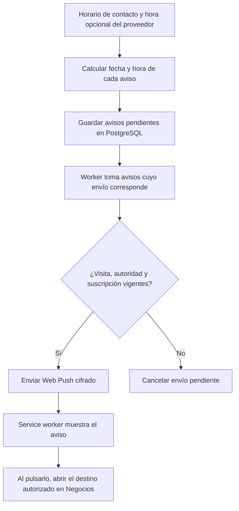

# PWA de Nodia — plan de implementación por entregas

> Estado vigente al 2026-11-21. PWA-001 cerrado por alcance con aceptación humana de funcionamiento (§15). PWA-005 y el punto de lectura de PWA-006 se publicaron y verificaron en Chrome para Windows con las bases de PWA-002/003 (§8.3). PWA-002/003 conservan sus verificaciones de despliegue por alcance (§4 y §5). PWA-004 sigue su entrega independiente (§6). §11 y §14 conservan sus cortes históricos. Ver [TODO](TODO.md).
> Fecha: 2026-11-13. Rama de planificación: `codex/plan-pwa-installation`, desde `development`.
> Rama histórica de implementación local: `codex/pwa-001-installation`, desde development/origin en `a780099b456b9cb930865543d836e61147cc4190`. Opción gráfica1 seleccionada. La publicación posterior se registra en§12; no repetir esa operación al retomar el QA de instalación.
> Fuentes: [Client08](08-stack-frontend.md), [auth14](14-authentication.md), [privacidad89](89-module-access-and-user-data-scope.md), [rutas ADR092](../architecture/decisions/ADR-092-stable-module-navigation-routes.md), [rendimiento37](37-web-performance-implementation-plan.md), [producción99](99-production-deployment-and-cicd-plan.md) y [diseño Client](../../nodia-client/DESIGN.md).

## 1. Objetivo y orden de entrega

La primera entrega permite **instalar Nodia, reconocer su icono y abrirla en una
ventana propia, utilizando las mismas funciones online actuales**. Es un ítem
vertical completo: se desarrolla, prueba, revisa y despliega por separado. Su
cierre no depende de caché offline, avisos de actualización, push o sincronización.

| Orden / ítem | Resultado entregable | Dependencia | Prioridad / estimación inicial |
| --- | --- | --- | --- |
| **PWA-001** | **Instalación, iconos y ventana propia; funciones online** | App actual publicada por HTTPS | **Primera entrega obligatoria; 1–2 días de trabajo** |
| PWA-002 | Service worker con caché estática acotada y actualización controlada | PWA-001 y registro compartido con Web Push | Publicado con Teacher (§8.3). Validación del cambio de versión y reversión pendiente (§4) |
| PWA-003 | Experiencia clara ante desconexión y recuperación online | PWA-002 para pantalla disponible sin red | Publicado con Teacher (§8.3). Validación específica en producción pendiente (§5) |
| PWA-004 | Recordatorios push de visitas de proveedores | Horarios de Contactos y service worker; independiente de la caché y sincronización offline | 004.02–.04 en laboratorio (§6.4–6.6). Piloto HTTPS 004.05 verificado en Chrome para Windows (§6.7) |
| PWA-005 | Lectura offline de material de estudio de Teacher | PWA-002/003 y política de privacidad/persistencia | Publicado y verificado en Chrome para Windows (§8.3) |
| PWA-006 | Punto de lectura de Teacher sin conexión y sincronización | PWA-005, recibo y revisión del cursor de Teacher | Publicado y verificado en dos perfiles Chrome para Windows (§8.3) |

Son estimaciones para una persona dedicada, sujetas a QA y disponibilidad de
dispositivos; no son fechas comprometidas. El rango anterior de3–5 días para la
base robusta corresponde aproximadamente a PWA-001/002/003 juntos, no al primer
ítem aislado. Las entregas posteriores avanzan por separado de PWA-001. Push
es independiente de las escrituras offline.

## 2. Punto de partida comprobado y límites

- El checkout usa React/Vite/TypeScript. [vite.config.ts](../../nodia-client/vite.config.ts) no registra un plugin PWA; [index.html](../../nodia-client/index.html) referencia favicon y no manifiesto. No se encontró registro propio de service worker en la revisión inicial.
- Existe identidad gráfica; revisar sus originales y resolución antes de exportar iconos. La presencia de un favicon no acredita un icono512 válido ni calidad al instalar.
- El frontend acordado es `https://nodia-1ge.pages.dev/`; la API usa configuración pública independiente. Confirmar origen canónico, HTTPS y recursos efectivos durante el desarrollo, sin incorporar credenciales al manifiesto.
- La entrega usa [artefactos CI](../../ops/ci/artifact-release.mjs) y [CD Pages](../../ops/ci/cd-pages.mjs). Se debe verificar el artefacto y después la respuesta publicada, sin reconstruir en CD.
- El acceso sigue perteneciendo a sesión/actor/módulos y al backend. La instalación no concede módulos, extiende sesiones ni habilita proveedores IA.
- El service worker del navegador y el worker del VPS son componentes distintos. Instalar una PWA no mantiene JavaScript ejecutándose24h en el teléfono.

## 3. PWA-001 — instalación online independiente y desarrollable

### 3.1 Historia y resultado visible

**Como usuario de Nodia, quiero instalarla desde mi navegador y abrirla mediante
su icono en una ventana propia para usar las mismas funciones online sin buscar
la pestaña del navegador.**

La entrega termina con un PR propio y un artefacto publicable. Una persona debe
poder instalar, cerrar, volver a abrir, iniciar sesión y navegar con sus permisos
actuales. Otro dispositivo puede seguir utilizando la web sin instalarla.

### 3.2 Alcance cerrado

Incluye manifiesto, iconos, metadatos HTML, instalación mediante la interfaz del
navegador, `display: standalone`, comprobación de rutas/auth y validación mínima
de empaquetado/publicación. El nombre propuesto es `Nodia`; se reutilizan la marca
y el theme actuales. Las instrucciones distinguen plataforma/navegador.

No incluye service worker, `vite-plugin-pwa`, caché persistente nueva, un botón
propio de instalación, funcionamiento offline, notificaciones, tiendas de apps,
rediseño general ni cambios funcionales de API/BD/Redis. La desconexión conserva
el comportamiento online actual; no se promete abrir la aplicación sin internet.

La guía MDN confirma que un service worker no es requisito general de
instalabilidad. Por eso se difiere a PWA-002: no hace falta introducir su ciclo de
actualización/caché para completar este ítem. Ver fuentes técnicas en§10.

### 3.3 Tareas, en orden

| ID | Trabajo concreto | Comprobación / salida |
| --- | --- | --- |
| 001.01 | Crear rama desde development actualizado; inventariar manifiestos/registro SW, favicon, rutas, auth y empaquetado existentes. Registrar la matriz de lanzamiento: Windows/Chrome y Edge, Android/Chrome; añadir iOS sólo cuando se pueda comprobar. | Base, plataformas anunciadas y archivos afectados identificados; cambios ajenos conservados. |
| 001.02 | Fijar identidad de instalación: `id` estable, `name`, `short_name`, `lang`, `start_url`, `scope`, `display`, colores del theme y ausencia de preferencia por app nativa. | Propuesta concreta: `id: /`, `start_url: /`, `scope: /`, `display: standalone`, `lang: es`; validar que `/` conserva la resolución de sesión/ruta actual. |
| 001.03 | Exportar desde la marca existente PNG192 y512; variantes maskable adecuadas y apple-touch-icon180. Revisar contraste, márgenes seguros, resolución real y recorte. | Archivos propios con dimensiones verificadas, sin rediseñar el logo ni ampliar un bitmap pequeño sin QA. |
| 001.04 | Añadir `public/manifest.webmanifest` con rutas relativas al mismo origen y referencias reales a los iconos; enlazarlo en index.html y añadir theme-color/apple-touch-icon. | Respuesta JSON válida y metadatos coherentes. Manifiesto público sin usuario, token, API privada o datos de negocio. |
| 001.05 | Comprobar instalación desde menú/barra del navegador y apertura standalone. Documentar el recorrido manual de iOS Safari. | No depende de que aparezca un banner automático ni de `beforeinstallprompt`. |
| 001.06 | Probar login/logout, renovación de sesión, rutas directas y autoridad desde la ventana instalada. | Mismos destinos canónicos y permisos; ninguna ruta funcional pública por estar instalada. |
| 001.07 | Verificar que el build y el paquete incluyen manifiesto/iconos y que Pages los sirve como archivos, con MIME correcto, sin devolver el HTML de la SPA. | Hashes/inventario del artefacto y respuesta publicada compatibles con el CD existente. Ajustar validación sólo donde falte esta garantía. |
| 001.08 | Ejecutar checks pertinentes y matriz mínima de§3.5; documentar instalación/desinstalación y límites online. | Resultados reales por plataforma/versión, sin declarar aceptado un dispositivo no probado. |
| 001.09 | Crear PR de PWA-001, integrar por el flujo development→master y verificar instalación en el origen final tras el deploy autorizado. | Entrega independiente aceptable; tareas PWA-002…006 permanecen abiertas. |

Solicitud visual del 2026-11-13: adaptar la N de la marca existente, conservando
turquesa, azul y violeta, con estilo simple y moderno para móvil y favicon. Se
prepararon cinco propuestas visuales para revisión: N esencial, N en círculo,
N con aro, N conectada y N bicolor. El usuario seleccionó **la opción 1, N
esencial**, y solicitó una rama desde development actualizado para implementar.
Se reconstruyó como SVG limpio y se exportaron favicon SVG/ICO/PNG, iconos
192/512, variantes maskable y Apple180; fuente y receta en
[branding](../../nodia-client/branding/README.md). La selección del icono no
aprueba el documento completo ni acredita instalación PWA. La comprobación
local y los pendientes se registran en §11.

Cambiar de dominio puede requerir otra instalación; un `id` estable no migra
identidad ni datos entre orígenes. Usar el origen Pages actual permite avanzar;
la futura compra de dominio no bloquea esta entrega. El manifiesto no debe fijar
un hostname de preview que termine identificando la instalación productiva.

### 3.4 Archivos y contratos previstos

| Área | Archivos previstos / existentes | Límite |
| --- | --- | --- |
| Instalación | `nodia-client/public/manifest.webmanifest` e iconos bajo `public/` | Nuevos archivos estáticos públicos. |
| HTML/estética de instalación | `nodia-client/index.html`, theme existente y fuente de marca | Metadatos; sin rehacer páginas. |
| QA/CI | Pruebas pequeñas bajo `nodia-client/src/test/` y validación existente de artefactos si corresponde | Manifiesto, referencias y dimensiones reales; no tests espejo de markup. |
| Publicación | `_headers` y empaquetado/CD actuales, sólo si la respuesta efectiva lo requiere | Preservar COOP del login y reglas de integridad; sin desactivar verificadores. |
| Documentación | Este plan, [ficha PWA](../nodia-ai/knowledge/general-settings/features/pwa-installation.md), índices y pasos de instalación | Estados reales; publicación de contexto IA separada. |

### 3.5 QA y criterios de aceptación completos

La matriz original siguiente conserva sus casillas como registro de evidencia
por criterio. El cierre funcional aceptado posteriormente en§15 no marca como
ejecutadas pruebas de dispositivo o compatibilidad sin recibo detallado; las
casillas históricas no reabren PWA-001 por sí solas.

- [ ] **AC01 — Artefacto:** manifiesto parseable, campos/URLs válidos, scope/start_url coherentes e iconos existentes con dimensiones declaradas reales; empaquetados y servidos por HTTPS con MIME correcto.
- [ ] **AC02 — Instalación escritorio:** Chrome y Edge en Windows permiten instalar Nodia desde sus controles; el sistema muestra nombre e icono correctos y abre una ventana standalone. No basta crear un acceso directo que abra una pestaña.
- [ ] **AC03 — Instalación móvil:** Chrome Android se prueba en un dispositivo compatible, con dispositivo/versión registrados. Si se anuncia soporte iOS en ese lanzamiento, también Safari iOS mediante Añadir a pantalla de inicio. La emulación responsive no acredita instalar una app en esos sistemas.
- [ ] **AC04 — Reapertura:** cerrar por completo y abrir desde el icono conserva el destino de entrada y resuelve correctamente sesión vigente o login, sin pantalla en blanco.
- [ ] **AC05 — Google/auth:** login, popup/retorno, cancelación/error de login, renovación y logout funcionan desde la ventana instalada; logout seguido de reapertura no expone la vista privada y cambiar cuenta no muestra datos del actor anterior. Conservar los contratos de COOP/cookies/CORS, sin suponer sesiones compartidas entre Safari y su instalación. Si un navegador exige un ajuste de auth para funcionar, ese ajuste acotado y su regresión pertenecen a PWA-001.
- [ ] **AC06 — Rutas y acceso:** recargar un destino privado mantiene la ruta canónica; sin sesión se aplica el guard habitual y sin módulo no se concede acceso. Comprobar al menos un usuario ordinario y super_admin con su política existente.
- [ ] **AC07 — Funciones online:** smoke del módulo accesible, carga de datos y apertura de archivos; comprobar un flujo ya disponible de Teacher/NodiaAI sin consumir inferencias ni ejecutar mutaciones de negocio por rutina. Login de proveedores no se confunde con disponibilidad de inferencia.
- [ ] **AC08 — Navegación externa:** autorización Google/proveedores y enlaces externos conservan su destino seguro; no se intenta introducir páginas de terceros dentro del scope del manifiesto.
- [ ] **AC09 — Límite online:** no aparece nueva caché Cache Storage de PWA, service worker ni cola de peticiones; la documentación explica la necesidad de red. Instalar no modifica el caché en memoria actual de TanStack ni promete eliminar datos preexistentes del navegador.
- [ ] **AC10 — Entrega:** lint, pruebas de valor afectadas y un build con TypeScript incluido; CI/CD verifica el mismo artefacto sin rebuild. TypeScript no se repite en tests o lint. Después se prueba la instalación publicada; un JSON local válido no acredita ese resultado.
- [ ] **AC11 — Compatibilidad:** checklist con fecha, navegador, versión, dispositivo y origen. Un entorno no disponible queda pendiente; no se anuncia como soportado por extrapolar una prueba de Chromium o un viewport móvil.
- [ ] **AC12 — Documentación/retirada:** instrucciones de instalación y desinstalación por plataforma; limitaciones registradas. La retirada de una versión vuelve por el procedimiento de release existente y no borra sesiones/almacenamiento del dispositivo.

Matriz de lanzamiento propuesta: Windows/Chrome y Edge, Android/Chrome.
iOS/Safari es objetivo adicional: se incluyen sus instrucciones y se prueba si
se dispone del dispositivo; mientras tanto queda explícitamente sin verificar,
sin anunciar soporte ni bloquear el lanzamiento de las plataformas comprobadas.
Las versiones efectivas se fijan al ensayar; el navegador decide su UI de
instalación. Safari macOS/Firefox y tiendas no forman parte del gate inicial.
Si falta un dispositivo de la matriz anunciada, registrar la limitación y no
marcar AC03/AC11 completos para él. Standalone no promete pantalla completa ni
ocultar controles propios del sistema operativo.

### 3.6 Definición de terminado y prueba de independencia

PWA-001 está terminado cuando AC01–AC12 estén satisfechos por alcance, el código
esté revisado e instalado en el origen acordado y una persona pueda abrir su
icono/ventana y usar las funciones online con sus permisos. Antes de ese despliegue
se distingue «implementado y probado localmente» de «operativo para usuarios».
El cierre solicitado y aceptado por el usuario el2026-11-16 se concilia en§15;
esa aceptación del alcance entregado no certifica cada plataforma de la matriz.

**Prueba de independencia:** el PR puede cerrarse con PWA-002…006 sin empezar,
sin instalar plugin PWA, crear contratos de sincronización o contratar servicios.
Si el PR incluye precache, push o persistencia offline, dividirlo antes de revisar.
Las correcciones indispensables de auth, rutas o empaquetado descubiertas por
AC01–AC12 sí pertenecen al mismo ítem; no se pospone una instalación rota.

## 4. PWA-002 — caché estática y actualizaciones controladas

La base de actualización se publicó con Teacher (§8.3). Las pruebas de
cambio de versión y reversión en producción siguen pendientes. Ver la
[decisión de arquitectura propuesta](../architecture/decisions/ADR-112-pwa-controlled-release-updates.md).

- [x] Integrar metadatos en el build de Vite y usar el mismo registro raíz para actualizaciones y el piloto de Web Push. La evaluación de Workbox se resolvió con el worker nativo y el generador de metadatos, con las dependencias vigentes del proyecto.
- [x] Acotar la caché a JavaScript, CSS y fuentes públicas con hash del artefacto, de hasta 2 MiB por archivo. Calentar sólo JavaScript y CSS de entrada y guardar el resto bajo demanda.
- [x] Aplicar la lista a lecturas GET de scripts, estilos y fuentes del mismo origen. Mantener navegación, API y autenticación sobre la red, con la autoridad habitual. Validar HTTP 200 y MIME del recurso antes de cachear.
- [x] Ofrecer «Actualizar ahora» y «Más tarde» en ES/EN. La versión se activa sin recargar las demás pestañas. Ediciones, formularios abiertos y mutaciones de la pestaña solicitante permiten abrir la versión nueva en otra pestaña.
- [x] Reservar `nodia-static-v1-<versión>` para recursos de Nodia y conservar la versión activa y dos cachés anteriores. Recuperar recursos antiguos ya consultados por su URL con hash. La falta de un módulo diferido antiguo conduce al estado de error con recuperación explícita.
- [x] Validar relación entre HTML, worker, recursos declarados y `/pwa-release.json` en el artefacto. Mantener `/service-worker.js` en el scope raíz y aplicar la configuración de producción en un contexto seguro.
- [x] Probar en Chromium dos publicaciones consecutivas, aplazamiento, aplicación con dos pestañas, un formulario real, recurso ausente y reversión local.
- [ ] Comparar arranque en el origen publicado según plan37 y verificar recuperación con los recursos y navegadores del despliegue.
- [ ] Verificar el rollback del release publicado, que mantiene el registro de push. La retirada completa del worker requiere un procedimiento que contemple la suscripción vinculada.
- [ ] Probar desconexión durante instalación, auth/permisos y reapertura en los entornos que se declaren soportados.

Aceptación: nueva versión ofrecida y aplicada sin perder borradores; API conserva
su autoridad online; recursos públicos anteriores/nuevos tienen recuperación
probada. Comparación de rendimiento y rollout/rollback documentados. Evaluar ADR
si la estrategia introduce garantías compartidas o alternativas costosas.

### Verificación local — 2026-11-21

Dos builds de producción de Client se sirvieron por turnos en un origen
seguro de loopback con Chrome 158.0.8127.36 y un API sintético. En una pestaña se abrió
el formulario real **Nuevo proveedor** y se editaron el nombre y el impuesto.
En la otra se aplazó la actualización y luego se aplicó. El primer cambio
de documento ocurrió sólo en la pestaña que lo pidió y conservó su ruta,
parámetros y fragmento. El formulario conservó el documento, ambos valores y
sus controles. Se guardó en una sola petición exitosa del fixture y después
esa pestaña aplicó la versión nueva y mostró el proveedor guardado.

Al devolver HTTP 404 para el script de entrada de la versión publicada, el
candidato falló la instalación y la versión activa siguió mostrando avisos.
Al restaurar el script, el candidato esperó la acción de la persona. Chrome
mantuvo el registro raíz y la suscripción FCM del perfil de prueba tras el
cambio de worker. Se inyectaron eventos push por Chrome DevTools antes,
durante la espera y después de la activación. El worker mostró el aviso y su
payload conservó el destino canónico. La entrega remota de extremo a extremo
pertenece a los ensayos de PWA-004 por plataforma.

El worker nuevo recuperó desde caché el script de entrada que había preparado
para la versión anterior, mientras el origen servía sólo la publicación actual.
La inspección encontró 136 entradas y todas correspondían a `/assets/`.
Al revertir el origen a la publicación anterior, la pestaña solicitante
volvió a esa versión con la misma URL y el proveedor guardado. La otra
pestaña siguió abierta en la versión posterior. La suscripción FCM se
conservó también durante la reversión. Se dio de baja la suscripción de
prueba, se retiró el registro del navegador aislado y se cerró el origen.

Pasaron el build con tipado, 39 regresiones de Client, 34 pruebas de
artefactos y publicación en Linux y la validación de conocimiento. El
artefacto validó 12 archivos públicos PWA, incluida la versión, y comprobó
que el cuerpo del worker coincide con la fuente. El candidato prepara dos
archivos de entrada que suman 558.536 bytes sin comprimir. El worker en el
ensayo ocupó 16.014 bytes sin comprimir y cerca de 5,7 kB con gzip. La
comparación de arranque en el origen publicado queda pendiente.

## 5. PWA-003 — desconexión y recuperación comprensibles

La base de reconexión se publicó con Teacher (§8.3). La verificación
específica de PWA-003 en producción sigue pendiente. Ver la
[decisión de arquitectura propuesta](../architecture/decisions/ADR-113-pwa-connection-recovery.md).

- [x] Ofrecer un aviso traducido de desconexión o problema con el servidor y un reintento en la vista y el modal. Conservar los formularios montados.
- [x] Usar el estado del navegador como señal de red y validar el liveness real de `GET /api/v1`. Tratar fallos sin respuesta como problemas de alcance cuando el navegador todavía indica conexión.
- [x] Revalidar la sesión cuando esté indisponible según el flujo vigente y reintentar lecturas GET activas que fallaron por conectividad. Los HTTP 401/403/404/410 conservan el manejo por sesión o módulo.
- [x] Impedir que una escritura intentada sin conexión quede en cola de TanStack Query. La recuperación conserva el borrador en memoria y requiere una acción explícita para guardar.
- [x] Servir una página estática de contingencia cuando falle el transporte de una navegación controlada. Ofrecer reintento en la misma URL y conservar las respuestas HTTP del origen. La primera visita requiere que el navegador pueda cargar el sitio para instalar el worker.
- [x] Probar en Chromium la desconexión real del navegador, el API con 503, el borrador preservado, un único guardado explícito y el arranque sin conexión.
- [ ] Comprobar disponibilidad, reconexión y alcance de autenticación en el origen publicado y las plataformas declaradas. Verificar los escenarios de expiración y cambio de cuenta de extremo a extremo.

Aceptación: el usuario entiende por qué no puede completar una acción y puede
recuperar la vista online sin perder su borrador. No se anuncian consultas o
escrituras offline de datos del negocio.

### Verificación local — 2026-11-21

Se reprodujo en el candidato anterior que **Guardar** sin conexión dejaba
una mutación en espera y la enviaba al reconectar. Con PWA-003, Chrome 158
mostró **Sin conexión a internet** al deshabilitar la red en un formulario
real de Proveedores. El intento de guardado dejó el formulario abierto.
Con el navegador en línea y el API de prueba en HTTP 503 se mostró
**Problema con el servidor**. El reintento exitoso mantuvo el documento, la
URL y los valores de nombre e impuesto. El servidor del fixture registró
cero envíos automáticos y un único `POST 201` después de pulsar **Guardar**.

Con el worker activo, una segunda pestaña abierta sin red recibió la página
estática de contingencia. Volvió a la ruta exacta, con sus parámetros y
fragmento, al pulsar **Reintentar** tras recuperar la conexión. Una
respuesta HTTP 503 de navegación del origen se conservó íntegra.

Con red activa, un HTTP 503 de la consulta de proveedores mostró el aviso de
servidor. Una comprobación con HTTP 200 y HTML inesperado mantuvo el aviso.
Con la respuesta válida, **Reintentar conexión** recuperó la consulta GET y la
tabla. El sondeo no envió un encabezado de autorización. Un HTTP 403 siguió
el tratamiento del módulo. En un viewport de 375 px, la acción de reintento
midió 44 px, fue alcanzable por teclado y el aviso conservó el foco en el
campo activo al desconectarse. El modal no tuvo desbordamiento horizontal.

Pasaron 114 pruebas dirigidas de Client, que incluyeron clasificación de
errores, concurrencia del reintento, guardado sin red, guardias de sesión y
el worker de push y navegación. El ensayo utilizó un API sintético y se
cerró el origen de prueba al terminar.

## 6. PWA-004 — notificaciones push

**Alcance inicial planificado el 2026-11-20.** Enviar un recordatorio por cada
visita prevista de un contacto activo de un proveedor activo. El horario semanal
del contacto se mantiene en [Plan31](31-provider-contacts-proposal.md#día-de-visita-con-hora-por-confirmar--2026-11-20).
La hora de alarma se configura opcionalmente en el proveedor y se aplica a sus
contactos. La primera entrega comprende recordatorios por visita. Un resumen
diario agrupado queda como ampliación independiente. El
[ADR111 propuesto](../architecture/decisions/ADR-111-web-push-provider-visit-reminders.md)
describe la frontera de planificación, autoridad y entrega.

### 6.1 Regla de hora y destinatario

**Contrato de PWA-004.01, documentado el 2026-11-20.** El ajuste de hora se comparte
entre los contactos del proveedor. La preferencia de recibir avisos es personal
por negocio. El permiso y la suscripción se activan en cada instalación.

#### Alarma del proveedor

Mostrar **Hora de alarma de visitas** en el formulario habitual de Proveedores.
El valor `visit_alarm_time` es un campo propio de `providers`, nullable y en
formato `HH:mm` de 24 horas. Alta con valor omitido crea `null`. En la edición,
omitirlo conserva el ajuste y `null` selecciona el cálculo automático. El
formulario envía `null` al limpiar el campo. Usar el contrato existente de
alta/edición y su autoridad por negocio. Las cargas CSV de esta primera entrega
conservan la alarma en proveedores existentes y crean nuevos proveedores con
`null`. La edición del ajuste se hace desde el formulario. La fecha y el
horario semanal siguen en Contactos.

| Datos de la visita del miércoles | Hora de alarma del proveedor | Aviso |
| --- | --- | --- |
| Inicio a las 10:30 | 08:45 | Miércoles a las 08:45 |
| Inicio a las 10:30 | Vacía | Miércoles a las 10:00 |
| Día de visita con hora por confirmar | Vacía | Miércoles a las 09:00 |
| Día de visita con hora por confirmar | 08:45 | Miércoles a las 08:45 |
| Inicio a las 10:30 | 10:30 o posterior | Miércoles a las 10:00, con advertencia visible en el ajuste |
| Sin visita el miércoles | Cualquiera | No se genera un aviso para ese día |

La hora fija se interpreta el día de la visita. Si coincide con el inicio
conocido o cae después, se propone aplicar los 30 minutos previos solo a esa
visita. El proveedor conserva su ajuste para los demás horarios. Esta excepción
mantiene el aviso útil cuando se modifica un contacto o hay contactos con horas
distintas. Mostrar la hora efectiva o la advertencia al editar los datos afectados.

Resolver cada fecha civil en `America/Santiago` y guardar `send_at` en UTC. Para
los 30 minutos previos, resolver primero el inicio a un instante y restar 30
minutos reales. Una visita a las 00:15 puede avisarse a las 23:45 del día
anterior. Como regla propuesta en el cambio estacional, usar la primera
ocurrencia de una hora repetida y desplazar una hora inexistente por la duración
del salto. Comparar la alarma fija con el inicio después de resolver ambos
instantes. Caducar cada aviso 30 minutos después de `send_at` o al inicio
conocido de la visita, lo que suceda primero. Si cambia un horario y el nuevo
aviso queda en el pasado, solo se admite dentro de esa ventana y si la misma
ocurrencia todavía no tuvo una entrega aceptada para esa suscripción.

#### Destinatarios y preferencias

- Es elegible el dueño o un colaborador activo del negocio con cuenta activa y
  acceso vigente a `/business`. El negocio, proveedor y contacto deben estar
  activos. El bypass administrativo permite editar el proveedor conforme a su
  política habitual. Para recibir avisos, también requiere una relación explícita
  con ese negocio y opt-in personal.
- En **Negocios → Proveedores**, cada persona puede habilitar **Avisos de visitas
  de este negocio** para su propia cuenta. Persistir un booleano por `(user_id,
  business_id)`, con ausencia equivalente a desactivado. Nadie activa avisos a
  nombre de otro usuario. La preferencia se aplica a todas las instalaciones
  activadas de esa cuenta. Deshabilitarla afecta a ese negocio en todos sus
  dispositivos.
- Revalidar relación, acceso y preferencia antes de cada despacho. Si se retira
  la relación o el módulo, cesan los envíos. Si se recupera el acceso, el
  opt-in guardado vuelve a aplicarse a nuevas visitas bajo la autoridad actual.
  Los envíos cancelados por pérdida de acceso no se reponen.

[Autoridad de Negocios](89-module-access-and-user-data-scope.md#contratos-y-barreras).

#### Activación por dispositivo

1. En **Mi cuenta → Notificaciones**, mostrar el estado de **este dispositivo**.
   La unidad es la instalación PWA o perfil de navegador del origen de Nodia.
   Preparar el service worker y obtener la clave pública antes de habilitar el botón.
   Tras tocar **Activar en este dispositivo**, solicitar permiso del navegador
   con esa misma acción. Si ya está concedido, la acción confirma el alta en
   Nodia. Un permiso denegado se gestiona desde la configuración del navegador
   o sistema y la UI permite volver a comprobarlo.
2. Con permiso concedido, registrar la suscripción de Web Push en Server con la
   sesión actual. La cuenta y el `sid` se derivan de la autenticación. Usar
   un `installation_id` aleatorio en ese perfil, sin fingerprint, y vincular
   la suscripción a `(user_id, installation_id)`. Registrar el `sid` para
   propagar la revocación explícita de esa sesión a la instalación. La UI
   confirma **Activo** tras el acuse de Server. Para recibir avisos también debe
   estar activada la preferencia del negocio. En iOS/iPadOS se activa desde la
   app añadida a la pantalla de inicio.
3. **Desactivar en este dispositivo** revoca el alta en Server y cancela la
   suscripción local. Afecta a esa instalación, con las otras instalaciones y
   preferencias vigentes. Mostrar **Baja pendiente** si queda por confirmar una
   parte del cierre. Un logout explícito intenta cancelar la suscripción local
   de esa cuenta. La revocación de su `sid` en Server invalida el alta vinculada.
   Si el navegador está sin conexión, conservar la baja pendiente, impedir que
   se registre la cuenta siguiente sobre la suscripción previa y finalizar la
   limpieza al reconectar.
   Un aviso ya aceptado por el intermediario aún puede llegar con texto genérico.
4. La expiración normal de la sesión de navegación conserva el consentimiento
   de la instalación. El aviso puede llegar mientras su suscripción siga
   vigente y el destinatario tenga acceso. Su destino exige volver a iniciar
   sesión cuando corresponda. Al entrar de nuevo con la misma cuenta, solo
   se puede vincular la nueva sesión a un alta activa que coincida con la
   instalación y la suscripción local. Tras una baja o revocación, volver a
   activar requiere acción explícita. Si se cambia de cuenta en el mismo
   perfil, retirar la suscripción previa antes de registrar la nueva.
5. Al volver a la app, conciliar el estado del navegador y del servidor. Ante
   permiso retirado, suscripción ausente o confirmación de endpoint expirado,
   marcar **Requiere reactivar** y esperar dicha acción. Usar `pushsubscriptionchange`
   como señal adicional cuando esté disponible.

La gestión de la propia instalación sigue accesible con sesión válida aunque
se pierda el módulo Negocios. Opera exclusivamente sobre la cuenta autenticada.
Ver [permiso y suscripciones Push](https://www.w3.org/TR/push-api/#permission) y
[Web Push de Apple](https://developer.apple.com/documentation/usernotifications/sending-web-push-notifications-in-web-apps-and-browsers).

#### Contratos y estados de PWA-004.01

| Operación planificada | Entrada y resultado |
| --- | --- |
| Alta y edición de proveedor | `visit_alarm_time` opcional y nullable en el contrato de Proveedores. Devolver el valor vigente en la edición. |
| `GET` / `PUT` `/businesses/:businessId/notification-preferences/provider-visits` | Consultar o fijar `{ enabled: boolean }` de la cuenta actual. Habilitar exige relación y acceso a Negocios. Una lectura administrativa global queda fuera de este ajuste personal. |
| `GET` `/notifications/web-push/config` | Devolver configuración pública del ambiente, incluida la clave pública VAPID y su identificador. |
| `GET` / `PUT` / `DELETE` `/notifications/web-push/installations/:installationId` | Estado, registro y baja propios. El alta recibe la suscripción del navegador, identificador de clave y revisión esperada. La baja usa la revisión observada. La respuesta contiene estado, revisión y fecha, con los datos de transporte reservados a Server. |

Hay una suscripción activa por cuenta e instalación, y cada endpoint pertenece a
una sola alta activa. La API rechaza reutilizar un endpoint vigente de otra
cuenta. Usa actualización condicional para evitar que un reintento obsoleto
reactive una instalación dada de baja. Repetir un alta idéntica aún vigente o
una baja ya aplicada devuelve su estado actual. En un registro nuevo la
revisión esperada es cero. La rotación reemplaza el transporte en la misma
instalación mediante una revisión nueva y queda vinculada al `sid` vigente.

Conservar estados `active`, `revoked` y `expired`. Validar `endpoint`, `p256dh`
y `auth` al registrar. Al revocar o constatar expiración, retirar endpoint y
claves de transporte del registro activo. Mantener el registro mínimo de baja
mientras su sesión pueda aceptar reintentos y hasta 30 días después de su
cierre. Conservar metadatos operativos mínimos de entregas durante 30 días,
con las credenciales y el contenido fuera de logs y del historial de entrega.
Los estados de entrega descritos en §6.3 se guardan aparte del consentimiento.
Estos contratos siguen en revisión y requieren verificación de implementación.

### 6.2 Recorrido de datos

### 6.3 Entregas y verificación

| Paso | Trabajo | Gate para continuar |
| --- | --- | --- |
| 004.01 | Documentado en §6.1. Alarma por proveedor, destinatarios, consentimiento, suscripción y ciclo de baja definidos para revisión. | Revisar los ejemplos de hora, cambio de cuenta y revocación junto con el contrato. |
| 004.02 | Implementado y verificado en Server local (§6.4). Incluye el ajuste del proveedor, preferencias, suscripciones, cálculo y planificación durable. | Pasaron los ensayos de contratos HTTP y concurrencia con PostgreSQL 16 aislado. |
| 004.03 | Implementado en Server y verificado con PostgreSQL aislado y transporte sintético (§6.5). Revalida destinatarios y suscripciones, firma VAPID, cifra y limita los intentos a la ventana del aviso. | Pasaron los casos de clave inválida, endpoint vencido, cuota, indisponibilidad, respuesta ambigua, expiración y revocación. La recepción en navegador se verifica en 004.04/004.05. |
| 004.04 | Implementado en Client local (§6.6). Alarma nativa en Proveedores, preferencia personal por negocio, alta/baja por instalación y worker en el scope raíz. El aviso abre `/business/:id` y pasa por la autoridad habitual. | La verificación local usa Chromium y cuentas sintéticas. Antes de habilitar el piloto en un origen público, desplegar esquema y Server compatibles y comprobar el artefacto servido. |
| 004.05 | Piloto HTTPS verificado en Chrome para Windows (§6.7). Recepción con la pestaña cerrada, apertura del negocio al pulsar el aviso de Windows y baja desde la UI. La prueba de una visita nueva tras la revocación por API acreditó cero intentos durante su ventana. | Completar los ensayos de otros navegadores y dispositivos que se declaren soportados. iOS/iPadOS requiere una prueba en la PWA de la pantalla de inicio. |

La identidad lógica del aviso incluye negocio, proveedor/contacto y fecha civil
de la visita. La revisión de la fuente permite invalidar un pendiente obsoleto.
La entrega se deduplica por aviso y suscripción. Se libera la transacción antes
del POST externo. Un resultado ambiguo se conserva como tal y la política de
recuperación debe considerar que un reenvío puede mostrar otra notificación.
La respuesta del servicio push acredita aceptación del mensaje. La visualización
y la lectura requieren evidencia propia. La agenda del negocio sigue siendo la
fuente de la hora y del estado vigente de la visita.

Web Push requiere un `endpoint` HTTPS y claves de suscripción `p256dh`/`auth`.
Validar el destino con una política de salida limitada a servicios push
soportados y sin seguir redirecciones. Custodiar la clave VAPID privada en
Server y proteger los datos de suscripción en reposo. El aviso en pantalla
bloqueada usa texto genérico y el destino contiene la referencia mínima
necesaria para navegar. [RFC 8030](https://www.rfc-editor.org/rfc/rfc8030.html),
[RFC 8291](https://www.rfc-editor.org/rfc/rfc8291.html),
[RFC 8292](https://www.rfc-editor.org/rfc/rfc8292.html) y
[Web Push de Apple](https://developer.apple.com/documentation/usernotifications/sending-web-push-notifications-in-web-apps-and-browsers).

### 6.4 Implementación local de Server — 004.02

Las dos capturas compartidas antes del desarrollo son propuestas de interfaz
con datos de ejemplo. Muestran la hora de alarma en Proveedores y los ajustes
de notificaciones. Pertenecen al directorio local de capturas. Client y el
service worker de notificaciones corresponden a 004.04.

- La [migración 179384](../../nodia-server/src/migrations/1793840000000-AddProviderVisitAlarmTime.ts)
  añade `providers.visit_alarm_time` nullable. Las altas sin hora parten en
  `null`, una edición que omite el campo conserva su valor y una edición con
  `null` lo borra. El contrato nativo lo devuelve en el listado y detalle de
  Proveedores. La importación CSV conserva el ajuste existente y usa `null`
  para altas nuevas. El CSV mantiene su formato.
- La [migración 179385](../../nodia-server/src/migrations/1793850000000-CreateVisitNotificationSettings.ts)
  registra preferencias por cuenta y negocio e instalaciones propias con control
  de revisión. Los [endpoints de configuración](../../nodia-server/src/visit-notifications/visit-notifications.controller.ts)
  distinguen ausencia de alta, alta activa, revocada y expirada. Antes de guardar
  se valida URL HTTPS de un host admitido, clave P-256, secreto de suscripción y
  expiración informada. Server cifra `endpoint` y claves en reposo con AES-256-GCM
  asociado a la cuenta e instalación. Una huella del endpoint impide dos altas
  activas para el mismo destino. La revocación explícita de la sesión vinculada
  da de baja la instalación en la misma transacción y retira el material de
  transporte. La expiración normal del login preserva el consentimiento.
- La [configuración de registro](../../nodia-server/src/visit-notifications/web-push-config.ts)
  requiere `WEB_PUSH_PUBLIC_KEY` (pública VAPID P-256 en base64url),
  `WEB_PUSH_SUBSCRIPTION_KEY` (32 bytes hexadecimales para cifrado en reposo) y
  `WEB_PUSH_ENDPOINT_HOSTS` (lista separada por comas de hosts HTTPS admitidos).
  Configuración ausente o inválida deshabilita el alta. La lectura de
  configuración expone `enabled`, `public_key` y `key_id`. Los estados de la
  instalación exponen su UUID, estado, revisión y fecha de actualización. El
  envío firmado con la clave VAPID privada corresponde a 004.03.
- La [migración 179386](../../nodia-server/src/migrations/1793860000000-PlanProviderVisits.ts)
  crea cola y ocurrencias en PostgreSQL. Los cambios de actividad, traslado,
  alarma o agenda actualizan la revisión y encolan trabajo en la misma
  transacción del cambio, también cuando el origen es CSV. La migración
  encola registros históricos elegibles. El
  [planificador](../../nodia-server/src/provider-visit-planning/use-case/reconcile-provider-visit-planning.use-case.ts)
  reclama trabajo por proveedor con `FOR UPDATE SKIP LOCKED`, calcula por páginas
  de hasta 48 contactos y confirma el avance y las ocurrencias en una sola
  transacción. Las fechas elegibles llegan hasta siete días civiles desde hoy
  en `America/Santiago`. El recálculo conserva las ocurrencias vigentes dentro
  de su ventana de aviso. El cálculo guarda UTC y el motivo de
  la hora elegida, incluido el ajuste cuando la alarma fija quedaría tarde.
- El [worker de planificación](../../nodia-server/src/provider-visit-planning/provider-visit-planning.worker.ts)
  consume la cola con un intervalo de 15 segundos y renueva los proveedores
  activos con agenda cada 24 horas. Cancela o expira las ocurrencias que dejan
  de aplicar y limpia lotes de ocurrencias e instalaciones retiradas conforme
  a la retención de §6.1. La fila candidata a envío debe conservar estado
  `planned`, tener `send_at <= ahora < expires_at` y coincidir con la revisión
  vigente en `provider_visit_planning_queue`. La comprobación de destinatarios
  y la entrega por instalación corresponden a 004.03.

El [ADR111](../architecture/decisions/ADR-111-web-push-provider-visit-reminders.md)
permanece propuesto. La [ficha candidata de recordatorios](../nodia-ai/knowledge/businesses/features/supplier-visit-reminders.md)
registra este alcance parcial. La entrega, la interfaz de notificaciones y el
piloto mantienen los gates de 004.03–004.05.

#### Verificación de 004.02

Los ensayos de [preferencias y suscripciones](../../nodia-server/test/visit-notifications.integration.mjs)
y [planificación](../../nodia-server/test/provider-visit-planning.integration.mjs)
pasaron con Server compilado y PostgreSQL 16 aislado. El primer ensayo cubrió
permisos HTTP, datos cifrados, dos instalaciones, revisiones, baja y una carrera
entre alta y revocación de sesión. El segundo cubrió migración ascendente,
descendente y nuevamente ascendente, encolado de datos históricos, dos
consumidores concurrentes, recuperación tras rollback inyectado, cambios de
agenda y actividad, avance entre páginas de contactos, renovación del horizonte
y limpieza. Pasaron las 12 pruebas de cálculo, incluidas medianoche y las dos
transiciones del horario estacional. La regresión [CSV de Proveedores](../../nodia-server/test/provider-csv.integration.mjs)
pasó 46 peticiones y conservó la alarma en una reimportación histórica.
La instalación completa desde una base vacía pasó 47 comprobaciones. Pasaron
también los ensayos de Contactos y las siete comprobaciones de precios/OCR.
La suite completa de Server pasó 6370 pruebas en 376 archivos, con una prueba
omitida, usando `--testTimeout=20000` en esa ejecución. Pasaron la compilación,
la comprobación de artefactos y los pins locales de conocimiento. Oxlint
conservó un aviso previo de `no-unsafe-finally` en un fixture ajeno al cambio.

La [configuración local reproducible](../../nodia-server/package.json) expone
`npm run test:pwa-004:integration`. El alcance verificado usa instalaciones y
suscripciones sintéticas. La aceptación con navegadores reales corresponde a
004.04/004.05 y el transporte a 004.03.

### 6.5 Entrega Web Push desde Server — 004.03

El [worker de entrega](../../nodia-server/src/visit-notifications/delivery/provider-visit-delivery.worker.ts)
se registra en el proceso independiente de Server. La
[migración 179387](../../nodia-server/src/migrations/1793870000000-CreateProviderVisitDeliveries.ts)
crea el registro de entregas y protege la deduplicación frente a un rollback con
registros. El
[registro de entregas](../../nodia-server/src/visit-notifications/delivery/web-push-delivery.store.ts)
identifica un aviso por negocio, proveedor, contacto, fecha civil, usuario e
instalación. Conserva la revisión de la ocurrencia y de la instalación. El
worker reclama por lease y comprueba nuevamente las revisiones, la ventana de
envío, los registros activos, la relación explícita con el negocio, el acceso
vigente a Negocios, la preferencia personal y la suscripción. La expiración
normal del login conserva la suscripción y la revocación explícita la invalida.

La transacción confirma que puede comenzar el intento antes de abrir HTTPS.
Si el proceso se interrumpe antes de confirmar el intento, otro worker puede
recuperar el lease. Si se interrumpe después, el resultado pasa a `unknown`.
Ese estado y `accepted` bloquean reenvíos de la misma entrega. Una baja u otro
cambio posterior a esa última verificación puede coincidir con un envío en
curso. La aplicación revalida sesión y acceso al destino cuando se abre el aviso.

El [adaptador](../../nodia-server/src/visit-notifications/delivery/web-push-transport.ts)
usa la clave privada VAPID `WEB_PUSH_PRIVATE_KEY` del mismo par P-256 que
`WEB_PUSH_PUBLIC_KEY` y el contacto operativo `WEB_PUSH_SUBJECT` (`mailto:` o
HTTPS). Desencripta la suscripción con `WEB_PUSH_SUBSCRIPTION_KEY`. Solo conecta
por HTTPS a un host admitido mediante `WEB_PUSH_ENDPOINT_HOSTS`, con resolución
y conexión limitadas a una dirección pública verificada, validación del
certificado contra el hostname original y sin redirecciones. Para el formato
Web Push usa `web-push` con cifrado `aes128gcm` y autenticación VAPID. La fecha
de expiración limita el TTL de cada intento. La carga tiene `version: 1`,
`kind: "provider_visit"`, `path: "/business/<uuid>"` y `notificationId` opaco.
El contenido visible corresponde a Client y deriva del tipo de aviso. Los
logs operativos excluyen las credenciales, los cuerpos y los endpoints.

Se permiten hasta tres intentos. Los rechazos HTTP 429 y 503 y los errores DNS
previos a la conexión se reintentan con espera de 15 y 30 segundos más una
variación de hasta 3 segundos, respetando un `Retry-After` posterior. Si no
queda margen de entrega antes de caducar, el aviso expira. Un resultado 404 o
410 vence solo la revisión de la suscripción que hizo el intento. Otros 5xx
y errores de conexión posteriores al inicio del POST quedan `unknown`. Una
respuesta 2xx representa aceptación del servicio de transporte. La
visualización en un dispositivo requiere la verificación de 004.04/004.05.

#### Verificación de 004.03

`npm run test:pwa-004:integration` pasó con Server compilado y PostgreSQL 16
aislado. El [ensayo de entrega](../../nodia-server/test/provider-visit-delivery.integration.mjs)
verificó el aislamiento por negocio, suscripción y preferencia, incluido el
administrador sin relación explícita. Dos workers concurrentes respetaron la
identidad por instalación. Se comprobaron la revocación antes de un intento y
entre intentos, `Retry-After`, el límite de tres, la caducidad, la respuesta
ambigua y la recuperación antes y después de iniciar el intento. Un 410 de una
revisión anterior conservó una suscripción que había rotado.

Pasaron 31 pruebas focalizadas, que cubren el cálculo de reintentos y el
[protocolo Web Push](../../nodia-server/src/visit-notifications/delivery/web-push-transport.spec.ts).
Las pruebas capturan la petición HTTPS, descifran el mensaje con la clave de
la instalación sintética y verifican la firma VAPID, el TTL y el destino TLS.
La suite de Server pasó 6401 pruebas en 378 archivos, con una omitida. La
instalación completa en PostgreSQL 16 pasó 47 comprobaciones. Pasaron el build
y la verificación local de conocimiento. Oxlint conservó un aviso previo en
un fixture ajeno al cambio.
Las respuestas del servicio push fueron simuladas.

### 6.6 Client y apertura del negocio — 004.04

- En **Negocios → Market → Proveedores**, el formulario de proveedor edita la
  alarma opcional `visit_alarm_time` en hora de Santiago. Mantiene una alarma
  intacta sin enviarla de nuevo, envía `null` al borrarla y conserva el borrador
  cuando falla el guardado. El control de avisos de la pestaña guarda la
  preferencia de la cuenta para ese negocio.
- En **Mi cuenta → Notificaciones**, Client prepara la clave pública y el
  registro del worker, solicita la suscripción desde el botón y muestra
  **Activo** al confirmar Server. El estado contempla permiso denegado,
  instalación requerida en iOS/iPadOS, baja pendiente y suscripción que
  requiere reactivación. El cambio de cuenta retira el transporte anterior del
  navegador antes de vincular otro. El cierre explícito intenta la baja local y
  Server revoca la sesión vinculada. La renovación ordinaria conserva el alta
  sólo si coincide la suscripción activa.
- `/service-worker.js` usa un registro raíz, muestra texto genérico en español
  o inglés y valida la versión, la clase, el identificador y el destino
  canónico del payload. Al pulsar el aviso intenta recargar una pestaña con ese
  mismo destino o abrir la URL exacta. Client valida la sesión y las
  asignaciones vigentes, y Server comprueba el acceso al negocio. Si es preciso
  iniciar sesión, Client conserva el destino validado en el historial de esa
  navegación. El worker no intercepta peticiones ni añade Cache Storage.

El empaquetado verifica que el script compilado conserve los bytes del asset de
origen y la verificación pública comprueba los bytes y el MIME. En Chromium
local se probó actualizar A → B → A conservando un solo registro y retirar ese
registro con un script de laboratorio en la misma URL. Para revertir a una
versión anterior a Web Push, primero retirar el envío y publicar la retirada en
la URL estable durante el periodo en que los navegadores puedan actualizarse.
Devolver un 404 o servir el fallback HTML deja registros previos en equipos
que aún no procesaron la retirada. La retirada en el origen público queda para
el piloto.

Chromium recibió un push de DevTools e invocó `showNotification`. Con el clic
sintético, una pestaña ya abierta en el negocio volvió a navegar por red. Para
la rama de ventana nueva, el ensayo navegó a la URL exacta solicitada al
navegador. Con cuentas y respuestas HTTP sintéticas, comprobó el acceso
autorizado, la renovación fallida seguida de login y vuelta al destino, el
módulo retirado sin petición al negocio y la denegación HTTP del negocio para
otra cuenta y para un usuario con permisos retirados. Los 32 ensayos de assets
y empaquetado pasaron en Linux x64 con el Node fijado por CI. También pasaron
85 pruebas focalizadas de Server de política HTTP, autoridad del negocio,
alarma y notificaciones. Un ensayo separado con NestJS y PostgreSQL 16
revalidó las rutas de preferencias y el alta, la baja y el aislamiento de
suscripciones con el guard de módulos real.

El ensayo de interfaz verificó en escritorio el permiso bloqueado y el alta y
baja de la instalación con suscripción y API sintéticas. A 390 px guardó la
preferencia del negocio y creó un proveedor desde el formulario con alarma
`08:45`. Los ensayos de Client cubren además el borrado explícito, los
reintentos de baja tras desconexión y el aislamiento ante cambios de cuenta.
Pasaron 3372 pruebas en 415 archivos, el chequeo de tipos, el lint de Client y
el build de producción. El artefacto compilado validó los 11 assets PWA,
incluido el worker idéntico al de origen.

La entrega a través de un servicio push público, la visualización en el sistema
operativo y la apertura de una ventana nueva mediante una acción real quedan
para 004.05, incluida la PWA instalada en iOS/iPadOS.

### 6.7 Piloto HTTPS y retirada — 004.05

El piloto del 2026-11-20 usa un origen HTTPS temporal con certificado válido,
un Client compilado, un NestJS aislado y PostgreSQL 16 desechable. Sólo el
operador puede ingresar. El dominio sirve el manifiesto y el worker del build
con los tipos MIME y bytes verificados. El API real de notificaciones, el guard
de módulos, el planificador y el consumidor usan un negocio, una cuenta y
claves efímeras de prueba. Los controles para programar y detener el ensayo
están en loopback. El destino Web Push admitido en este ensayo es FCM.

La [consulta del piloto](../../ops/lab/pwa-004-pilot-snapshot.sql) emite un
recibo agregado y de solo lectura para la cuenta y el negocio de prueba.
Registrar consentimiento, instalaciones activas y revocadas, ocurrencias
vigentes, estados de entrega, intentos y causas agrupadas. FCM `201` confirma
la aceptación por el transporte. Los eventos de Chrome y la navegación
posterior acreditan etapas distintas del recorrido.

| Ensayo en Chrome 158 para Windows 10 | Resultado observado |
| --- | --- |
| 20:50 UTC, primer envío con cero páginas de Nodia | FCM aceptó y Chrome recibió. Chrome descartó el aviso con `DELIVERY_PERMISSION_DENIED` al perderse el permiso de la sesión de automatización. |
| 20:53 UTC, permiso de prueba conservado y cero páginas de Nodia | FCM aceptó en un intento. Chrome registró recepción, despacho al worker y `Notification displayed` a las 20:53:01 UTC. El navegador siguió en ejecución. |
| 20:56–21:01 UTC, nueva visita después de la baja | El `DELETE` autenticado devolvió 200 y dejó la instalación `revoked`, sin datos de transporte y con el opt-in del negocio activo. La visita distinta estuvo vigente cinco minutos. El worker avanzó de 358 a 651 ciclos durante la ventana, con cero errores y cero filas de entrega para esa visita. El total quedó en dos intentos y dos aceptaciones FCM, ambos anteriores a la baja. |

El evento de presentación de Chrome se observó con un permiso temporal de
prueba activo. La apertura desde el aviso del sistema quedó pendiente en ese ensayo. El
control remoto de Windows se detuvo al no poder comprobar la URL del navegador
y no se observó un clic humano ni una lectura autorizada posterior atribuible
al aviso. La apertura del negocio y la baja desde la interfaz conservan la
evidencia sintética de §6.6. La matriz móvil tampoco se ensayó en este origen.

Para el control posterior a la baja, mantener habilitada la preferencia del
negocio, programar otra visita y comparar los intentos y los eventos del
navegador hasta que caduque. Un aviso aceptado antes de la baja todavía puede
estar en el centro de notificaciones. El control corresponde a la nueva
ocurrencia programada después de confirmar `revoked`.

Al terminar el ensayo se apagaron el emisor, la API, el gateway y el túnel.
Se eliminaron la base desechable y los archivos efímeros de acceso y control
del servidor. Una petición pública posterior al worker devolvió 530. El
perfil local de Chrome quedó cerrado en `.tmp/`. La política de ejecución
impidió borrar ese directorio de forma recursiva.

#### Repetición asistida en Windows

En otro origen HTTPS temporal, FCM aceptó el aviso de las 21:32 UTC y Chrome
registró su presentación con cero páginas de Nodia abiertas. El operador
confirmó que el aviso no aparecía en el Centro de actividades. La consulta de
`ToastNotifier.Setting` al identificador de Google Chrome devolvió
`DisabledForApplication`, lo que identifica un bloqueo por aplicación en
Windows. Se pidió al operador habilitar ese remitente antes de repetir el
clic del sistema.

En esta repetición se pulsó **Desactivar en este dispositivo** en el Client
HTTPS. La API autenticada confirmó `revoked` y `PushManager.getSubscription()`
devolvió `null` a las 21:36:48 UTC. Se programó una visita distinta para las
21:38 UTC, con la preferencia del negocio activada. A las 21:38:11 UTC el
worker había ejecutado nuevos ciclos y el total de intentos seguía en dos.

Una vez que el operador habilitó las notificaciones de Chrome, Windows devolvió
`Enabled`. Se reactivó deliberadamente la instalación, se cerraron las páginas
de Nodia y se habilitó otra vez la preferencia del negocio. Chrome registró la
presentación a las 21:39:08 UTC y el operador confirmó que el aviso apareció en
Windows. Al pulsar el cuerpo, el aviso se cerró. El perfil temporal conservó
cero páginas del piloto, el registro de Chrome carecía del evento de clic y el
API registró cero lecturas nuevas del negocio. Se eligió repetir en Chrome
habitual. El helper de Chromium activo en Windows lanza Chrome con el ID del
aviso y el arranque resuelve el perfil dentro del directorio de datos del
proceso. [Activación nativa](https://chromium.googlesource.com/chromium/src/+/HEAD/chrome/notification_helper/)
· [Selección de perfil](https://chromium.googlesource.com/chromium/src/+/91ba9c5ad23d04f49e3472e703b58b666641d3cb/chrome/browser/ui/startup/startup_browser_creator.cc)

Los avisos de las 21:55 y 21:57 UTC fueron aceptados por FCM en un intento
cada uno. El alta que recibió ambos reutilizó la instalación del perfil
temporal, y una petición autenticada al manifiesto desde ese perfil confirmó
que el acceso al piloto se había abierto allí. Se revocó esa instalación y
se confirmó la eliminación de su suscripción local a las 21:57:46 UTC. Se
cerró ese proceso de Chrome y el navegador habitual seguía en ejecución.
El envío quedó condicionado al alta en el navegador habitual y al cierre de
la pestaña del piloto.

#### Apertura desde el aviso de Windows

El piloto confirmó el alta de una instalación distinta en el Chrome habitual
del operador a las 22:12:55 UTC. La instalación temporal quedó revocada.
El operador cerró la pestaña y dejó Chrome en ejecución. A las 22:14 UTC,
FCM aceptó el nuevo aviso con HTTP 201 en un intento. El operador pulsó el
aviso de Windows y su captura mostró **Panadería piloto 004.05** en el destino
canónico `/business/:id`. A las 22:14:21 UTC, la comprobación del API registró
una lectura autorizada adicional del negocio exacto. El resumen comercial
mostró alertas porque el fixture aislado ofrece un conjunto acotado de datos.
Este ensayo acredita la entrega y apertura del destino en Chrome para Windows.

Al finalizar, la API confirmó la revocación de la instalación del Chrome
habitual a las 22:18:50 UTC. El recibo final registró dos instalaciones
revocadas, cero activas y cero datos de transporte retenidos. Se verificó la
retirada de la base, las credenciales de acceso, la API, el gateway y el túnel.
La URL temporal dejó de servir el worker y devolvió 530.

#### Verificación en Edge para Windows

En Edge 157.0.4341.60, un perfil aislado registró una suscripción real de
WNS en `wns2-bn3p.notify.windows.com`. El transporte compilado de Nodia
envió el payload canónico cifrado y WNS respondió HTTP 201. El service
worker de Client se ejecutó desde un origen de loopback seguro. Edge
registró recepción, despacho, `Notification displayed` y fin del evento,
con cero páginas del origen abiertas en todo el recorrido. La apertura
desde una notificación visible del sistema en Edge habitual queda pendiente.
Al retirar el entorno se comprobó la baja de la suscripción local, la
desinstalación del worker y el cierre del servidor y perfil de prueba.

#### Verificación en Chrome para Android

El origen HTTPS temporal sirvió el manifiesto, los iconos y el worker.
El gateway registró un acceso autenticado desde Chrome 158 en Android 14.
El operador informó que instaló la app y llegó al inicio. El estado del
servidor se mantuvo sin intentos mientras se preparó el aviso con la
preferencia de negocio deshabilitada. A las 22:35:57 UTC, el API registró
HTTP 200 para el alta desde Chrome en Android. Tras el cierre de la app
informado por el operador, se habilitó la preferencia. A las 22:36:49 UTC
se comprobó la aceptación de FCM con HTTP 201 en un intento. El operador
confirmó que el aviso llegó. Al tocar su cuerpo, el aviso se cerró sin abrir
una pantalla; el API registró cero lecturas del negocio. La recepción queda
comprobada para ese dispositivo. Sigue pendiente la apertura del destino.
Se preparó una repetición con diagnóstico local del worker en el artefacto
temporal del piloto para distinguir evento de toque y resultado de apertura.
El operador informó que la primera página de diagnóstico quedó esperando la
activación. La segunda versión comprueba un marcador de activación del worker
y muestra el estado del registro. Chromium de laboratorio verificó la
transición desde el worker original y la respuesta HTTPS de los archivos.
El operador confirmó «Diagnóstico listo» en Android y cerró la página de
diagnóstico y Nodia antes del envío. FCM aceptó el aviso de diagnóstico en
un intento (HTTP 201, constatado a las 22:55:25 UTC). Al tocarlo, Chrome abrió
**Panadería piloto 004.05**, según el operador. A las 22:57:42 UTC, el API
se constató una lectura autorizada de la ruta canónica del negocio y cero
denegaciones. Este resultado corresponde al worker con instrumentación del
piloto. Queda pendiente repetir la apertura con el worker original y
determinar la causa del primer intento fallido.

La sesión HTTPS temporal venció antes de que se registrara una baja desde la
interfaz de Android. A las 23:00:05 UTC se revocó la instalación aislada
mediante el `DELETE` autenticado del API. La base confirmó cero instalaciones
activas y la retirada del material de transporte de la instalación revocada.
Se reactivó la preferencia personal del negocio y se programó una visita
distinta con ventana de entrega de 23:01 a 23:06 UTC. La observación del
control terminó a las 23:06:02 UTC con cero filas de entrega y cero intentos
para esa visita. El worker pasó de 893 a 1191 ciclos, sin errores. La baja
desde el botón y la retirada de la suscripción local en Android quedan por
comprobar.

Al cerrar el piloto de Android se retiraron la API, la base desechable, los
archivos de acceso y control, el gateway y el túnel. El origen público
devolvió HTTP 530 al solicitar el worker después del cierre.

El 2026-11-20 el usuario decidió aplazar la validación de Web Push en iPhone
y retomar el tema si aparecen fallos. iOS sigue sin verificación en un
dispositivo real. PWA-002 y PWA-003 tienen sus propios criterios de avance.

## 7. PWA-005 — lectura offline por módulo

El 2026-11-21 el usuario eligió Teacher como primer módulo y pidió descargar
material de estudio, abrirlo sin conexión y asociarlo a la cuenta correcta.
PWA-005 reutiliza la lectura autorizada del material vigente de
una lección. Su política se detalla en el [ADR114 propuesto](../architecture/decisions/ADR-114-teacher-offline-study-copies.md)
y en la [ficha de material sin conexión](../nodia-ai/knowledge/studies/features/offline-study-material.md).

- [x] Implementar descarga explícita de teoría, ejemplos y resúmenes de una unidad, con cancelación y confirmación tras guardar.
- [x] Mantener una copia de hasta 256 KiB por unidad y diez copias por concesión, por 24 horas. Etiquetarlas como copias descargadas y reemplazarlas desde Teacher en línea.
- [x] Cifrar la copia y vincularla a cuenta y sesión. Aplicar invalidación ante salida, sesión o cuenta nueva y revocación conocida. Ofrecer eliminación de una copia.
- [x] Validar la disponibilidad del lector público con el worker antes de confirmar. Abrirlo desde Descargas de Teacher o desde el aviso de arranque sin red.
- [x] Probar en Chrome la reapertura sin red, el cambio de cuenta en el mismo perfil, el acceso directo a la ruta anterior, el borrado y una revocación conocida.
- [x] Verificar la descarga y reapertura sin red desde el origen publicado en Chrome para Windows (§8.3).
- [ ] Verificar las plataformas restantes, la recuperación tras purga del navegador y el comportamiento con cuota agotada.

### Verificación local — 2026-11-21

Chrome 158 usó el Client compilado, una API de prueba y dos cuentas
sintéticas en el mismo perfil. A descargó una lección desde el Teacher real,
cerró la pestaña de la app y abrió el lector en una pestaña nueva sin red.
La copia mostró el texto de la unidad y su vigencia con cero peticiones al API
en esa apertura. Los registros locales mostraron cifrado AES-GCM con clave no
exportable y la caché del worker sólo contenía recursos públicos.

El cambio de cuenta retiró el contenido abierto para A. B tampoco recuperó
la copia al abrir directamente el enlace guardado de A. B pudo descargar y
eliminar su propio material. Una revocación conocida del API retiró el
contenido de otra pestaña y continuó bloqueándolo al volver sin red.
El ensayo se ejecutó en un perfil aislado de laboratorio.
Con el reloj de Chrome controlado, la copia seguía abriendo tras 23 horas
sin red con la misma sesión local. Al superar 24 horas dejó de abrir.

Pasaron el build con tipado, 394 pruebas de Client, 35 pruebas de artefactos
en Linux y la validación de las fichas candidatas. La comprobación del build
validó los 13 recursos PWA y el cuerpo del worker. El servidor y el navegador
del ensayo se cerraron al terminar.

## 8. PWA-006 — escrituras offline y sincronización

La primera operación admitida es **Guardar punto de lectura** en los bloques
descargados de Teacher. Se almacena una intención cifrada por estudio bajo
la cuenta, sesión y vigencia de la copia (§7). Las copias anteriores mantienen
la lectura. Volver a descargar incorpora la revisión para guardar el punto.
El alcance cubre la posición de lectura. La práctica, las evaluaciones y
otras escrituras requieren sus propios contratos.

- [x] Reconciliar cada envío por UUID y revisión de cursor. Si se pierde la
  respuesta, consultar el recibo antes de repetir el mismo comando.
- [x] Validar acceso a Teacher, ownership y versión de plan/material en
  Server. Persistir el cursor y el recibo juntos, sin migración de base de datos.
- [x] Mostrar el punto pendiente, el envío incierto, la confirmación, el
  rechazo o el conflicto. Permitir reintentar y descartar un punto sin enviar.
- [x] Al volver la red, reanudar con Teacher o el lector abiertos y la sesión
  vigente. Si otro dispositivo guardó el mismo punto, usar la revisión actual.
  Con puntos distintos, mostrar ambos y permitir **Usar este punto** o
  **Conservar el del servidor**. La primera elección vuelve a comprobar la
  revisión mostrada y la segunda descarta el pendiente sin escribir.
- [x] Verificar el piloto HTTPS local en Windows con Server y PostgreSQL.
- [x] Verificar guardado, reconexión y resolución desde el origen publicado en dos perfiles de Chrome para Windows (§8.3).
- [ ] Repetir el recorrido en dispositivos físicos distintos.

### 8.1. Verificación local — 2026-11-21

- Server compilado y PostgreSQL 16 aislado, con dos sesiones autenticadas.
  Dos comandos concurrentes sobre la misma revisión devolvieron HTTP 200 y
  409. La consulta del recibo y la repetición exacta devolvieron el primer
  resultado, con un solo avance del cursor y del conjunto de bloques visitados.
  Reutilizar el UUID con contenido distinto se rechazó. La elección explícita
  avanzó una vez desde la revisión vigente. Se comprobó la protección por
  permisos, ownership, material obsoleto, evaluación activa y alcance del
  endpoint limitado a bloques de lectura.
  [Integración de dominio](../../nodia-server/test/teacher-domain.integration.mjs).
- Build de Client en Chrome 158 para Windows, dos perfiles aislados con
  la misma cuenta de prueba y sesiones distintas, sobre un API HTTP simulado.
  Cada perfil guardó sin red y recuperó su punto al reabrir el lector. Una
  respuesta truncada después de confirmar se recuperó por recibo, con un
  solo PATCH confirmado. Una interrupción anterior a las cabeceras permitió
  comprobar también el reenvío con el mismo UUID. Se verificaron ambas
  elecciones de conflicto y el aislamiento al cambiar de cuenta. Borrar la
  copia con un punto pendiente y volver a descargar la misma lección no
  reactivó la intención ni generó una petición de recibo o escritura.
- El contrato y las decisiones se registran en el [ADR115 propuesto](../architecture/decisions/ADR-115-teacher-offline-reading-sync.md)
  y la [ficha de avance sin conexión](../nodia-ai/knowledge/studies/features/offline-reading-progress.md).

### 8.2. Piloto HTTPS en Windows — 2026-11-21

Se probó el build de Client en dos perfiles temporales de Chrome 158 en el
mismo PC, con TLS 1.3 en loopback y un certificado limitado a esos perfiles.
La misma cuenta sintética usó dos sesiones distintas. El API de Teacher
ejecutó el controlador, los casos de uso y los recibos reales de Server
sobre PostgreSQL 16 descartable. La revisión automática bloqueó la apertura
del túnel público. La verificación de un origen publicado queda pendiente.

1. Ambos perfiles descargaron **Cómo funciona DNS** con el cursor en
   revisión 3. Se cortó la red en cada perfil. Se guardó **Teoría de DNS**
   en A y **Ejemplo de resolución** en B. Al cerrar y reabrir el lector sin
   red, ambos conservaron su selección. El cursor en PostgreSQL seguía en 3.
2. Al reconectar A, Server confirmó el punto de teoría con HTTP 200 y
   revisión 4. B recibió HTTP 409 al reconectar y vio los dos puntos con
   sus opciones. Server conservó teoría hasta que B pulsó **Usar este
   punto**. Se confirmó el ejemplo con HTTP 200 y revisión 5.
3. A guardó el resumen sin red desde revisión 4 y obtuvo otro conflicto.
   **Conservar el del servidor** mantuvo el ejemplo en revisión 5. La
   elección produjo cero PATCH y siguió aplicada tras recargar el lector.
4. Se consultó el recibo de B y se repitió su último PATCH con el mismo
   identificador y cuerpo. Se recuperó el mismo resultado HTTP 200. En
   PostgreSQL quedaron dos recibos y dos bloques visitados, una vez cada uno.

### 8.3. Publicación HTTPS — 2026-11-21

El lote de Teacher incorpora PWA-005/006 y las bases de actualización y
reconexión de PWA-002/003. Se integró en `development` con el
[PR 83](https://github.com/oscarvalenzuela25/Nodia/pull/83) y se promovió a
`master` con el [PR 84](https://github.com/oscarvalenzuela25/Nodia/pull/84).
El primer CI detectó un conflicto de semántica accesible en los diálogos.
El indicador de conexión conserva su anuncio con `aria-live` y `aria-atomic`.

El [CI de master](https://github.com/oscarvalenzuela25/Nodia/actions/runs/44872170628)
y el [CD](https://github.com/oscarvalenzuela25/Nodia/actions/runs/44873017820)
pasaron para `c13ef763`. CD instaló Server y Client y verificó los 13
recursos de la PWA. La comprobación HTTPS desde el PC confirmó el API activo,
el rechazo de una sesión anónima, el scope del worker y la versión
`124b910c147c65273a59ec16`. Los once archivos del lector coinciden con los
metadatos de ese worker.

En dos perfiles de Chrome para Windows se autenticó la misma cuenta con
sesiones distintas. Ambos descargaron la misma versión de una lección
sintética de DNS y reabrieron el lector sin red con el worker activo. Los
perfiles conservaron los puntos diferentes que habían marcado.

1. A guardó **Un nombre y una dirección: caso ficticio** desde revisión 3.
   Su primera consulta de recibo al reconectar falló por transporte y el
   lector mostró el resultado pendiente de confirmar. **Sincronizar ahora**
   recuperó el mismo intento. El PATCH respondió HTTP 200 y la lectura
   posterior confirmó revisión 4.
2. B había marcado **Qué hace DNS y qué no hace**. Al reconectar recibió
   `409 revision_conflict`. El lector mostró ambos títulos y conservó
   revisión 4. **Usar este punto** devolvió HTTP 200 y dejó el punto de B
   en revisión 5.
3. A había marcado **Idea central** sin red desde revisión 4. Ante el segundo
   conflicto, **Conservar el del servidor** dejó el punto de B en revisión 5
   con cero PATCH posteriores a la elección, incluso al recargar.

La repetición deliberada del mismo PATCH se comprobó en §8.2. La prueba
publicada cubre dos perfiles de un mismo PC.

### 8.4. Lectura y resolución de conflictos más claras — 2026-11-21

El lector offline mantiene a la vista la conexión, la vigencia de la copia y
el estado del punto de lectura. El acceso **Ir al punto de lectura** lleva el
foco al bloque elegido. En un conflicto se muestran los dos puntos con sus
orígenes y cada acción conserva el flujo con teclado. La lección conserva
párrafos, listas, citas, énfasis y código mediante elementos semánticos. El
renderizador recibe el Markdown persistido y construye nodos con texto, sin
ejecutar el HTML del material ni solicitar recursos externos.

Teacher restaura el acceso **Abrir copia descargada** al volver a una lección
que ya tiene una copia vigente para la misma cuenta, sesión y versión. Si se
publicó material nuevo, ofrece actualizar la copia. La presentación reutiliza
los contratos de sesión, vigencia y revisión de PWA-005/006.

Chrome 158 en Windows verificó dos perfiles con la misma cuenta sintética,
un API de prueba y el build de producción en loopback. Se restauró el acceso
a la copia al recargar Teacher. El lector abrió sin red, marcó dos puntos
distintos y enfocó el bloque con **Ir al punto de lectura** a 320 px. Se
comprobó el diseño a 390 px en oscuro y a 1280 px en claro, el recibo tras
perder la respuesta y la navegación por teclado durante el conflicto. Se
verificaron las dos elecciones, el cambio de cuenta y la eliminación offline
seguida de una nueva descarga sin reactivar el pendiente anterior.

Los recursos públicos del lector pasaron de 34.123 a 101.638 bytes
minificados y de 13.823 a 32.980 bytes con gzip local. Los 13 archivos
incluyendo HTML permanecen dentro de 512 KiB y 32 archivos. El parser se
carga al abrir una copia y el worker lo prepara con el resto de los recursos
para que esté disponible sin red.

[PR 85](https://github.com/oscarvalenzuela25/Nodia/pull/85) y
[PR 86](https://github.com/oscarvalenzuela25/Nodia/pull/86) integraron la
entrega. El [CI de master](https://github.com/oscarvalenzuela25/Nodia/actions/runs/44877292270)
y el [CD](https://github.com/oscarvalenzuela25/Nodia/actions/runs/44878161812)
pasaron en `8d63163d`. La versión publicada `443becb4f02108594e215676`
verificó los 13 archivos del lector por HTTPS y el mensaje de inicio de
sesión desde un perfil limpio de Chrome, con el material oculto.

## 9. Seguimiento y entregables

- [x] Plan creado con PWA-001 independiente y fases posteriores desglosadas.
- [x] Ficha candidata e índices enlazados; entrada explícita de fuente para validación, sin publicación.
- [x] Desarrollar PWA-001 desde development actualizado, en su propia rama; publicación y verificación HTTPS registradas en§12.
- [x] Registrar aceptación humana de funcionamiento y cierre de PWA-001 por alcance (§15); conservar la matriz AC01–AC12 como evidencia por criterio, sin inventar pruebas de dispositivos.
- [x] Implementar PWA-002 y PWA-003 (§4 y §5) y publicar sus bases con Teacher (§8.3).
- [ ] Verificar la actualización y reversión de PWA-002 y la recuperación de PWA-003 en el despliegue.
- [x] Identificar como primer evento push la visita de un contacto de proveedor (§6).
- [x] Documentar los contratos de PWA-004.01 para revisión (§6.1).
- [x] Implementar localmente los contratos de Server y la planificación durable (PWA-004.02, §6.4).
- [x] Verificar PWA-004.02 con Server compilado y PostgreSQL 16 aislado.
- [x] Implementar y verificar en laboratorio el consumidor de entrega Web Push (PWA-004.03, §6.5).
- [x] Implementar el service worker y la interfaz de notificaciones (PWA-004.04, §6.6).
- [x] Ejecutar el piloto HTTPS de entrega, apertura y retirada en Chrome para Windows (PWA-004.05, §6.7).
- [ ] Completar la matriz de otros navegadores y dispositivos de PWA-004.05 según el alcance de soporte.
- [x] Elegir Teacher y verificar su lectura offline por cuenta en laboratorio (PWA-005, §7).
- [x] Implementar y verificar el punto de lectura de Teacher como primera operación elegible de PWA-006 (§8).
- [x] Publicar PWA-005 y PWA-006 y verificar ambas en dos perfiles de Chrome para Windows (§8.3).
- [ ] Completar la verificación de PWA-005 y PWA-006 en las plataformas declaradas y en dispositivos físicos distintos.

El corte inicial fue documental. El candidato PWA-001 posterior implementó
manifiesto, iconos, metadatos y validación del artefacto, sin añadir
dependencias, service worker ni cambios del VPS. La [ficha funcional](../nodia-ai/knowledge/general-settings/features/pwa-installation.md)
permanece draft/implemented, con aprobación nula. Esta ficha y las candidatas de
Estudios siguen fuera del contexto publicado de NodiaAI.
Los reportes intermedios van a output/ o .tmp/; sólo evidencia durable útil se
consolida en la entrega. La [guía de instalación](pwa-installation-guide.md)
distingue pasos de usuario y compatibilidad realmente comprobada.

Validación documental del corte inicial: `knowledge:check` correcto con91fuentes,
47excluidas,44documentos y46fragmentos; la candidata queda excluida. Se comprobó
igualdad de bytes de las44fichas aprobadas y ausencia de cambios en capacidades
y bindings. UTF-8/LF y destinos de enlaces locales correctos. El registro añade
una fuente y puede cambiar la huella del catálogo compilado; esto no publica la
candidata. No se ejecutaron builds/tests de aplicación para una entrega sólo
documental ni se realizó QA de instalación PWA.

## 10. Referencias técnicas verificadas para el plan

- [MDN: instalación de PWA](https://developer.mozilla.org/en-US/docs/Web/Progressive_web_apps/Guides/Making_PWAs_installable): manifiesto, HTTPS, standalone y diferencias de navegador; service worker separado de instalación.
- [Vite PWA: aviso de actualización](https://vite-pwa-org.netlify.app/guide/prompt-for-update): ciclo de nuevas versiones y cachés. Es candidato para PWA-002; su compatibilidad exacta se valida al elegir versión.
- [web.dev: caché PWA](https://web.dev/learn/pwa/caching): estrategia de recursos y almacenamiento; no implica disponibilidad offline de operaciones de negocio.
- [Apple: Web Push](https://developer.apple.com/documentation/usernotifications/sending-web-push-notifications-in-web-apps-and-browsers): requisitos por plataforma a comprobar cuando se aborde PWA-004.

Las referencias describen mecanismos, no aceptación de Nodia. Los pasos de
instalación/versiones se vuelven a comprobar al implementar y registrar QA.

## 11. Candidato local PWA-001 — 2026-11-13

Rama `codex/pwa-001-installation`, creada tras fetch y fast-forward de
development a `a780099b456b9cb930865543d836e61147cc4190`, conservando el apunte
visual previo. [PR16](https://github.com/oscarvalenzuela25/Nodia/pull/16) abierto
en borrador hacia development; CI Linux y resultados finales se consultan en
ese PR, sin merge o deploy por esta entrega. Implementación de 001.01–004 y
001.07/008 por alcance local:

- Manifiesto con identidad `/`, nombre Nodia, idioma es, entrada/scope `/`,
  ventana standalone y colores del theme claro existente. Sin hostname de
  preview, credenciales o rutas privadas en el manifiesto.
- Opción1 en SVG vectorial y exportaciones independientes; maskable opaco con
  la N dentro del círculo seguro de radio40%, comprobado en192/512. Favicon
  legible a16/32px y recortes circular/cuadrado revisados sobre claro/oscuro.
- HTML enlaza manifiesto/favicon/Apple; `_headers` conserva COOP para Google y
  añade MIME/revalidación del manifiesto. No cambian guards, sesión o destinos.
- CI valida el dist antes de empaquetar/subir; CD comprueba diez recursos
  publicados por MIME/tamaño/SHA256 sin reconstrucción. Los paquetes históricos
  sin perfil PWA siguen siendo conciliables. Fallar después de publicar conserva
  el deployment y un estado explícito sin reenviar la publicación.

Build con TypeScript correcto;90pruebas existentes de auth/sesión/permisos y
82pruebas Node de CI/CD correctas,10omitidas por requisitos Linux/Node del CI.
Lint del código correcto con `npm run lint -- --ignore-pattern '.tmp/**'`:
el comando sin exclusión detecta una regla react-refresh en un experimento
preexistente e ignorado `.tmp/teacher-upgrade-browser/main.tsx`; no se modificó.

QA local Windows: Chrome157.0.8103.52 y Edge157.0.4341.46, perfiles persistentes
aislados, origen `http://127.0.0.1:4183`. Manifiesto sin errores y
`Page.getInstallabilityErrors` vacío; nueve archivos públicos con200/MIME
correcto. Ruta privada `/nodia-ai` sin sesión vuelve a `/login`; cero peticiones
API anónimas, registros SW y Cache Storage. La ventana ensayada seguía en modo
browser (`standalone=false`): esto no acredita instalar o reabrir la app.
Un primer perfil efímero devolvió `in-incognito`; al ensayar perfil persistente
desapareció, sin cambios de código.

`knowledge:check` correcto:91fuentes,47excluidas,44documentos y46fragmentos;
fichas aprobadas sin cambios y candidata PWA excluida, sin publicar.

Evidencia consolidada: [PWA-001 local](../evidence/pwa-001-local-20261113.md).
Pendientes 001.05/006/009 y AC01–AC12 por alcance: instalación/reapertura real
Chrome/Edge, Google/auth/cambio de cuenta desde standalone, prueba Android
física, CI Linux, revisión e integración por PR y comprobación HTTPS del mismo
artefacto publicado. iOS no verificado y sin soporte anunciado. No hubo
inferencias, mutaciones de negocio, instalación en dispositivos o deploy.
PWA-002…006 permanecen abiertas y no condicionan este candidato.

## 12. Verificación HTTPS: transición pública tras publicar — 2026-11-14

El CD43622185230 publicó el frontend pero su primera verificación pública
falló en digest. La lectura posterior de los diez recursos del ZIP CI original,
sin rebuild y con digest oficial verificado, coincide exactamente. El gate
se corrige con snapshots completos durante un plazo de120segundos y hasta25
intentos, sólo GET sin credenciales; MIME/tamaño/SHA256 exactos permanecen
obligatorios. Una discordancia persistente conserva el deployment publicado
y el fallo, sin volver a publicar. [Plan99§27](99-production-deployment-and-cicd-plan.md#27-pages-publicado-verificación-pública-durante-la-transición--2026-11-14)
y [evidencia](../evidence/pages-public-convergence-20261114.md) registran
identidades, límites y validación. No modifica los assets, auth, manifest o
alcance instalable; standalone y dispositivos siguen pendientes por su alcance.

## 13. Favicon web igual a la marca PWA — 2026-11-14

Solicitud adicional sobre PR25 abierto hacia development. Los archivos ya
comparten la opción1 elegida: N esencial en gradiente turquesa/azul/violeta.
Se inspeccionaron PNG192 y favicon32 y la fuente SVG común. Se conservan sus
bytes y las imágenes/manifiesto PWA; sólo se versionan las tres referencias
favicon del HTML con `?v=6e46f1a62f82`, prefijo12 del SHA256 del SVG.
Esto solicita una URL nueva; no acredita borrar la caché de un dispositivo
particular ni comprobar su pestaña instalada.

El gate de empaquetado conserva el href canónico para históricos y acepta sólo
la versión derivada de los bytes actuales del SVG, rechazando versión incorrecta,
parámetros arbitrarios, origen externo y modificación del SVG sin actualizarla.
Manifiesto e inventario público de10archivos conservan sus restricciones.

Build Client con tipos correcto;31comprobaciones PWA/artefactos en Linux con
Node24.22.2 correctas y0omisiones. Windows:25correctas/6exclusivasLinux omitidas.
El primer intento Linux sobre /mnt/c detectó modos incompatibles; la corrida
final usó el directorio de fixtures nativo mediante NODIA_ARTIFACT_TEST_TEMP_ROOT,
sin cambiar las garantías. Una copia parcial de la fixture sin dependencia de
empaquetado se descartó; el ensayo final usa los módulos originales completos.
El build contiene los tres href versionados,10assets válidos y favicon bytes
idénticos a public/. No React, auth, API, SW, capacidades o publicación nuevos.

Evaluación visual en la [ficha existente](../nodia-ai/knowledge/general-settings/features/pwa-installation.md).
Cambio local para actualizar el mismo PR; sin nuevo despliegue de VM/producción,
instalación real, prueba de caché personal o aceptación adicional PWA-001.

## 14. Estado conciliado para el TODO — 2026-11-15

El usuario identifica el paso1 PWA como realizado al pedir el núcleo de pendientes.
Se concilian los cortes existentes: implementación/assets de§11 y favicon de§13;
§12 acredita publicación y comprobación posterior por HTTPS de diez recursos del
artefacto CI original. Las referencias a «publicación pendiente» en el corte
histórico§11 no describen ese resultado posterior. No se repite PR, merge o CD.

No implica cierre de todos los AC01–AC12: instalación/reapertura Chrome/Edge,
Google/auth/renovación/cambio de cuenta desde standalone y Android físico requieren
su evidencia. iOS sigue sin verificar. Reconciliar cada gate con la versión y
dispositivo de la prueba futura; publicación exacta no acredita instalación humana.
PWA-002…006 siguen sin implementación acreditada por este corte.

[TODO](TODO.md) contiene el punto de reanudación por entrega; las especificaciones
y evidencias permanecen en este plan. Sin nueva consulta productiva, despliegue,
instalación, aprobación o verificación de dispositivo por esta conciliación.

## 15. Cierre de PWA-001 por aceptación humana — 2026-11-16

El usuario confirmó «PWA 001 igual ya funciona bien» y solicitó cerrar el ítem.
**PWA-001 queda cerrado por alcance**: instalación con icono y ventana propia,
conservando las funciones online. La aceptación humana sucede el pendiente
funcional de§14; la publicación y la integridad de recursos siguen acreditadas
por§12, sin repetir PR, merge o CD.

La confirmación no identifica navegador, versión, dispositivo u origen de la
prueba. No se marcan automáticamente AC01–AC12 como pruebas ejecutadas ni se
anuncia compatibilidad iOS o de otra plataforma sin evidencia específica. La
matriz conserva esos límites de verificación; no constituye un bloqueo nuevo
del alcance que el usuario acaba de aceptar.

PWA-002…006 continúan abiertos como entregas independientes: caché/actualización,
desconexión, push, datos offline y sincronización. Este cierre no incorpora
service worker ni esas capacidades, no ejecuta un despliegue y no aprueba el
plan completo o la ficha NodiaAI, que mantiene draft y approval:null.

## 16. Recargar la página desde el avatar — 2026-11-17

**Actualizar información** aparece encima de **Cerrar sesión** para la
persona autenticada. Usa la recarga nativa en la ubicación actual, incluida
la ruta, query y fragmento. El mismo menú se usa en escritorio, móvil y la
ventana instalada. Una sesión en proceso de renovación o cierre bloquea la
acción junto al resto del menú.

La recarga vuelve a iniciar Client y sus consultas en esa URL. La gestión de
versiones, caché estática y borradores al actualizar corresponde a PWA-002.
En Chromium con fixture sintético, el clic a 320 px y Enter a 1440 px
registraron una navegación de tipo `reload` con la misma URL. El control queda
antes de Cerrar sesión y conserva 44 px de alto en móvil.
