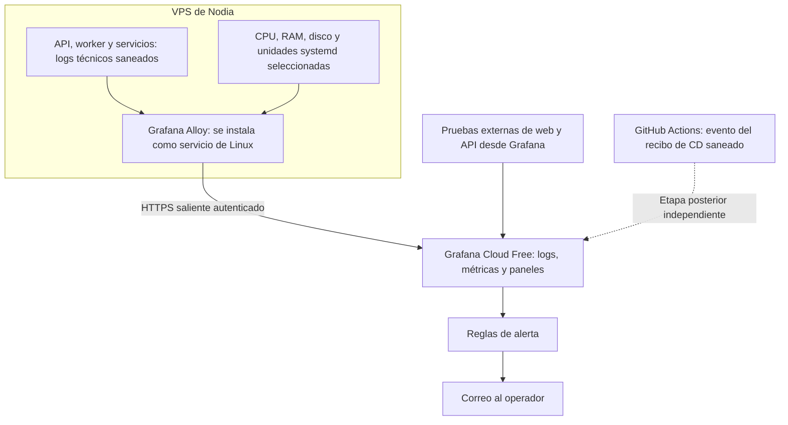

# Logs y monitoreo de Nodia — Grafana Cloud Free

> Seguimiento de implementación: `OBS-001` (G1–G6) y `OBS-002` (G7)
> en [TODO central](TODO.md). Este plan conserva especificación y checklist;
> el índice no acredita instalación o ingesta.

> Estado: en revisión. La [evidencia de G6](#15-g6-consumo-observado-y-reversión-ensayada--2026-11-19) registra el uso operativo y el ensayo de reversión. La [evidencia de G7](#16-g7-eventos-del-recibo-de-entrega--2026-11-19) registra el ensayo aislado y la emisión automática comprobada en Loki.
> Elección confirmada por el usuario: Grafana Cloud, plan gratuito, el 2026-11-14.
> Rama: `codex/plan-grafana-cloud-monitoring`, desde origin/development actualizado a `0639f0d9444bf81b15603fd1dce33bbb69598760`.
> Dependencias: [producción99](99-production-deployment-and-cicd-plan.md), [DevOps10](10-stack-devops.md), [operación](../../ops/production/README.md) y [ADR101 propuesto](../architecture/decisions/ADR-101-grafana-cloud-observability.md).

## 1. Decisión y entrega actual

Usar **Grafana Cloud Free** para centralizar logs técnicos, observar el VPS y
avisar cuando fallen servicios o comprobaciones externas. En el VPS se propone
instalar **Grafana Alloy**, el recolector; almacenamiento, paneles y alertas
permanecen en Grafana Cloud. No hace falta alojar Grafana, Loki o Prometheus en
el VPS de Nodia para esta arquitectura administrada.

El usuario pidió entender el funcionamiento antes de implementar. Este corte
crea la rama, conserva la comparación, inventaría las fuentes existentes y
prepara la configuración por etapas. No crea cuentas/stacks/tokens, instala
paquetes, cambia aplicaciones o configura servicios/alertas en producción. La
elección del proveedor no aprueba íntegramente este documento ni el ADR.

## 2. Comparación consultada y elección

Consulta de fuentes oficiales: 2026-11-14. Los límites son del proveedor, no
consumo medido de Nodia. La facilidad es una evaluación para nuestro despliegue.

| Opción | Gratis principal | Uso en Nodia | Puesta en marcha estimada |
| --- | --- | --- | --- |
| [Better Stack](https://betterstack.com/pricing) | 3 GB de logs, retención3d,10monitores; anuncia el plan para proyectos personales | Logs y disponibilidad integrados | Fácil; recolector y monitores |
| **[Grafana Cloud — elegida](https://grafana.com/pricing/)** | 50 GB de logs ingeridos/mes y14d; métricas con límite de10.000series activas | Logs, estado/recursos del VPS, paneles y alertas | Media; Alloy y configuración acotada |
| [Sentry](https://sentry.io/pricing/) | 5.000errores y5GB de logs por ciclo mensual;1usuario | Diagnóstico de errores React/NestJS mediante sus SDK | Fácil; integración en ambas aplicaciones |
| [Axiom Personal](https://axiom.co/pricing) | 25 GB de almacenamiento, retención30d y límites de cómputo/consultas | Búsqueda de logs mediante recolector, por ejemplo Vector | Media |
| [Uptime Kuma](https://github.com/louislam/uptime-kuma) | Software MIT gratuito; alojamiento y mantenimiento propios | Comprobar disponibilidad; no sustituye un almacén de logs | Fácil con Docker, operación propia |

Se elige Grafana Cloud por reunir observabilidad del host y logs con margen
gratuito útil. Sentry y los otros proveedores quedan como alternativas
comparadas, sin instalación o contratación paralela. Compatibilidad por
integraciones documentadas no significa aceptación operativa ya comprobada.

## 3. Qué existe realmente en el repositorio

Inventario de fuentes del corte inicial del 2026-11-14. Para la operación y
emisión comprobadas, consultar el checklist y la evidencia de §10–16.

| Fuente actual | Evidencia | Alcance y pendiente |
| --- | --- | --- |
| API y worker escriben en journald | [API](../../ops/production/nodia-api.service), [worker](../../ops/production/nodia-ai-worker.service) | Hay origen de logs; seleccionar y sanear antes de exportar |
| Backups, rotación y reconciliación escriben en journald | [backup](../../ops/production/nodia-ai-backup.service), [rotación](../../ops/production/nodia-ai-backup-rotate.service), [reconciliación](../../ops/production/nodia-ai-journal-reconcile.service) | Un timer activo no acredita una copia reciente correcta |
| Registro HTTP global | [LoggingInterceptor](../../nodia-server/src/common/interceptors/logging.interceptor.ts), [main](../../nodia-server/src/main.ts) | Método/path/status/duración en emisiones exitosas; tap(next) no cubre todos los errores. Path contiene identidades concretas; no usarlo como etiqueta de alta cardinalidad |
| Filtro de errores | [AllExceptionsFilter](../../nodia-server/src/common/filters/all-exceptions.filter.ts) | Teacher/NodiaAI tienen códigos acotados; la rama general registra mensaje/stack bruto. Correlation ID no es global |
| Worker sin servidor HTTP propio | [entrada](../../nodia-server/src/nodia-ai-worker.ts), [eventos de ejecución](../../nodia-server/src/nodia-ai-runtime/use-case/run-nodia-ai-worker.use-case.ts) | Supervisar unidad y eventos, no inventar un endpoint de salud del worker |
| API pública y proxy TLS | [AppController](../../nodia-server/src/app.controller.ts), [AppService](../../nodia-server/src/app.service.ts), [Nginx](../../ops/production/nodia-api.nginx.conf) | GET /api/v1 devuelve Hello World!: liveness básico, no readiness DB/Redis. /tls-check sólo verifica Nginx/TLS |
| Logs de Nginx | [configuración versionada](../../ops/production/nodia-api.nginx.conf) | No declara log_format/access_log/error_log; verificar configuración efectiva y permisos antes de elegir rutas o parser |
| Resultados de despliegue saneados | [workflow CD](../../.github/workflows/cd.yml), [delivery-receipt](../../ops/ci/delivery-receipt.mjs) | Recibo de CI/CD existente; no se envía a Grafana automáticamente |

En las fuentes revisadas no se encontró configuración propia de Alloy ni
instrumentación Prometheus/OpenTelemetry o ruta /metrics de la aplicación.
Antes de instalar hay que confirmar lo efectivo en el host y la cuenta. Los
logs privados del updater están en archivos específicos y algunas unidades
del receiver usan stdout/stderr null: no aparecen completos por recoger journal.

## 4. Flujo simplificado propuesto

Alloy recoge sólo las fuentes configuradas, filtra/procesa y envía. En Cloud,
Loki almacena los logs y el servicio administrado de métricas almacena las
series; Grafana permite consultarlos y evaluar alertas. Las sondas públicas
hacen peticiones a las URLs elegidas **desde fuera del VPS**, para observar
inaccesibilidad aunque el host o Alloy no puedan enviar información.

El camino GitHub es distinto: el runner de Actions y la API de Cloudflare no
están dentro del VPS. Para ver esos fallos en Grafana se debe integrar
explícitamente el recibo saneado; instalar Alloy no añade esa conexión.
El diagrama completo describe el objetivo, no conexiones ya habilitadas.

Fuentes: [instalación Alloy Linux](https://grafana.com/docs/alloy/latest/set-up/install/linux/),
[journal](https://grafana.com/docs/alloy/latest/reference/components/loki/loki.source.journal/),
[exporter unix integrado](https://grafana.com/docs/alloy/latest/reference/components/prometheus/prometheus.exporter.unix/),
[Synthetic Monitoring](https://grafana.com/docs/grafana-cloud/observe-and-act/testing/synthetic-monitoring/introduction/)
y [correo administrado](https://grafana.com/docs/grafana-cloud/observe-and-act/alert-and-measure-reliability/alerting/configure-notifications/manage-contact-points/integrations/configure-email/).

## 5. Mantener el plan gratuito

| Recurso Free | Límite publicado | Qué significa |
| --- | --- | --- |
| Logs | 50 GB ingeridos/mes; retención14d | Ingesta no es espacio total almacenado |
| Métricas | 10.000series activas; retención14d | No equivale a10.000mediciones; las etiquetas multiplican series |
| Synthetics API | 100.000ejecuciones/mes | Se cuenta cada prueba, ubicación y minuto de ejecución redondeado |
| Synthetics navegador | 10.000ejecuciones/mes | No se necesitan pruebas de navegador para la primera entrega |
| Precio | Free permanente $0, sin tarjeta | Confirmar Free efectivo; no basar el diseño en cuotas de una prueba temporal |

[Precios oficiales](https://grafana.com/pricing/). No se presupone un mecanismo
universal de bloqueo/descartes al superar cualquier cuota: revisar los
[límites efectivos del stack](https://grafana.com/docs/grafana-cloud/platform/pricing-and-usage/usage-limits/)
y sus paneles de consumo antes de enviar datos. No activar Pro, complementos
pagados o ampliaciones automáticas. La [medición de G6](#15-g6-consumo-observado-y-reversión-ensayada--2026-11-19)
documenta el corte observado de uso y recursos de Alloy.

Propuesta inicial:2checks HTTP (web y liveness de API),2ubicaciones públicas,
cada5minutos, con ejecución inferior a1minuto. Cálculo para31días:
`2 × 2 × 1 × (31 × 24 × 60 / 5) = 35.712ejecuciones`. Es una previsión de esa
configuración, no consumo real ni un mínimo de frecuencia impuesto por Free.
Más ubicaciones, pruebas o duración aumentan el consumo; también generan
logs/métricas. Confirmar disponibilidad de probes y calculadora del portal.
[Modelo de consumo oficial](https://grafana.com/docs/grafana-cloud/platform/pricing-and-usage/synthetic-monitoring/).

## 6. Casos de uso con incidentes de Nodia

| Caso | Señal y resultado esperado | Límite importante |
| --- | --- | --- |
| Pages #4: backend completo y frontend anterior | Evento explícito de entrega parcial con CI/CD, fase y código saneados; enlace al run/recibo. Ver [99§25](99-production-deployment-and-cicd-plan.md#25-pages-respuesta-válida-rechazada-y-preflight-antes-del-backend--2026-11-14) | La web/API pueden seguir respondiendo 200. El evento se comprueba en [G7](#16-g7-eventos-del-recibo-de-entrega--2026-11-19). |
| Fallo del updater durante SIGTERM | Correlacionar fase de entrega, estado de unidades y chequeo externo. Ver [99§22](99-production-deployment-and-cicd-plan.md#22-parada-limpia-por-sigterm-recuperación-de-disponibilidad-y-conciliación--2026-11-13) | Una parada planificada no equivale automáticamente a incidente. Ventanas acotadas y verificación de recuperación, sin ocultar fallos indefinidamente |
| Un endpoint devuelve500 | Evento HTTP saneado con método, ruta normalizada, status, duración y código; regla de error y búsqueda por correlación | El interceptor actual no cubre todos los fallos; completar la fuente antes de prometer tasas/latencias. Un check al root no prueba todos los endpoints |
| VPS inaccesible | Sonda externa falla; alerta desde Cloud y ausencia de telemetría interna | El agente no puede enviar desde un host caído. La sonda demuestra inaccesibilidad, no su causa interna |
| Alloy detenido con aplicación viva | Falta telemetría esperada del agente; alerta por ausencia de datos | Web/API pueden seguir respondiendo200. Un check HTTP correcto no demuestra que los logs estén llegando |
| Worker parado con API viva | Estado de unidad configurada y eventos de worker; alerta separada | Un200 de la API no prueba la ejecución del worker ni la capacidad de inferencia |
| Backup falla o no hay copia reciente | Recibo/resultado técnico del backup y antigüedad comprobable | Timer activo y ausencia de un log de error no demuestran backup/restore correcto |

Las alertas ayudan a detectar y diagnosticar. No cambian permisos, ejecutan
inferencias, reintentan deployments o restauran bases. Los recibos y gates
actuales conservan su autoridad. Un401/403 esperado de autenticación no debe
clasificarse como caída general. Definir umbrales tras observar tráfico real.

## 7. Qué se enviaría y qué se excluye

Enviar únicamente datos técnicos permitidos: servicio/entorno/unidad, nivel,
evento/código acotados, timestamp y, cuando existan, status/duración/ruta
normalizada. IDs de correlación, CI/CD y SHA como campos del evento, no como
etiquetas ilimitadas. Mantener etiquetas estables y evitar IDs de usuario,
sesión, conversaciones, archivos o productos como etiquetas.
[Buenas prácticas de Loki](https://grafana.com/docs/loki/latest/get-started/labels/bp-labels/).

Antes de exportar el journal de API/worker, sanear mensajes y stacks brutos del
filtro general y logs de Redis que incluyen claves/patrones concretos. Evaluar
formato estructurado con allowlist en origen y descarte de entradas no
reconocidas en el recolector. No basta con quitar un campo Authorization si
el secreto puede estar dentro de un mensaje libre.

Excluir cookies, JWT/API keys, cabeceras, bodies de petición/respuesta, SQL,
chat/material/documentos/adjuntos, datos de negocio y perfiles/sesiones IA.
No leer EnvironmentFile, credenciales o directorios privados como fuentes de
logs. Para Nginx, evitar query strings e IP/identidades innecesarias antes de
salir del host. El detalle privado del updater se conserva en su custodia actual;
Grafana recibe sólo eventos seleccionados del recibo saneado.

Alloy tendrá identidad propia y permisos mínimos de lectura. La documentación
advierte que el journal puede no producir entradas aunque el componente esté
healthy; comprobar recepción real y ajustar permisos concretos, sin agregar
privilegios indiscriminados. El collector systemd y los contadores de reinicios
del exporter no se habilitan automáticamente: declarar y filtrar unidades.

Usar tokens de ingesta limitados al stack y scopes necesarios (logs:write y
metrics:write), con custodia/rotación en servidor; nunca frontend, Git o chat.
Región y destino del stack se eligen antes del primer envío. Sólo HTTPS saliente
a destinos de la instancia; diagnósticos/metrics locales sin puertos públicos
nuevos ni exposición de PostgreSQL/Redis.
[Access Policies](https://grafana.com/docs/grafana-cloud/platform/security-and-account-management/security-and-access/authentication-and-permissions/access-policies/).

## 8. Secuencia de configuración posterior

| Paso | Trabajo acotado | Comprobación de salida |
| --- | --- | --- |
| G0 | Investigación, comparación, elección y explicación | Este documento y ADR propuesto; sin instalación |
| G1 | Confirmar cuenta/stack/región/Free y correo receptor; revisar host efectivo | Destinos y cuotas reales identificados; no compartir tokens en chat |
| G2 | Preparar configuración versionada y runbook de Alloy con ubicación operativa independiente de releases de la app | Conservar revisión/CI de los archivos ops; versión fijada, credenciales externas, permisos y retiro/reversión local; sin modificar el mecanismo de CD |
| G3 | Instalar Alloy como servicio; métricas del host y unidades seleccionadas; dos checks externos | Series y resultados reales en Cloud, sin exponer /metrics, sin detener API/worker |
| G4 | Sanear/completar logs HTTP/servicios y conectar sólo fuentes aprobadas | Evento de diagnóstico identificable recibido, ausencia de secretos, éxitos/errores/duración observables por alcance |
| G5 | Paneles, reglas y correo; pruebas controladas en laboratorio | Aviso y recuperación recibidos; distinguir sin datos de cero errores; mantenimiento y falsas alarmas revisados |
| G6 | Medir consumo y costo de recursos del recolector | Uso logs/series/ejecuciones dentro de Free, cardinalidad y permisos comprobados; sin estimaciones presentadas como medición |
| G7 | Integración separada de eventos de CD a partir del recibo saneado | Fallo/entrega parcial detectados sin subir stdout completo de Actions, sin bloquear publicación por una caída de telemetría ni conceder replay |

Primera entrega operativa propuesta: G1–G6. G7 es posterior y explícito; no
prometer visibilidad de los fallos Pages/Actions antes de implementarlo. La
seguridad y completitud de los logs son parte de la aceptación, no un paso
opcional. No habilitar SDK/trazas, RUM, eBPF o métricas de aplicación nuevas por
el solo hecho de crear una cuenta Grafana; requieren alcance y prueba propios.

## 9. Checklist y estado real

- [x] Elección Grafana Cloud Free confirmada; alternativas y fuentes conservadas.
- [x] Rama desde development actualizado y documentación previa a implementación.
- [x] Inventario del repositorio y flujos VPS/external checks/CI separados.
- [x] Cuenta, stack y Cloud Free como plan actual comprobados.
- [x] Región, endpoints de ingesta y correo receptor comprobados.
- [x] Fuente HTTP dedicada, esquema permitido y permisos mínimos comprobados por alcance.
- [x] Alloy instalado, activo y habilitado. Primeras métricas comprobadas en Grafana Explore.
- [x] Dos checks externos configurados y aprobados en prueba manual desde ambas ubicaciones.
- [x] Ejecuciones programadas comprobadas desde ambas ubicaciones.
- [x] Logs HTTP del VPS saneados y comprobados en Loki Cloud.
- [x] Paneles y reglas configurados. Correo de fallo y recuperación verificados en el buzón.
- [x] Uso operativo de Grafana Cloud y recursos de Alloy medidos por ventana.
- [x] Retiro y reversión de Alloy comprobados en un entorno aislado.
- [ ] Conciliar series facturables, ingesta de logs y ejecuciones del mes cuando el portal publique datos de uso.
- [x] Fallo y entrega parcial del recibo de CD detectados en Loki aislado, con el despliegue fuera del ensayo.
- [x] Credencial dedicada en GitHub y recepción de fallo y entrega parcial sintéticos en Grafana Free.
- [x] Workflow de G7 integrado y registrado como activo en `development`.
- [x] Emisión automática de un CD normal con recibo comprobada en el reportero de GitHub y en Grafana Explore.

El primer pendiente de `OBS-001` es la conciliación mensual de G6.

Evaluación de impacto NodiaAI: observabilidad de infraestructura/operaciones,
sin nueva función de negocio, endpoint, permiso o herramienta del chat. No
publicar logs o este inventario como contexto operativo del modelo; no se
modifican fichas aprobadas ni el registro de capacidades. Si después se propone
consultar monitoreo desde NodiaAI, requiere su propio contrato y ficha conforme
al [estándar de conocimiento](../nodia-ai/knowledge/README.md).

## 10. Inicio de G1 y configuración candidata de Alloy — 2026-11-19

- Se creó `codex/grafana-observability` desde `origin/development` en `3c882ad4`.
- El portal autenticado muestra **Cloud Free** como plan actual y un aviso de
  15 días restantes de uso ilimitado. Es el plazo de la prueba que muestra
  este stack. La documentación general indica que al terminar la prueba se
  aplican automáticamente los límites Free y el uso de la prueba queda sin cargo.
  [Facturación de Grafana](https://grafana.com/docs/grafana-cloud/platform/cost-management-and-billing/manage-invoices/understand-your-invoice/).
- Inspección SSH de solo lectura: Ubuntu 26.04.1 LTS x86-64 con systemd, raíz
  ext4, API, worker y Nginx activos. Alloy no figura instalado. El bus de
  systemd respondió a la cuenta de inspección. Web y liveness API devolvieron
  HTTP 200 desde el equipo local.
- [Configuración y runbook](../../ops/production/observability/README.md)
  de métricas acotadas de host y unidades. `alloy validate` pasó con v1.22.0
  en Linux, con valores sintéticos y red deshabilitada. La misma validación
  queda configurada en CI para cambios de observabilidad. La prueba del
  servicio con la cuenta `alloy`, la ingesta y la reversión siguen pendientes.
- Pendiente: región, endpoint, límites efectivos y correo del stack. La
  activación requiere la credencial `metrics:write` mediante custodia. Aún
  no hay servicio Alloy, métricas recibidas, sondas, alertas ni exportación de logs.

## 11. Instalación inicial en el VPS — 2026-11-19

- El portal confirma **Cloud Free**, región `prod-sa-east-1` y el endpoint de
  Remote Write del servicio Prometheus. El correo receptor se verificará en
  la etapa de alertas.
- Alloy `1.22.0-1` amd64 quedó instalado con el SHA-256 del paquete oficial
  verificado. La configuración pasó `alloy validate` con el binario del VPS.
  El paquete agrega el usuario de fábrica a dos grupos de lectura de logs.
  Se quitaron ambas membresías y el drop-in usa la cuenta de sistema dedicada
  `nodia-alloy`, que pudo consultar el estado de la API por D-Bus. Se eligió
  la cuenta de sistema después de que la identidad dinámica fallara la
  comprobación de D-Bus en el laboratorio Ubuntu.
- API, worker y Nginx conservaron sus PID y estado activo durante la
  instalación. Alloy se mantuvo enmascarado hasta cargar por consola
  privada la credencial `metrics:write` del stack.

### Primera ingesta comprobada

- Política `nodia-alloy-vps-metrics` de alcance exclusivo al stack Free, con
  `metrics:write`. El operador cargó por Warp el token `nodia-alloy-vps-01`,
  emitido con vigencia de 90 días. Systemd lo recibe mediante `LoadCredential`,
  desde un archivo `root:root` con modo `0600`.
- Explore comprobó **56 series** bajo `job="nodia-host"`, `instance="nodia-vps"`,
  `environment="production"`. Ocho familias: CPU, memoria disponible/total,
  espacio disponible/total en `/`, estado de recolectores, estado de unidades y
  `up`. Los cuatro recolectores valen `1`; API, worker y Nginx tienen estado
  `active=1` en Grafana.
- El exportador introducía `job="integrations/unix"` en el primer envío. Se
  fijó `job` mediante `discovery.relabel` y se recargó la configuración sin
  reiniciar Alloy. El navegador estaba atrasado unos ocho minutos respecto al
  VPS sincronizado y a Grafana. Se corrigió el intervalo de Explore para
  abarcar las últimas muestras recibidas.
- Corte 18:10 CLST: Alloy activo y habilitado al arranque, listener en
  `127.0.0.1:12345`, 280 muestras enviadas y cero fallidas, reintentadas o
  pendientes en el contador local. API, worker y Nginx conservaron sus PID;
  web y API devolvieron HTTP 200. El conteo de series de Nodia en Explore
  describe este corte, mientras que el consumo mensual queda para G6.
- G3 continúa con las dos sondas externas administradas. G4 requiere
  saneamiento antes de exportar logs. Alertas, correo, medición de uso y
  ensayo de reversión quedan pendientes.

## 12. Sondas externas de web y API — 2026-11-19

Se activó Synthetic Monitoring en el mismo stack Cloud Free. Se guardaron
dos checks HTTP habilitados con `GET`, HTTP `200` exacto, TLS requerido,
timeout de 10 segundos, frecuencia de 300 segundos y sondas públicas
de São Paulo y Norte de Virginia. La prueba manual de Grafana pasó desde
ambas ubicaciones para cada check.

| Check | Destino | Validación adicional |
| --- | --- | --- |
| [nodia-web](https://giganticflounder594.grafana.net/a/grafana-synthetic-monitoring-app/checks/8032) | `https://nodia-1ge.pages.dev/` | Título HTML de Nodia. Mide la disponibilidad del documento público. |
| [nodia-api](https://giganticflounder594.grafana.net/a/grafana-synthetic-monitoring-app/checks/8033) | `https://166.0.112.187/api/v1` | Cuerpo exacto `Hello World!`. Mide el liveness público de la API. |

La calculadora de Grafana estima 17.856 ejecuciones por check y 35.712 en
total para un mes de 31 días, dentro de las 100.000 ejecuciones mensuales
de API del plan Free. Se conservó la configuración de notificación sin
destino de correo. La regla de fallos que Grafana añade por defecto está
asociada a los checks. Las notificaciones se verificarán en G5.
[Cálculo de Synthetic Monitoring](https://grafana.com/docs/grafana-cloud/platform/pricing-and-usage/synthetic-monitoring/).

**Cierre de G3.** Grafana Explore confirmó las cuatro combinaciones de check
y ubicación en las versiones guardadas. Cada una registró `probe_success=1`
y `probe_http_status_code=200`. El intervalo de Explore se ajustó al desfase
del reloj del navegador descrito en §11. El siguiente paso es G4, con revisión
y saneamiento de las fuentes de logs del VPS antes de exportarlas.

## 13. G4, logs HTTP saneados — 2026-11-19

Se verificaron el destino Loki de la región `prod-sa-east-1`, el `access_log`
heredado en Nginx y las unidades que registran en journald. El formato combinado
de Nginx y los mensajes libres de API, worker y servicios se excluyen del flujo:
pueden incluir rutas, IP, query strings, excepciones, stacks y claves de caché.
Las métricas de systemd siguen siendo la señal de estado de servicios.

El [runbook](../../ops/production/observability/README.md#logs-http-saneados-en-loki)
define un archivo dedicado de Nginx con método permitido, familia de ruta fija,
estado HTTP y duración. El include conserva el sitio y el hash exigidos por CD.
Alloy abre sólo ese archivo y descarta cualquier línea distinta del esquema
permitido, incluidas entradas con campos extra. Loki recibe sólo el evento
permitido y etiquetas fijas de trabajo, instancia y entorno. El token de Loki
se gestiona aparte del de métricas.

Prueba en contenedores aislados, Nginx 1.28.3 → Alloy 1.22.0 → Loki 3.7.10:
recibidos tres eventos exactos para respuestas 200, 401 y 503. Un 404 fuera de
la API no generó evento. Los canarios de path, query, Authorization, Cookie,
User-Agent, Referer, IP y cuerpo quedaron fuera. Alloy descartó seis líneas
malformadas o con campos inadmisibles inyectadas en el archivo de prueba.

En el VPS se inventariaron sólo volúmenes y clases de entradas del journal y
Nginx. El archivo dedicado quedó instalado con `0640`, legible por `nodia-alloy`.
Se verificaron acceso denegado a ambos archivos crudos de Nginx, validación de
la configuración y simulación de rotación. El hash del sitio protegido por CD
coincidió antes y después de la recarga. Después de la transición de workers,
se comprobaron en origen tres eventos 200, 404 y 401 con estructura íntegra y
cero coincidencias de los canarios sintéticos. Alloy seguía recopilando métricas.

La política de Loki y su token `logs:write` de 90 días quedaron limitados al
stack autorizado. El operador cargó el token por Warp y Alloy lo recibe con
`LoadCredential` desde un archivo `root:root` con modo `0600`.

**Cierre G4, alcance HTTP.** El primer arranque de Alloy descartaba `logs.env`
por el orden de los drop-ins de systemd y el primer lote quedó sin enviar.
El drop-in de Loki ahora carga después del de métricas y verifica que haya
destino y usuario antes de arrancar. Tras reiniciar Alloy, tres pedidos
nuevos de sólo lectura a las 18:47 CLST produjeron 200 (`HEAD liveness`),
401 (`GET auth`) y 404 (`GET api_other`). Alloy registró un push HTTP 204
y tres eventos enviados, con cero reintentos desde el arranque corregido.
Grafana Explore confirmó los tres recuentos por método, familia y estado.
Las dos consultas negativas sobre el flujo dedicado devolvieron cero líneas
fuera del esquema y cero coincidencias de los canarios de la prueba.

Alloy siguió habilitado y reanudó el envío de métricas. API, worker y Nginx
conservaron sus PID principales, y las comprobaciones externas puntuales de
web y API devolvieron HTTP 200. Queda para G5 comprobar reglas, correo y
recuperación. El inventario de fuentes crudas no habilita su exportación.

## 14. G5, paneles y correo comprobados — 2026-11-19

Se importó [Nodia · Observabilidad](https://giganticflounder594.grafana.net/d/nodia-observabilidad/nodia-c2b7-observabilidad)
en `Nodia Operaciones`. Su [JSON versionado](../../ops/production/observability/nodia-dashboard.json)
usa los orígenes administrados Prometheus y Loki. Los siete paneles muestran
sondas por ubicación, estado de Alloy y unidades, CPU, memoria y disco, y
volumen, errores y duración media HTTP. Se observó el tablero con series de
producción. La ventana con tráfico y cero errores HTTP 5xx se distingue de la
ventana sin registros.

Cuatro reglas gestionadas por Grafana quedaron activas y se verificaron en
estado `Normal` en [Nodia - 1 minuto](https://giganticflounder594.grafana.net/alerting/grafana/namespaces/fkrg2b/groups/Nodia%20-%201%20minuto/view).
Todas dirigen sus avisos al contacto `Nodia - correo operativo`, que usa el
correo administrador confirmado por el usuario y envía también recuperación.

| Regla | Umbral inicial y tratamiento de datos |
| --- | --- |
| Fallos de sondeo externo | Al menos dos resultados y todos fallidos en 11 minutos por check y ubicación. |
| Telemetría del VPS interrumpida | Cinco minutos sin muestras o con todos los scrapes fallidos, más un minuto de persistencia. |
| Unidad del VPS inactiva | Ninguna muestra de estado activo en tres minutos para API, worker o Nginx. |
| Errores HTTP 5xx repetidos | Tres o más respuestas 5xx en diez minutos. Con tráfico y ningún 5xx el resultado es cero. Sin logs la regla conserva el último estado. |

La [regla temporal](https://giganticflounder594.grafana.net/alerting/grafana/eg4t6g9bw45c0d/view)
usó una señal con ventana de tiempo finita y el mismo contacto que las reglas
operativas. Se confirmó en el buzón administrador un correo `[FIRING:1]` a
las **18:55** y uno `[RESOLVED]` a las **18:57** (CLST). El segundo resultó
de la evaluación normal al terminar la ventana. Después de verificar ambos,
se pausó sólo la regla de prueba. No se provocaron fallos en los destinos.
La prueba acredita el ciclo de envío y recepción. Los umbrales operativos
son el punto de partida hasta observar tráfico y mantenimiento reales.

G5 queda cerrado para este alcance. G6 continúa con consumo real, recursos
del recolector y ensayo del retiro documentado.

## 15. G6, consumo observado y reversión ensayada — 2026-11-19

### Uso medido en Grafana Cloud

Corte de Grafana Explore a las 22:06:24 UTC (19:06:24 CLST). Los límites
publicados de Free se comprobaron en el [pricing](https://grafana.com/pricing/)
y en la documentación de [métricas](https://grafana.com/docs/grafana-cloud/platform/pricing-and-usage/metrics/)
y [sondas](https://grafana.com/docs/grafana-cloud/platform/pricing-and-usage/synthetic-monitoring/).

| Recurso | Dato observado | Límite Free |
| --- | --- | --- |
| Métricas | 294 series con muestras en los últimos 20 min en el stack, 56 de Alloy. El corte equivale al 2,94 % del límite publicado. | 10.000 series activas, con la frecuencia de muestras contemplada en el cálculo de uso. |
| Loki | 103.991 bytes de líneas consultables en 85 streams con `service_name` en las últimas 3 h. La fuente `nodia-http` en la misma ventana aportó 12 líneas y 1.078 bytes. | 50 GB de ingesta al mes. |
| Sondas API | 40 ejecuciones registradas de la configuración actual, 10 por cada pareja de check y ubicación. La frecuencia sigue en 300 s. | 100.000 ejecuciones mensuales. La previsión de §12 es 35.712 en 31 días (35,7 %). |

- Prometheus: `count(last_over_time({__name__=~".+"}[20m]))` para el stack y el mismo cálculo filtrado por `job="nodia-host",instance="nodia-vps",environment="production"` para Alloy. La cifra observada usa una ventana de consulta de 20 minutos. El cómputo de consumo mensual del proveedor usa su propia agregación y frecuencia de muestras.
- Loki: `sum(bytes_over_time({service_name=~".+"}[3h]))` y `count(count_over_time({service_name=~".+"}[3h]))` para el conjunto consultado. Para Nodia se usó `job="nodia-http",instance="nodia-vps",environment="production"` y se contaron líneas con `sum(count_over_time(…[3h]))`. Se midió el tamaño de las líneas consultables. Queda pendiente el volumen de ingesta contabilizado por Grafana.
- Sondas: `probe_all_success_count{job=~"nodia-(web|api)"}` en las últimas 3 h. Por `(job, probe, config_version)` se observó un mínimo de 1, un máximo de 10 y cero reinicios de contador. Se tomó el máximo por grupo para evitar duplicar series enriquecidas con etiquetas adicionales. Las muestras de `probe_success` quedan fuera de ese cálculo.

[Cost Management and Billing](https://giganticflounder594.grafana.net/a/grafana-cmab-app/)
mostró «No data for Month-to-date» para los tres productos. El
[portal de uso](https://grafana.com/orgs/giganticflounder594/my-account/usage)
mostró valores de uso en cero para noviembre con Cloud Free y el aviso de
prueba vigente. La fuente `grafanacloud-usage` tampoco devolvió las series de
uso consultadas. Los datos de Explore y la previsión vigente muestran holgura
en el alcance medido. El total mensual de la cuenta queda por conciliar cuando
el proveedor publique sus datos. [Facturación y prueba de Grafana](https://grafana.com/docs/grafana-cloud/platform/cost-management-and-billing/manage-invoices/understand-your-invoice/).

### Recursos medidos en el VPS

21 lecturas en intervalos de 15 s, de 22:04:58 a 22:09:58 UTC. La unidad
`alloy.service` estaba activa y habilitada, con el mismo PID durante la ventana
y cero reinicios. Corre como `nodia-alloy` y escucha localmente en
`127.0.0.1:12345`.

| Recurso | Resultado |
| --- | --- |
| CPU del cgroup | 0,91 % de una vCPU en promedio y 1,13 % en el intervalo de 15 s más alto. El promedio equivale al 0,23 % de las cuatro vCPU del VPS. |
| Memoria | 49,63–52,19 MiB de memoria del cgroup, mediana de 51,18 MiB. El RSS del proceso marcó 221,79–223,79 MiB. Son contadores con alcances distintos. |
| Disco | WAL de Prometheus de 120,2 KiB a las 22:10:15 UTC. El archivo HTTP saneado de Nginx medía 2.357 bytes. |
| Envío | 280 muestras de Prometheus (56/min) y dos registros de Loki. El contador de bytes enviados de Loki aumentó 204 B. Los contadores de fallos de envío no aumentaron. |

La lectura se hizo sin `sudo`. El directorio de estado completo quedó fuera
del alcance de lectura. `IOAccounting` e `IPAccounting` estaban deshabilitados,
por lo que no hay medición de E/S total ni del tráfico de red de la unidad.
API, worker y Nginx seguían activos. Web y API devolvieron HTTP 200 en la
verificación externa de cierre.

### Retiro y restauración controlados

Ensayo en un contenedor desechable Ubuntu 26.04 con systemd, cgroups privados,
el paquete oficial Alloy `1.22.0-1`, los drop-ins del despliegue y receptores
locales. El contenedor estuvo sin red externa y sin puertos publicados. Se
usaron credenciales ficticias y servicios API, worker y Nginx simulados.

1. La configuración conjunta envió 150 muestras nuevas y un registro HTTP 200.
2. Al retirar sólo Loki, Prometheus recibió otras 150 muestras nuevas. Loki dejó de recibir registros durante el retiro, incluida una línea HTTP 404 escrita entonces.
3. `systemctl disable --now alloy.service` dejó Alloy inactivo y deshabilitado, cerró el listener y detuvo ambos envíos. El estado local se conservó.
4. Al volver al diseño legado de sólo métricas, el receptor volvió a recibir 150 muestras nuevas y Loki siguió retirado.
5. La restauración dejó Alloy activo y habilitado. Prometheus recibió 150 muestras nuevas, y Loki recibió el nuevo HTTP 401 y recuperó una sola vez el 404 desde la posición guardada.

Los PID de los tres servicios simulados se mantuvieron en todas las fases. Se
eliminó el contenedor al terminar. El ensayo se ejecutó íntegramente fuera del
VPS y del stack de producción. El [runbook de Alloy](../../ops/production/observability/README.md#detener-o-revertir)
recoge la secuencia reversible y el comportamiento de los registros pendientes.

## 16. G7, eventos del recibo de entrega — 2026-11-19

El paso de entrega del [workflow de CD](../../.github/workflows/cd.yml) activa
el [reportero](../../.github/workflows/cd-observability.yml) con el ID del CD
cuando finaliza el trabajo de producción. El reportero se ejecuta en
`development`, con su propio plazo y fuera del grupo de concurrencia de
producción. Verifica que el origen sea el primer intento de `cd.yml` en
`master` del repositorio, espera la conclusión `success` o `failure` y
descarta solicitudes posteriores para el mismo ID. Descarga únicamente
`delivery-receipt-<run_id>-1` y valida la identidad dentro del recibo. Si
falla la producción antes de emitir el recibo, el diagnóstico queda en GitHub
Actions.

El [emisor](../../ops/ci/cd-observability.mjs) envía una línea JSON con el
estado de cada componente, fase, código saneado, CI/CD, SHA y enlace al run
con el nombre del recibo. `partial` significa que el backend quedó `complete`
y la entrega del cliente carece de confirmación completa. Se conserva el
último estado del cliente, incluido `unknown`, `submitted` o
`published_assets_verification_failed` cuando consta en el recibo. Los IDs y
SHA quedan en el cuerpo. Las etiquetas estables son `job`, `service_name` y
`environment`. El emisor lee el recibo saneado, nunca los logs del runner,
sus estados privados ni sus credenciales de despliegue.

La ingesta intenta un solo POST con 8 s de plazo y devuelve un estado fijo.
El resultado de la entrega conserva el estado del trabajo de producción.
GitHub Actions registra los rechazos de la activación del reportero y el estado de
ingesta. La credencial del emisor se limita a `logs:write`. La recuperación
del informe consulta el recibo existente y queda fuera de toda operación de
despliegue.

| Ensayo aislado con Loki 3.7.10 | Resultado |
| --- | --- |
| Upload rechazado antes de confirmar backend | HTTP 204. LogQL detectó `failed` con backend `upload_rejected` y cliente `not_confirmed`. |
| Backend completo, Pages rechaza consulta de activos | HTTP 204. LogQL detectó `partial`, con backend `complete` y cliente `asset_check_requested`. |
| Backend completo, resultado de Pages desconocido | HTTP 204. LogQL detectó `partial` y preservó `client_status=unknown`. |
| Ambos componentes completos | HTTP 204. `succeeded` quedó fuera del filtro de incidentes. |
| Respuesta 503 simulada | Un intento, estado `rejected`. El emisor no invoca despliegues. |

Las pruebas generaron los recibos con el saneador existente. El contenedor
corrió sin red exterior, con credenciales ficticias, y fue eliminado al cierre.
El selector de producción devolvió cero eventos. El canario, el token ficticio,
los identificadores internos de operación/despliegue y los digests de
artefactos quedaron fuera del cuerpo. Pasaron 184 pruebas de `ops/ci` en Linux
con Node 24.22.2 y `actionlint` 1.7.12 para el workflow nuevo.

### Ingesta comprobada en Grafana Free

La política `nodia-ci-cd-logs` se limitó al stack Free en `prod-sa-east-1` con
el único alcance `logs:write`. El token `nodia-ci-cd-actions` vence el
2027-02-17. GitHub confirmó el secreto `NODIA_CD_LOKI_TOKEN` en el entorno
`cd-observability`, autorizado sólo para la rama `development`, junto con las
dos variables de conexión. La credencial de Alloy en el VPS es independiente.

El emisor POST obtuvo HTTP 204 para los dos recibos sintéticos. Explore leyó
exactamente estas dos líneas bajo `{job="nodia-cd",environment="test"}`:

| ID sintético | Resultado | Backend | Cliente |
| --- | --- | --- | --- |
| `880219689425031` | `failed` | `upload_rejected` | `not_confirmed` |
| `880219689425032` | `partial` | `complete` | `asset_check_requested` |

Grafana mostró ambas marcas a las 19:29:26–27 CLST. Al corte de las 19:39
CLST hubo cero coincidencias del canario de contenido privado en `test` y
cero coincidencias de los dos IDs en `production`. Los ensayos no iniciaron
CD ni cambiaron el VPS o Pages.

Se verificó además el ZIP histórico del [CD ordinario 44595287853](https://github.com/oscarvalenzuela25/Nodia/actions/runs/44595287853)
contra el hash del artefacto de GitHub. El emisor pudo interpretar el único
archivo `delivery-receipt.json` y clasificarlo como `succeeded`, con ambos
componentes `complete`. La comprobación local terminó en la clasificación.

### Activación del workflow

El [PR #76](https://github.com/oscarvalenzuela25/Nodia/pull/76) integró el
workflow y el emisor a `development` en `13aa27cb`. Pasó la
[CI de integración](https://github.com/oscarvalenzuela25/Nodia/actions/runs/44633142601).
GitHub Actions registró [el workflow](https://github.com/oscarvalenzuela25/Nodia/actions/workflows/cd-observability.yml)
como activo. El PR se limitó a los cuatro archivos de G7. Al cierre, `master`
seguía en `a4a6ee2d`, el último CD seguía siendo el run `44595287853` y la
web y la API respondieron HTTP 200.

### Emisión y recuperación comprobadas — 2026-11-20

El [CD 44666924048](https://github.com/oscarvalenzuela25/Nodia/actions/runs/44666924048)
terminó con éxito y dejó el recibo disponible. El reportero inicial con
`workflow_run` no se inició. Los [PR #79](https://github.com/oscarvalenzuela25/Nodia/pull/79)
y [#80](https://github.com/oscarvalenzuela25/Nodia/pull/80) integraron la
activación explícita en `development` y `master`. El
[reportero 44669802097](https://github.com/oscarvalenzuela25/Nodia/actions/runs/44669802097)
recuperó el recibo original en una sola ejecución de informe. Loki aceptó
el POST y Explore confirmó el evento, con `succeeded` y backend y cliente
en `complete`.

El [CD 44673206896](https://github.com/oscarvalenzuela25/Nodia/actions/runs/44673206896)
activó automáticamente el
[reportero 44673802429](https://github.com/oscarvalenzuela25/Nodia/actions/runs/44673802429).
El emisor registró `Nodia CD telemetry: sent` tras HTTP 204. En
[Grafana Explore](https://giganticflounder594.grafana.net/explore) se observó
una línea por cada ID de entrega, ambas con `succeeded` y los dos componentes
en `complete`.

OBS-002 queda cerrado por ese alcance. Los fallos y entregas parciales se
validaron con recibos sintéticos. La conciliación mensual de OBS-001 sigue
pendiente según §15. El
[runbook](../../ops/production/observability/README.md#eventos-de-entrega-en-github-actions)
registra la consulta y el diagnóstico.
