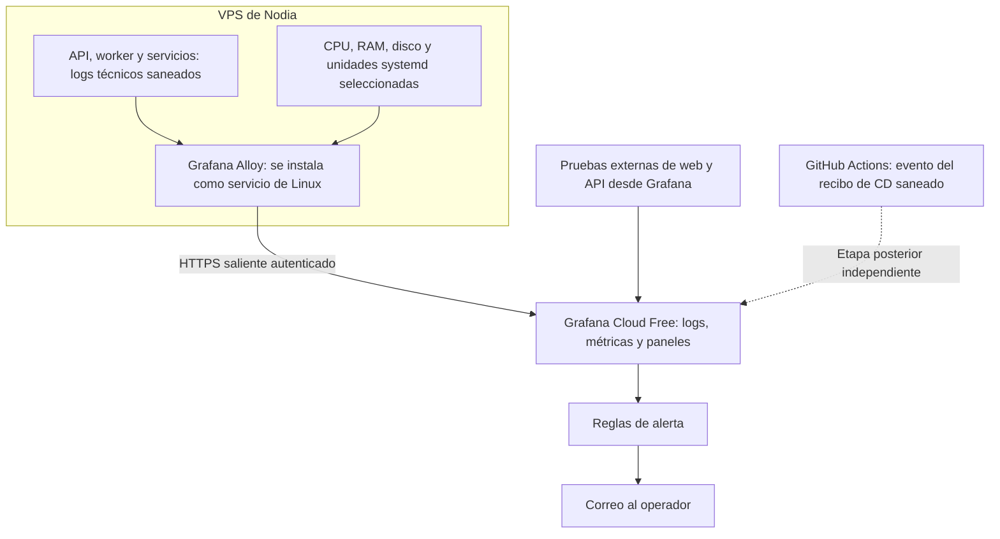

# Logs y monitoreo de Nodia — Grafana Cloud Free

> Estado: en revisión; investigación y planificación, sin implementación.
> Elección confirmada por el usuario: Grafana Cloud, plan gratuito, el 2026-11-14.
> Rama: `codex/plan-grafana-cloud-monitoring`, desde origin/development actualizado a `0639f0d9444bf81b15603fd1dce33bbb69598760`.
> Dependencias: [producción99](99-production-deployment-and-cicd-plan.md), [DevOps10](10-stack-devops.md), [operación](../../ops/production/README.md) y [ADR101 propuesto](../architecture/decisions/ADR-101-grafana-cloud-observability.md).

## 1. Decisión y entrega actual

Usar **Grafana Cloud Free** para centralizar logs técnicos, observar el VPS y
avisar cuando fallen servicios o comprobaciones externas. En el VPS se propone
instalar **Grafana Alloy**, el recolector; almacenamiento, paneles y alertas
permanecen en Grafana Cloud. No hace falta alojar Grafana, Loki o Prometheus en
el VPS de Nodia para esta arquitectura administrada.

El usuario pidió entender el funcionamiento antes de implementar. Este corte
crea la rama, conserva la comparación, inventaría las fuentes existentes y
prepara la configuración por etapas. No crea cuentas/stacks/tokens, instala
paquetes, cambia aplicaciones o configura servicios/alertas en producción. La
elección del proveedor no aprueba íntegramente este documento ni el ADR.

## 2. Comparación consultada y elección

Consulta de fuentes oficiales: 2026-11-14. Los límites son del proveedor, no
consumo medido de Nodia. La facilidad es una evaluación para nuestro despliegue.

| Opción | Gratis principal | Uso en Nodia | Puesta en marcha estimada |
| --- | --- | --- | --- |
| [Better Stack](https://betterstack.com/pricing) | 3 GB de logs, retención3d,10monitores; anuncia el plan para proyectos personales | Logs y disponibilidad integrados | Fácil; recolector y monitores |
| **[Grafana Cloud — elegida](https://grafana.com/pricing/)** | 50 GB de logs ingeridos/mes y14d; métricas con límite de10.000series activas | Logs, estado/recursos del VPS, paneles y alertas | Media; Alloy y configuración acotada |
| [Sentry](https://sentry.io/pricing/) | 5.000errores y5GB de logs por ciclo mensual;1usuario | Diagnóstico de errores React/NestJS mediante sus SDK | Fácil; integración en ambas aplicaciones |
| [Axiom Personal](https://axiom.co/pricing) | 25 GB de almacenamiento, retención30d y límites de cómputo/consultas | Búsqueda de logs mediante recolector, por ejemplo Vector | Media |
| [Uptime Kuma](https://github.com/louislam/uptime-kuma) | Software MIT gratuito; alojamiento y mantenimiento propios | Comprobar disponibilidad; no sustituye un almacén de logs | Fácil con Docker, operación propia |

Se elige Grafana Cloud por reunir observabilidad del host y logs con margen
gratuito útil. Sentry y los otros proveedores quedan como alternativas
comparadas, sin instalación o contratación paralela. Compatibilidad por
integraciones documentadas no significa aceptación operativa ya comprobada.

## 3. Qué existe realmente en el repositorio

Inventario de fuentes, no inspección viva del VPS ni de la cuenta Grafana.

| Fuente actual | Evidencia | Alcance y pendiente |
| --- | --- | --- |
| API y worker escriben en journald | [API](../../ops/production/nodia-api.service), [worker](../../ops/production/nodia-ai-worker.service) | Hay origen de logs; seleccionar y sanear antes de exportar |
| Backups, rotación y reconciliación escriben en journald | [backup](../../ops/production/nodia-ai-backup.service), [rotación](../../ops/production/nodia-ai-backup-rotate.service), [reconciliación](../../ops/production/nodia-ai-journal-reconcile.service) | Un timer activo no acredita una copia reciente correcta |
| Registro HTTP global | [LoggingInterceptor](../../nodia-server/src/common/interceptors/logging.interceptor.ts), [main](../../nodia-server/src/main.ts) | Método/path/status/duración en emisiones exitosas; tap(next) no cubre todos los errores. Path contiene identidades concretas; no usarlo como etiqueta de alta cardinalidad |
| Filtro de errores | [AllExceptionsFilter](../../nodia-server/src/common/filters/all-exceptions.filter.ts) | Teacher/NodiaAI tienen códigos acotados; la rama general registra mensaje/stack bruto. Correlation ID no es global |
| Worker sin servidor HTTP propio | [entrada](../../nodia-server/src/nodia-ai-worker.ts), [eventos de ejecución](../../nodia-server/src/nodia-ai-runtime/use-case/run-nodia-ai-worker.use-case.ts) | Supervisar unidad y eventos, no inventar un endpoint de salud del worker |
| API pública y proxy TLS | [AppController](../../nodia-server/src/app.controller.ts), [AppService](../../nodia-server/src/app.service.ts), [Nginx](../../ops/production/nodia-api.nginx.conf) | GET /api/v1 devuelve Hello World!: liveness básico, no readiness DB/Redis. /tls-check sólo verifica Nginx/TLS |
| Logs de Nginx | [configuración versionada](../../ops/production/nodia-api.nginx.conf) | No declara log_format/access_log/error_log; verificar configuración efectiva y permisos antes de elegir rutas o parser |
| Resultados de despliegue saneados | [workflow CD](../../.github/workflows/cd.yml), [delivery-receipt](../../ops/ci/delivery-receipt.mjs) | Recibo de CI/CD existente; no se envía a Grafana automáticamente |

En las fuentes revisadas no se encontró configuración propia de Alloy ni
instrumentación Prometheus/OpenTelemetry o ruta /metrics de la aplicación.
Antes de instalar hay que confirmar lo efectivo en el host y la cuenta. Los
logs privados del updater están en archivos específicos y algunas unidades
del receiver usan stdout/stderr null: no aparecen completos por recoger journal.

## 4. Flujo simplificado propuesto

Alloy recoge sólo las fuentes configuradas, filtra/procesa y envía. En Cloud,
Loki almacena los logs y el servicio administrado de métricas almacena las
series; Grafana permite consultarlos y evaluar alertas. Las sondas públicas
hacen peticiones a las URLs elegidas **desde fuera del VPS**, para observar
inaccesibilidad aunque el host o Alloy no puedan enviar información.

El camino GitHub es distinto: el runner de Actions y la API de Cloudflare no
están dentro del VPS. Para ver esos fallos en Grafana se debe integrar
explícitamente el recibo saneado; instalar Alloy no añade esa conexión.
El diagrama completo describe el objetivo, no conexiones ya habilitadas.

Fuentes: [instalación Alloy Linux](https://grafana.com/docs/alloy/latest/set-up/install/linux/),
[journal](https://grafana.com/docs/alloy/latest/reference/components/loki/loki.source.journal/),
[exporter unix integrado](https://grafana.com/docs/alloy/latest/reference/components/prometheus/prometheus.exporter.unix/),
[Synthetic Monitoring](https://grafana.com/docs/grafana-cloud/observe-and-act/testing/synthetic-monitoring/introduction/)
y [correo administrado](https://grafana.com/docs/grafana-cloud/observe-and-act/alert-and-measure-reliability/alerting/configure-notifications/manage-contact-points/integrations/configure-email/).

## 5. Mantener el plan gratuito

| Recurso Free | Límite publicado | Qué significa |
| --- | --- | --- |
| Logs | 50 GB ingeridos/mes; retención14d | Ingesta no es espacio total almacenado |
| Métricas | 10.000series activas; retención14d | No equivale a10.000mediciones; las etiquetas multiplican series |
| Synthetics API | 100.000ejecuciones/mes | Se cuenta cada prueba, ubicación y minuto de ejecución redondeado |
| Synthetics navegador | 10.000ejecuciones/mes | No se necesitan pruebas de navegador para la primera entrega |
| Precio | Free permanente $0, sin tarjeta | Confirmar Free efectivo; no basar el diseño en cuotas de una prueba temporal |

[Precios oficiales](https://grafana.com/pricing/). No se presupone un mecanismo
universal de bloqueo/descartes al superar cualquier cuota: revisar los
[límites efectivos del stack](https://grafana.com/docs/grafana-cloud/platform/pricing-and-usage/usage-limits/)
y sus paneles de consumo antes de enviar datos. No activar Pro, complementos
pagados o ampliaciones automáticas. Consumo real y recursos de Alloy aún no
están medidos; no se inventan cifras de RAM/CPU/latencia o capacidad de Nodia.

Propuesta inicial:2checks HTTP (web y liveness de API),2ubicaciones públicas,
cada5minutos, con ejecución inferior a1minuto. Cálculo para31días:
`2 × 2 × 1 × (31 × 24 × 60 / 5) = 35.712ejecuciones`. Es una previsión de esa
configuración, no consumo real ni un mínimo de frecuencia impuesto por Free.
Más ubicaciones, pruebas o duración aumentan el consumo; también generan
logs/métricas. Confirmar disponibilidad de probes y calculadora del portal.
[Modelo de consumo oficial](https://grafana.com/docs/grafana-cloud/platform/pricing-and-usage/synthetic-monitoring/).

## 6. Casos de uso con incidentes de Nodia

| Caso | Señal y resultado esperado | Límite importante |
| --- | --- | --- |
| Pages #4: backend completo y frontend anterior | Evento explícito de entrega parcial con CI/CD, fase y código saneados; enlace al run/recibo. Ver [99§25](99-production-deployment-and-cicd-plan.md#25-pages-respuesta-válida-rechazada-y-preflight-antes-del-backend--2026-11-14) | La web/API pueden seguir respondiendo200: uptime no detecta esa entrega parcial; requiere la integración de CD posterior |
| Fallo del updater durante SIGTERM | Correlacionar fase de entrega, estado de unidades y chequeo externo. Ver [99§22](99-production-deployment-and-cicd-plan.md#22-parada-limpia-por-sigterm-recuperación-de-disponibilidad-y-conciliación--2026-11-13) | Una parada planificada no equivale automáticamente a incidente. Ventanas acotadas y verificación de recuperación, sin ocultar fallos indefinidamente |
| Un endpoint devuelve500 | Evento HTTP saneado con método, ruta normalizada, status, duración y código; regla de error y búsqueda por correlación | El interceptor actual no cubre todos los fallos; completar la fuente antes de prometer tasas/latencias. Un check al root no prueba todos los endpoints |
| VPS inaccesible | Sonda externa falla; alerta desde Cloud y ausencia de telemetría interna | El agente no puede enviar desde un host caído. La sonda demuestra inaccesibilidad, no su causa interna |
| Alloy detenido con aplicación viva | Falta telemetría esperada del agente; alerta por ausencia de datos | Web/API pueden seguir respondiendo200. Un check HTTP correcto no demuestra que los logs estén llegando |
| Worker parado con API viva | Estado de unidad configurada y eventos de worker; alerta separada | Un200 de la API no prueba la ejecución del worker ni la capacidad de inferencia |
| Backup falla o no hay copia reciente | Recibo/resultado técnico del backup y antigüedad comprobable | Timer activo y ausencia de un log de error no demuestran backup/restore correcto |

Las alertas ayudan a detectar y diagnosticar. No cambian permisos, ejecutan
inferencias, reintentan deployments o restauran bases. Los recibos y gates
actuales conservan su autoridad. Un401/403 esperado de autenticación no debe
clasificarse como caída general. Definir umbrales tras observar tráfico real.

## 7. Qué se enviaría y qué se excluye

Enviar únicamente datos técnicos permitidos: servicio/entorno/unidad, nivel,
evento/código acotados, timestamp y, cuando existan, status/duración/ruta
normalizada. IDs de correlación, CI/CD y SHA como campos del evento, no como
etiquetas ilimitadas. Mantener etiquetas estables y evitar IDs de usuario,
sesión, conversaciones, archivos o productos como etiquetas.
[Buenas prácticas de Loki](https://grafana.com/docs/loki/latest/get-started/labels/bp-labels/).

Antes de exportar el journal de API/worker, sanear mensajes y stacks brutos del
filtro general y logs de Redis que incluyen claves/patrones concretos. Evaluar
formato estructurado con allowlist en origen y descarte de entradas no
reconocidas en el recolector. No basta con quitar un campo Authorization si
el secreto puede estar dentro de un mensaje libre.

Excluir cookies, JWT/API keys, cabeceras, bodies de petición/respuesta, SQL,
chat/material/documentos/adjuntos, datos de negocio y perfiles/sesiones IA.
No leer EnvironmentFile, credenciales o directorios privados como fuentes de
logs. Para Nginx, evitar query strings e IP/identidades innecesarias antes de
salir del host. El detalle privado del updater se conserva en su custodia actual;
Grafana recibe sólo eventos seleccionados del recibo saneado.

Alloy tendrá identidad propia y permisos mínimos de lectura. La documentación
advierte que el journal puede no producir entradas aunque el componente esté
healthy; comprobar recepción real y ajustar permisos concretos, sin agregar
privilegios indiscriminados. El collector systemd y los contadores de reinicios
del exporter no se habilitan automáticamente: declarar y filtrar unidades.

Usar tokens de ingesta limitados al stack y scopes necesarios (logs:write y
metrics:write), con custodia/rotación en servidor; nunca frontend, Git o chat.
Región y destino del stack se eligen antes del primer envío. Sólo HTTPS saliente
a destinos de la instancia; diagnósticos/metrics locales sin puertos públicos
nuevos ni exposición de PostgreSQL/Redis.
[Access Policies](https://grafana.com/docs/grafana-cloud/platform/security-and-account-management/security-and-access/authentication-and-permissions/access-policies/).

## 8. Secuencia de configuración posterior

| Paso | Trabajo acotado | Comprobación de salida |
| --- | --- | --- |
| G0 | Investigación, comparación, elección y explicación | Este documento y ADR propuesto; sin instalación |
| G1 | Confirmar cuenta/stack/región/Free y correo receptor; revisar host efectivo | Destinos y cuotas reales identificados; no compartir tokens en chat |
| G2 | Preparar configuración versionada y runbook de Alloy con ubicación operativa independiente de releases de la app | Conservar revisión/CI de los archivos ops; versión fijada, credenciales externas, permisos y retiro/reversión local; sin modificar el mecanismo de CD |
| G3 | Instalar Alloy como servicio; métricas del host y unidades seleccionadas; dos checks externos | Series y resultados reales en Cloud, sin exponer /metrics, sin detener API/worker |
| G4 | Sanear/completar logs HTTP/servicios y conectar sólo fuentes aprobadas | Evento de diagnóstico identificable recibido, ausencia de secretos, éxitos/errores/duración observables por alcance |
| G5 | Paneles, reglas y correo; pruebas controladas en laboratorio | Aviso y recuperación recibidos; distinguir sin datos de cero errores; mantenimiento y falsas alarmas revisados |
| G6 | Medir consumo y costo de recursos del recolector | Uso logs/series/ejecuciones dentro de Free, cardinalidad y permisos comprobados; sin estimaciones presentadas como medición |
| G7 | Integración separada de eventos de CD a partir del recibo saneado | Fallo/entrega parcial detectados sin subir stdout completo de Actions, sin bloquear publicación por una caída de telemetría ni conceder replay |

Primera entrega operativa propuesta: G1–G6. G7 es posterior y explícito; no
prometer visibilidad de los fallos Pages/Actions antes de implementarlo. La
seguridad y completitud de los logs son parte de la aceptación, no un paso
opcional. No habilitar SDK/trazas, RUM, eBPF o métricas de aplicación nuevas por
el solo hecho de crear una cuenta Grafana; requieren alcance y prueba propios.

## 9. Checklist y estado real

- [x] Elección Grafana Cloud Free confirmada; alternativas y fuentes conservadas.
- [x] Rama desde development actualizado y documentación previa a implementación.
- [x] Inventario del repositorio y flujos VPS/external checks/CI separados.
- [ ] Cuenta/stack/región y Free efectivos comprobados.
- [ ] Fuentes/política de datos saneadas y permisos mínimos comprobados.
- [ ] Alloy, métricas, logs y checks externos operativos por alcance.
- [ ] Alertas/correo probados, consumo medido y runbook de retiro validado.
- [ ] Eventos de CD integrados y comprobados en su fase propia.

Próximo paso: G1; antes de ello, revisar este funcionamiento con el usuario.
No se solicitó ni recibió una API key, no se inició sesión, creó un stack,
instaló el recolector o emitió telemetría en esta entrega.

Evaluación de impacto NodiaAI: observabilidad de infraestructura/operaciones,
sin nueva función de negocio, endpoint, permiso o herramienta del chat. No
publicar logs o este inventario como contexto operativo del modelo; no se
modifican fichas aprobadas ni el registro de capacidades. Si después se propone
consultar monitoreo desde NodiaAI, requiere su propio contrato y ficha conforme
al [estándar de conocimiento](../nodia-ai/knowledge/README.md).
