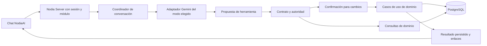

# NodiaAI investigación y planificación de la v1

> Estado: en progreso — entrevista y propuesta técnica; sin aprobación documental ni implementación
> Creación y actualización: 2026-10-14
> Dependencias: [progreso](00-progress.md), [PRD](04-prd-v2.md), [arquitectura](11-architecture-overview.md), [contrato IA](ai-provider-feature-contract.md), [Finanzas22](22-personal-finance-contracts.md), [Reservas28](28-rental-reservations-contracts.md), [Contactos31](31-provider-contacts-proposal.md).
> Decisión técnica propuesta: [ADR-032](../architecture/decisions/ADR-032-nodia-ai-domain-tools-and-conversation.md).
> Inventario de implementación: [módulos y endpoints39](39-nodia-ai-current-capabilities-inventory.md) y [snapshot de rutas](nodia-ai-current-endpoints.json).
> Catálogo y contratos propuestos: [herramientas40](40-nodia-ai-tool-catalog-v1.md), [contratos41](41-nodia-ai-v1-contracts.md) y [ADR-033](../architecture/decisions/ADR-033-nodia-ai-confirmation-and-sequential-recovery.md).
> ERD/ejecución propuestos: [42](42-nodia-ai-erd.md), [43](43-nodia-ai-execution-architecture.md), [ADR-034](../architecture/decisions/ADR-034-nodia-ai-postgres-jobs-and-retention.md).

NodiaAI permitirá conversar en lenguaje natural sobre las funcionalidades y datos de Nodia y ejecutar las mismas operaciones de información que los contratos del backend permiten al usuario. Por confirmación explícita posterior, la v1 abarca todos los módulos actuales, incluidos Ajustes Generales, Negocios, Reservas, Finanzas, recursos relacionados y flujos disponibles: consulta, creación, actualización y eliminación donde el contrato lo permita. Los seis ejemplos de la entrevista son escenarios de aceptación, no un catálogo cerrado. También incluye consultas específicas, filtros e informes con datos comprobables. Cada conjunto de cambios tendrá una vista previa editable y requerirá confirmación.

La experiencia solicitada se parece a Gemini o ChatGPT web: página propia, conversaciones continuas, historial lateral organizable y drawer para elegir conexión, modo y modelo. Una conversación puede combinar módulos. Gemini será el primer ecosistema, incorporando API key, Web y Agentic por etapas y comprobando las capacidades de cada adaptador.

## Decisiones confirmadas

Respuestas explícitas del usuario del 2026-10-14. Son decisiones de alcance; no aprueban automáticamente este documento ni prueban viabilidad técnica.

| Tema | Decisión |
|---|---|
| Producto | Chat integrado llamado NodiaAI, con acceso a información y operaciones de la BD |
| Configuración | Drawer lateral para conexión/proveedor, modo API key/Web/Agentic y modelo |
| Separación de modos revisada | Web sólo conversación; Agentic con MCP. API en una etapa posterior |
| Alternancia autorizada | Switch en el drawer de modos/modelos/intensidad para alternar desde Web; v1 sólo Agentic verificado, API después. Política y contratos pendientes en[48](48-nodia-ai-mode-routing-policy.md) |
| Contexto | Conservar conversación y compactarla cuando sea necesario |
| Historial | Barra izquierda; renombrar, buscar, fijar y archivar en v1; carpetas para después |
| Ámbito | Una conversación puede combinar cualquiera de los módulos actuales, incluidos Ajustes Generales, según lo solicitado |
| Público | Usuario actual y personas a quienes asigne acceso al módulo |
| Escrituras | Vista previa editable y confirmación para cada conjunto de cambios |
| Ecosistema inicial | Gemini: API key, Web y Agentic con sus modelos; entrega por etapas |
| Ambigüedad | Preguntar cuando haya dudas sobre qué registrar; formar preferencias con el uso |
| Memoria persistente | NodiaAI propone recordar una preferencia; usuario acepta y puede verla y borrarla |
| Consultas de importes | Mostrar generalmente el monto total; detalle completo a petición |
| Usuarios ordinarios | Historial propio y autoridad de datos conforme a sus contratos |
| Superadministrador | Ver todas las conversaciones y consultar/modificar datos de cualquier usuario, incluidas Finanzas y Reservas; conservar confirmación |
| Ubicación v1 | Página propia para pulir el proceso |
| Siguiente versión | Globo conversacional accesible desde cualquier parte de la app |
| Entradas v1 | Texto, imágenes, PDF y notas de voz |
| Datos para crear | Reunir y validar todos los campos obligatorios y condicionalmente requeridos del contrato; preguntar lo faltante. No exigir opcionales |
| Consultas ambiguas | Preguntar por el significado/fuente/período cuando no estén claros; los ejemplos no fijan un criterio mensual por defecto |
| Operaciones v1 | Consultar, crear, actualizar y eliminar información en todos los módulos actuales, incluidos Ajustes Generales, según operaciones y restricciones del backend; eliminaciones incorporadas por aclaración posterior. Siete escrituras bulk/import excluidas expresamente de v1 |
| Cambio de configuración | Cambiar conexión, modo y modelo entre turnos conservando historial, decisiones y operaciones previas |
| Salir de la página | Continuar la ejecución y guardar el resultado para recuperarlo al volver |
| Lotes e importación CSV | Siete handlers de escritura bulk/import inventariados; mantenerlos fuera de v1 por confirmación expresa durante el inventario39 |
| Módulo de destino | Usuarios distintos de super_admin requieren NodiaAI y módulo de destino asignados; comprobar al descubrir/ejecutar/recuperar |
| Informes v1 | Filtros, agrupaciones y sumas combinables sobre campos y relaciones permitidos; contrato nuevo, no solo resúmenes actuales |
| Operaciones dependientes | Ejecución secuencial; mostrar cada resultado, conservar lo creado si falla otro paso y recuperar sin duplicarlo |
| Canal de confirmación | Botón sobre vista previa exacta; no confirmación mediante texto del modelo |
| Informes cruzados | Combinar medidas compatibles de varios módulos con procedencia separada |
| Primera viabilidad | Priorizar Gemini Web y Agentic; comprobarlos independientemente. API key permanece en alcance por etapas |
| Retención del chat | Borrado automático a90 días del último mensaje del dueño, precisado durante42/43; no lo reinician lectura/otras acciones/respuestas automáticas ni borra registros de negocio |
| Adjuntos/transcripciones | Borrar con el chat; archivo incorporado a un registro de negocio independiente |
| Preferencias aceptadas | Conservar independientemente hasta borrado explícito, aunque expire el chat de origen |

La facultad transversal de `super_admin` cambia expresamente las restricciones anteriores de Finanzas22 y Reservas28. Se registra en esos contratos como cambio pendiente de implementación. No permite alterar arbitrariamente saldos, saltarse validaciones, modificar propietarios históricos o ejecutar como si el autor fuera otra persona. Actor administrador y propietario/usuario destinatario deben distinguirse.

### Aclaración de alcance y extensibilidad del 2026-10-14

El usuario retoma para precisar que NodiaAI debe conocer los distintos productos/módulos de Nodia y permitir la misma manipulación de información disponible mediante endpoints, incluida eliminación, además de reportes, consultas específicas y filtros en lenguaje natural. Esto sustituye la decisión previa de posponer eliminaciones; conserva confirmación, permisos y restricciones del dominio. Un recurso sin eliminación en su contrato no adquiere un DELETE por tener chat: cancelar una reserva, archivarla y borrarla son efectos distintos.

El chat no se limita a los seis ejemplos. La planificación pasa de un piloto de herramientas específicas a una cobertura inventariada de las operaciones de todos los módulos actuales, incluidos usuarios, roles, módulos y configuración de Ajustes Generales, por respuesta explícita a la pregunta de alcance. El diseño deberá permitir integrar futuros módulos sin reescribir el núcleo conversacional. La paridad es funcional: una operación que requiera introducir un secreto o completar login utiliza un formulario/canal seguro o el flujo interactivo existente, sin entregar credenciales al modelo. Una ruta privada de infraestructura no se publica automáticamente como herramienta por existir.

## Ejemplos de uso y aceptación

| Petición de ejemplo | Resultado esperado | Aclaraciones y validación |
|---|---|---|
| «Voy a comprar; registra un gasto de X, comida» | Proponer movimiento y guardar tras confirmación | Importe CLP, categoría real, nombre y estado. Si hay duda, preguntar; no crear una categoría por suposición |
| «Revisa si hay cupo del día X al día Y» | Consultar disponibilidad | Identificar casa, fechas y preparación. Una lectura favorable no reserva cupo |
| «Genera una reserva del día X al día Y» | Completar el mínimo válido, preparar reserva y confirmar el conjunto elegido | Pedir todos los obligatorios que falten; no insistir en opcionales. Distinguir borrador de confirmar/pagar: son operaciones distintas |
| «Agrega este número X al proveedor Y» | Preparar actualización o creación de contacto | Resolver negocio/proveedor/contacto; un contacto nuevo requiere nombre |
| «Tráeme los productos del proveedor X» | Listado paginado y enlaces a la app | Resolver proveedor/negocio, actividad y filtros; no cargar toda la BD en el chat |
| «Tráeme lo gastado en el proveedor X en el mes Y» | Total y detalle a petición | Si fuente, período o alcance son ambiguos, preguntar. El ejemplo no decide entre facturas registradas y pagos ni entre fechas diferentes |

No se eligió todavía el caso para implementar primero. La solicitud de documentación no requiere crear registros reales.

La cobertura funcional requiere inventariar endpoints/casos de uso de todos los módulos actuales y recursos relacionados. Cada operación tendrá correspondencia con una capacidad conversacional o un flujo seguro asistido; exclusiones funcionales necesitan justificación explícita para revisar. Un inventario no demuestra que ya esté integrada o disponible en los tres modos Gemini. Incluir reglas administrativas como rol reservado, último superadministrador y claves inmutables, además de integridad monetaria y pertenencia.

Inventario39 completado estáticamente: 177 handlers en34 controladores, 296 pares método/ruta con aliases y37 módulos Nest locales alcanzables. Separar estos módulos técnicos de los ocho destinos funcionales de Client y de las asignaciones reales de BD, que no se consultaron. No son177 herramientas disponibles. La excepción de7 handlers bulk/import queda confirmada; los demás tienen clasificación candidata de lectura/mutación, flujo seguro/archivo, auxiliar o instalación, con contratos pendientes.

NI-13 registra garantías administrativas aún no demostradas en caminos revisados: UserService.update sin comprobación explícita de último superadministrador/transacción conjunta de asociaciones y ModuleService.update sin protección explícita de key. Cerrar reglas compartidas y pruebas antes de habilitar esas escrituras; la paridad funcional no debe reproducir una omisión que contradiga las reglas del producto. No se alteró código/BD ni se probaron esos efectos operativos.

El agente debe conocer el flujo real de cada operación y completar su entrada mínima. Resolver lo que ya tenga una fuente válida en el chat, una preferencia aceptada o datos de Nodia; preguntar los obligatorios faltantes y las decisiones ambiguas antes de la propuesta. Omitir opcionales no bloquea la creación; sus defaults solo pueden provenir del contrato. Las reglas condicionales de negocio también deben cumplirse. Guardar nunca procede con entrada incompleta. La confirmación del usuario no sustituye la validación final del servidor.

### Límites de los contratos actuales

Finanzas exige `name`, `amount`, `type`, `status` y `category_id`. Sus fechas actuales son `created_at` y `updated_at`: «registra el gasto de ayer» no permite inventar una fecha de ocurrencia ni modificar `created_at`. Si el usuario necesita fechas de compra/pago distintas, debe ampliar expresamente el dominio. Referencias: [DTO de movimiento](../../nodia-server/src/finance-movement/dto/create-finance-movement.dto.ts), [caso de uso](../../nodia-server/src/finance-movement/use-case/create-finance-movement.use-case.ts), contrato22.

Reservas crea inicialmente `draft`; confirmar disponibilidad/acuerdo es otra operación. Fechas y horarios son campos separados. La disponibilidad debe revalidarse al confirmar aunque antes se consultara. Referencias: [DTO](../../nodia-server/src/rental-reservation/dto/create-rental-reservation.dto.ts), [creación](../../nodia-server/src/rental-reservation/use-case/create-rental-reservation.use-case.ts), contrato28.

Los teléfonos pertenecen a `personal_info_provider.phone`, asociado a un contacto con nombre obligatorio. Añadir debe preservar teléfonos existentes y respetar el versionado ante edición concurrente. Referencia: Contactos31.

[Invoice](../../nodia-server/src/invoice/entities/invoice.entity.ts) aporta `provider_id`, `business_id`, `total_amount`, `created_at` y JSON `data`; no tiene columnas tipadas de pago ni fecha de emisión. Sumar facturas no demuestra dinero efectivamente pagado. El mes del informe debe definirse; no tomar una fecha arbitraria del JSON. Evitar que joins con productos multipliquen el total de facturas.

Los IDs siguen cada contrato: [Business](../../nodia-server/src/business/entities/business.entity.ts) usa UUID; Finanzas, Reservas y proveedores usan BIGINT/string. No imponer un formato universal desde las herramientas. Importes y agregados conservan la precisión del dominio; no convertir sumas grandes a `Number`.

## Investigación de proveedores y MCP

Investigación documental inicial del 2026-10-14. El soporte de una plataforma y el adaptador ejecutado por Nodia son evidencias diferentes.

| Modo Gemini | Base existente | Pruebas necesarias para NodiaAI |
|---|---|---|
| API key | API oficial permite llamadas a funciones; Nodia usa `generateContent` para extracción | Historial, streaming, ciclo de herramientas, metadatos y entradas multimodales por modelo; claves permitidas por el proyecto |
| Web | Adaptador y OCR comprobados localmente según contrato IA | Reanudar chat, aislamiento, streaming/cancelación y canal estructurado de acciones; no asumir herramientas nativas |
| Agentic | CLI integrado para funciones IA actuales según plan32/runbook | Continuidad de chat, herramientas restringidas, identidad por usuario y soporte de entradas; sin shell/archivos generales |

Modelos y opciones se obtienen por configuración/descubrimiento. Una sesión autenticada, catálogo disponible o factura extraída no prueba chat con herramientas. Ningún modo sustituye a otro automáticamente. Las keys gratuitas de Gemini continúan excluidas como vía operativa.

La [documentación de Gemini sobre function calling](https://ai.google.dev/gemini-api/docs/function-calling) describe funciones y argumentos para consultar información o actuar. La [documentación de thought signatures](https://ai.google.dev/gemini-api/docs/generate-content/thought-signatures) requiere conservar metadatos de historial en los flujos que los utilizan. No generalizar esas capacidades a Web o al CLI.

Como referencia para una extensión posterior, OpenAI documenta [estado conversacional](https://developers.openai.com/api/docs/guides/conversation-state) y [compactación](https://developers.openai.com/api/docs/guides/compaction), que puede devolver estado cifrado opaco. Inferencia de diseño: ese estado no sustituye el historial portable de Nodia al cambiar proveedor. El [App Server de Codex](https://learn.chatgpt.com/docs/app-server) documenta reanudación de threads, pero el [extractor actual](../../nodia-server/src/ai-provider/use-case/execute-codex-invoice.use-case.ts) crea threads efímeros y su [configuración](../../nodia-server/src/common/ai/codex/codex-contract.ts) deshabilita herramientas/MCP. Un chat necesitaría un contrato separado. OpenAI Web permanece descartado por ADR-029.

MCP normaliza descubrimiento e invocación de herramientas; no concede autoridad para escribir. Su [especificación de herramientas](https://modelcontextprotocol.io/specification/2025-11-25/server/tools) exige validación y control de acceso. La [especificación de transportes](https://modelcontextprotocol.io/specification/2025-11-25/basic/transports) distingue stdio y Streamable HTTP.

OpenAI contempla [MCP remoto y túneles privados](https://developers.openai.com/api/docs/guides/tools-connectors-mcp). Esa alternativa no cambia [ADR-008](../architecture/decisions/ADR-008-internal-microservices-only.md): solo Nodia Server consume microservicios internos. Propuesta inicial: Server coordina el ciclo y la ejecución de herramientas, conservando ese límite. No hace falta crear un microservicio para diseñar una fachada MCP.

### Viabilidad por modo

Orden funcional solicitado tras catálogo40: primera prueba de chat/herramientas con **Gemini Web y Agentic**. No sustituirlos automáticamente por API si no soportan las capacidades requeridas; API sigue prevista por etapas. Ambos requieren evidencia propia y aislamiento, no inferir viabilidad conversacional del OCR.

Comprobar dos chats intercalados sin mezcla, reanudación tras recarga/reinicio, modelo exacto, consulta estructurada, escritura sintética confirmada, cancelación, salida inválida, caída del servicio y respuesta perdida sin duplicación. Verificar contexto largo y formatos de entrada por separado.

Las notas de voz requieren decidir transcripción o comprensión nativa, mostrar texto interpretable antes de confirmar una escritura y probar fidelidad de nombres, montos y fechas. Imágenes/PDF requieren extracción y referencias al archivo cuando expliquen una propuesta. No asumir un modelo OCR/transcriptor por defecto ni recurrir silenciosamente a otro modo.

Si un modo solo demuestra chat, definir explícitamente si puede publicarse sin operaciones. No ejecutar texto libre o JSON extraído mediante expresiones regulares como autorización de una herramienta. Ninguna prueba real conversacional/MCP de NodiaAI se ha realizado todavía.

## Experiencia propuesta

Página propia accesible mediante el módulo NodiaAI, siguiendo tema, traducciones y responsive de Nodia. Ruta y grupo de navegación pendientes; historial con renombrar/buscar/fijar/archivar ya confirmado.

- Barra izquierda: chats, nueva conversación y organización elegida por cada usuario.
- Centro: mensajes, aclaraciones, adjuntos, resultados, propuestas editables y acciones de confirmar/cancelar.
- Drawer: conexión concreta, modo, modelo dinámico y opciones verificadas. Configuración del chat separada del predeterminado global de Ajustes IA.
- Consultas: total/lista acotada, fuente y período visibles, detalle a petición y enlaces a la app.
- Escrituras: resultado real del servidor, toast internacionalizado e invalidación de consultas afectadas para ver el cambio en la aplicación.
- Móvil: paneles abribles preservando borrador/foco/chat, controles táctiles y carga/error recuperables.

Durante una ejecución se fija conexión/modo/modelo para todo el ciclo de herramientas. El cambio entre turnos conserva historial visible, decisiones y operaciones previas, y valida contexto/capacidades; nunca cambiar a mitad de una escritura. El estado específico del adaptador queda separado del historial portable.

Renombrar, buscar, fijar y archivar son requisitos v1. Carpetas quedan para después. Proyectos/contexto compartido, edición/regeneración, exportación y visualizaciones siguen pendientes. Editar/regenerar un mensaje no puede repetir sus efectos anteriores.

Al salir de la página, la ejecución continúa y su resultado queda disponible al regresar. Mostrar las ejecuciones pendientes/terminadas y recuperar su estado sin volver a enviar el mensaje ni la confirmación. V1 incluye eliminaciones de registros donde el backend las permita, con vista previa del impacto y confirmación; mantiene los bloqueos por relaciones o reglas monetarias. Acciones por lotes siguen fuera del alcance confirmado. Eliminar un chat o una preferencia no elimina registros de negocio.

## Contexto y memoria propuestos

| Fuente | Contenido | Tratamiento |
|---|---|---|
| Conversación | Mensajes, aclaraciones, propuestas, resultados y referencias | Historial persistido en Nodia y reanudable |
| Conocimiento de Nodia | Funciones, reglas y contratos vigentes | Selección por tarea y versionado; no cargar todo el repositorio |
| Datos operativos | Registros y agregados consultados | Lecturas actuales con ámbito, origen y período; no tratar un saldo antiguo como vigente |
| Preferencias aceptadas | Patrones personales y defaults autorizados | Propietario/ámbito/procedencia; ver, corregir y borrar |

«Contexto de los desarrollos» se interpreta inicialmente como conocer funciones y operar datos. Acceso al código fuente, programación y despliegue no forman parte de los casos confirmados.

### Descubrimiento de módulos y operaciones

Propuesta: cada módulo publica capacidades versionadas mediante el backend, describiendo finalidad, entidades públicas, operaciones, esquemas de entrada/salida, campos obligatorios/opcionales, filtros, orden, agregaciones, reglas de ámbito y efectos. El registro referencia contratos/casos de uso reales; no es un inventario de todas las tablas/columnas ORM ni un proxy que acepte cualquier URL.

NodiaAI recibe primero una descripción breve de los módulos accesibles al usuario y descubre el detalle de las operaciones relevantes a su petición. El coordinador resuelve el catálogo y aplica autoridad tanto al descubrir como al ejecutar; no depende de que el modelo decida respetar un permiso. Si catálogo/permisos cambian, actualizar su versión e invalidar el contexto operativo anterior sin perder el historial.

El contexto funcional se documenta en Markdown bajo `docs/nodia-ai/knowledge/` siguiendo el [estándar de producto/funcionalidad](../nodia-ai/knowledge/README.md), establecido por solicitud del usuario y exigido desde AGENTS al especificar nuevas funciones o ampliar las existentes. No necesita adjuntarse manualmente a cada chat ni reemplaza DTOs/casos de uso. Servir esa explicación como recurso versionado, seleccionado cuando haga falta; derivar campos/esquemas del backend siempre que sea viable y comprobar consistencia en CI. La publicación/carga selectiva y las fichas iniciales de los productos existentes siguen pendientes. OpenAPI ayuda a inventariar rutas y estructuras, pero no demuestra por sí solo reglas de negocio, autorización o idempotencia. La [especificación OpenAPI](https://spec.openapis.org/oas/v3.1.1.html) define descripciones de operaciones y esquemas; su traducción a capacidades NodiaAI sigue siendo diseño pendiente.

MCP documenta descubrimiento con `tools/list`, esquemas de herramientas y avisos de cambio de catálogo; también permite [recursos de contexto](https://modelcontextprotocol.io/specification/2025-11-25/server/resources). Estos mecanismos pueden transportar el catálogo y las explicaciones; no hacen que el modelo adivine lo que significa un producto. Su uso en cada adaptador Gemini requiere la viabilidad ya prevista.

Flujo propuesto para añadir un módulo: implementar sus contratos/casos de uso; registrar/describir capacidades y conocimiento funcional; probar correspondencia con las operaciones HTTP y sus permisos; publicar una versión del catálogo; verificar que los chats existentes descubren el módulo nuevo. La integración debe ser parte del checklist del módulo. Leer tablas o descubrir URLs sin esa declaración no lo habilita automáticamente.

Los datos de usuarios/productos/reservas se consultan con herramientas al necesitarlos. La BD es fuente de datos, no una explicación suficiente de reglas y flujos. No cargar toda la BD, leer el repositorio o explorar rutas arbitrarias para cada mensaje. Nombres, IDs y cantidades deben salir de resultados reales, y la conversación puede combinar operaciones descubiertas de varios módulos.

### Límites del historial y de una ejecución

No se ha decidido un máximo funcional de mensajes ni obligar a iniciar otro chat tras cierta cantidad. Propuesta: conservar un historial extensible y paginado, con retención aún pendiente, y seleccionar/compactar únicamente el contexto que necesita el siguiente turno. El límite de contexto del modelo no es el tamaño del historial guardado.

Sí hacen falta límites técnicos por ejecución: tiempo, pasos de herramientas, concurrencia, tamaño de entradas/resultados, adjuntos y volumen de consultas; definir costo/cuota solo cuando haya datos verificables. Sirven para evitar ciclos, saturación y lecturas completas por accidente; no recortan el catálogo de módulos ni fijan un número arbitrario de mensajes. Los valores deben medirse por adaptador/modelo; no inventarlos en esta entrevista.

Al alcanzar un límite, conservar conversación, propuesta y estado de efectos ya ejecutados; explicar el motivo y permitir dividir/continuar cuando sea seguro. Continuar no significa repetir una operación incierta ni ampliar silenciosamente el presupuesto. Estos límites, la retención y las capacidades disponibles son conceptos separados.

La compactación portable preservará objetivo, decisiones, entidades referenciadas, preguntas pendientes, preferencias y operaciones ejecutadas. Confirmaciones y propuestas permanecerán como registros estructurados independientes del resumen: compactar no autoriza un cambio. Guardar versión/rango resumido y conservar historial original para recuperar detalles.

No prometer memoria perfecta. Probar importes, IDs, negaciones, cambios de intención y operaciones incompletas. Un fallo de compactación preserva historial y ofrece recuperación; no elimina silenciosamente mensajes.

El presupuesto de contexto depende del modelo y reserva espacio para respuesta/herramientas. Si conteo/límite no están disponibles, mostrar desconocido y comprobar una política de admisión explícita; no inventar porcentajes, cuotas o costos. El estado opaco de un proveedor queda separado del resumen portable.

Ejemplo de memoria: «¿Quieres que recuerde esta categoría para tus gastos de comida?». Guardar solo tras aceptación. Una preferencia no sustituye una instrucción actual, una entidad vigente, una aclaración necesaria ni la confirmación de escritura. Cancelar propuestas no genera aprendizaje automático.

## Arquitectura propuesta

El modelo interpreta intención y propone argumentos. Nodia Server valida identidad, ámbito, contrato y confirmación y ejecuta casos de uso de dominio. SQL vive en repositorios/consultas controladas del backend; no exponer `execute_sql` libre.

Catálogo v1: correspondencia inventariada con consultas y operaciones disponibles de todos los módulos actuales, incluidos Ajustes Generales; cubre creación, actualización, eliminación y comandos específicos del dominio. Los ejemplos de productos, gastos, contactos y disponibilidad sirven para empezar sus pruebas. Catálogo40/manifiesto proponen141 herramientas de dominio,11 comunes y4 flujos seguros; contratos41/schema común y ADR-033 detallan coordinación. Esquemas de dominio derivados de DTOs/casos de uso con validación runtime aún pendientes de implementar; nombres candidatos, no publicados. El catálogo debe poder descubrirse y versionarse sin cambiar el núcleo del chat por cada módulo. Gestión de credenciales/login utiliza flujos seguros sin secretos en contexto, historial o logs.

La fachada MCP y las llamadas a funciones reutilizarán las mismas reglas. Comparar coordinador propio/runtime externo, historial canónico/sesión remota exclusiva y fachada dentro de Server/proceso privado en ADR-032. Un microservicio nuevo requeriría la [guía interna](../architecture/internal-microservice-security.md).

Consultas e informes pueden combinar filtros, orden, agrupaciones y agregados admitidos para las entidades públicas. No limitarse a botones o reportes predefinidos de la UI: un contrato de consulta estructurada puede expresar combinaciones válidas en lenguaje natural y resolverlas en el backend. Su esquema debe declarar campos, relaciones, medidas y criterios permitidos con autoridad y límites. SQL parametrizado construido en backend, no fragmentos libres aportados por el modelo. Si faltan un dato o una operación, explicarlo; lenguaje natural no crea información ni una capacidad que todavía no existe. Usar consultas por conjuntos y totales exactos; evitar N+1, joins que duplican importes y exportaciones ilimitadas.

### Confirmación y recuperación

1. Resolver IDs y campos; coincidencias múltiples o datos dudosos generan aclaración.
2. Preparar propuesta con valores, ámbito e impacto. Editarla crea una versión nueva.
3. Vincular confirmación al actor y a esa versión exacta. Texto de archivos, BD o modelo no confirma cambios.
4. Revalidar autoridad/estado al ejecutar; conflicto conserva borrador y exige revisión.
5. Persistir identidad/resultado de operación y deduplicar bajo concurrencia con el efecto transaccional.
6. Mostrar efectos comprobados y actualizar la app. Timeout/cancelación después de commit requieren recuperar estado antes de reintentar.

Reservas ya tiene `Idempotency-Key` y recuperación; Finanzas no ofrece la misma deduplicación por intención. Añadirla antes de crear desde el chat. Registrar éxito después de un commit separado deja una ventana de duplicación. Contactos tiene `creation_key` y versionado: evaluar por operación.

No mantener transacciones abiertas durante inferencia o revisión humana. El usuario confirma conjuntos de operaciones individuales ejecutados secuencialmente, con resultados por paso y conservación de lo creado ante fallo. Reanudar sin duplicación; no prometer atomicidad cruzada o deshacer universal. Botón sobre propuesta exacta y contrato detallado de recuperación en41/ADR-033. Mantener la exclusión de siete escrituras masivas/importación.

### Autoridad y recursos

Sesión y acceso a NodiaAI verificados en backend. Por decisión explícita durante39, usuarios ordinarios requieren también el módulo de destino asignado al descubrir, ejecutar y recuperar capacidades. Los recursos sin página propia necesitan una correspondencia declarada con su módulo padre. Esta regla del coordinador no está implementada todavía ni redefine automáticamente los guards REST existentes. Historial propio para usuarios ordinarios y transversal para `super_admin`. Su autoridad nueva incluye lectura y escritura de datos ajenos; seleccionar explícitamente al destinatario cuando corresponda y separar actor de propietario. La implementación debe compartir las reglas del dominio con los casos de uso, evitando un bypass de sus invariantes desde el chat.

Credenciales de proveedor en servidor. Cuenta compartida de proveedor no equivale a conversación compartida ni permiso de datos. Contenido recuperado es dato, nunca instrucciones. Acotar pasos, resultados, tamaño, tiempo y concurrencia; fijar valores tras pruebas y no copiar automáticamente límites OCR.

Coordinar chat, OCR y login cuando compartan perfil/runtime, sin mezclar contextos ni clonar sesiones sin evidencia. Diseñar cancelación, limpieza de archivos y recuperación tras reinicio. Adjuntos requieren ownership, almacenamiento privado, límites por formato/tamaño/páginas/duración y retención explícita; aprovechar R2 cuando corresponda sin cargar documentos en logs.

### Ejecuciones persistidas

La vida de una ejecución pertenece a Server, no a la petición HTTP o al componente React. Persistir identidad, actor/destinatario, configuración fija, fase y resultados/eventos necesarios para volver a consultar. La desconexión del navegador deja de ser una señal de cancelar el trabajo de NodiaAI; no cambiar por ello la política de cancelación del OCR existente.

Diseñar admisión y coordinación compatibles con reinicio y varios procesos. Crear/confirmar devuelve una identidad estable; volver a la página recupera esa ejecución. Evaluar worker/cola según duración y adaptadores, sin imponer infraestructura nueva antes de comprobarlo. La generación de texto puede transmitirse mientras el usuario observa y reconstruirse desde el resultado/eventos guardados al regresar.

Continuar fuera de la página no significa ejecutar indefinidamente: deadlines y límites siguen vigentes. Reinicio/caída con resultado incierto requiere reconciliación, no reenviar inferencias o mutaciones a ciegas. Una cancelación explícita debe distinguir trabajo aún no iniciado, generación activa y efecto ya confirmado; nunca afirmar rollback por cerrar un stream.

## Plan de implementación por etapas

| Etapa | Entregable | Cierre requerido |
|---|---|---|
| NA-01 Entrevista | Alcance, prioridades, cobertura de módulos, historial, memoria, reportes y autoridad | Respuestas y eliminación v1 registradas; pendientes claros |
| NA-02 Viabilidad Gemini | Matriz ejecutada API/Web/Agentic y modalidades | Chat, contexto y herramientas comprobados por modo/modelo |
| NA-03 Contratos y arquitectura | Inventario39, catálogo40/contratos41 y ERD42/ejecución43/ADR-034 propuestos; plan por etapas y schemas por dominio pendientes | Correspondencia ejecutable con backend, evolución de módulos, confirmación, autoridad y recuperación verificadas |
| NA-04 Conversaciones | Historial, drawer, ejecuciones persistidas y primer modo viable | Reanudar/cambiar modo sin perder contexto; continuar al salir y recuperar sin reenvío |
| NA-05 Consultas y MCP | Descubrimiento, filtros/informes y lecturas de todos los módulos actuales | Cobertura inventariada, ámbito correcto, SQL acotado y cálculos exactos |
| NA-06 Escrituras | Crear/actualizar/eliminar y comandos disponibles de todos los módulos actuales; flujos administrativos seguros | Paridad con contratos, confirmación, invariantes administrativas/relaciones protegidas y recuperación sin duplicación |
| NA-07 Multimodal y memoria | Imágenes/PDF/voz, preferencias y compactación | Interpretación revisable, contexto recuperable y sin repetir efectos |
| NA-08 Aceptación | Regresiones IA, QA responsive y pruebas reales | Evidencia por cuenta/mode/entorno y aceptación operativa |

Secuencia propuesta; todas las etapas pertenecen al alcance candidato v1, incluidas las cuatro entradas solicitadas. Viabilidad puede exigir revisar etapas o capacidades con el usuario. No se implementa código, instalan herramientas, ejecutan inferencias ni migran datos por crear este documento.

### Aceptación candidata

- Dudas preguntadas, obligatorios completos, opcionales no exigidos, propuesta editable, cancelación sin escritura y fallo con borrador intacto.
- Confirmaciones duplicadas/concurrentes y respuesta perdida sin duplicar registros.
- Operación admitida por HTTP y herramienta ofrece el mismo resultado/reglas para el mismo actor; rechazos por relaciones/estados se conservan, incluidos DELETE protegidos y recursos sin eliminación.
- Usuarios/roles/módulos/configuración conservan reglas administrativas, autenticación y protección de secretos. La paridad no elimina la restricción del último superadministrador ni registra credenciales en el chat.
- Un módulo nuevo registrado aparece en descubrimiento y chats existentes sin modificar el núcleo; operación no registrada o metadata histórica no se ejecuta por intuición del modelo.
- Filtros/informes usan campos y agregados admitidos, rechazan criterios inválidos y no cargan la BD completa. Aclarar antes de calcular si la semántica es dudosa.
- Reserva que cambia de disponibilidad antes de confirmar informa conflicto; `draft` no se anuncia como confirmada.
- Ledger y categorías válidos; no alterar timestamps para fingir otra fecha.
- Contacto conserva teléfonos y rechaza versión obsoleta.
- Total por proveedor identifica fuente/mes; joins no duplican importes; cero, vacío y error distintos.
- Historial ajeno rechazado para no administrador; `super_admin` transversal con actor/destinatario explícitos. Revocación validada en herramientas y recuperación.
- Adjuntos/voz ambiguos o malformados no producen acciones sin revisión; instrucciones incrustadas no cambian permisos.
- Salir durante generación o después de confirmar conserva ejecución/resultado; volver desde una sesión válida no vuelve a enviar. Reinicio y desconexión no duplican efectos ni convierten incertidumbre en éxito.
- Modelo ausente/retirado, configuración histórica, servicio caído y resumen fallido sin fallback ni éxito ficticio.
- Server: unitarias de casos de uso e integración PostgreSQL aislada para atomicidad/locks. Client: conversación, drawers, propuestas, adjuntos, i18n y móvil. Regresiones IA existentes conservadas.

## Preguntas pendientes

Continuar por rondas pequeñas. No convertir pendientes en defaults de producto.

1. Prioridad de caso de uso para la prueba. Primeros modos elegidos: Gemini Web y Agentic; completar su matriz propia.
2. Convertir inventario39/catálogo40 en contratos ejecutables y pruebas de reglas por dominio, incluidas reserva/confirmación/cancelación/pagos. No convertir «eliminar» en otra operación por suposición; si no existe eliminación, explicar alternativas.
3. Catálogo de informes y criterios admitidos. Ante ambigüedad se pregunta; si el dato requerido no existe, explicarlo y decidir una ampliación.
4. Implementar caducidad90 días del último mensaje del dueño, adjuntos/transcripciones con el chat y preferencias independientes, confirmados en42/43. Cerrar retención de recibos/audit/jobs, limpieza física/backups; localStorage es caché, autoridad en Server.
5. Edición/regeneración/ramas de mensajes; cambios de conexión/modo/modelo entre turnos ya confirmados.
6. Derivar esquemas ejecutables/proyecciones por herramienta y autoridad desde catálogo40/contratos41; las141 entradas de dominio aún son referencias de fuente. DELETE solo donde exista; siete handlers bulk/import excluidos. Módulos padre documentados en39, resolver sus IDs estables en implementación.
7. Implementar/verificar ERD42, jobs/leases/recibos de43/ADR-034 y conjuntos secuenciales; conservación de efectos/recovery confirmados, implementación pendiente.
8. Transcripción/confirmación de voz, formatos y límites de adjuntos.
9. Formato/autoría de descripciones de módulo y versionado/validación del catálogo. Acceso a programación/repositorio sigue siendo una ampliación distinta.
10. Acceso administrativo a preferencias/adjuntos y presentación/auditoría de chats ajenos.
11. Cancelación explícita y recuperación tras reinicio/desde otro dispositivo; continuar al salir de la página ya confirmado.

## Continuidad

- [x] Registrar solicitud, diecinueve respuestas de entrevista y seis ejemplos de uso.
- [x] Registrar aclaración posterior: paridad de información con backend, eliminación v1, ejemplos no exhaustivos, filtros/informes y descubrimiento de futuros módulos.
- [x] Confirmar expresamente cobertura de todos los módulos actuales, incluidos Ajustes Generales.
- [x] Inventariar estáticamente módulos, handlers, aliases, entradas y destinos; clasificar177 operaciones en39/snapshot con fuentes comprobables.
- [x] Resolver bulk/import fuera de v1, asignación de módulo de destino para ordinarios e informes combinables dentro de v1.
- [x] Consultar fuentes primarias de chat, compactación, funciones y MCP.
- [x] Contrastar contratos/código y registrar límites actuales.
- [x] Registrar ampliación administrativa en Finanzas22 y Reservas28; ADR técnico propuesto.
- [x] Resolver ronda sobre secuencia/resultados parciales, botón de confirmación e informes cruzados compatibles.
- [x] Elegir Web/Agentic para primeras pruebas y precisar90 días del último mensaje del dueño; no prueba viabilidad ejecutada.
- [x] Registrar borrado de adjuntos/transcripciones con chat y preferencias aceptadas independientes.
- [x] Derivar catálogo40/manifiesto y borrador41/schema común, autoridad, confirmación/recovery y ADR-033; sin implementación ni aprobación.
- [x] Definir ERD42/arquitectura43/ADR-034 propuestos, revisados en44:23 tablas previstas (una condicional), trabajo PostgreSQL, receipts separados, leases/fences y recuperación.
- [x] Segunda revisión del modelo en[44](44-nodia-ai-data-model-review.md) y [plan por etapas45](45-nodia-ai-implementation-plan.md), con38 tareas, fichas actuales y carga de contexto; schemas por dominio incluidos como tareas pendientes.
- [x] AI-01: contratos/baseline compilables en[46](46-nodia-ai-ai01-contract-baseline.md), con111 definiciones y190 casos estructurales; runtime pendiente.
- [ ] Implementar AI-02..38; primer pendiente viabilidad Web/Agentic AI-02/03, políticas AI-04 y fichas AI-05.
- [ ] Ejecutar viabilidad por modo; ninguna inferencia conversacional real probada todavía.
- [ ] Cerrar ADR/ERD/contratos y tareas de implementación.
- [ ] Reconciliar documentos 03/04/05/06/11/12 y consumidores afectados.
- [ ] Aprobar documentación explícitamente al completar el borrador.

La autorización general del proyecto permanece vigente. La ampliación de superadministrador reabre la revisión de acceso y su implementación en Finanzas/Reservas; los resultados anteriores de sus pruebas no acreditan la política nueva. El alcance visual conserva DESIGN; no se desmarca una aprobación por una propuesta que no cambie sus reglas.
