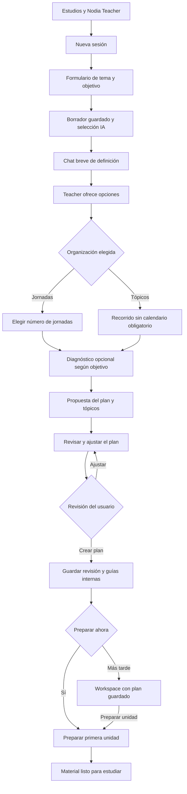
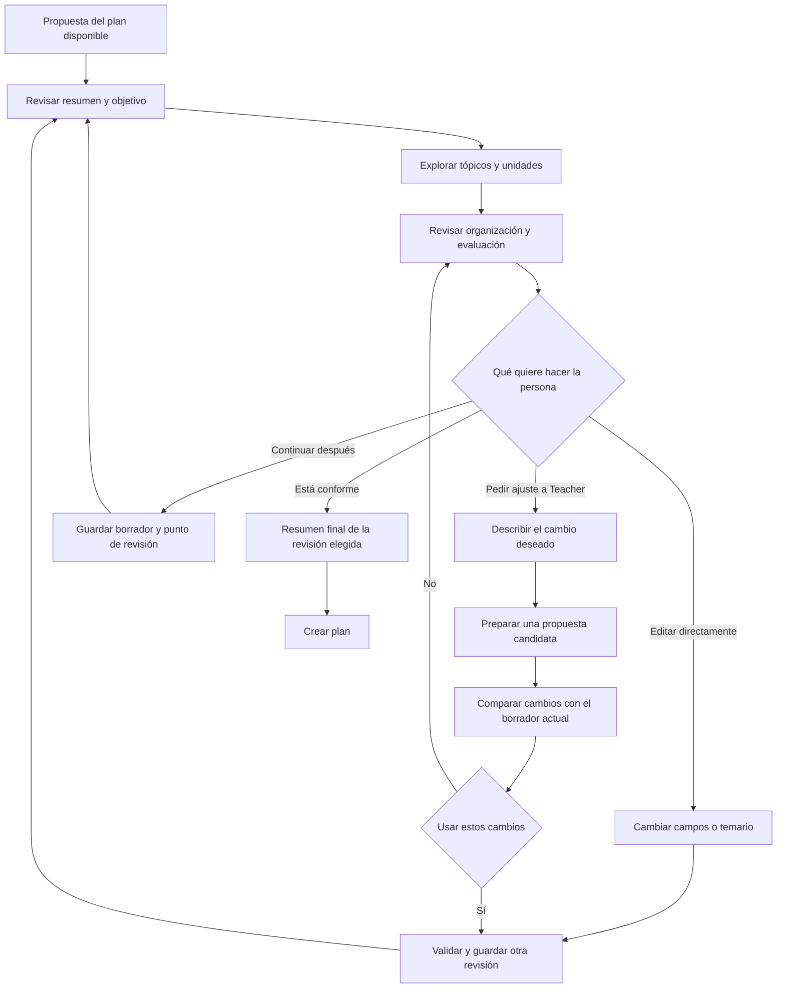
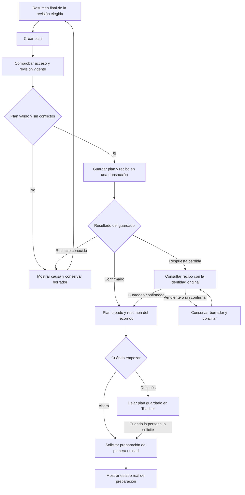
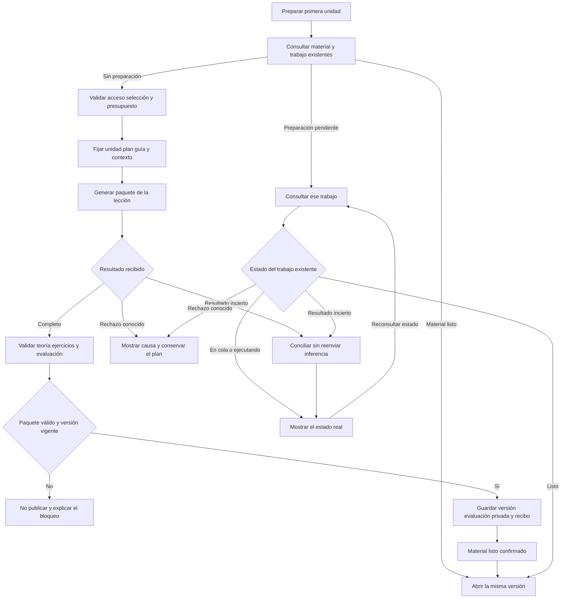
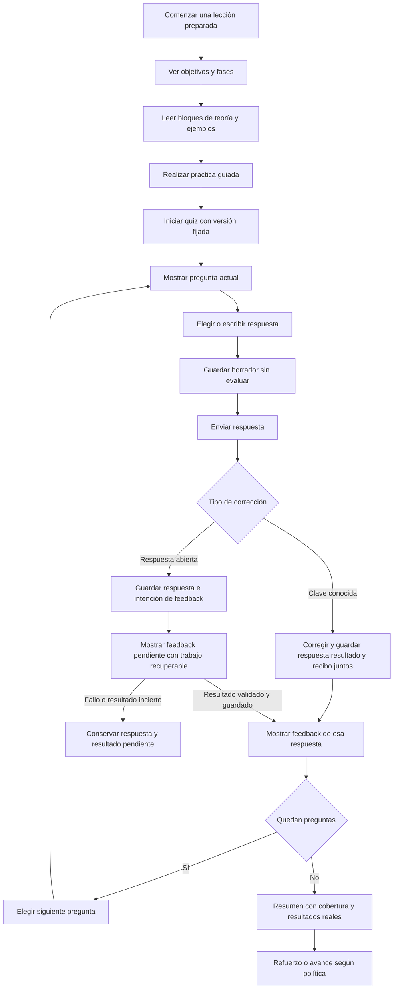
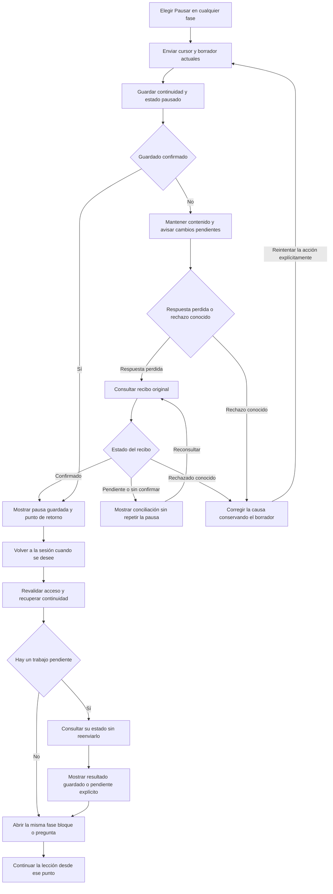
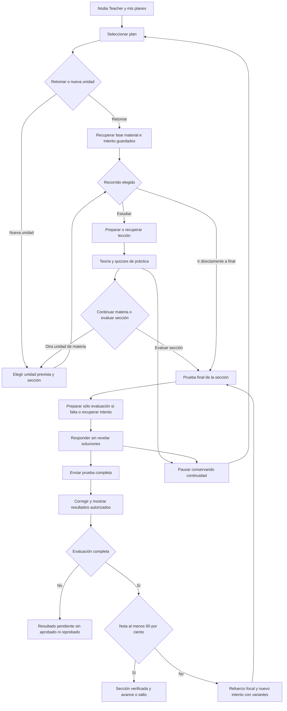
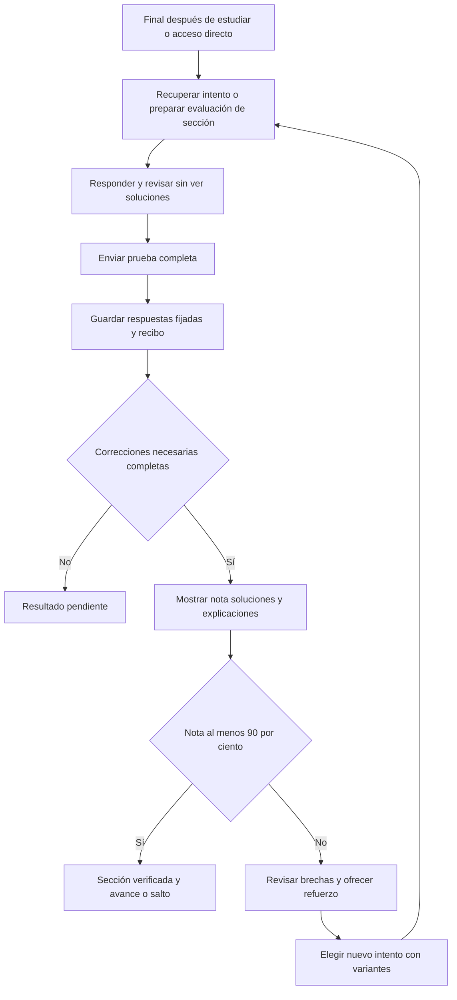

# Nodia Teacher con sesiones de estudio y planes adaptativos

> Cierre técnico del upgrade2026-11-11:55/55TU verificados para Windows y la selección API key exacta configurada.18POST reales, revisión de47ítems, QA HTTP/JWT/SQL y rendimiento comparado, correcciones y restore final comprobados. Alcance y límites en la [matriz R02](../evidence/teacher-upgrade-acceptance-20261111-r02.md) y el [recibo R02](../evidence/teacher-upgrade-local-20261111-r02.json). No adopta otros proveedores/entornos, no acredita eficacia humana ni despliega/publica o aprueba ADR/fichas.

> Upgrade en revisión R02, 2026-11-11: [plan101](101-nodia-teacher-adaptive-upgrade-plan.md) documenta diagnóstico conectado, evidencia por objetivo y práctica adaptativa como primera entrega útil, seguidos de enseñanza interactiva, repaso, aclaraciones, fuentes/actividades/visuales y memoria entre planes. Distingue brechas ya previstas en95/96 de ampliaciones posteriores; conserva la final≥90% y los contratos V1. [102](102-nodia-teacher-phased-implementation-and-final-qa.md) define construcción directa por fases y QA/correcciones al final, sin aprobación funcional entre fases. La solicitud actual sólo autoriza esta documentación: sin implementación, aprobación integral o disponibilidad nueva. [ADR098 propuesto](../architecture/decisions/ADR-098-teacher-learning-evidence-and-adaptive-progression.md) y [fichas candidatas](../nodia-ai/knowledge/studies/README.md).

> Seguimiento de implementación local2026-11-01: código Teacher/rutas implementado y verificado localmente por capas. [Plan96 §21](96-nodia-teacher-implementation-plan.md#21-implementación-local-y-evidencia) y [recibo](../evidence/teacher-local-implementation-20261101-r01.json) separan hechos, calificación y pendientes. Los cortes documentales inferiores mantienen su fecha/estado; este seguimiento no aprueba/publica fichas ni adopta VM.

> Estado: diseño V1 en revisión. R07, 2026-11-01: el usuario solicita iniciar ahora en un chat nuevo, con `/nodia-teacher`, dominio propio, referencia visual adaptada a Nodia/móvil y migración de rutas independientes del menú. [98 recoge la ampliación vigente](98-nodia-teacher-start-handoff.md#solicitud-vigente-para-comenzar-ahora). Conserva el paquete R06 y el umbral final≥90% confirmado; no implica aprobación documental integral, implementación o integración operativa.

Estudios será una nueva sección de Nodia y **Nodia Teacher será su producto general de aprendizaje**. Cada persona podrá crear una sesión sobre el tema que quiera, definirla mediante formulario y conversación breve, elegir un recorrido por jornadas o tópicos y estudiar material generado progresivamente. Inglés cotidiano y tecnológico es un caso de uso personal de referencia, no un catálogo ni un curso obligatorio.

[Plan de implementación96](96-nodia-teacher-implementation-plan.md) · [Modelo/contratos97](97-nodia-teacher-technical-contracts.md) · [Entrega para iniciar98](98-nodia-teacher-start-handoff.md) · [Contexto Teacher](../nodia-ai/knowledge/studies/README.md) · [ADR089 propuesto](../architecture/decisions/ADR-089-versioned-study-plans-and-content.md).

## 1. Solicitud confirmada y propuestas

| Tema | Confirmado por el usuario | Recomendación pendiente de validar |
|---|---|---|
| Organización R02 | Nodia Teacher para sesiones nuevas de cualquier tema dentro de Estudios | Un único módulo Teacher y temas como datos de cada sesión, sin módulo ni motor por materia |
| Definición R02 | Formulario sobre el tema y pequeño chat donde Teacher da forma al pedido | Tema/objetivo mínimos; contexto y conocimientos opcionales; borrador guardado antes de inferir |
| Opciones R02 | Teacher ofrece organización día a día o por tópicos | Sugerencias comparables, elección explícita y vista previa editable del plan antes de crearlo |
| Proveedores R02 | Usar los mismos proveedores de NodiaAI | Configuración y credenciales compartidas en Server; frontera de generación común con autoridad Teacher |
| Prompts R02 | Guardar prompts internos y tópicos del plan | Plantillas versionadas, guía pedagógica estructurada y snapshot por generación; no usar texto libre como permiso |
| Objetivo de Inglés | Conversación cotidiana, expresar situaciones, disponer de vocabulario y enfoque tecnológico/informático | Combinar situaciones diarias y técnicas desde el inicio, con dificultad según habilidades observadas; sin imponer una proporción fija |
| Entrada | Quiz inicial para orientar el nivel de Inglés; otros temas pueden comenzar directamente | Diagnóstico por habilidades, opción «No lo sé» y preguntas revisadas; no presentar una certificación |
| Recorrido | Jornadas o tópicos; entrar a la lección, teoría y quiz con selección múltiple u otros formatos | Mismas unidades con IDs estables; X sólo se requiere al elegir un recorrido de X jornadas |
| Conocimiento previo | Poder ir al quiz para saltar o completar una sección conocida | Desafío sin pistas que cubra los objetivos de esa sección, con comprobación posterior de retención |
| Referencia | Estudio diario en Obsidian mediante un prompt por día | Sustituir el prompt repetido por «Preparar material de esta jornada», conservando también una instrucción reutilizable exportable si resulta útil |
| Continuidad | Pedir el material del día, guardarlo y poder pausar o continuar después | Paquete de jornada persistido, progreso independiente del chat y reanudación de la misma versión |
| Generación R02 | Registrar el plan y generar material/preguntas a medida que se avanza | Temario completo persistido, preparación por unidad y recuperación sin regenerar contenido listo |
| Recorrido R05 | El usuario propone listado de planes, retomar/nueva unidad y estudiar o ir a prueba final | Mostrar planes propios; generar sólo lo ausente; final de sección independiente de haber leído su teoría |
| Umbral R05 | Confirmado por el usuario: **90% o superior aprueba la prueba final** | Cálculo exacto con cobertura/denominador fijados; no trasladar ese umbral al diagnóstico o cada quiz formativo |
| Correcciones/reintento R05 | El usuario propone respuesta correcta y porqué al enviar, y repetir si no aprueba | Práctica: feedback inmediato; final: tras entregar todo. Refuerzo focal y nuevo final con variantes, sin repetir literalmente ni borrar historia |

La referencia de Obsidian describe un flujo del usuario; no supone que exista actualmente en Nodia ni autoriza importar o modificar sus notas. La aclaración R02 retira la propuesta de un módulo Inglés y la obligación de elegir días para todo tema. El nombre de trabajo elegido es Nodia Teacher; sus sesiones son contenedores persistentes de aprendizaje y no sesiones de autenticación, visitas diarias ni conversaciones de NodiaAI.

## 2. Punto de partida comprobado

La inspección de documentación, rutas Client y recursos Server no identificó un dominio de estudio, lecciones, quiz o Inglés implementado. No se consultó la base de datos operacional para esta propuesta.

- [ModuleGroup](../../nodia-server/src/module-group/entities/module-group.entity.ts) y [Module](../../nodia-server/src/module/entities/module.entity.ts) ya soportan grupos y módulos con enlace, traducciones y orden. Un registro administrativo no crea una ruta ejecutable.
- [Sidenav](../../nodia-client/src/layouts/components/Sidenav/Sidenav.tsx), [catálogo móvil](../../nodia-client/src/layouts/components/MobileBottomNav/catalog.ts) y [router](../../nodia-client/src/routes/index.tsx) permiten aprovechar la navegación existente. La solicitud R07 fija `/nodia-teacher`, módulo `nodia_teacher` y ubicación de menú asignable por el mantenedor; Estudios es la presentación inicial, no parte de URL, carpeta o autoridad. Requiere alta explícita en Client/Server y no constituye una ruta disponible.
- La [política89](89-module-access-and-user-data-scope.md) exige sesión, módulo de destino y datos propios para usuarios ordinarios; super_admin activo conserva su bypass global. Un grupo llamado Estudios no concede acceso.
- [Planes90](90-agentic-api-only-web-retirement.md), [91](91-ai-provider-onboarding-verification.md) y [92](92-nodia-ai-api-chat-parity.md) permiten diseñar sobre Agentic/API key. Sus resultados previos no califican automáticamente esta tarea de generación o una modalidad de voz.

### Referencia de Obsidian contrastada

Se leyeron en modo consulta las notas «Método de clases y evaluación — Inglés», «Guía de progreso — Inglés» y la introducción de «Síntesis Curso Inglés» de la carpeta Estudio del vault del usuario, con actualización declarada del 2026-10-19. No se modificaron ni se importaron respuestas, resultados o documentos al producto.

El método existente ya distingue teoría, práctica guiada, cuestionario de una pregunta por turno, refuerzo y reevaluación. Guarda un cursor de clase/fase/pregunta y separa la evidencia escrita de la oral. Su nota se calcula por criterios de 0–2 puntos con denominador fijado y avance desde 90%, no por porcentaje de preguntas acertadas. Es una referencia personal previa: trasladar ese umbral y rúbrica a Nodia requiere decidirlo expresamente; no adoptarlo como regla universal para todos los temas.

La síntesis organiza 90 unidades, pero el nuevo pedido permite planes de X jornadas: no imponer 90 días, copiar el temario completo ni deducir el nivel del usuario desde esa nota. Una clase puede ocupar varias visitas y debe conservar su identidad; la propuesta de jornada no obliga a terminarla en una fecha. Las fuentes externas enlazadas allí no quedan verificadas por haber leído la nota.

## 3. Experiencia propuesta

1. Entrar en Nodia Teacher y ver «Mis planes de estudio», con retomar/unidad prevista o «Nueva sesión de estudio» para crear otro.
2. Completar tema y objetivo; añadir opcionalmente conocimientos previos, contexto e idioma. Guardar el borrador sin generar contenido todavía.
3. Elegir de forma visible una conexión, modo, modelo y esfuerzo aplicables de los proveedores configurados. Sin selección válida se puede guardar, pero no generar.
4. Conversar brevemente con Teacher. El formulario inicia el contexto; Teacher aclara huecos relevantes y propone organizar por jornadas o por tópicos. No imponer una cantidad fija de mensajes ni fabricar un nivel.
5. Elegir recorrido. Jornadas pide su cantidad; tópicos permite avanzar por unidades sin fecha. Un diagnóstico se ofrece sólo si sirve al objetivo y puede omitirse dejando desconocidos explícitos.
6. Revisar la propuesta: objetivos, tópicos, unidades, orden/prerrequisitos, organización y evaluación. Se puede ajustar y volver a proponer; «Crear plan» acepta la revisión exacta y guarda su estructura.
7. Preparar la primera unidad mediante el subflujo R04 de generación, validación y guardado. Mostrar qué está listo y qué no; guardar un índice no significa que las lecciones ya existan.
8. Leer teoría/ejemplos, practicar, responder preguntas y recibir feedback. Los errores orientan refuerzo y repaso; material preparado y progreso permanecen separados.
9. Pausar y continuar en el mismo punto o preparar la siguiente unidad. Sólo el contenido futuro usa la nueva evidencia; una reapertura no genera otra lección.

### Flujo de creación

«Crear plan» sólo confirma el plan revisado. La preparación inicial se puede ofrecer en el mismo paso con alcance visible, pero tiene trabajo, resultado y recuperación propios. Un error de generación no borra el plan creado.

### Revisar y ajustar el plan R03

La propuesta se abre como un borrador que ya se puede entender y recorrer. Primero muestra un resumen de lo que Teacher entendió; después permite revisar tópicos y unidades, y finalmente los criterios para avanzar. No se muestran prompts técnicos, claves, soluciones de preguntas futuras ni una lista de lecciones supuestamente listas.

| Bloque de revisión | Qué ve la persona | Qué puede ajustar |
|---|---|---|
| Resumen del pedido | Título, tema, objetivo y resultado que busca lograr | Título, objetivo y contexto de uso |
| Punto de partida | Conocimientos declarados, evidencia diagnóstica disponible y aspectos sin evaluar | Corregir su descripción; una edición no crea evidencia de dominio |
| Temario | Tópicos con descripción, objetivos, unidades y orden/prerrequisitos | Añadir, editar, excluir o reordenar; comprobar dependencias |
| Organización | Jornadas y distribución si eligió esa modalidad, o recorrido por tópicos sin fecha | Cantidad/distribución o modalidad; mostrar el efecto en las unidades |
| Forma de estudiar | Idioma, profundidad, tipo de ejemplos y ejercicios admitidos | Preferencias compatibles con el alcance y selección disponibles |
| Evaluación | Cómo se practica, cómo se comprueba lo conocido y qué permite avanzar | Elegir entre políticas soportadas y explícitas; sin porcentajes inventados por Teacher |
| Preparación | Qué material existe realmente y qué se preparará después | Crear el plan ahora y decidir luego cuándo preparar la primera unidad |

Las ediciones directas del temario se guardan como otra revisión del borrador sin llamar a la IA: renombrar una unidad no consume una inferencia. Teacher puede advertir que un cambio de objetivo/profundidad requiere replantear el contenido, pero no lo genera por su cuenta.

Para cambios más amplios se ofrece «Pedir un ajuste a Teacher», con instrucciones como «más ejemplos prácticos», «añade un proyecto final» o «reduce el alcance a las jornadas que elegí». Usa la propuesta actual y su revisión, no sólo el formulario original. La respuesta produce una propuesta candidata y muestra qué añadió, quitó o modificó; la persona elige usarla o conservar la anterior. No pierde su borrador si la IA falla o responde tarde.

Ante un fallo o resultado incierto al pedir un ajuste, se conserva la propuesta anterior y se consulta el estado de ese trabajo; no se reenvía automáticamente. Si otro cambio se guardó mientras Teacher preparaba la respuesta, la candidata queda vinculada a su revisión de origen y no reemplaza la nueva: hay que revisar/conciliar sus diferencias. Al elegir «Usar estos cambios», Server recibe la identidad de la candidata y la revisión/hash base esperados, valida su relación con la sesión y crea otra revisión sin inferencia; no se limita a aceptar campos copiados por Client. No aplicar cambios por una respuesta tardía.

Excluir un tópico significa reducir el alcance elegido, no aprobarlo ni atribuirse su dominio. Si afecta prerrequisitos, mostrar el problema y permitir resolverlo. Bloquean la creación los errores estructurales reales —campos requeridos ausentes, referencias rotas, ciclos o distribución incompatible con la modalidad—; una recomendación pedagógica se muestra como tal y no crea bloqueos inventados.

### Crear y guardar el plan R03

La acción **«Crear plan»** acepta la revisión que se acaba de revisar. Guardar es una operación local y no solicita inferencia al proveedor. La disponibilidad del proveedor puede impedir preparar material, pero no debe impedir guardar una propuesta válida que ya existe. No hace falta un segundo diálogo genérico de confirmación: la revisión final y el botón explícito constituyen la acción directa del usuario en Teacher.

Antes de guardar se comprueban autoridad, revisión del borrador, campos/relaciones y políticas elegidas. En una única transacción se conserva la revisión aceptada, su temario/unidades, organización, guía de enseñanza, políticas/versiones y referencias de plantillas; se vincula a la sesión, se establece el punto inicial y se registra un recibo recuperable. El contenido de lecciones, preguntas y respuestas todavía no generadas no se inventa ni se marca completado.

Tras éxito, mostrar «Plan creado» y el workspace con sus unidades aún sin preparar, salvo material real ya disponible. Proponer «Preparar primera unidad» o «Continuar después». La primera opción es otra intención con su propio presupuesto/selección/trabajo; un fallo deja el plan intacto e informa que su material no está listo. El mensaje de guardado no afirma que el curso completo se generó.

Durante el guardado se evita el doble envío. Dos clics o una respuesta perdida deben recuperar el mismo plan/recibo. Si otra pestaña aceptó exactamente esa propuesta, devolver el plan existente; si aceptó otra revisión, mostrar conflicto y abrir una comparación sin sobrescribirla. Para modificar un plan ya creado se inicia una revisión posterior del recorrido; «Crear plan» no reemplaza silenciosamente su historia.

Ejemplo ilustrativo: una persona pide aprender redes por tópicos; revisa «Direcciones», «DNS» y «HTTP», solicita a Teacher más situaciones prácticas y compara la propuesta ajustada. Crea esa revisión y deja la primera unidad para otro momento. Al volver verá el plan elegido y podrá preparar esa unidad, sin repetir el formulario o el chat de definición. Los títulos son sólo un ejemplo de propuesta, no contenido generado ni un temario obligatorio.

### Preparar la primera unidad y guardar su material R04

«Preparar primera unidad» toma la unidad inicial recomendada del plan aceptado. Primero comprueba si ya existe una versión lista o una preparación pendiente para la misma intención. En esos casos abre el material o recupera el trabajo, sin iniciar otra inferencia. Si falta material, muestra la selección IA y el alcance de una unidad; exige selección válida y presupuesto antes de despachar.

Teacher utiliza el objetivo de esa unidad, su lugar/prerrequisitos en el temario, la guía e idioma elegidos, la plantilla interna versionada y sólo la evidencia pertinente ya registrada. Si es la primera lección y no existe desempeño previo, no inventa errores ni nivel. Ese contexto queda fijado para la generación; un cambio posterior de plan no modifica el trabajo a mitad de ejecución.

La generación produce un **paquete de lección**. El primer alcance prepara teoría, ejemplos, práctica y quiz formativo de esa unidad juntos, para evitar llamar a la IA por cada pantalla o pregunta. La prueba final R05 pertenece a la sección/tópico y se prepara por separado cuando se solicita; ir directamente a ella no exige generar todas las lecciones. Las respuestas abiertas que necesiten valoración posterior usan otro trabajo explícito de feedback.

| Parte del paquete | Qué contiene | Cuándo se presenta |
|---|---|---|
| Presentación | Objetivos y relación con el plan; prerrequisitos conocidos o pendientes | Al abrir la unidad |
| Teoría | Bloques breves con títulos e IDs estables y explicaciones adecuadas al objetivo | Durante la lectura |
| Ejemplos y práctica | Situaciones aplicadas y ejercicios guiados con ayuda diferenciada | Junto a la teoría y en la fase de práctica |
| Quiz formativo | Preguntas con tipos soportados, IDs y cobertura de objetivos de la unidad | Al iniciar práctica, una pregunta por paso |
| Corrección privada | Soluciones, alternativas válidas, explicaciones y rúbrica/política versionadas | En Server; práctica tras enviar la respuesta, final sólo después de entregar la prueba completa |
| Procedencia | Plan/unidad/versiones, selección IA y snapshot privado del prompt/contexto | Para continuidad y trazabilidad; no es contenido público de la lección |

Server comprueba estructura, tamaño, pertenencia a unidad/objetivos, tipos de ejercicio, referencias, unicidad y coherencia de claves/rúbricas. Después guarda versión de material, evaluación privada y resultado/recibo en una transacción local. **«Listo» exige ese guardado confirmado**, no sólo recibir texto del proveedor. Una salida mal formada no se sustituye por una lección vacía ni se repara mediante inferencias ilimitadas. Validar estructura no certifica calidad factual o pedagógica; se mantiene revisión y reporte de ítems.

Si cambió el plan o se revocó el acceso durante la preparación, no publicar el resultado como material vigente sin revalidar. Si el guardado pierde su respuesta, recuperar el recibo; no regenerar. Los estados visibles son reales —en cola, preparando, validando cuando exista ese hito, listo o causa de bloqueo—, sin porcentajes o tiempos inventados. Las unidades ya listas siguen accesibles aunque el proveedor no esté disponible para contenido nuevo.

### Presentar teoría práctica y quiz R04

R05 precisa que el quiz de este subflujo es **formativo**; la prueba final de sección usa las condiciones de17 y no revela correcciones durante el intento. La entrada de la lección muestra su título, objetivos y fases **Teoría → Práctica → Quiz → Resultado/refuerzo**. Las fases son un recorrido guardado, no un cronómetro ni una prueba de dominio por haber abierto pantallas. La teoría se presenta en bloques con ejemplos relacionados con el objetivo de la sesión; «Continuar» conserva el bloque visitado. No exigir terminar una unidad en una visita ni confundir scroll con aprendizaje demostrado.

La práctica guiada permite aplicar lo explicado y pedir una pista o consultar una solución con asistencia registrada. Al comenzar el quiz se fija un intento con la versión de evaluación, sus condiciones y el orden de preguntas/opciones. La propuesta inicial muestra una pregunta por paso, con selección, completar o respuesta breve según el plan; la opción marcada o texto escrito se guarda como borrador sin corregirlo todavía.

**«Enviar respuesta» es distinto de autoguardar.** Confirma la respuesta de esa pregunta y produce una corrección o un estado pendiente. La selección se corrige con la clave fijada, sin IA. Completar usa alternativas/normalización explícitas. Una respuesta breve se guarda primero y puede necesitar feedback asíncrono: si falla o queda incierto, conserva la respuesta como pendiente; no asigna cero ni aprobado. No mostrar un total final si faltan evaluaciones necesarias.

El diagrama recorre una primera visita; al retomar se abre directamente la fase guardada. No obliga a volver a leer teoría o crear otro intento para continuar una pregunta pendiente. En formatos con clave conocida, respuesta, corrección y recibo se guardan juntos antes de confirmar el envío.

El feedback explica el resultado y puede enlazar al bloque de teoría pertinente. Sólo revela la solución de la pregunta ya enviada y autorizada; no entrega el solucionario completo ni las preguntas futuras en el paquete público inicial. Tras verlo, «Siguiente pregunta» avanza explícitamente. Reabrir mantiene IDs y orden; no crea otro intento ni permite que un autoguardado tardío sobrescriba un envío confirmado.

Si se pide una pista o consulta material durante una comprobación independiente, registrar la ayuda según las condiciones fijadas antes del intento. La práctica asistida sigue siendo útil, pero no se etiqueta como comprobación sin ayuda. Una explicación adicional o nueva variante que requiera IA es otra intención observable, no un coste oculto al abrir feedback. El refuerzo puede reutilizar bloques y explicaciones guardados.

### Pausar y retomar la lección R04

«Pausar» está disponible durante preparación, teoría, práctica, quiz, feedback y refuerzo. Se propone autoguardado acotado de cambios y guardado al cambiar de fase; la pausa envía el cursor y el borrador más recientes y espera confirmación. No se afirma que esté guardado sólo por haberse escrito en pantalla.

| Información conservada | Propósito al volver |
|---|---|
| Sesión, revisión de plan y versión de material/evaluación | Abrir la misma lección, sin regenerarla |
| Fase y bloque/ejercicio/pregunta actuales | Volver al paso pendiente, con ancla estable en vez de depender de píxeles de scroll |
| Intento, orden de preguntas/opciones y borrador confirmado | Mantener selección/texto y condiciones del quiz |
| Envíos, feedback y asistencia recibida | No repetir corrección ni convertir ayuda en evidencia independiente |
| Trabajo/recibo pendiente y estado real de guardado | Consultar el resultado sin reenviar la inferencia |

Si falla el guardado de la pausa, no salir automáticamente de la lección ni mostrar «Pausa guardada»: conservar los cambios visibles y distinguir **Guardando**, **Guardado** y **Cambios sin guardar**. Al cerrar una pestaña sin confirmación sólo se garantiza recuperar el último estado confirmado en Server, no el texto que nunca se guardó. Un resguardo local persistente requeriría una política propia; no se promete aplicación offline.

Pausar impide armar nuevos envíos. Un trabajo ya armado/iniciado puede terminar y guardar su resultado en la versión original, manteniendo la sesión pausada; no prepara después otra unidad. Un trabajo aún no despachado queda retenido y su continuación exige una acción explícita, «Continuar preparación» para material o «Continuar corrección» para feedback; abrir/reanudar la sesión por sí solo no envía inferencias. Un resultado remoto incierto se muestra en conciliación, nunca como reintento automático o cancelación remota demostrada.

Dos pestañas no pueden sobrescribir cursor/respuestas sin comprobar versiones: el conflicto conserva el borrador y permite revisar el estado actual. Al volver tras reautenticación se comprueba el mismo ámbito; cambiar de usuario no restaura datos privados del anterior. La consulta de material ya preparado y la corrección determinista dependen de Nodia disponible, no de una nueva inferencia del proveedor.

### Flujo de estudio y continuidad actualizado R05

Pausar está disponible en todo el recorrido, incluido borrador, planificación y evaluación. En una preparación iniciada, detiene nuevos envíos y conserva la identidad para conciliar; el esquema no supone cancelación remota. La consulta del trabajo no dispara una generación nueva.

Si un tema no necesita nivelación, comienza con su contenido y mantiene «Ir a la prueba final» por sección. Al retomar se recupera el intento existente, no se abre uno nuevo por visitar esa pantalla. «Nueva unidad» elige una del plan con sus prerrequisitos explícitos, no inventa otra materia fuera del recorrido. No inventar niveles equivalentes a A1–C2 para informática u otros temas.

### Ejemplo de una jornada de Inglés

Ejemplo ilustrativo, no material producido ni nivel asignado al usuario: «Explicar un problema y pedir ayuda». La teoría presenta recursos para describir una situación; los ejemplos mezclan una dificultad cotidiana y un problema con una aplicación. La práctica pide completar una frase, elegir una respuesta y escribir una explicación propia. El cierre recupera vocabulario anterior y añade los errores relevantes al repaso.

Practicar también cómo pedir que repitan, comprobar que se entendió, describir una palabra desconocida y reformular una idea. Esas situaciones responden al objetivo de no quedarse bloqueado por falta de vocabulario.

## 4. Diagnóstico y avance

### Inglés por habilidades

Proponer un perfil de lectura, vocabulario/gramática en contexto y producción escrita. Comprensión auditiva, interacción oral y pronunciación requieren tareas y modalidades propias; si no se ejercitan, mostrar «Sin evaluar». Un quiz escrito no demuestra conversación oral.

Usar descriptores del MCER/CEFR como referencia orientativa. La vinculación concreta de ítems, rúbricas y resultados a esos descriptores necesita revisión. No convertir un porcentaje de aciertos directamente en un nivel certificado ni inventar un porcentaje de confianza.

El primer banco diagnóstico debe tener ítems y respuestas revisados, versión y objetivo explícitos. La IA puede preparar candidatos; un ítem nuevo sin calibrar no es equivalente a una pregunta validada. La adaptación inicial puede seguir reglas de dificultad explícitas; no prometer psicometría avanzada sin datos.

### Saltar una sección y demostrar aprendizaje

R05 concreta «Ya lo sé» como entrada directa a la **prueba final de la sección**, con la misma cobertura/política que la entrada posterior a estudiar. Por sí solo no completa nada. Si falla, se ofrece teoría y práctica sobre las brechas y otro intento con variantes, conservando respuestas/resultados. Aprobar verifica esa sección sin marcar falsamente su teoría como leída ni otras secciones como completadas.

Separar cuatro conceptos: contenido recorrido, desempeño en una evaluación, habilitación para avanzar y retención comprobada después. Una respuesta con pista o después de ver la solución cuenta como práctica asistida, no como prueba independiente de dominio. Repetir las mismas preguntas memorizadas tampoco acredita transferencia.

R05 confirma el umbral **≥90% para aprobar la prueba final de sección**.97 concreta cantidad, cobertura, puntos/rúbrica y avance como política V1 versionada de Server; la IA no elige otro porcentaje. No convierte el diagnóstico en aprobado/reprobado ni exige90% en cada quiz formativo. La rúbrica personal de Obsidian es un antecedente distinto, no una fórmula importada automáticamente. Repaso V1 significa recuperar errores/feedback y bloques pertinentes por acción del usuario; no crea calendario, notificaciones o inferencias automáticas.

## 5. Plan de X jornadas y material guardado

R02 admite **jornadas** y **tópicos** desde el primer alcance. En jornadas, X significa jornadas secuenciales y las fechas de calendario son opcionales; en tópicos no se exige X ni duración. Ambos organizan las mismas unidades y objetivos con identidad estable. Cambiar sólo la vista no regenera contenido; redistribuir o cambiar alcance requiere una revisión del plan. Una pausa no borra avances. Si el objetivo no cabe en las jornadas solicitadas, ofrecer reducir alcance o ampliar el plan sin prometer ambos.

Cada jornada debe guardar el objetivo, teoría, ejemplos, ejercicios, referencias utilizadas y versión del material. Las respuestas correctas y rúbricas permanecen en Server; el paquete mostrado antes de responder no incluye el solucionario del quiz. Tras corregir se muestra el feedback autorizado. Exportación con solucionario, formato de descarga y uso sin conexión quedan pendientes de decisión.

Guardar el material no equivale a tener una aplicación offline: V1 propuesta conserva contenido y progreso en Server y permite reanudar con sesión y conexión. No depende del historial o de la retención de un chat. Pausar detiene la preparación futura y concilia trabajos en vuelo, sin suponer cancelación remota. Al volver, recuperar el paquete existente, los borradores y el estado de cada ejercicio; no regenerarlo al abrir.

Puede ofrecerse «Preparar esta jornada» y, más adelante, «Preparar próximas jornadas» o «Preparar todo». Toda preparación costosa muestra su alcance y presupuesto antes de empezar. Una preparación pendiente de autorización o pausada no debe enviar nuevas inferencias. El coste monetario sólo se muestra si existe una fuente real; si falta, indicar que no está disponible.

## 6. Estrategia de IA recomendada

| Alternativa | Ventaja | Problema principal |
|---|---|---|
| Generar todo al crear el plan | Todo el material queda preparado y revisable desde el inicio | Mayor espera y consumo; trabajo descartado si cambia el diagnóstico o el objetivo; adaptación más costosa |
| Generar todo al abrir cada lección | Puede usar el desempeño más reciente | Dependencia del proveedor para estudiar, esperas y riesgo de cambiar el contenido entre visitas |
| Plan completo y paquetes por etapas | Recorrido visible, material guardado y adaptación de lo aún no preparado | Requiere controlar versiones, preparación parcial y una ventana de contenido listo |

**Diseño R02: tercera alternativa**, coherente con la generación progresiva solicitada. Preparar inicialmente una unidad cuando el usuario lo solicite o acepte junto al plan; no activar una cadena ilimitada en segundo plano. Preparar unidades adicionales o todo el curso puede ser una opción posterior con alcance y presupuesto explícitos.

La IA propone estructura, explicaciones, ejemplos, distractores, pistas y variantes. El servidor valida formatos, objetivos, referencias, duplicados, coherencia del solucionario y correcciones deterministas. La validación estructural no demuestra verdad pedagógica: hace falta un conjunto de contenido revisado y una evaluación de calidad antes de uso real.

No llamar a la IA para contar aciertos, guardar progreso o resolver una selección múltiple con clave conocida. Las respuestas abiertas necesitan rúbrica y tratamiento explícito del feedback incierto. Una respuesta ambigua o un proveedor caído no convierten una producción correcta en un fallo del alumno; los ítems reportados o retirados conservan historia y permiten revisar su efecto.

Conversación guiada por texto, práctica oral, audio y evaluación de pronunciación son ampliaciones distintas. Dado el objetivo conversacional, la producción escrita breve debería estar en el primer alcance; el texto permite iniciar el entrenamiento, pero la evaluación oral seguirá pendiente hasta incorporar y comprobar tareas de voz. No reutilizar el dictado del chat como prueba de pronunciación.

## 7. Base técnica propuesta

Un módulo vertical de Estudios dentro de Nodia Server y la aplicación Client actual. Sin microservicio nuevo ni sistema de plugins general para el primer tema. Separar políticas puras de diagnóstico, elegibilidad, corrección, repaso y reparto de jornadas; Inglés aporta sus objetivos y rúbricas sin incrustarlos en todo el motor.

| Concepto | Responsabilidad propuesta |
|---|---|
| Sesión Teacher | Contenedor persistente del tema, formulario, conversación de definición, plan y progreso; independiente del chat NodiaAI |
| Tema y objetivo | Qué se aprende y para qué; texto libre acotado, no otorga permisos ni requiere un módulo por tema |
| Plan y revisión | Recorrido del usuario y cambios futuros aceptados |
| Sección y jornada | Agrupan objetivos y material; el orden respeta prerrequisitos |
| Versión de contenido y evaluación | Teoría, ítems y clave fijados; nunca reescribir un intento histórico |
| Intento y respuesta | Evidencia del alumno, asistencia recibida, corrección y versión utilizada |
| Evidencia por objetivo y repaso | Distinguen práctica, avance y retención sin inventar precisión |
| Preparación durable | Estado real, presupuesto, selección IA, resultado y recuperación |
| Guías y plantillas internas | Objetivos/estilo por plan, plantilla/versiones y snapshot por trabajo; nunca son credenciales ni autoridad |

Es un mapa conceptual, no un ERD ni un DTO aprobado. Persistir agregado de plan, versión de contenido, respuestas y recibos con integridad entre propietario/tema/plan. Diseñar paginación, carga de una jornada y consultas por usuario/estado; no cargar el curso entero ni ejecutar una inferencia por elemento de un listado.

La selección IA debe ser explícita y fijar proveedor, conexión, modo, modelo y esfuerzo aplicables. Modelos dinámicos, sin fallbacks ni cambio de proveedor silencioso. Cada POST al proveedor de IA descuenta presupuesto antes del envío. Recuperar resultados parciales y no repetir una inferencia con resultado remoto desconocido. El detalle del contrato y la cualificación real siguen pendientes de planes91/92 y del [contrato de proveedores](ai-provider-feature-contract.md).

Los intentos y la corrección deben persistirse de forma idempotente: dos pestañas, doble clic o respuesta HTTP perdida no duplican progreso. Una regeneración crea otra versión sólo para material futuro; no cambia preguntas activas ni respuestas enviadas.97 fija conservación por sesión y archivo reversible sin purga/DELETE V1; una futura eliminación necesita su contrato/limpieza propios, sin heredar90 días del chat.

Para NodiaAI, consultar planes o preparar cambios requiere módulos de destino y autoridad vigente. Crear/replanificar, saltar secciones o borrar desde el chat exige contratos estrictos y confirmación humana exacta cuando corresponda al efecto. En la UI de Estudios, responder o continuar es una acción directa del usuario; no pedir una propuesta de chat por cada clic. Las fichas candidatas no registran herramientas ni habilitan ejecución.

## 8. Primera entrega propuesta y evolución

La primera entrega reúne sesiones de tema libre, formulario, chat de definición, opciones por jornadas/tópicos, selección IA compartida, plan estructurado aceptado, guías internas versionadas, generación progresiva, teoría/ejemplos, selección múltiple y completar frases, producción escrita breve, comprobación de secciones y pausa/reanudación. Diagnóstico y repaso son políticas aplicables según el objetivo. Inglés y una materia no lingüística deben comprobar que no existe una dependencia oculta de Inglés. Necesita reglas explícitas y calidad pedagógica revisada antes de uso real.

Después: conversación de práctica por escenarios, comprensión auditiva y práctica oral con cualificación propia; preparación completa/exportación; archivos propios con procedencia y límites; biblioteca de temas opcional. La conversación breve para definir el plan sí pertenece al primer alcance. No se promete terminar el producto el 2026-11-02: esa fecha corresponde a la entrega prevista del plan para iniciar implementación.

## 9. Decisiones pendientes

- [x] Aclaración R02: Estudios → Nodia Teacher → sesiones de cualquier tema; Inglés deja de ser un módulo o temario obligatorio.
- [x] Aclaración R02: formulario y chat breve con proveedores compartidos; Teacher propone jornadas o tópicos y guarda plan/tópicos/guías internas.
- [x] Aclaración R02: material y preguntas se generan progresivamente; el plan de implementación se prepara hoy para entregarlo mañana.
- [x] Diseño técnico V1 documentado en96/97: unidad común, ruta/módulo, contratos, políticas y frontera IA. Estar documentado no equivale a aprobación humana o implementación.
- [x] Confirmación R05 del usuario:90% exacto o superior aprueba la prueba final de sección.
- [x] Política de evaluación y formatos del diseño V1 fijados en97; práctica/final diferenciadas, umbral final confirmado y feedback/refuerzo de17 adoptados como propuesta técnica para ejecutar.
- [x] Primera unidad por intención, límites/presupuesto y selección explícitos en97; no cuotas o precios inventados del proveedor.
- [x] Guardado en Server y archivo reversible, sin purga automática ni botón Eliminar V1; contenido privado conservado mientras exista la sesión. Voz, exportación, offline y archivos propios quedan fuera del alcance inicial, sin bloquear su inicio.
- [ ] Contrastar el diseño con el baseline y materializar TH-01..16 de96; calificación real y calidad pedagógica siguen pendientes de ejecución.

## 10. Checklist de continuidad

- [x] Registrar solicitud, dos aclaraciones, hechos comprobados y recomendaciones sin aprobación implícita.
- [x] Comparar estrategias de generación y describir material de jornada/pausa.
- [x] Crear fichas candidatas de producto y tres funciones, enlazadas a fuentes e índices.
- [x] Reconciliar el alcance con la aclaración R02 y redactar diagramas y plan de implementación96; no equivale a aprobarlos.
- [ ] Retomar TH-01 de96 contrastando el modelo/contratos97 con el checkout real; implementar etapas y reconciliar03/05/06/12 al materializarlas.
- [ ] Implementar y probar reglas atómicas; integración aislada para propiedad, transacciones, concurrencia, idempotencia y recuperación.
- [ ] Comprobar contenido revisado, datos ausentes/invalidación, proveedor caído y selección histórica; prueba real por proveedor/modelo/modo/modalidad sin generalizar evidencia.
- [ ] Verificar Client responsive ES/EN, progreso conservado, cargas/vacíos/errores, accesibilidad y reintento local.
- [ ] Aprobar/publicar sólo las fichas autorizadas y capacidades verificadas. Ningún hito de runtime está completado por redactar este borrador.

## 11. Referencias pedagógicas y límites

El [Consejo de Europa describe habilidades diferenciadas en su rejilla MCER](https://www.coe.int/en/web/portfolio/self-assessment-grid) y el [uso formativo de descriptores para orientar tareas y evaluación](https://www.coe.int/en/web/common-european-framework-reference-languages/classroom-assessment). Eso fundamenta separar habilidades y objetivos; no valida nuestro futuro test ni permite certificar un nivel con ítems generados.

La [guía del Institute of Education Sciences sobre organización del estudio](https://ies.ed.gov/ncee/WWC/PracticeGuide/1) recomienda espaciar el aprendizaje, alternar ejemplos con ejercicios y usar quizzes para recuperar contenido. La propuesta de repasos y práctica variada se apoya en esas recomendaciones generales; sus intervalos, eficacia concreta en Nodia y umbrales requieren evaluación propia. Fuentes consultadas el 2026-10-29; sin copiar sus bancos de preguntas ni tablas protegidas.

## 12. Comprobación documental R01 del 2026-10-29

knowledge:check/build y las 58 pruebas existentes del compilador/pin pasaron. El registro incluye las cuatro fichas candidatas de Estudios y el build las excluye por su estado draft. Se comprobaron sus metadatos, fuentes y enlaces locales, además de UTF-8/LF de los archivos de esta entrega.

La comparación con el estado anterior conserva los bytes de las 44 fichas aprobadas y el contenido de documentos, fragmentos y contratos de capacidades del manifiesto. La procedencia de plan94 refleja su edición concurrente, sin cambiar el cuerpo aprobado que lo cita. Las capacidades/bindings y configuración del registro no cambian por Estudios; sólo se añaden sus source_paths. Se conciliaron los pins y artefactos generados locales con el registro actual, que también contiene una propuesta de POS de otro trabajo concurrente. No se revirtió ese trabajo ni se modificó su ADR088; Estudios utiliza ADR089.

Esta comprobación valida documentación y empaquetado local. No implementa Estudios, aprueba sus reglas, publica sus borradores, valida aprendizaje o inferencia, modifica el vault de Obsidian ni adopta un release en VM.

## 13. Formulario, conversación y prompts internos R02

El formulario requiere tema y objetivo. Conocimientos previos, contexto de uso e idioma del material son opcionales; si falta idioma, Teacher lo propone y lo muestra en la revisión. La organización inicial ofrece «Que Teacher me proponga», «Por jornadas» y «Por tópicos». Sólo jornadas requiere cantidad antes de crear el plan; no exigir tiempo diario ni un nivel universal. Teacher puede sugerir reducir alcance y ofrece ejemplos de ambas organizaciones sin fingir que ya generó sus lecciones.

La conversación de definición usa los mismos proveedores configurados en NodiaAI, pero tiene persistencia, permisos y propósito propios. Se conserva con el borrador; recargar no envía otro mensaje. La salida contiene una respuesta visible, datos entendidos, dudas pendientes y opciones estructuradas. El servidor valida cada cambio de ese borrador. Ni el modelo ni el texto del usuario pueden aceptar el plan, cambiar notas o ejecutar herramientas de negocio por sí solos.

El plan guarda tópicos, unidades, prerrequisitos y objetivos como datos estructurados, junto con una guía de enseñanza: profundidad, contexto, idioma, preferencias y políticas elegidas. Cada generación referencia una plantilla interna mantenida por el código, su versión y hash, variables validadas, revisión del plan y contexto/evidencia utilizados. Guardar privadamente el prompt efectivo renderizado, o la copia inmutable de plantilla y variables que permita reconstruirlo; no depender de la última versión del código. Ese snapshot no incluye credenciales o razonamiento privado ni se publica en logs, UI o ai_providers.fields.

Los prompts internos organizan la generación; **no reemplazan el plan estructurado ni el progreso persistido**. Actualizar una plantilla afecta nuevas generaciones explícitas; nunca cambia silenciosamente material o preguntas ya estudiados. No es necesario mostrar ni copiar esos prompts para reanudar. Retención y borrado del snapshot siguen al dominio Teacher y deben cerrarse antes de habilitar eliminación física.

## 14. Integración y entrega R02

La inspección del 2026-11-01 confirma que catálogo/eligibilidad HTTP y jobs del chat requieren contexto NodiaAI. Tener sólo Teacher no concede ese módulo. El [plan96](96-nodia-teacher-implementation-plan.md) propone una fachada Teacher para selecciones y una extracción compartida de transporte, credenciales, capacidad y dispatch durable; no una conversación falsa, un acceso administrativo ni un segundo runtime sin coordinación.

El mini chat inicial genera texto/datos sin herramientas de negocio, SQL, archivos o acciones del sistema. Esa restricción debe poder aplicarse en API y Agentic, no sólo en el prompt. Calificar cada selección para Teacher conforme91/92. Las restricciones de ventas de94 R17 se conservan: la extracción no rehabilita escritores retirados.

La entrega incluye el flujo funcional de este documento,96 con contratos candidatos/tareas/dependencias/pruebas y un mensaje listo para iniciar la implementación el 2026-11-02. No se programa una ejecución automática ni se crean servicios, migraciones o inferencias durante esta planificación.

## 15. Ampliación de revisión y guardado R03

La solicitud del2026-11-01 amplía dos nodos del flujo sin cambiar el alcance de temas libres: revisión por bloques, edición directa sin inferencia, ajuste asistido mediante candidata comparada y aceptación exacta. El guardado crea el plan independientemente de la preparación de material.96 y las fichas candidatas se reconcilian con esa distinción; ninguna operación está implementada o aprobada por describirla.

## 16. Ampliación de la primera lección R04

La solicitud del2026-11-01 detalla preparar, validar y guardar un paquete de lección antes de publicarlo, presentar teoría/práctica/quiz, distinguir borrador de envío y pausar/retomar con continuidad confirmada. Tres subdiagramas nuevos y96/fichas reconciliados. Propuesta documental: no se generó ni impartió una lección, no se cambió un proveedor y no se publican borradores.

Validación de esta ampliación: ocho diagramas Mermaid revisados estructuralmente y66enlaces locales comprobados, metadatos/UTF-8/LF correctos,44fichas aprobadas intactas y contenido/contratos publicados conservados. Sin nuevas fuentes, capacidades o bindings. Las pruebas del compilador citadas en cortes anteriores no son pruebas de una lección implementada; R04 sólo modifica documentación candidata.

## 17. Práctica y prueba final de sección R05

### Entrada y alcance de la sección

La propuesta de entrada es **Mis planes de estudio**, con los planes propios autorizados y un acceso para crear otro. Cada plan mantiene su sesión persistente y sus borradores; no se convierte en un catálogo público. Al seleccionarlo se puede retomar la fase exacta pendiente o elegir otra unidad prevista y habilitada. Preparar una unidad requiere espera sólo si no existe material listo; un trabajo anterior se recupera y no se duplica. Cambiar de unidad no descarta respuestas o intentos de la anterior.

Para este alcance, **sección/tópico** es la agrupación de objetivos y una o más unidades del plan. Jornadas es una distribución de esas unidades, no otro tipo de examen. Dentro de la sección se puede estudiar teoría y quizzes o elegir «Ir a la prueba final». La final cubre todos los objetivos declarados de esa sección con independencia de la ruta elegida; no exige haber generado o leído sus lecciones. El acceso directo prepara sólo la evaluación que falte. Aprobar verifica esa sección sin atribuir lectura inexistente ni aprobar el plan entero.

### Dos evaluaciones con propósitos distintos

| Aspecto | Quiz de práctica de una unidad | Prueba final de una sección |
|---|---|---|
| Propósito | Aprender, detectar errores y practicar | Comprobar los objetivos de la sección para avanzar/saltarla |
| Acceso | Durante el estudio y como refuerzo | Después de estudiar o directamente si la persona quiere comprobar lo que sabe |
| Respuestas | Una por paso; borrador distinto de envío | Una por paso si se desea, con borradores/revisión hasta entregar el conjunto |
| Feedback propuesto | Al enviar cada respuesta: correcta/alternativas y porqué | Al pulsar «Enviar prueba» y fijar todo el intento; no revelar claves, puntos parciales o explicaciones durante el intento |
| Umbral | No se impone90% para poder seguir leyendo/practicando | **≥90%**, confirmado expresamente por el usuario |
| Fallo | Refuerzo y nuevas preguntas según la brecha | Resultado completo inferior a90%: refuerzo focal recomendado y otro intento final con variantes |

La diferencia de feedback y la estrategia de repetición son recomendaciones de diseño pendientes de revisión, no una aprobación documental implícita. En la final, «Siguiente pregunta» guarda y navega; **no corrige ni equivale a «Enviar prueba»**. Hasta entregar se pueden revisar respuestas anteriores sin ver soluciones. La pausa conserva lo pendiente y no produce una entrega automática.

### Entrega y correcciones

La prueba fija al iniciar su sección/revisión, objetivos/cobertura, preguntas/orden, pesos/rúbrica, puntos posibles y umbral. «Enviar prueba» valida que las respuestas requeridas estén resueltas o se haya elegido explícitamente «No lo sé», congela el conjunto y registra su recibo. Un campo nunca contestado sigue incompleto; «No lo sé» sí es una respuesta explícita sin acierto, no un fallo técnico. El autoguardado tardío u otra pestaña no pueden editar el intento entregado.

Después de la entrega, para cada respuesta corregida se propone mostrar **tu respuesta, solución o alternativas válidas, puntos/criterio y explicación del porqué**, con referencia al material pertinente cuando exista. La selección se corrige sin IA con su clave fija. Si faltan correcciones abiertas, el resultado final sigue pendiente; un timeout, respuesta ambigua o ítem en revisión no se convierte en cero/aprobado. Si sólo falta una explicación, indicarla como pendiente y no inventarla: completarla no modifica por sí sola la clave o nota. Un ítem inválido requiere revisión trazable, nunca cambiar el denominador silenciosamente para lograr aprobación.

### Regla del90% confirmada

Con evaluación completa y puntos posibles positivos: `porcentaje = 100 × puntos obtenidos / puntos posibles`. Aprobar exige **puntos obtenidos / puntos posibles ≥0,9**, con comparación exacta y sin redondear al alza. Los puntos posibles se fijan antes de responder; no se cambia la fórmula por la ruta directa, el número de fallos o el uso de IA para feedback. Cualquier condición adicional de avance debe mostrarse antes y no añadirse tras ver la nota.

Ejemplos ilustrativos con diez preguntas de igual valor: nueve correctas son90% y aprueban; ocho son80% y necesitan otro intento. Un89,6% no se convierte en90% por su presentación redondeada. Esos números explican la política, no son resultados del usuario. El diagnóstico inicial no usa este umbral como aprobado/reprobado ni acredita un nivel oficial.

### Refuerzo y nuevo intento

Si el resultado completo es menor a90%, conservar ese intento y señalar qué objetivos conviene reforzar. Proponer teoría/ejercicios de esas brechas y permitir pausar; no obligar a releer toda la sección ni reiniciar el plan. La sección queda pendiente de aprobar y no habilita dependencias que exijan su aprobación, pero no bloquea todo el estudio. Si alcanza90% o más, aprobar sin exigir100%; conservar los errores como repaso recomendado, sin borrar el aprobado ni fingir acierto total.

«Reintentar prueba final» inicia un intento nuevo con preguntas/ejemplos diferentes dentro de la misma cobertura, política y dificultad prevista. No basta cambiar el orden de las mismas opciones ni se reduce la nueva prueba sólo a lo fallado. Reutilizar una variante apta preparada o generar otra mediante intención presupuestada; si no hay una disponible, mostrar ese estado. No declarar equivalencia psicométrica sin calibración. No sumar puntos de intentos distintos ni promediar fallos previos como penalización: cada prueba tiene su nota y el historial permanece visible.

El regreso a un intento iniciado lo retoma; la elección explícita de reintento crea otro. Una respuesta perdida al entregar recupera el mismo recibo, sin duplicar corrección o abrir otra prueba. Aprobar permite avanzar/saltar según el alcance fijado, no demuestra retención permanente ni borra respuestas o intentos anteriores. Umbral confirmado, detalles de esta propuesta y pruebas de implementación pendientes en96.

Validación documental R05: nueve Mermaid y69enlaces locales comprobados estructuralmente, metadatos/UTF-8/LF correctos y44fichas aprobadas intactas; contenido/contratos publicados conservados. Sin cambios de source_paths, capacidades/bindings, código/schema o inferencias. No se ha ejecutado una prueba final ni acreditado rendimiento pedagógico por redactar esta política.

## 18. Paquete completo de implementación R06

La solicitud final es dejar un plan completo para iniciar mañana. El paquete separa95 producto/flujos,96 tareas/puertas/aceptación/comandos,97 datos/DTOs/estados/límites y ejecución compartida,98 mensaje de inicio e informe esperado. El diseño permite comenzar sin otra entrevista de producto sobre detalles rutinarios; TH-01 valida la base real y materializa el contrato, no reabre todos los campos o políticas.

Los valores técnicos de97 son propuestas V1 versionadas, no métricas observadas ni cuotas del proveedor. Una adaptación por diferencias reales del checkout se documenta y preserva reglas confirmadas y trabajo ajeno. Las tareas de código, pruebas de producto, calidad pedagógica, calificación de proveedores y adopción de entorno permanecen pendientes. El plan completo no declara esas tareas realizadas ni aprueba sus fichas para publicación.

## 19. Corregir ejemplos mediante una nueva versión de material — 2026-11-04

La solicitud del usuario sobre CODE99 y credenciales se implementa como reemplazo explícito y versionado del material. La persona puede pedir otra versión desde el paquete vigente; la confirmación explica que las versiones y prácticas anteriores se conservan. El contenido nuevo requiere revisión, con ejemplos ficticios no sensibles y deletreo completo de identificadores. No se reescribe una práctica iniciada ni se mezclan sus notas con la evaluación de otro paquete.

Continuar una práctica existente retoma su misma versión hasta finalizarla. Después se puede abrir una práctica de la nueva evaluación; la generación, validación estructural y QA no certifican por sí mismas nivel personal, pronunciación ni calidad pedagógica universal. [96§30](96-nodia-teacher-implementation-plan.md#30-corrección-de-ejemplos-y-continuación-de-práctica--2026-11-04) separa implementación, adopción y resultados observados.

## 20. Comprender la definición y el trabajo en curso — 2026-11-05

La definición se presenta como una conversación, con Teacher a la izquierda identificado por un birrete y los mensajes de la persona a la derecha con su identidad visual. Reutiliza el editor de texto y dictado de NodiaAI mediante un componente común, sin adjuntos en Teacher. La persona puede escribir o dictar, corregir el texto y enviarlo; Enter envía, Shift+Enter conserva el salto de línea y los eventos de composición IME o una tecla mantenida no envían. El dictado del navegador puede utilizar su servicio de reconocimiento; no es audio enviado al proveedor IA de Teacher.

El borrador se conserva privadamente mediante el autoguardado existente. Se retiran Guardar mensaje como acción habitual y el caption de éxito «Mensaje guardado» bajo el editor; permanecen los estados pendiente/guardando, los errores, el reintento explícito y el conflicto con su texto remoto. Enviar a Teacher guarda primero el borrador y publica el mensaje en la conversación para precisar requisitos. El texto no enviado sigue excluido de la propuesta; no se envía automáticamente por guardarlo o proponer. El campo conserva sus límites de4000unidades UTF-16 y8192bytes UTF-8, sin truncar silenciosamente un resultado dictado.

Cada burbuja propia recuperada por GET de mensajes muestra un check con color success a la derecha de su autoría y tooltip «Mensaje guardado». Indica exclusivamente que ese mensaje de la persona está persistido en el historial. No aparece por escribir o autoguardar un borrador, en respuestas Teacher ni por el estado de una generación; no es un acuse de lectura, entrega al proveedor o respuesta de Teacher. El mensaje propio puede estar guardado aunque su respuesta siga en cola o termine con error/resultado incierto.

La conexión, el modo, el modelo y el esfuerzo se reúnen en el pie del editor usando la selección existente. La combinación exacta debe estar confirmada y calificada; un cambio local pendiente o una comprobación fallida bloquea enviar/proponer, sin elegir sustitutos. No se duplica un panel de selección independiente en esta definición. La ayuda de autoguardado, envío y propuesta está en un tooltip informativo accesible.

En Teacher, Gemini Agentic puede mostrar una única opción de presentación por grupo de variantes observadas y elegir su intensidad aparte. Sólo se agrupan cuando el catálogo identifica realmente provider_key=gemini, la etiqueta termina en una intensidad ya presente entre sus preferencias y el sufijo del ID concuerda, con al menos dos variantes inequívocas. Es una organización léxica de las opciones recibidas, no una afirmación de identidad interna del proveedor, soporte o equivalencia de modelos. Si faltan datos, hay colisiones o la selección histórica cruza variante e intensidad, se mantienen las opciones individuales. API key y Codex conservan su presentación.

La agrupación no inventa un ID base ejecutable ni modifica la combinación guardada al leerla: una variante high con esfuerzo high sigue siendo exactamente esa selección. Elegir explícitamente otra intensidad selecciona el ID real observado correspondiente y su esfuerzo; se comprueba su elegibilidad exacta y se aplica por el guardado habitual antes de enviar o implementar. Elegir un grupo nuevo sin intensidad completa no habilita ejecución. Calificación, recibos y pruebas de una variante no se transfieren al resto; no cambia la configuración predeterminada ni se reparan históricos automáticamente.

La cabecera dice «Define tu plan con Nodia Teacher», en22px y negrita, sin transformar el título a mayúsculas. A su derecha, «Implementar plan» es la etiqueta visible de la misma acción de propuesta: abre la confirmación antes de solicitar la estructura. Cancelar permite seguir conversando; cambiar el contexto capturado obliga a cerrar y abrir otra confirmación. Confirmar usa el objetivo y el historial enviado para crear una propuesta revisable: no acepta el plan, no inicia el curso ni cierra permanentemente la definición. La persona puede revisar, conversar y pedir ajustes antes de aceptar; una revisión posterior conserva las versiones y resultados anteriores. Un fallo o resultado incierto mantiene la recuperación de la intención original, sin reenvío automático.

El estado del trabajo se presenta dentro de la conversación, bajo su título: chip de estado y actualización GET compacta, sin una sección independiente «Trabajo de Teacher» durante la definición. Cola o preparación conservan una carga indeterminada estable; Actualizar estado sólo consulta ese trabajo y no genera de nuevo. Un fallo conocido, un resultado incierto y una consulta de estado fallida se distinguen, con explicación pública del código conocido y conservación de resultados anteriores; no se inventan porcentajes, tiempos o causas. Las acciones de continuación y nueva generación conservan sus condiciones y recuperación explícita. Fuera de esta definición, la presentación de trabajos mantiene su alcance propio. [96§31](96-nodia-teacher-implementation-plan.md#31-definición-clara-y-estado-de-preparación-estable--2026-11-05) registra el diagnóstico y la comprobación del alcance anterior.

Mientras exista un trabajo de la sesión en cola o ejecución, la definición bloquea Enviar, Proponer y los ajustes generativos. Se puede conservar el borrador privado y pausar. El bloqueo termina al consultar el estado terminal; un unknown histórico cerrado no se interpreta como preparación en curso. Esta prevención de nuevas intenciones en Client no sustituye los controles de identidad, idempotencia y presupuesto del servidor. [96§32](96-nodia-teacher-implementation-plan.md#32-qa-final-solicitado-y-prevención-de-intenciones-superpuestas--2026-11-05) registra la comprobación R16.

### Mis planes y trabajo en segundo plano — ampliación del 2026-11-06

Después de admitir una generación se puede volver voluntariamente mediante «Mis planes» y consultar otras sesiones; no se impone una redirección automática. Navegar fuera retira la observación Client, no cancela ni vuelve a enviar el trabajo que conserva su propietario Worker. La tarjeta distingue el estado de la sesión del estado real de generación: un resultado guardado no equivale a plan aceptado o curso completado, y pausado/unknown no se presentan como ejecución activa.

El listado proyecta para cada sesión autorizada el trabajo queued/running más reciente; si no existe uno activo, el último por fecha/ID. Sólo devuelve job_id/state/purpose, sin prompts, resultados privados o selección. Una consulta por conjunto cubre la página, sin pedir cada sesión/job por tarjeta. El Client consulta el listado cada5s únicamente si hay queued/running y la pestaña está visible; es cadencia local de GET, no duración estimada. Error detiene el sondeo automático, conserva las tarjetas como «último estado confirmado» y ofrece reintento GET. Un servidor anterior sin proyección no autoriza inventar el chip ni una generación en curso.

Esta ampliación funcional y el recorrido compacto están en ClientR26/ServerR09 adoptados: pruebas locales y SQL aislado, build, adopción y muestra UI se distinguen en [96§40](96-nodia-teacher-implementation-plan.md#40-recorrido-compacto-y-generación-visible-en-mis-planes--2026-11-06) y la [evidencia](../evidence/teacher-study-journey-20261106-r01.json). No cambia admisión, dispatch, proveedor, CAS, presupuestos o cancelación, ni declara finalizado un trabajo o cerrada V1.

### Corte anterior de la presentación compartida

El editor compartido anterior fue adoptado en ClientR19/R20 conforme96§34; estado integrado y autoría guardada se comprobaron en ClientR21 según la [evidencia](../evidence/teacher-inline-status-20261105-r01.json). La agrupación visual Gemini está adoptada en ClientR24:28pruebas focales/2suites, tipos/lint/build y CUA escritorio/320px correctos. [96§38](96-nodia-teacher-implementation-plan.md#38-modelo-gemini-e-intensidad-separados-en-teacher--2026-11-05) y la [evidencia](../evidence/teacher-model-effort-20261105-r01.json) separan el resultado local y el entorno efectivo. No cambia Server, DTOs de selección, protocolo, SDK, base de datos, configuración predeterminada, proveedores o inferencias; no transfiere calificaciones. La reutilización de MessageComposer y del ciclo de dictado no añade endpoints, herramientas, adjuntos o permisos. Las pruebas locales no acreditan por sí mismas reconocimiento de voz real, calidad pedagógica o cierre completo de V1. El [contrato de interfaz](97-nodia-teacher-technical-contracts.md#agrupación-visual-de-variantes-gemini-y-selección-exacta--2026-11-05) fija la semántica vigente;96 registra por separado build, QA y entorno efectivos. Los cortes anteriores mantienen sus hechos históricos.
