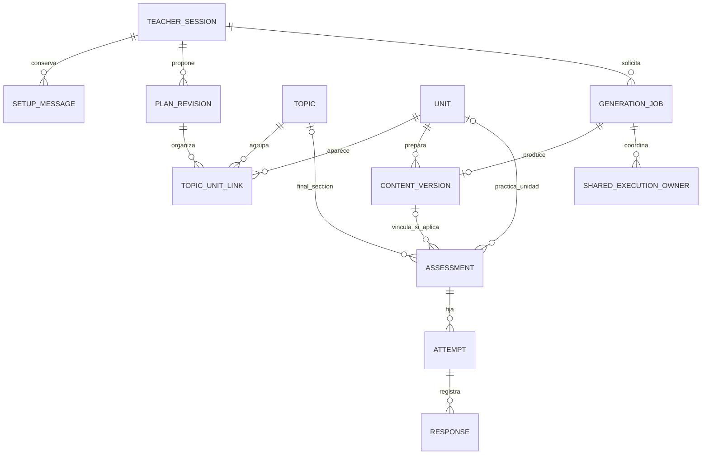

# Plan de implementación de Nodia Teacher

> Corte técnico previo2026-11-03 (la continuación completa y recuperación final están en[§27](#27-recorrido-completo-gemini--continuación-solicitada)): [§26](#26-recorrido-directo-vm--2026-11-03) y [evidencia](../evidence/teacher-v1-vm-process-20261103-r01.json) actualizan los checklists históricos. Ambos proveedores Teacher tienen su alcance exacto comprobado; ClientR03/continuidad y compatibilidad Chat pasaron. Respaldo DB final/restore/GCM y captura privada final/copia/GCM/reanudación pasados; sin aprobación/publicación documental.

> R06, 2026-11-01: solicitud de comenzar ahora en contexto nuevo. Ruta `/nodia-teacher`, dominio propio y ampliación transversal de rutas/BD conforme a [98](98-nodia-teacher-start-handoff.md#solicitud-vigente-para-comenzar-ahora). Conserva contratos/modelo97 y las16 tareas de Teacher. Umbral≥90% confirmado; tareas pendientes, sin ejecución de código o migraciones por esta actualización documental.

## 0. Ampliación previa de rutas y BD

Antes de TH-01, inventariar las rutas funcionales de Client, definir el mapa a destinos sin prefijos de sección y documentar la decisión transversal. Migrar los enlaces persistidos y sus referencias reales conservando IDs, permisos, relaciones y asignaciones; coordinar las constantes, guards, políticas HTTP y catálogos. Probar en DB descartable y verificar que mover/renombrar grupos conserva el acceso. [98](98-nodia-teacher-start-handoff.md#solicitud-vigente-para-comenzar-ahora) fija el alcance confirmado. No modificar APIs de recursos por arrastre ni ampliar permisos de NodiaAI. El informe debe separar preparación, ensayo y aplicación efectiva de la migración.

Teacher se desarrolla en `nodia-client/src/modules/teacher/` y `nodia-server/src/teacher/`, con `/nodia-teacher` y `/nodia-teacher/:sessionId`. Registrar la entrada en el selector de URLs para asignación manual por mantenedor, sin asignación masiva. La imagen de98 complementa el diseño de Nodia; la entrada Mis planes y la compatibilidad móvil se mantienen. TH-03/08 y todas las verificaciones de autoridad deben consumir este contrato actualizado.

## 1. Resultado que debe entregar el implementador

Una persona entra en **Estudios → Nodia Teacher**, crea una sesión sobre un tema libre, completa un formulario breve y conversa con Teacher para concretar lo que quiere aprender. Teacher ofrece un recorrido por jornadas o tópicos. La persona revisa y crea el plan; sus tópicos, objetivos y guías internas quedan guardados. Al avanzar se prepara el material de cada unidad con teoría, ejemplos, preguntas y feedback, conservando respuestas y punto de continuación.

Inglés cotidiano y tecnológico es un caso de aceptación; una materia no lingüística debe funcionar con el mismo motor. No implementar un módulo Inglés ni un curso fijo. Compartir proveedores/configuración con NodiaAI no significa compartir su conversación, permisos, retención o herramientas de negocio.

Lectura del paquete: [especificación95 y diagramas](95-studies-adaptive-learning.md), **este96 como orden de ejecución**, [modelo/contratos97](97-nodia-teacher-technical-contracts.md), [mensaje de inicio98](98-nodia-teacher-start-handoff.md) y [ADR089 propuesto](../architecture/decisions/ADR-089-versioned-study-plans-and-content.md). Las [fichas Teacher](../nodia-ai/knowledge/studies/README.md) describen contexto candidato. Reglas vigentes: [acceso89](89-module-access-and-user-data-scope.md), [contrato de proveedores](ai-provider-feature-contract.md), [verificación91](91-ai-provider-onboarding-verification.md) y [runtime92](92-nodia-ai-api-chat-parity.md); ventas NodiaAI sólo lectura por94 R17.

El diseño deja de delegar ERD/DTOs/políticas completos a una entrevista inicial:97 los concreta. TH-01 contrasta ese contrato con el checkout/baseline real y resuelve diferencias de implementación, no vuelve a descubrir el producto. Si una fila orientativa anterior de96 difiere del contrato técnico97,97 precisa campos, estados, límites y serialización; las reglas confirmadas de95 y AGENTS conservan prioridad. Registrar cualquier ajuste técnico con su motivo y mantener el paquete coherente.

## 2. Alcance de la primera entrega

Incluye sesiones privadas, formulario, borrador durable, selección IA exacta, mini chat de definición, propuesta estructurada, jornadas/tópicos, aceptación de revisión, generación textual progresiva por unidad, prompts internos versionados, lector, preguntas de selección y completar, respuesta breve, corrección/feedback, desafío de conocimientos previos y pausa/reanudación. Un diagnóstico es opcional según el objetivo y no certifica un nivel.

No incluye voz, pronunciación, generación de audio/imágenes, carga de documentos, navegación autónoma por URLs, importación/sincronización con Obsidian, aplicación offline, curso predeterminado, marketplace, colaboraciones, notificaciones o programación automática de estudio. Son ampliaciones independientes. El mini chat de definición sí forma parte de esta entrega; no confundirlo con una conversación oral de práctica futura.

Decisiones del diseño V1 para ejecutar sin otra ronda de decisiones rutinarias: una primera unidad por intención explícita; sin precarga de todo el curso; jornadas secuenciales sin calendario obligatorio; guardado en Server; archivo reversible, sin purga automática ni botón Eliminar en esta versión. Contenido y snapshots privados se conservan mientras exista la sesión, bajo su autoridad; archivo no borra.97 fija límites de entrada/trabajo y política de evaluación/consulta. No son cuotas del proveedor ni una ampliación de modalidades. La organización no impone minutos diarios.

## 3. Recorrido y pantallas

| Paso | Información y acción | Resultado persistente |
|---|---|---|
| Listado | «Mis planes de estudio» propios, retomar/unidad prevista y crear otro; borradores identificados sin fingir que ya tienen plan | Consulta autorizada/paginada sobre sesiones y su plan aceptado; ninguna inferencia por listar |
| Formulario | Tema/objetivo requeridos; base, contexto, idioma opcionales; Teacher propone/jornadas/tópicos | Sesión draft; falta de proveedor no impide guardar |
| Selección IA | Conexión/mode/model/effort visibles; opciones dinámicas y elegibilidad exacta | Selección/configuración vinculadas al trabajo, sin key en Client |
| Definición | Formulario como contexto inicial; mensajes breves y dudas relevantes | Mensajes, resumen estructurado y opciones; no lecciones completas |
| Opciones | Teacher recomienda organización y explica alcance; usuario puede cambiarla | Preferencia elegida; cantidad sólo si jornadas |
| Diagnóstico opcional | Se ofrece si ayuda; autodeclaración o prueba con alcance explícito | Evidencia separada; omitir deja desconocido |
| Vista previa | Tema, objetivos, tópicos, unidades, prerrequisitos, idioma, organización y evaluación | Propuesta versionada; editar invalida la revisión anterior |
| Crear plan | Acción explícita sobre revisión/hash; preparar primera unidad opcional y visible | Aceptación local idempotente; generación posterior independiente |
| Workspace | Índice de tópicos, jornadas/unidades, preparación real, cursor y repasos | Plan disponible incluso si falla otra preparación |
| Estudiar | Teoría y quizzes formativos; acceso a prueba final de sección antes o después de leer | Final independiente del paquete de unidad, cobertura de sección y evidencia con condiciones |
| Pausa/retorno | Guarda fase, ejercicio y borrador; reanudar no genera material nuevo | Cursor recuperable e identidad del trabajo en vuelo |

El flujo completo de creación y el ciclo de estudio están en95 §3. Tema, sesión, plan, unidad y visita son conceptos distintos. Una sesión puede ocupar muchas visitas; una unidad puede atravesar varias jornadas. Cambiar la presentación no cambia IDs ni respuestas; cambiar objetivos/distribución crea una revisión futura.

### 3.1 Revisión y ajustes detallados

Aplicar los [dos subflujos de95 §3](95-studies-adaptive-learning.md#revisar-y-ajustar-el-plan-r03). La revisión presenta resumen, base declarada/observada, temario/unidades, organización, preferencias y evaluación. Edición directa y ajuste por Teacher son intenciones diferentes: la primera valida y guarda otra revisión sin inferencia; la segunda crea un trabajo vinculado a la revisión actual y devuelve una candidata/diff. Conservar el borrador anterior y permitir usar o descartar esos cambios. Una respuesta tardía no reemplaza revisiones posteriores.

«Usar estos cambios» es una mutación sin inferencia con los campos literales de97: candidate_id, expected_base_revision_id, expected_base_hash y expected_session_revision; la identidad idempotente va en Idempotency-Key. Server valida candidata/sesión/base/esquema/vigencia y crea otra revisión con procedencia. No aplicar por PATCH de campos copiados ni saltar un conflicto; candidata y borrador se conservan.

Materializar en TH-01 los campos/validadores de97: orden/prerrequisitos acíclicos, referencias de unidades, modalidad/cantidad condicionales, formatos/políticas e integridad entre objetivos y distribución. Excluir un tópico reduce alcance y no crea evidencia de dominio. Distinguir bloqueos estructurales de recomendaciones pedagógicas. Guardar un borrador incompleto es posible; aceptarlo exige el contrato de creación.

### 3.2 Creación y guardado detallados

«Crear plan» acepta la revisión/hash observados mediante acción directa. Validar acceso y campos de97 expected_session_revision, proposal_revision_id y proposal_hash, con Idempotency-Key; guardar en una transacción la revisión aceptada, organización, tópicos/unidades, guía/políticas/plantillas, vínculo de sesión/cursor y recibo. Aceptar una propuesta existente no llama al proveedor ni requiere su disponibilidad para material nuevo.

El mismo comando recupera el mismo resultado. Si otra intención ya creó el plan inicial desde esa revisión exacta, recuperar ese plan sin duplicar; otra revisión aceptada produce conflicto y conserva el borrador local. Una respuesta perdida se consulta por request_key, no autoriza crear otro plan. La transacción fallida conserva la propuesta y el formulario; no cerrar su editor como si hubiera guardado.

Después de guardar se ofrecen «Preparar primera unidad» y «Continuar después». Preparar tiene request/job y presupuesto separados; su rechazo no revierte la creación ni se muestra como fallo del guardado. No enviar automáticamente una preparación no aceptada. Una edición de un plan activo pertenece a una revisión posterior, no al endpoint de creación inicial ni a una sobrescritura del material/intentos históricos.

### 3.3 Preparación y persistencia del paquete

Aplicar [95 R04](95-studies-adaptive-learning.md#preparar-la-primera-unidad-y-guardar-su-material-r04). Resolver sesión/revisión aceptada/unidad/propósito antes de generar. Devolver material vigente listo o job activo de la misma intención; impedir dos preparaciones equivalentes concurrentes aunque lleguen desde dos pestañas con request_keys distintos. Una variante nueva es otra intención explícita, no una reapertura ni un reintento de unknown.

learning_packet fija guía/plantilla/prompt, objetivos, revisión/unidad y snapshot acotado de evidencia. Incluye teoría por bloques con IDs estables, ejemplos, práctica y quiz formativo privado: no una inferencia por pantalla o pregunta. La final de sección se prepara con assessment_only sin exigir paquetes de todas sus unidades. Parsear/validar todo antes de publicar. En una transacción local guardar versión, relación con assessment/clave privada y receipt/estado final; el mapper público nunca devuelve el solucionario o snapshot interno. Recibir una salida completa pero inválida es failed_known de contenido, no una lección vacía ni un resultado remoto incierto.

Volver a comprobar acceso/revisión al publicar. Un resultado de una revisión anterior mantiene procedencia, pero no se convierte silenciosamente en versión vigente. Una respuesta SQL perdida recupera receipt; no vuelve al proveedor. La UI muestra hitos reales, sin simulación de porcentaje/tiempo. Un proveedor caído no bloquea leer o responder selección sobre material previamente guardado con Server disponible.

### 3.4 Lector y quiz formativo por pregunta

El lector conserva fase, content_version, bloque/ejercicio y ancla estable. Recorrer una pantalla o mover el scroll no prueba dominio. La práctica guiada y el quiz tienen condiciones distintas: registrar ayuda/solución vista; una comprobación independiente no conserva esa etiqueta si recibió asistencia.

El envío/corrección por pregunta de este apartado corresponde a unit_practice; no se aplica a section_final. En la final, «Siguiente» navega/autoguarda y sólo entregar la prueba permite revelar correcciones. El90% confirmado se aplica a esa final, no a cada ejercicio ni como bloqueo para seguir leyendo.

Iniciar intento fija assessment_version, política/rúbrica y orden de preguntas/opciones. GET del intento entrega la pregunta activa y feedback autorizado de envíos anteriores, no la clave o todas las preguntas futuras. El borrador se autoguarda de forma acotada sin evaluar ni avanzar. Enviar por pregunta es otra mutación idempotente con question_id y versiones esperadas: persistir respuesta y corrección determinista/recibo/progreso aplicable juntos, o respuesta+intención de feedback para formatos abiertos. Un autoguardado tardío no sobrescribe un envío confirmado.

Selección usa clave conocida sin IA. Completar usa alternativas/normalización contractuales; ambigüedad no es cero inventado. Producción abierta devuelve feedback_pending y job: conservar respuesta ante fallo/unknown y no declarar nota final mientras falte evidencia necesaria. Después del feedback, avanzar por acción explícita y guardar el nuevo cursor. Finalizar el intento calcula su resumen desde evidencia persistida, sin reenviar correcciones o duplicar puntos. Nuevas variantes/explicaciones generativas tienen intención/budget propios; no están ocultas en GET o en «Siguiente».

### 3.5 Pausa y reanudación confirmadas

Materializar el snapshot de continuidad de97: fase, content/assessment_version, bloque/ejercicio/question_id, attempt_id, orden fijado, borrador, revisiones y referencias a jobs/requests. El POST pause combina cursor/borrador válido y estado pausado en una transacción/recibo, revalidando versiones y respuestas ya enviadas. Coordinar autoguardados en vuelo; conflicto conserva el borrador y no fuerza overwrite. Mostrar saving/saved/unsaved reales; si falla, no navegar fuera ni afirmar guardado.

Si se perdió la respuesta, consultar la identidad/payload originales: un receipt confirmado completa la pausa sin otro POST; pending/sin confirmar mantiene conciliación. No cambiar el payload de esa intención con teclas posteriores; cualquier diferencia pendiente se guarda después con su revisión/intención correspondiente. Sólo un rechazo conocido corregido vuelve al flujo de envío explícito.

Cerrar pestaña sin confirmación sólo recupera lo confirmado en Server. No depender de beforeunload ni prometer captura de la última tecla. Resguardo local durable, si se propone posteriormente, requiere autoridad/aislamiento/retención propios y no crea modo offline. Cache y respuestas tardías deben aislarse por usuario/sesión; reautenticación revalida ámbito y no restaura datos al cambiar de usuario.

La pausa impide armar nuevos dispatches bajo la misma barrera/fence que el worker. Un dispatch ya armado puede continuar y guardar su resultado original sin despausar ni encadenar la siguiente unidad. Los jobs aún no armados se retienen mediante bloqueo explícito de pausa; resume de sesión sólo recupera continuidad. Continuar una preparación previa al dispatch requiere otra acción explícita sobre ese job y prueba de que no estaba armado/enviado; no reiniciar jobs unknown. Revalidar selección, presupuesto, deadline y autoridad antes de permitirla. El estado visible de material puede ser pendiente/conciliación, nunca failed reintentable por mapear unknown.

### 3.6 Prueba final de sección y política del90%

Aplicar [95 R05 §17](95-studies-adaptive-learning.md#17-práctica-y-prueba-final-de-sección-r05). Sección/tópico agrupa una o más unidades y objetivos del plan; la organización por jornadas no cambia el alcance de su final. scope/purpose diferencia diagnóstico, unit_practice y section_final. La comprobación para saltar una sección es section_final con entry_route direct; la otra ruta es after_study. Ambas fijan cobertura, pesos/rúbrica, dificultad prevista y el mismo umbral≥90%. Ese umbral está confirmado; la separación de feedback y las variantes son propuestas que se materializan como política explícita en TH-01, sin aprobar el documento completo.

Iniciar la final no requiere content_version de lecciones no preparadas. Recuperar intento/job vigente o preparar assessment_only para sección/revisión/objetivos/política; no generar todas las unidades. En el intento guardar respuestas/borradores y navegación sin exponer claves, puntuación parcial, pistas o explicaciones. Se pueden revisar respuestas antes de entregar. GET/serializadores y el endpoint de enviar pregunta deben impedir filtrar feedback usando otra ruta. Una ayuda explícita se registra y no convierte práctica asistida en una final independiente.

POST submit final valida cobertura de respuestas: omisión sigue incompleta; «No lo sé» es explícito y sin acierto, no desconocido técnico. En una transacción fijar conjunto de respuestas, versiones/puntos posibles y recibo; corregir determinísticamente o encolar feedback abierto durable con contenido congelado. No permitir autosaves/otra pestaña sobre el intento enviado. Mantener pending mientras falte corrección necesaria; no mostrar aprobado/reprobado por un subtotal. Tras entregar mostrar respuesta real, correcta/alternativas, criterio/puntos y explicación de esa versión. Explicación ausente queda pendiente y su generación no recalifica por sí misma. Ítem inválido exige revisión trazable, sin alterar el denominador histórico a escondidas.

Comparar puntos exactos contra≥90%, sin redondear. Pesos y denominador fijados antes; validar rango/coherencia y puntos posibles positivos. Con cobertura completa:90 pasa,89,6 no pasa,100 pasa; pending no tiene porcentaje final. No sumar puntos entre intentos, promediar fallos previos ni bajar dificultad/cobertura para aprobar. Si no alcanza90%, refuerzo focal propuesto y nuevo intento con variantes que cubran toda la sección. Reordenar respuestas iguales no basta. Nuevo intento usa otra intención/assessment apto; no confundirlo con recuperar un intento incompleto. Con90% o más no exigir100%; errores conservados como repaso recomendado. La sección verificada habilita avance/salto según el plan, sin marcar teoría como leída o aprobar otras secciones.

## 4. Estados y fronteras transaccionales

| Agregado | Estados candidatos | Regla |
|---|---|---|
| Sesión | draft, active, paused, completed, archived | Guardar draft no genera; pausar bloquea nuevos dispatches; completar no certifica dominio |
| Revisión de plan | proposed, accepted, superseded | Aceptar exige versión/hash exactos; preservar revisión usada por intentos |
| Trabajo de generación | queued, running, ready, failed_known, unknown, cancelled_before_dispatch | Separar motivo de error, cierre local y resultado remoto; unknown nunca activa replay |
| Material | not_prepared, preparing, ready, failed, reconciling | Proyección del trabajo/versión publicada; unknown se muestra bloqueado en reconciling con referencia al job, nunca como failed reintentable |
| Aprendizaje | not_started, in_progress, practiced, verified | La disponibilidad del material no altera esta evidencia |

Implementar las transiciones y política de97, distinguiendo recorrido, respuesta, resultado y comprobación independiente. R05 confirma≥90% en la final de sección; no es un umbral global para diagnóstico/práctica. La rúbrica de Obsidian no se importa automáticamente. Un resultado abierto pendiente no es cero ni éxito. Saltar exige final de sección con cobertura/condiciones explícitas, no un clic ni aprobar una unidad. Repaso V1 reutiliza errores/feedback y bloques pertinentes por acción explícita, sin scheduler o inferencias automáticas.

Crear plan + aceptar revisión es una transacción local. Programar generación usa una intención durable/outbox compatible con la coordinación común; no mantener esa transacción abierta durante la inferencia. Persistir resultado validado + versión + estado final es atómico. Enviar una respuesta + corrección determinista + recibo/progreso es atómico. Corrección abierta costosa es otro trabajo recuperable, no una llamada oculta dentro de esa transacción.

## 5. Reutilización IA comprobada y extracción necesaria

| Fuente actual | Qué existe | Consecuencia para implementar |
|---|---|---|
| [AiProviderModule](../../nodia-server/src/ai-provider/ai-provider.module.ts) y [GetSelectableModels](../../nodia-server/src/ai-provider/use-case/get-selectable-models.use-case.ts) | Configuración/modelos compartidos desde Server | Reutilizar la fuente, no otra tabla de proveedores ni secretos en Teacher |
| [Resolver de adaptador](../../nodia-server/src/nodia-ai-adapter/use-case/resolve-nodia-ai-adapter.use-case.ts) | Selección exacta, flags y configuración | Extraer resolución común preservando identidad/histórico; sin modelos por defecto |
| [Credenciales API](../../nodia-server/src/nodia-ai-adapter/api-nodia-ai-credentials.service.ts) | Configuración/epoch y key seleccionada privada | Compartir internamente; sólo etiquetas/máscaras públicas |
| [Transporte API](../../nodia-server/src/nodia-ai-adapter/api-nodia-ai-chat-transport.ts) | Texto y function calling; presupuestos/cierres en su runtime | Reutilizar transporte con envelope Teacher; no asumir JSON Schema remoto ya implementado |
| [Tipos del adaptador](../../nodia-server/src/nodia-ai-adapter/types/nodia-ai-adapter.types.ts) | observe/measure/verify/execute ligados al runtime actual | Base para un puerto interno de generación; no está Teacher-ready |
| [Codex común](../../nodia-server/src/common/ai/codex/codex-chat-runtime.ts) y [Gemini Agentic](../../nodia-server/src/nodia-ai-adapter/use-case/gemini-nodia-ai-adapter.use-case.ts) | Supervisión, perfiles, prueba terminal y contexto específicos | Una única coordinación de capacidad; envelope sin herramientas y restricciones nativas comprobables |
| [Política HTTP](../../nodia-server/src/authorization/http-module-policy.ts) y [servicios Client del chat](../../nodia-client/src/modules/nodiaAi/infrastructure/services.ts) | /nodia-ai/connections exige módulo NodiaAI | Fachada Teacher de catálogo/eligibilidad con autoridad Teacher; no bypass ni acceso a Ajustes IA |

ApiNodiaAiRuntimeService.armed/reserveExchange y los claims actuales dependen de nodia_ai_job_attempts/jobs/runs/runtime_slots. El primer POST se reserva al armar el dispatch; los posteriores en reserveExchange. La extracción debe conservar esta división sin cobrar dos veces ni transmitir antes de reservar. No crear un chat o run ficticio para satisfacer esos JOINs.

Diseñar un puerto interno de generación, nombre candidato AiGenerationPort: propósito, selección exacta, origen durable chat/teacher, prompt canónico/versionado, esquema esperado, límites/deadline y callbacks de ownership/reserva/cierre. No es una API pública de prompts arbitrarios. Chat mantiene wrappers compatibles. Teacher tiene sus propios jobs de dominio, pero comparte coordinación de perfiles/conexiones y prueba terminal con el chat; una segunda cola sin esa coordinación no resuelve concurrencia.

97 fija el vínculo de dispatch/slot con un dueño existente mediante operación neutral, XOR/FKs y slot canónico. No aceptar owner_type/owner_id libre de Client ni vínculo polimórfico sin integridad. Ensayar su migración aditiva y compatibilidad de trabajos pendientes antes de cambiar un entorno real; no rediseñar ese ownership mediante conversaciones ficticias.

La lane Teacher inicial tiene herramientas vacías y no recibe ToolGateway. En API se omiten/rechazan function calls; en Agentic se deben impedir también herramientas nativas de archivos/comandos/red/agentes. No basta una frase en el prompt. Si un adaptador no puede imponerlo, queda no calificado para Teacher, con razón visible. Reutilizar proveedor no equivale a aceptar todos sus modos o modalidades.

## 6. Información que debe modelarse

Este diagrama resume conceptos.97 concreta tablas/campos, relaciones, índices y DTOs; TH-01 los contrasta con el baseline y materializa schemas/migraciones antes de ejecutarlas. El diseño técnico no se declara aprobado por estar completo.



Decisiones obligatorias del ERD:

- Actor/owner derivado de autenticación; todas las relaciones entre sesión, unidad, versión, intento y job deben impedir mezclar sesiones/usuarios. Super_admin conserva89 y atribución real.
- UUIDs para agregados nuevos; IDs bigint existentes viajan como strings. Relaciones bidireccionales TypeORM con Relation<T> y arranque ESM/DI comprobado.
- Versiones inmutables de plan, paquete, assessment, rúbrica y plantilla. Fijar versión al iniciar un intento; un cambio futuro no recalcula lo histórico silenciosamente.
- Assessment con ámbito unit_practice/section_final/diagnostic y referencias coherentes por FK/CHECK, no un scope_id arbitrario. Una final se vincula a sección/revisión/objetivos sin material previo obligatorio. Intento fija política/pesos/denominador/umbral, ruta directa/estudio y condición de feedback; aprobación de sección y lectura de unidades son evidencias distintas.
- Prompt/guía como parte del plan y snapshot privado por trabajo, no en ai_providers.fields. Material público separado del solucionario/rúbrica privada y del contexto interno.
- Cursor y borradores de respuestas en Server; cache Client segmentada por usuario/sesión. Clave idempotente única por actor en todo Teacher: UNIQUE(actor_id, request_key), con operación y sesión/destino dentro del hash canónico. Esto cubre también el alta antes de existir sesión. La misma clave con otra operación/sesión es conflicto; recibo y cambio comparten transacción.
- Índices para propietario/estado/updated_at y cola/lease; unicidad de revisión, versión y pregunta por intento. Paginación y carga por unidad evitan N+1 o descargar todo el curso.
- Archivo conserva materiales/progreso. Definir borrado físico, snapshots y jobs pendientes antes de ofrecer eliminación; no copiar la retención del chat ni crear retención perpetua implícita.

## 7. Contratos HTTP candidatos

Rutas relativas al prefijo API existente; todas son **propuestas nuevas**, no endpoints disponibles. Validación estricta de DTO/response, política HTTP explícita y autoridad del recurso. Alias no crean operaciones adicionales.

Los nombres literales de DTO/body son los de97. request_key en este documento describe la identidad derivada del header **Idempotency-Key**, no otro campo público del body. Client/DTOs/QA deben consumir ese contrato, no inventar aliases de expected_*_version o scope libre.

| Operación | Contrato candidato | Respuesta/garantía a concretar |
|---|---|---|
| Selecciones Teacher | GET /teacher/connections y GET /teacher/connections/:id/eligibility | Proyección pública y selección exacta; sin exigir módulo de chat o administración |
| Sesiones | GET/POST /teacher/sessions; GET/PATCH /teacher/sessions/:id | Listado paginado; draft sin inferencia; revisión esperada en cambios |
| Definición | GET/POST /teacher/sessions/:id/messages | Mensaje persistido una vez; POST devuelve job si genera respuesta |
| Proponer plan | POST /teacher/sessions/:id/plan-proposals | 202 con job/request ID; revisión de formulario/conversación fijada |
| Revisar/editar | GET/PATCH /teacher/sessions/:id/plan-proposals/:proposalId | PATCH manual sin inferencia; expected_revision/hash y campos permitidos; guardar otra revisión y devolver sus diferencias |
| Ajustar con Teacher | POST /teacher/sessions/:id/plan-proposals | Intención explícita con propuesta/revisión de origen e instrucciones; job para nueva candidata, sin reemplazar automáticamente el borrador |
| Usar candidata | POST /teacher/sessions/:id/plan-proposals/:proposalId/apply-candidate | candidate_id, revisión/hash base y sesión esperados; validar identidad/procedencia y crear otra revisión sin inferencia; conflicto si quedó obsoleta |
| Aceptar | POST /teacher/sessions/:id/plan-proposals/:proposalId/accept | Revisión/hash y sesión vigentes; transacción local sin inferencia; conflicto si se aceptó otra revisión; no presupone material listo |
| Preparar unidad | POST /teacher/sessions/:id/units/:unitId/material | Reutiliza versión lista o job activo de la misma intención; nueva variante exige intención explícita |
| Leer unidad | GET /teacher/sessions/:id/units/:unitId | Teoría/ejemplos/práctica de versión guardada y disponibilidad de evaluación; sin solucionario ni preguntas futuras del quiz |
| Iniciar práctica | POST /teacher/sessions/:id/units/:unitId/attempts | purpose unit_practice y assessment fijo; no verifica una sección completa |
| Iniciar final | POST /teacher/sessions/:id/sections/:sectionId/attempts | purpose section_final y entry_route direct/after_study; recuperar vigente o ACK/job de evaluación si falta; sin material previo obligatorio |
| Recuperar intento | GET /teacher/sessions/:id/attempts/:attemptId | Misma versión/orden y borrador; práctica admite feedback previo autorizado, final sólo tras entregar; sin clave/puntos/explicaciones durante final |
| Borradores | PATCH /teacher/sessions/:id/attempts/:attemptId/responses | Autoguardado con versiones esperadas; no evalúa ni avanza, no sobrescribe envíos |
| Enviar pregunta de práctica | POST /teacher/sessions/:id/attempts/:attemptId/responses/:questionId/submit | unit_practice solamente: respuesta+corrección o feedback_pending; denegar ruta para obtener claves/puntos de una final en curso |
| Entregar/finalizar intento | POST /teacher/sessions/:id/attempts/:attemptId/submit | En section_final congela todo y corrige/agenda feedback una vez; en práctica resume evidencia; receipt idempotente, sin nota final si hay pendientes |
| Continuidad | PATCH /teacher/sessions/:id/cursor; POST .../:id/pause; POST .../:id/resume; POST .../:id/archive | Versiones esperadas; pause guarda cursor/borrador y estado juntos; resume recupera sin generar |
| Trabajos | GET /teacher/jobs/:jobId y GET /teacher/requests/:requestKey | Recibo por actor autenticado+requestKey único; revalidar autoridad del recurso asociado; recupera también el alta sin conocer sessionId; sin replay generativo |
| Continuar trabajo retenido | POST /teacher/jobs/:jobId/continue-before-dispatch | Material o feedback: sólo job previo no armado/despachado, intención explícita y versiones/condiciones revalidadas; jamás unknown |

TH-01 debe materializar schemas/errores de97 antes de conectar Client: payloads acotados, campos permitidos, semántica null/ausente, revisiones enteras, request_key estable y hash canónico. La misma clave con otro payload es conflicto. Un202 no es una lección lista. Las rutas de esta tabla son resumen;97 fija DTO/respuesta y guardas por operación.

Errores públicos diferenciados: validación, sesión/recurso ausente o no autorizado con política89, revisión obsoleta, selección/configuración cambiada, sin modelo, adaptador sin calificar, perfil ocupado, presupuesto agotado, rechazo conocido, salida inválida y resultado remoto unknown. Mostrar mensaje seguro específico y conservar inputs; nunca exponer claves, logs privados o respuesta cruda con secretos.

## 8. Prompts, salidas y evaluación

| Propósito de generación | Entrada mínima del servidor | Salida validada |
|---|---|---|
| setup_reply | Formulario, últimos mensajes pertinentes y resumen versionado | Texto visible, brief estructurado, dudas y opciones de organización |
| plan_outline | Brief, organización elegida, evidencia inicial y política | Tópicos/unidades/objetivos/prerrequisitos; jornadas si aplica; sin generar todo el material |
| learning_packet | Revisión aceptada, unidad, guía y evidencia pertinente | Teoría, ejemplos, práctica, preguntas y clave/rúbrica privada separables |
| assessment_only | Sección/revisión, objetivos/cobertura, política/pesos y exclusión de ítems ya vistos cuando proceda | Final independiente de paquetes de unidad, con variantes y clave/explicación privadas; diagnóstico tiene su alcance propio |
| written_feedback | Respuesta real, objetivo, rúbrica fijada y ayuda registrada | Feedback por criterio y límites/estado pendiente; no una actualización libre de progreso |

Una plantilla mantenida en código por propósito, con versión/hash. Cada plan guarda guía estructurada; cada job guarda el prompt efectivo privado o una copia inmutable de plantilla/variables/contexto que permita reconstruirlo sin depender del código de la última release. El snapshot se acota y comparte autoridad/retención de Teacher; no incluye secretos, razonamiento privado o logs crudos ni se muestra como material público. Prompts del usuario se tratan como datos de tema/objetivo y no pueden ampliar permisos ni sustituir instrucciones de seguridad. No enviar todos los chats, planes ni errores de otros usuarios.

El transporte devuelve texto: parsear y validar JSON estricto en Server, referencias a IDs del plan, ausencia de ciclos/prerrequisitos imposibles, cobertura, enums de tipo de pregunta, unicidad, número de soluciones y tamaño. Una salida inválida es un fallo conocido del contenido si se recibió completa; no un curso vacío ni unknown remoto. No iniciar un bucle automático de «repara JSON» que eluda presupuesto o reenvíe un resultado incierto.

Para selección, corregir en Server con la clave/versiones conocidas; no inferencia por pregunta. Completar admite alternativas explícitas y una política de normalización documentada; una variante no prevista puede requerir revisión, no una penalización inventada. Respuesta breve usa rúbrica y trabajo de feedback separado. Pistas/solución vista quedan registradas y no cuentan como comprobación independiente.

Validar schema no garantiza exactitud pedagógica o factual. Usar un conjunto revisado de casos sintéticos de Inglés y otro tema, comprobar ambigüedad/distractores y feedback, y permitir reportar un ítem. Una referencia sólo se etiqueta verificada si realmente fue consultada por un mecanismo autorizado; la IA no acredita una fuente por escribir una URL.

## 9. Presupuesto, concurrencia y recuperación

- Alcance y presupuesto finitos fijados por trabajo y sesión; cada POST al proveedor reserva antes de transmitir, incluida cualquier continuación. Nunca cobrar dos veces el primero ni ampliar el techo por reiniciar worker/reabrir página. Los valores son límites técnicos documentados en TH-01, no cuotas inventadas del proveedor.
- Locks/leases/fences y capacidad compartidos entre chat y Teacher; no transacción SQL abierta durante red. Un perfil ocupado conserva cola/causa visible y no cambia proveedor.
- Duplicado concurrente del mismo comando recupera request/job/resultado. Cancelar antes del dispatch es demostrable; después, cerrar localmente y conciliar sin suponer cancelación remota.
- Tras timeout/COMMIT perdido, Client consulta estado/recibo con la identidad original; no vuelve a enviar la inferencia. Un resultado remoto unknown permanece tal aunque se cierre la propiedad local. Una nueva generación, si se permite después de conciliar, es una intención distinta, visible y presupuestada.
- Pausa bloquea nuevos envíos mediante precondición revalidada en el punto de armado. Trabajo ya iniciado puede guardar su resultado en la versión original; no enviar la siguiente unidad. Reanudación recupera ese estado.
- Revisión/contexto cambiado o acceso revocado impide publicar resultado como material actual. Conservar receipt mínimo necesario para conciliar según retención definida; no filtrar contenido a otro usuario. Fallar una unidad no invalida las ya preparadas.
- Cambios de conexión/mode/model/effort o epoch invalidan observaciones anteriores; el usuario vuelve a elegir. Sin fallback de modelos/proveedores ni adaptación silenciosa de modalidad.

## 10. Tareas y dependencias

En el corte de planificación todas las tareas estaban pendientes. El estado de la implementación del2026-11-01 se registra en§21 y su recibo. Cada tarea entrega regla/contrato, implementación, pruebas pertinentes y ficha coherente; no cerrarlas sólo por crear archivos. Los ámbitos siguientes guiaron el trabajo paralelo autorizado después de fijar contratos.

| ID | Depende de | Ámbito y entrega | Aceptación observable |
|---|---|---|---|
| TH-01 | — | Contrastar97/ADR089 con baseline real, materializar schemas/DTOs/migraciones y registrar ajustes de compatibilidad | Contratos de97 trazados al código, versiones/constraints y transición de runtime verificables; no entrevista de producto pendiente ni vínculo fake con chat |
| TH-02 | TH-01 | Infraestructura IA: extraer selección/credenciales/dispatch/capacidad; wrappers chat compatibles | Mismos contratos de chat y presupuesto/cierre; perfiles Teacher/chat no se solapan; writers de ventas siguen retirados |
| TH-03 | TH-01 | Backend Teacher: módulo, entidades, migraciones/constraints, autorización y fachada pública de selecciones; alta idempotente del grupo Estudios/módulo Teacher o reutilización comprobada | Preservar identidades existentes y sin asignación masiva a usuarios; Teacher sin módulo NodiaAI puede ver selecciones autorizadas; sin Teacher no accede; datos propios y super_admin89 |
| TH-04 | TH-02,03 | Jobs Teacher: admisión, prompt refs, worker compartido, budgets/leases/proof y lane sin herramientas | Identidad durable propia; no POST sin reserva; no herramientas de negocio/nativas; unknown sin replay |
| TH-05 | TH-03,04 | Formulario/chat/plan: draft, mensajes, opciones, edición manual, candidata asistida/diff y aceptación de revisión | Cualquier tema; jornadas/tópicos; editar sin inferencia; candidata obsoleta no se aplica; creación única recuperable y guardado posible con proveedor caído |
| TH-06 | TH-05 | Contenido: lookup de paquete/job, snapshot de contexto y paquete/assessment/recibo versionados en transacción | Concurrencia no duplica preparación; listo sólo tras commit; inválido no publica; clave privada y revisión vigente comprobadas |
| TH-07 | TH-06 | Aprendizaje: ámbito/purpose de práctica y final, entrega por pregunta o conjunta, feedback/política90%, evidencia y continuidad | Final directa sin lecciones; no filtrar claves/puntos antes de entrega;90 exacto pasa,89,6 no; pendientes sin fallo ficticio; reintento nuevo y sin duplicados |
| TH-08 | TH-01 | Client shell: constante/ruta lazy, catálogo de navegación y selector de URLs, listado/sesión y estados | /nodia-teacher bajo guard; módulo asignable desde mantenedor, independiente del grupo de menú; móvil deriva catálogo; sin módulo vuelve a Inicio sin consultas privadas |
| TH-09 | TH-03,08 | Client creación: formulario, selector público Teacher, borrador y cache por sesión | Rechazo conserva inputs; selección desaparecida visible; no usa endpoints privados de otro módulo |
| TH-10 | TH-05,09 | Client planificación: chat, opciones, revisión por bloques, comparación de ajustes y aceptación | Conservar/usar candidata; conflicto y borrador intactos; crear una vez, luego preparar ahora/después; guardado no finge material listo |
| TH-11 | TH-06,10 | Client workspace: jornadas/tópicos, paquete observable y lector por bloques/fases | Reabrir reutiliza la versión/ancla; hitos reales; conciliación sin replay; material listo usable con proveedor caído |
| TH-12 | TH-07,11 | Client preguntas: práctica con feedback por envío y final con revisión/entrega conjunta, nota/refuerzo/reintento y pausa | Final no revela corrección al navegar; explicar después correcta/porqué; distinguir90/pending/fallo y variante nueva; conservar orden/texto, historial y ámbito |
| TH-13 | TH-02..07 | Integración backend aislada y regresiones comunes | DB/HTTP/worker prueban barreras, constraints, concurrencia, budgets y crash; no sólo mocks |
| TH-14 | TH-10..12 | QA integrada de riesgos Client→Server y responsive ES/EN | Dos temas/dos organizaciones; errores/pausas/otra pestaña; layouts y feedback correctos |
| TH-15 | TH-13,14 | Cualificación real de Teacher y revisión pedagógica | Evidencia por selección/modo/entorno, sin generalizar texto a voz ni una selección a otra |
| TH-16 | TH-13..15 | Entrega: builds/checks, docs/fichas, evidencias y pendientes de operación | Plan reconciliado; ninguna aprobación/publicación implícita; estado de cada capacidad y límite explícitos |

Orden de ejecución: TH-01; luego TH-02/03/08 independientes; integrar en TH-04/09; TH-05..07 y TH-10..12 en secuencia por contrato; cierre común TH-13..16. Backend IA, Backend Teacher y Client pueden repartirse después de TH-01 con propietarios de archivos explícitos. Una persona integra cambios compartidos de autorización, DI, registro y migraciones. No crear tres implementaciones del selector, del presupuesto o de la política de avance.

## 11. Verificación mínima de valor

| Capa | Casos que justifican la prueba |
|---|---|
| Unidades puras/atómicas | Validadores, brief→plan, orden/ciclos, reparto jornadas, parser/esquemas, clave/respuesta, ayudas, rúbrica y política de avance |
| Hooks/componentes atómicos | Selector exacto y modelo ausente, respuesta obsoleta, borrador/reintento, submit/cursor, feedback pending; sin suites rutinarias de páginas completas |
| PostgreSQL/HTTP aislado | Propiedad/FKs, revocación, super_admin89, aceptación CAS, doble clic/dos pestañas, mismo request con payload diferente, rollback y recibo post-COMMIT perdido |
| Worker/transporte aislado | Competencia chat/Teacher, reserva concurrente antes del POST, primer POST no doble cobrado, cancelación antes/después, crash después de dispatch, proof/ACK/unknown, selección histórica y cambios de epoch |
| Seguridad de la lane | Tema/mensaje/salida maliciosos no activan MCP, function calls, SQL, archivos/comandos/red/agentes ni otras materias/usuarios |
| Recorrido puntual | Crear Inglés por jornadas y otro tema por tópicos, ajustar preview, guardar/leer/quiz, pausar/reforzar/continuar; validación y fallo de una unidad |
| Proveedor real | Según91/92, propósito Teacher, selección exacta, salida conocida y cierre local; calidad pedagógica por separado |

R04 añade riesgos concretos: preparación concurrente que debe recuperar una sola versión/job; recepción correcta seguida de COMMIT perdido; cambio de revisión mientras genera; material sin solucionario/futuras; orden estable tras reload; autoguardado tardío frente a envío confirmado; feedback inválido/unknown pendiente sin nota; pausa con cursor/borrador atómicos y carrera contra dispatch; retorno con proveedor caído sobre material ya listo; dos pestañas o reautenticación de otro usuario; cierre no confirmado sin promesa de recuperar texto no persistido.

R05 añade: final directa sin paquetes; cobertura de sección igual en ambas rutas; no fuga de clave/puntos por GET o submit de pregunta; freezing final y receipt con dos pestañas/COMMIT perdido; explícito «No lo sé» frente a omisión/pending;89,6/90/100 con comparación exacta; explicación pendiente sin cambiar clave; variante nueva y sin sumar entre intentos; final aprobada no inventa lectura ni aprueba otras secciones. Los aliases de purpose lesson_quiz/check_prior_knowledge de borradores anteriores no se implementan como equivalentes de una final de sección.

El blueprint97 cierra además el pending irrecuperable: sólo tras conciliar cierre local, el usuario puede retirar su condición activa con CAS/recibo y pedir otra final con preguntas distintas. Conservar resultado pendiente y respuestas del intento anterior; no reejecutar la misma corrección incierta ni inventar una nota. Probar que un índice de intento activo no deja la sección bloqueada para siempre y que no permite generar una variante antes de conciliar.

Client sigue AGENTS, DESIGN y skills frontend-quality/create-component/responsive-design. MUI/Emotion, Axios/TanStack Query, React Hook Form/Zod con el contrato Server; i18n ES/EN; toast sileo en mutaciones/errores con fuente segura del servidor; modal abierto y datos intactos ante fallo; Boneyard sólo en primera carga informativa, revalidación suave y controles bloqueados. No doble padding, foco/cursor preservados, scrollbars transparentes y lazy con retry local si se aplica. Verificar al menos320/390/600/1280px, teclado, retorno de overlays, temas y cero overflow accidental.

Server sigue AGENTS y skills backend-service-quality/nestjs-service-quality además de las específicas de cada tarea. Priorizar lógica atómica junto a la unidad, integración puntual para garantías entre capas y arranque DI/ESM compilado. No pruebas de controladores que sólo delegan ni test espejo. Build/tipos/lint y suites92/contratos/conocimiento afectados deben pasar; no añadir dependencias o actualizar lockfiles sin necesidad.

## 12. Preparación de entrega y límites

Antes de operar un entorno real, el implementador contrasta baseline de esquema/migraciones, respalda según runbook y define el alcance de instalación/adopción con la autorización vigente. Una solicitud de implementar localmente no equivale a desplegar en VM. No modificar perfiles, keys, sesiones o procesos existentes para facilitar las pruebas; coordinar recursos compartidos. No extender ninguna aprobación de fichas anteriores a Teacher.

Las fichas permanecen draft/planned/unregistered hasta evidencia y cambios reales. Cuando cambie implementación se actualizan estados por función. Publicar requiere aprobación explícita de la revisión exacta y capacidades/bindings verificados. Los prompts internos de Teacher no se publican como conocimiento de producto.

## 13. Mensaje listo para entregar al implementador

El [mensaje canónico actualizado está en98](98-nodia-teacher-start-handoff.md). Incluye alcance, evaluación≥90%, continuidad, restricciones del runtime, orden de trabajo y entrega esperada. Usar ese texto para iniciar mañana, sin copiar versiones intermedias del plan.

Una orden breve equivalente es:

```text
Comienza la implementación completa de Nodia Teacher siguiendo el mensaje de
docs/mvp/98-nodia-teacher-start-handoff.md y el paquete95/96/97/ADR089.
Lee primero AGENTS e índices vigentes. Ejecuta TH-01..16 y puertas G0..G6,
con evidencia AC-01..16 y sin publicar borradores ni adoptar VM en esta orden.
```

Es una entrega para iniciar el2026-11-02, no una automatización. La definición del producto y sus contratos están en95/97; este texto no sustituye su lectura.

## 14. Registro de esta planificación

- [x] Aclaración del usuario reconciliada con95: producto genérico, formulario/chat, dos organizaciones, prompts internos y material progresivo.
- [x] Diagramas funcionales en95 y mapa conceptual de datos en96.
- [x] Fronteras reales de catálogo/runtime inspeccionadas; tareas y dependencias identificadas.
- [x] Mensaje de inicio listo para enviar; ninguna tarea TH marcada implementada.
- [ ] TH-01 y siguientes: ejecución posterior, separada de esta validación documental.

Comprobación del2026-11-01: ocho documentos de producto/ADR/contexto, tres diagramas Mermaid y60enlaces locales comprobados estructuralmente; UTF-8/LF y diff sin errores de whitespace. knowledge:check/build y58pruebas existentes de compilador/pin correctas. Las cinco fichas Teacher quedan excluidas por draft; el registro conserva153capacidades/44documentos/46fragmentos, sin cambios de contenido/contratos publicados frente al candidato previo. Las44fichas aprobadas permanecen byte-idénticas.

Se detectó knowledge_runtime_pin_mismatch en la comprobación local inicial, anterior a esta revisión. Se conciliaron artefactos/pins generados locales con el registro validado, sin cambiar capacidades/bindings ni operar la VM. La comprobación final de conocimiento vigente pasa. Los diagramas se revisaron como código Mermaid; no se ejecutó una UI Teacher ni se declara QA visual de producto. Esta evidencia no acredita funcionalidad Teacher, inferencia, aprobación/publicación de sus borradores o despliegue.

Ampliación95 R03/96 R02: dos subdiagramas añadidos, cinco Mermaid totales y62enlaces locales comprobados; metadatos/UTF-8/LF correctos y44fichas aprobadas intactas. La publicación compilada conserva su contenido y contratos; no se añadieron source_paths ni capacidades/bindings respecto al corte R02. Las58pruebas citadas pertenecen a la verificación anterior del mismo compilador, sin cambios de código/schema en esta ampliación.

Ampliación95 R04/96 R03: preparación/paquete, lector/quiz y pausa/retorno añaden tres subdiagramas, ocho totales y66enlaces locales comprobados. Lookup concurrente, publicación tras commit, soluciones privadas, envío por pregunta y pausa confirmada se trasladan a contratos/tareas/pruebas. Metadatos/UTF-8/LF y conocimiento vigente comprobados;44fichas aprobadas y contenido/contratos publicados conservados. Sin código/schema, inferencias, migraciones, operación de VM o implementación de Teacher nuevos.

Ampliación95 R05/96 R04: umbral≥90% confirmado por el usuario, final de sección independiente y propuestas de feedback/refuerzo/variantes. Nueve Mermaid y69enlaces locales comprobados estructuralmente; metadatos/UTF-8/LF correctos,44fichas aprobadas y contenido/contratos publicados conservados. Mismas fuentes y capacidades/bindings; sin nueva implementación, inferencias, evaluación del alumno o publicación de borradores.

## 15. Puertas de ejecución para comenzar el2026-11-02

Este orden permite iniciar con un contrato concreto y cerrar garantías antes de ampliar el recorrido. No es una estimación de días de desarrollo. Se pueden implementar tareas independientes en paralelo, pero una puerta no se supera con fixtures de otra capa.

| Puerta | Trabajo de las tareas TH | Evidencia necesaria para continuar |
|---|---|---|
| G0 Base y contratos | TH-01 con97/ADR089 | Checkout actual identificado, cambios ajenos preservados, contrato/campos/estados/límites de97 trazados y diferencias registradas; firmas/hash de runtime y suite base conocidas |
| G1 Dominio privado | TH-03 y shell TH-08 | DDL/migraciones aisladas con constraints, acceso Teacher/propiedad/super_admin y alta idempotente grupo/módulo; DTOs/response serializados, arranque Nest/ESM compilado |
| G2 Infraestructura común | TH-02 y TH-04 | Capacidad compartida, owners reales, primer POST/exchanges correctos, leases/fences y pruebas terminales; chat/regresiones92/R17 conservados; migración compatible ensayada antes de habilitar Teacher |
| G3 Primera sección vertical | TH-05..07 y TH-09..12 | Con proveedor sintético aislado: formulario/chat→plan→unidad→práctica→final→90%/refuerzo; pausa/reload/recibo y final directa sin lecciones comprobados |
| G4 Robustez y experiencia | TH-13/14 | Matriz de16 criterios inferior, DB/HTTP/worker desechables, pérdida de respuesta/revocación/dos pestañas/unknown y QA ES/EN responsive sin pérdida de datos |
| G5 Calificación real | TH-15 | Por cada selección/modo que se habilite: inferencia Teacher real, salida válida, lane sin herramientas, cierre/recibo y calidad de contenido revisada. No extender un éxito a otra selección/modalidad |
| G6 Entrega local | TH-16 | Tests pertinentes/globales afectados, tipos/lint/build, docs/fichas/contratos/evidencias, límites reales y plan operacional. Borradores sin publicar y sin adopción de VM implícita |

G0 no permite crear un worktree desde un HEAD que omita el trabajo vigente sin verificarlo. Conservar el árbol actual y fuentes activas; si hace falta aislamiento, usar una base/snapshot que contenga los cambios pertinentes y documentar su identidad. No stash/reset/revert de trabajo ajeno. Consultar artefactos/worktrees existentes conforme a las herramientas del proyecto. No generar commits conjuntos de archivos ajenos.

En G1/G2 ordenar las migraciones según FKs de97; que el código se escriba en paralelo no autoriza ejecutar una migración del bridge antes de sus tablas base. Cambios de slots/ownership requieren coordinación y prueba de transición de trabajos pendientes. Lectores históricos y wrappers de contratos cerrados permanecen: no añadir campos ad hoc a proof3 para hacer pasar una identidad Teacher como chat.

## 16. Ámbitos de archivos y trabajo paralelo

| Ámbito | Archivos actuales que se deben leer | Destinos candidatos de implementación | Coordinación |
|---|---|---|---|
| Infraestructura IA | src/nodia-ai-adapter, src/nodia-ai-runtime, src/common/ai y configuración/providers de Server | Puerto de generación común y adaptadores/wrappers; bridge/slots/proof según97 | Propietario único de runtime/migraciones compartidas; ningún segundo lock de perfiles |
| Dominio Teacher | Política89, módulos/usuarios, patrón vertical de Server | nodia-server/src/teacher con entidades, DTOs, políticas, casos de uso, contratos y tests atómicos; migraciones específicas | Consume el puerto común; no importa el controlador ni los jobs ficticios del chat |
| Client Teacher | GuardStrict, navigationOptions, DESIGN y skills locales | nodia-client/src/modules/teacher, rutas/nav, traducciones ES/EN y pruebas de hooks/componentes atómicos | Consume DTO/response97; una sola cache/query por recurso y sesión; extracción de selector sólo si se mantiene contrato común |
| Pruebas integradas | Harness DB/HTTP/worker y fixtures existentes | test/teacher*.integration.mjs y fixture manual Teacher, como archivos nuevos por implementar | Entorno descartable, actores/datos sintéticos, sin inferencias reales dentro de unitarias |
| Documentación | 95..98, ADR089 y fichas Teacher | Reconciliar03/05/06/12 y contratos/diagramas al materializar cada etapa | Un integrador verifica enlaces/estados/procedencia y no aprueba fichas automáticamente |

Los destinos son rutas propuestas, no archivos existentes. Cada subagente recibe ámbito y contrato de entrada/salida; los cambios compartidos en AppModule/DI, autorización, registro y migraciones se integran de forma secuencial. No repartir una misma regla de puntuación entre Client y Server ni duplicar validadores con semántica divergente.

## 17. Matriz de aceptación trazada

| ID | Regla que debe demostrar la entrega | Tareas y capa |
|---|---|---|
| AC-01 | Mis planes propios/drafts; Teacher asignado sin chat puede usarlo; sin Teacher no monta página ni ejecuta HTTP; super_admin89 conservado | TH-03/08/13, HTTP/DB y guard |
| AC-02 | Selección dinámica exacta; ausencia/modelo histórico/configuración inválida/caída no fabrican disponibilidad ni fallback; credenciales privadas | TH-02/03/09/15, políticas/contratos y proveedor |
| AC-03 | Formulario/chat producen brief y opciones para dos temas; editar manualmente no infiere; candidata se compara y aplica sólo sobre base vigente | TH-05/09/10, unidades/hooks e integración puntual |
| AC-04 | Crear plan local con proveedor caído; dos clics/COMMIT perdido recuperan uno; otra revisión produce conflicto sin perder borrador | TH-05/10/13, transacción/HTTP |
| AC-05 | Preparación equivalente concurrente recupera un job/versión; contexto/prompt fijos; inválido no publica; listo sólo tras commit; clave privada | TH-04/06/11/13, worker/DB/mapper |
| AC-06 | Lectura/material listo y selección determinista funcionan sin inferencia nueva; orden/bloques y pregunta permanecen tras reload | TH-06/07/11/12, unidades y recorrido puntual |
| AC-07 | Práctica corrige al enviar; borrador no evalúa; autosave tardío no pisa envío; explicación ausente/feedback incierto se declara pendiente | TH-07/12/13, política/DTO/DB |
| AC-08 | Final directa prepara sólo assessment de sección; ambas rutas conservan cobertura/nota; lectura no inventada ni otras secciones aprobadas | TH-06/07/12/13, scopes/DB y recorrido |
| AC-09 | Final no revela clave/puntos/explicación por navegar, GET o submit de pregunta; revisar respuestas es posible; entrega fija todo una vez | TH-07/12/13, mappers/rutas/transacción |
| AC-10 | Puntos/denominador/política fijos:89,6 no pasa,90 sí,100 sí; No lo sé distinto de omisión/pending; sin redondeo ni suma entre intentos | TH-01/07/12/13, políticas puras y contrato |
| AC-11 | Menos de90% deja sección por reforzar; variante nueva mantiene cobertura;≥90% permite seguir y conserva errores como repaso sin exigir100% | TH-06/07/12/14, políticas/recorrido |
| AC-12 | Pausa guarda cursor/borrador y estado juntos; respuesta perdida consulta receipt; jobs retenidos no se despachan al reabrir; cambiar usuario no restaura datos ajenos | TH-04/07/12/13, carreras/autoridad/hooks |
| AC-13 | Chat/Teacher no compiten sin lock; revocación y cambios de selección/fence impiden publicación indebida; unknown no provoca replay ni falsa cancelación | TH-02/04/13/15, worker/transporte/DB |
| AC-14 | ES/EN, temas, teclado y320/390/600/1280px; cargas/vacíos/errores/reintentos y toast; foco/cursor/borradores sin perderse | TH-08..12/14, átomos y QA de riesgo |
| AC-15 | Teacher sin herramientas de negocio/nativas en cada modo habilitado; contratos de chat conservados y writers de ventas antiguos/actuales siguen rechazados | TH-02/04/13/15, regresión92/R17 y prueba real acotada |
| AC-16 | Código/migraciones/builds/documentación y evidencia conciliados; métricas/estados salen de Server; ninguna ficha aprobada/capacidad publicada por accidente | TH-13..16, empaquetado y revisión de entrega |

Los IDs son criterios, no objetivos de cantidad de tests. Una regresión útil puede cubrir varios; no escribir suites espejo para satisfacer filas. Los recorridos completos se limitan a los riesgos que las unidades no prueban.

## 18. Comandos y entorno de verificación

Los siguientes scripts existen en el corte inspeccionado. Ejecutarlos **durante la implementación** desde su paquete; no son evidencia de que Teacher exista hoy. Primero pruebas focales de reglas modificadas y después las suites afectadas/globales al cerrar una etapa. Conservar lockfiles; instalar dependencias desde el lock sólo si faltan y en el checkout adecuado.

```powershell
# En nodia-server, después de implementar la etapa correspondiente
npm test -- --maxWorkers=4
npm run lint
npm run build
npm run test:nodia-ai:catalog
npm run test:nodia-ai:common-contract-fixtures
npm run test:nodia-ai:knowledge

# En nodia-client, después de implementar sus tareas
npm test -- --maxWorkers=4
npm run typecheck
npm run lint
npm run build
```

Las integraciones requieren revisar su harness y configurarlas explícitamente contra PostgreSQL/servicios descartables, nunca asumir que la BD configurada es una fixture. Los archivos existentes test/nodia-ai-api-chat-runtime.integration.mjs, test/nodia-ai-api-chat-gateway.integration.mjs y test/http-module-access.integration.mjs son regresiones relevantes para la extracción; ejecutarlos después del build con su entorno aislado válido. Añadir y documentar los scripts/harness Teacher en TH-13; no afirmar que npm run test:teacher existe antes de crearlo.

No ejecutar canaries reales con claves/perfiles operacionales como parte de npm test. G5 usa contenido sintético conocido y selección autorizada exacta; cuenta cada POST, conserva prueba terminal y explica resultados parciales. Si un modo no pasa, queda no calificado y la UI lo informa; no se cambia silenciosamente a otro. No afirmar QA visual por medir únicamente un fixture o por compilar.

## 19. Criterio de cierre de la implementación

La entrega posterior debe incluir: código local y migraciones compatibles; contratos97 materializados; TH-01..16 con evidencia o pendientes explícitos; AC-01..16 comprobados por su capa; UI funcional para Inglés y otra materia en jornadas/tópicos; final directa,90%, refuerzo/variantes y pausa confirmada; calificación real por selección habilitada; informe de calidad/límites; fichas e índices coherentes. No declarar acabado un modo o proveedor que sólo tiene catálogo/key o un test simulado.

Una limitación externa real puede quedar como modo no disponible con razón/evidencia, manteniendo el producto verificable en los modos aceptados. Eso no autoriza omitir funciones del alcance, ignorar garantías o marcar tareas implementadas sin trabajo. Archivar no elimina; la primera versión no incorpora purga ni borrado físico. Una futura política de eliminación se diseña con jobs/receipts y backups antes de exponer esa acción.

La orden inicial de98 entrega implementación y verificación local. Adopción de VM/producción es una operación posterior con entorno, respaldo/ensayo de migración y coordinación definidos por el alcance autorizado. Un release local no es aceptación productiva completa. El paquete de hoy puede estar completo como plan mientras todas las tareas de desarrollo siguen pendientes.

## 20. Validación del paquete preparado

[Recibo documental consolidado](../evidence/teacher-implementation-plan-20261101-r01.json): diez documentos de producto/contratos/handoff/ADR/contexto, once diagramas Mermaid revisados como fuente, enlaces/anclas locales existentes, UTF-8/LF y JSON de metadatos válidos. DAG de16 tareas sin ciclos,16 criterios AC y siete puertas completos. Se conservan los bytes de44fichas aprobadas y el contenido/contratos publicados; sin nuevas capacidades, bindings o source_paths. La comprobación de conocimiento vigente local pasa con su mismo release.

La revisión independiente cerró nombres literales de DTO/Idempotency-Key, pausa de draft, al menos una sección requerida y salida explícita del feedback irrecuperable sin replay. La política de cantidad/puntos de97 es un default técnico visible/revisable antes de aceptar un plan; no un requisito humano ni una cuota del proveedor.

El recibo valida el paquete documental. No se ejecutaron Teacher, SQL/migraciones, UI, inferencias o VM, ni se afirma calidad pedagógica o render visual por validar Mermaid. Las58pruebas de compilador citadas en cortes previos pertenecen a su verificación anterior; no se presentan como pruebas de código Teacher inexistente. El trabajo puede comenzar con98 y TH-01, conservando todos los pendientes de implementación/verificación del plan.

## 21. Implementación local y evidencia

Inicio de implementación autorizado y ejecutado el2026-11-01 sobre el árbol vigente, preservando los cambios anteriores. Las secciones de planificación anteriores conservan su corte; sus frases «pendiente/sin implementación» no describen automáticamente este incremento. La aprobación documental, publicación de fichas y adopción VM siguen separadas.

- Rutas: mapa/ensayo PostgreSQL/reversión/repetición y aplicación local de diez enlaces, sin recrear registros o ampliar permisos, en ADR092/evidencia de rutas.
- Teacher: recurso vertical, DTOs/validadores,20 tablas, recibos transaccionales, planes/versiones, práctica/final mixta,90% exacto, pausa/cursor, archivo reversible y UI ES/EN.
- Runtime: identidades Teacher reales sobre slots compartidos; adaptador API restringido a texto sin herramientas. Agentic permanece adapter_unqualified para Teacher: sandbox read-only no demuestra que estén deshabilitadas todas sus herramientas nativas.
- Calificación: seis POST API reales en dos rondas acotadas de tres, con selección exacta configurada, produjeron canary estructurada, plan y paquete válidos, con cierre local y persistencia sólo en PostgreSQL descartable. La segunda ronda permitió revisar explícitamente seis bloques y cinco preguntas del paquete DNS contra fuentes técnicas. No se transfirieron acceptances a la BD operacional; no acredita otras selecciones, Agentic, voz ni exactitud pedagógica universal.

El [recibo de implementación](../evidence/teacher-local-implementation-20261101-r01.json) distingue las pruebas efectivas y los pendientes. Las tareas/puertas se cierran por su evidencia, no por el número de archivos o tests.

### Estado de tareas y puertas de esta entrega

| Tarea | Resultado local y evidencia |
|---|---|
| TH-01 | Contratos materializados y diferencias técnicas registradas en97; checkout vigente conservado, sin reset/stash/revert o commit conjunto. |
| TH-02 | Puerto API de texto y ownership neutral real; slots, presupuesto y cierre compartidos. Regresiones chat API runtime/gateway y contratos conservadas. |
| TH-03 | Recurso vertical privado y veinte tablas con FKs/constraints. Alta de catálogo idempotente disponible y probada; no se ejecutó seed ni asignación a usuarios. |
| TH-04 | Jobs/intentos Teacher reales, admisión y leases/fences, prueba terminal/ACK y recuperación sin replay;29 comprobaciones PostgreSQL del runtime. |
| TH-05 | Formulario/chat, brief versionado, plan manual/candidata/aceptación y revisión futura. Catorce garantías HTTP/PostgreSQL del dominio cubren identidad, recibos, concurrencia y versiones. |
| TH-06 | Publicación transaccional de paquetes/assessments y soluciones privadas; reutilización y rechazo de salida inválida. |
| TH-07 | Práctica/final/diagnóstico mixtos, corrección abierta pendiente explícita, umbral entero90%, variantes y continuidad. |
| TH-08 | Shell lazy `/nodia-teacher`, lista/detalle, guard y selector del mantenedor; rutas del resto de Client migradas con alias explícitos compatibles. |
| TH-09 | Formulario RHF/Zod, selección exacta y elegibilidad real; caché aislada por actor/sesión y errores con datos preservados. |
| TH-10 | Chat y revisión estructurada, comparación/aplicación y aceptación separada de preparar material; cantidades/política visibles antes de aceptar. |
| TH-11 | Workspace jornadas/tópicos, lector versionado, trabajo pendiente observable y recibos sin replay. |
| TH-12 | Preguntas con autoguardado CAS, feedback por envío y final conjunta, pausa/cursor/borrador atómicos; conflicto entre pestañas requiere resolución explícita. |
| TH-13 | Integraciones HTTP/SQL/worker descartables, regresiones de chat/autoridad y suites Server; sin datos simulados en producción. |
| TH-14 | QA real de navegador ES/EN, claro/oscuro,320/390/600/1280px, teclado/foco; dos temas/organizaciones y riesgos HTTP documentados en el recibo UI. |
| TH-15 | Dos rondas API reales de tres POST cada una y revisión explícita de un paquete DNS. Alcance exacto aislado; Agentic permanece no calificado y no hay acceptance operacional transferida. |
| TH-16 | Consolidación de tipos/lint/build, suites, fichas candidatas y evidencias; la suite final de Client figura con su estado efectivo en el recibo, sin aprobación/publicación ni VM implícitas. |

G0..G4 tienen evidencia local en el recibo consolidado y en los informes de rutas/UI. G5 sólo acredita la selección API de texto del entorno descartable descrito; no habilita otra selección ni genera una calificación en la BD configurada. G6 conserva los resultados finales de comprobación y los gates operacionales. La matriz AC-01..16 se traza individualmente en `acceptance_trace` del recibo, con su alcance y límites.

Verificación final sobre fuentes congeladas: Server5805 pruebas correctas y una omisión histórica en322archivos; Client2531 correctas en308archivos. Build/lint de ambos y typecheck de Client correctos; lint Server mantiene una advertencia preexistente en una fixture histórica. Las26pruebas específicas Client de Teacher se concentran en nueve archivos atómicos, incluida la recuperación accesible dentro de modales sin replay. Las integraciones aisladas del dominio/runtime, regresiones chat y QA de navegador tienen su alcance separado en los recibos; los conteos globales no representan inferencias reales ni aceptación productiva.

La BD configurada local recibió179356/179357/179358/179359 en orden, con respaldo y restauraciones descartables ensayadas:89 tablas y36 registros de migración al cierre. Sólo cambiaron diez enlaces preexistentes de módulos; IDs/relaciones/permisos/asignaciones se conservaron. Las tablas Teacher y las calificaciones permanecen vacías. No se arrancó/reinició API/worker de ese entorno ni se operó la VM.

Para operar Teacher quedan la asignación manual, un draft dedicado del usuario real, calificación de su selección exacta mediante el comando interno documentado y adopción coordinada con workers compatibles drenados. El restaurador histórico exclusivo del chat rechaza una BD Teacher poblada antes de modificarla: la restauración mixta requiere ensayo integral específico. Dos módulos NodiaAI históricos con IDs16/21 conservan su ambigüedad y acceso ordinario denegado; resolverlos administrativamente no formó parte de esta migración ni se amplió su autoridad.

El operador puede usar, desde `nodia-server`, `npm run qualification:teacher:text -- --session-id=<draft-uuid> --user-id=<owner-id> --auth-session-public-id=<actual-session-uuid>`. Los tres argumentos usan `=`; los marcadores deben sustituirse por las identidades reales autorizadas. Requiere un draft dedicado previamente creado por ese usuario y su selección exacta guardada; verifica la sesión/autoridad actuales y los mismos límites de admisión. No crea usuarios/sesiones de autenticación ni sustituye credenciales, y sólo registra calificación tras una canary válida y cierre demostrado. El cierre inicial de este §21 no ejecutó el comando sobre la BD configurada; sus dos rondas emplearon almacenamiento descartable. La ampliación operativa posterior se registra separadamente en §22.

## 22. Activación local por operador

Ampliación autorizada el 2026-11-01 para operar Teacher en el entorno de trabajo local, conservando la separación respecto de VM/producción. El [recibo de activación](../evidence/teacher-local-activation-20261101-r01.json) es la fuente de los hechos de este corte. No sustituye los recibos históricos de implementación, ensayos descartables o migraciones.

- Se registraron el grupo Estudios 9 y el módulo 22 `nodia_teacher`, con `/nodia-teacher`. La asignación 62 se concedió únicamente a Oscar 1; las 18 asignaciones anteriores y los roles se conservaron. No hubo concesión masiva.
- El operador creó un borrador técnico dedicado mediante los DTOs/casos de uso existentes, bajo la única sesión real activa validada de ese usuario. No se creó JWT ni sesión de autenticación; esta ruta de preparación no prueba un login OAuth o una creación desde el navegador.
- La selección procede de la configuración persistida: conexión 4, modo `api_key`, modelo `gpt-6.1-sol` y esfuerzo `medium`, identificados en el recibo. Es una observación de esa selección y época, nunca un modelo predeterminado o fallback. La canary realizó un POST real adicional a los seis de §21; quedó ready, con operación cerrada, resultado remoto completed, un exchange y ACK confirmado. La lectura posterior confirmó elegibilidad de la selección y una fila de calificación; el borrador se archivó mediante su caso de uso conservando historial, sin nuevos POST ni generaciones.
- Los procesos locales API 3000, Client 5174 y Worker quedaron activos. La entrada pública respondió HTTP 200 con marcador Vite y Teacher privado sin autenticación respondió 401; son comprobaciones de entrada/protección, no un recorrido autenticado. Se autorizó cerrar el túnel local que ocupaba 5174; no se ejecutaron comandos de servicios remotos ni despliegue en VM. Arranque de procesos y calificación por operador no constituyen una comprobación OAuth/navegador con sesión real, que sigue pendiente.

La regresión del preflight del CLI pasó 2/2, con cero llamadas a BD y cero POST en modo quarantine/inválido; lint Server pasó con una advertencia histórica. Los procesos arrancados no son un servicio de inicio automático instalado.

El CLI respeta el guard de modo operativo/quarantine antes de abrir la BD y antes de admitir trabajo. No se debe eludir un rechazo de quarantine ni cerrar artificialmente un trabajo unknown. Antes de calificar o adoptar workers, detener nueva admisión y drenar/conciliar los consumidores compatibles, verificando que no quedan dispatches abiertos ni slots held/unknown; el comando usa los límites y slots compartidos y no hace seguro un despliegue mixto de workers incompatibles. Cada POST requiere presupuesto y selección exacta vigentes; unknown se consulta y concilia, sin reenvío.

La disponibilidad local acreditada queda limitada a `teacher-text/1` de la selección API exacta registrada. Agentic continúa no calificado para Teacher y no se habilitan voz, imágenes o herramientas comerciales/nativas. Esta canary no genera un curso del usuario ni demuestra aprendizaje, una evaluación real o calidad pedagógica universal. La publicación de fichas y su aprobación permanecen pendientes explícitos e independientes. La condición de cero registros/calificaciones de §21 describe su baseline anterior; esta operación añade el borrador y su prueba técnica local sin reescribir ese historial.

## 23. Adopción VM y ambos proveedores Agentic en curso

El usuario autoriza el despliegue en la VM y confirma ambos proveedores Agentic: OpenAI/Codex y Gemini/Antigravity. Esta solicitud sustituye la limitación local anterior; no aprueba documentos ni publica fichas. El [ADR093 propuesto](../architecture/decisions/ADR-093-teacher-agentic-text-runtimes.md) conserva alternativas y decisión técnica. El [recibo VM](../evidence/teacher-agentic-vm-20261101-r01.json) separa instalación, migración, estado de servicios y calificación real.

La candidata deriva del Server R24 y Client R26 comprobados, conservando los cambios ajenos pendientes. El manifiesto Server final es `e08cd2384b45108143e10d4e1d9e4cdd4ee50c481e0bc92ef0ac7f9d7d3651af`, con 4512 archivos; su linaje desde `1746c4…` cambia únicamente la metadata de veracidad del CLI operador, sin recompilar ni alterar los otros 4511 archivos. El Client candidato contiene 179 estáticos y manifiesto `b3ae7d3b4f71200346a52cade6b63074c6199720daa445ebec792fc9d1dd76e7`. Se mantienen 44 fichas aprobadas y 46 fragmentos; Teacher sigue sin publicación.

Antes del cambio se creó un único backup de BD, con cero reintentos, capturado el `2026-11-01T21:34:18.858Z`. Su descarga cifrada, GCM completo y restore PostgreSQL descartable pasaron, incluyendo las cinco migraciones up/down/up. Filas, secuencias, PK/FK, índices y columnas coinciden. Los textos de 22 CHECK difieren por deparsing: las expresiones originales y restauradas se reparsaron con el mismo motor en clones temporales y sus definiciones canónicas coincidieron, sin reemplazar literales ni omitir checks. El recibo del ensayo tiene SHA256 `715dfcc56c3967227c0a74fd37f4848e7aee6148cffaf92ae325732fadf03497`.

El respaldo privado incluye configuración, HOME efectivo de API/keyring, perfiles, journal, compose persistente, bindings y host nativo. La copia cifrada local de archivo y journal autenticó GCM, sin exportar RSA privado ni persistir archivos planos; recibo independiente SHA256 `a5cd4eae3304aa466259fbaa9a01ef6ba318fdb909e63cab43f376601b76fd38`. El recibo original de la VM conserva su flag de copia local en false; no se reescribe para simular esa comprobación. La [recuperación previa de almacenamiento](../evidence/teacher-vm-storage-recovery-20261101-r01.json) conserva su alcance independiente sobre dos volúmenes privados huérfanos.

Hechos comprometidos en VM: Native adoptó la imagen `sha256:0041913524badff867a9ffd7203d8ed602fa77b719178742a312819778713509`, con compose persistente reconciliado y perfiles/entorno/mounts conservados. El host Codex instalado conserva SHA256 `9b949cb27efc9385a8ae23d2f255968cfe6b427f8f071f1a0d04366dda00c9a3`. Las cinco migraciones explícitas 179356..179360 se comprometieron: ledger 38→43 y tablas 70→94; filas previas, IDs, grants y asignaciones preservados, con sólo el mapa autorizado de enlaces y el ledger técnico nuevos. El readback posterior coincide con el resultado transaccional.

**Activación de servicios completada, calificación pendiente:** el primer readiness consultó el puerto antes de abrirse y una comprobación inmediata de Nginx alcanzó un worker anterior durante la recarga. Ambos cortes quedaron cerrados y sus historiales se conservaron. La continuación explícita verificó la conciliación y completó únicamente el arranque restante: API y worker nuevos activos, 30 segundos de estabilidad y las cuatro rutas SPA con el hash exacto del Client nuevo. No se repitieron migraciones, Native ni inferencias. El túnel localhost:5174 apunta a VM:8080; el Vite local de ese puerto se detuvo. Teacher quedó registrado como módulo10/grupo7 y asignado únicamente a Oscar1 (asignación16), conservando ocho asignaciones previas y roles; se invalidó únicamente su contexto de autorización en caché. No se crearon sesiones de autenticación ni JWT.

La implementación usa herramientas vacías en el Core oficial Codex y un rol propio Antigravity con terminador estructurado finish, catálogo exactamente finish y denegación de I/O con receipts de hook obligatorios. Se comparten perfiles/candados/capacidad existentes, sin credenciales nuevas, conversaciones ficticias o sustitución por API key. El contrato `teacher-agentic-text/1` distingue descriptor, calificación, cierre y ACK nativos; la calificación API local no se transfiere.

La selección persistida Codex se comprobó sin inferencia: account/read respondió sin cuenta, por lo que no se creó trabajo ni se despachó generación. Se solicitó reconectar la conexión existente y el usuario confirmó que lo hará; no se cambia modelo/esfuerzo ni se suplanta sesión. El primer canario Gemini sí tuvo un dispatch nativo y terminó con resultado remoto unknown, sin hash de respuesta, pero cierre real y ACK SQL/Native comprobados. Se conserva su identidad original y nunca se reenvía ni se presenta como éxito. El diagnóstico de su fallo, ambas calificaciones exactas, postbackup/restore con datos Teacher y smoke autenticado siguen pendientes. Las pruebas sintéticas, el binario instalado y un catálogo disponible no acreditan inferencia, disponibilidad o calidad pedagógica universal.

Corrección R02 tras el login real: el cuerpo enviado por el navegador contenía provider/credential válidos en forma, pero Nest los veía ausentes porque el middleware Teacher reutilizaba directamente el nombre jsonParser. Se envolvió con nombre propio y cuatro pruebas del adaptador Nest Express real comprobaron el login fuera de Teacher, límite Teacher de 256KiB, JSON estricto y UTF-8 fatal. ServerR02 conserva 4509 archivos idénticos y cambia sólo TS/JS/map del parser; manifiesto `db80f2d1587b0e611be9adda1335f1ca5465e299a0c4b5ab1a616161f2712887`. La VM lo adoptó con 30 segundos de estabilidad y una prueba negativa que sólo rechaza el provider sintético, sin error de credential, contacto Google o sesión creada. No hubo migraciones, cambio Client o replay Native; el usuario retomará su login real.

Corrección de la sonda Codex: systemd monta el socket real del almacén de claves en una ruta privada de API/worker. La primera sonda copió el entorno fuera de ese namespace y alcanzó el archivo placeholder del host; account:none no describía la sesión del servicio. La lectura con el bus real del mismo daemon/UID verificó sesión ChatGPT autenticada, ocho modelos y la selección/esfuerzo exactos admitidos, con perfil/época conservados y cero inferencias. No se cambiaron credenciales ni unidades.

**Estado posterior a R04:** ServerR02 conserva el manifiesto `db80f2…2887`. ClientR02 (`8f2a8117eb473abb89f3fc9e494be652b36be7e288fb57b77a438327738156c7`) corrige la falsa desconexión: la caché health caducada no demuestra pérdida de autenticación. El detalle Agentic obtiene la sesión real por intención, comparte su consulta con el panel y secuencia sesión→catálogo para no competir por el perfil físico. No añade polling, reconexiones ni inferencias automáticas. Pasaron64pruebas focales, tipos y lint;179recursos nuevos y175anteriores fueron verificados tras la adopción. En la pestaña autenticada real se observa «Cuenta Codex conectada», última comprobación `2026-11-01T23:37:54.813Z`, con el modelo y esfuerzo guardados intactos. El usuario confirmó que el login Nodia ya funciona. Estos hechos sustituyen los pendientes de login/reconexión descritos en los cortes anteriores.

Codex Agentic calificó texto estructurado Teacher para la conexión1, modelo `gpt-6.1-sol` y esfuerzo `medium` persistidos: trabajo `33554695-5cd1-43aa-8108-a00de01e2358`, operación `987006af-72e9-4f88-a7ae-e6032bfcc0d1`, resultado completo, cierre local y ambos ACK. Hubo un dispatch nativo; el número interno de POST del proveedor se conserva desconocido. Esto no acredita otras selecciones/modalidades. En ese corte anterior la comprobación por Worker normal no había terminado: su primer operador rechazó la admisión antes del intent Node/caso de uso al exigir cero mensajes de preparación. La verificación posterior R05 descrita abajo resolvió ese pendiente con el Worker/publisher real. La lectura posterior comprobó un único trabajo de calificación ready, prueba nativa válida y ambos ACK, junto con un mensaje persistido por la propia calificación; el operador debe reconocer esa publicación esperada sin admitir mensajes normales previos ni repetir trabajos.

Gemini conserva dos trabajos distintos unknown, cerrados y con ACK SQL/Native; no se repite ninguno. El segundo diagnóstico identificó `terminal/tool_catalog_mismatch`. NativeR03 añadió inspección EOF y NativeR04 únicamente el flag documentado `excludeDefaultComponents:true`; la imagen R04 es `sha256:9ba0a2845629712ee4c8f0fcab0304f028077ce524616a363ffa7c31095de950`, con compose persistente y perfiles conservados. Su suite pasó522pruebas y4omisiones históricas. La inspección R04, sin eventos user/step/tool, finalizó localmente y todavía anunció60herramientas, una finish. El nombre solicitado en init no prueba por sí solo que CLI1.3.1 haya descubierto/cargado el rol. Se mantiene el rechazo estricto del catálogo y el gate que impide otra calificación hasta demostrar la restricción real; no hubo generaciones en R03/R04. No se declara Gemini Teacher disponible.

En ese corte R04 continuaban pendientes la prueba de Worker/publisher por selección calificada, resolver y calificar Gemini, la revalidación acotada del chat NodiaAI tras fijar la identidad Native final, archivar sólo los borradores técnicos propios y el respaldo posterior cifrado con restore de datos Teacher y verificación GCM. El corte R05 inferior actualiza esos pendientes con evidencia separada. Las44fichas aprobadas permanecen idénticas; las fichas Teacher y ADR093 siguen sin aprobación/publicación implícitas.

### Verificación posterior R05 y límite Gemini

NativeR05 adoptó `sha256:8b22de6fa9eb465f806107bc90d3011f190ddb3b6c76223fe710e4ef7579304d`, con el rol dentro del HOME global aislado;523pruebas Python correctas y4omisiones históricas. El EOF real mantuvo60nombres anunciados. El análisis estático del binario SHA512 `f57ad0…` reconstruyó su origen: inventario global63−tres exclusiones fijas, no catálogo efectivo del rol. La construcción del rol consume `ToolNames`, pero añade `send_message`/`schedule`; no se demostró un contexto final sólo finish y cero I/O nativo. Gemini Teacher permanece **sin calificación y bloqueado**. No hubo generaciones en R03–R05 ni cambio automático a API key; el SDK público revisado no acreditó el OAuth personal necesario. Esto corrige la interpretación del diagnóstico `tool_catalog_mismatch` histórico: describe el rechazo del parser, no prueba que las60herramientas fueran ejecutables en ese rol.

Codex sí completó el recorrido normal de Teacher por el Worker systemd real: trabajo `924a7a49-b1f1-4b32-9c26-c539d2f547c2`, operación `01ff1155-bea7-4e60-ac0f-1cac0049ca66`, una generación, estado ready, respuesta/summary publicados, cierre y ACK SQL/Native. La correlación conserva PID/start ticks del mismo Worker antes/después; no se presenta su UUID como atestación criptográfica de PID. El smoke autenticado `/nodia-teacher` mostró el módulo en Estudios, selección Codex persistida y respuesta publicada, sin enviar otro mensaje. El guard del operador se corrigió conforme al backend: el hash Core pertenece a la prueba SQL y el hash Native a su descriptor; no deben igualarse entre contratos. Nueve pruebas Node y dos Python, parser real y preflight de filas reales comprobaron ambos enlaces, IDs/fences y hash de descriptor. Los dos rechazos previos del operador se conservan y no crearon trabajos.

NodiaAI chat conserva ambos proveedores en el alcance **texto/MCP autorizado**: una prueba nueva por proveedor, callback de índice diagnóstico una vez, nonce verificado, cierre y ACK, aceptación de la configuración/época actual. Gemini conserva su ABI de atestación previa al ACK; sólo se declaró éxito del operador tras el ACK y nueva observación. Cero SQL de dominio, propietarios de chat falsos, sesiones/JWT o herramientas comerciales. Este alcance no habilita Gemini Teacher ni otras modalidades. Se archivaron mediante casos de uso los tres borradores técnicos, conservando dos trabajos ready y dos unknown cerrados/ACK, sin replay.

El respaldo DB posterior fue único y su inventario completo antes/después resultó byte-idéntico. El cifrado de2979337bytes (`7de174…`) se copió y restauró en PostgreSQL descartable:43migraciones/94tablas, filas/secuencias idénticas,22CHECK reparsados equivalentes, pruebas Native y ambos ACK preservados, cero migraciones UP/DOWN o proveedores. La captura privada de configuración produjo ambos cifrados, pero falló su recheck final: se conserva ese fallo y se auditan independientemente los archivos existentes, sin otra captura ni recibo original de éxito supuesto. Ese corte conserva su fallo; la captura consistente posterior se documenta a continuación. La calificación Gemini sigue pendiente.

### Cierre de recuperación y estado de conexión

La UI autenticada mostró «Cuenta Codex conectada», Medium seleccionado y «Selección calificada para Teacher», junto a la respuesta del Worker en el borrador técnico archivado. No hubo nuevos mensajes, inferencias ni login durante esta comprobación. El estado de cuenta se consulta al abrir su detalle y no convierte una observación desconocida en desconexión; autenticación y catálogo siguen separados de disponibilidad por selección.

La auditoría independiente del primer archivo autenticó GCM y comprobó controles, sin recuperar su garantía temporal ni convertir el intento fallido en éxito. La captura nueva quiesced-r05 sí verificó los 15 árboles, controles, journal y quietud antes/después dentro de la ventana con API/Worker y temporizadores detenidos. Los once sockets históricos observados de control de login se registraron sólo como metadatos mediante sus identidades exactas; GNU tar no archiva su payload y se recrean por el runtime. No se atribuye su propietario por la mera forma del nombre. Otros archivos especiales permanecen rechazados. Los servicios originales se reanudaron y permanecieron estables durante 30 segundos; Native, keyring, PostgreSQL, Redis y Nginx conservaron su ejecución.

Ambos cifrados posteriores se copiaron localmente y autenticaron GCM íntegro con el RSA privado sólo en RAM local, sin archivos planos. El recibo original conserva su flag de copia local en false; el recibo independiente acredita esa verificación. El respaldo DB POST y su restore conservan filas/secuencias exactas y 22 CHECK equivalentes por AST; no se afirma igualdad textual del esquema. El catálogo local de recuperación referencia los archivos y sus hashes. No hubo replay de inferencias, intentos de mantenimiento consumidos ni falsificación de recibos anteriores.

Pendiente operativo de ambos proveedores en Teacher: demostrar el contexto efectivo Gemini sólo finish/cero I/O y, después, realizar su nueva calificación exacta y la prueba por Worker. Codex Teacher y texto/MCP NodiaAI en ambos proveedores están verificados por sus alcances respectivos. Esto no aprueba ADR093 ni publica las cinco fichas Teacher candidatas.

## 24. Reanudación Gemini Teacher y candidato SDK — 2026-11-02

> Corte vigente de cierre: [§25](#25-checklist-de-cierre-v1-por-capa--corte-r07-unknown--r08-local). Native R10/SDK R05 ya se adoptaron y la selección Gemini Teacher exacta calificó. Worker normal y recorrido de producto conservan sus gates separados. Los apartados siguientes mantienen su cronología histórica.

### Corte histórico parcial: OAuth real R03, R06 unknown y corrección R07 preparada

El perfil OAuth personal separado completó el login humano oficial en la ventana R03: proceso cerrado, Native reanudado y API/Worker estables; el recibo no registra inferencia generativa. La observación posterior confirmó autenticación y coincidencia de la selección persistida, sin sustituir modo, proveedor, modelo o esfuerzo. Esto no prueba inferencia Teacher.

Native R06 y su SDK previo sí se adoptaron. El trabajo técnico nuevo `03e2f6af-d5b8-4c68-832f-b58bbc90832c` terminó tras aproximadamente 87,9 segundos como `unknown`, con cierre local, ACK SQL y ACK Native; no tiene fila de calificación. Se preservaron el original y sus intents, sin replay. API y Worker se reanudaron tras comprobar quietud. El número de POST generativos efectivos del proveedor permanece desconocido: una reserva/dispatch Native no demuestra ese contador.

El análisis local verificó que el SDK emitía `toolConfig.functionCallingConfig.mode: NONE` al declarar finish. El mock anterior ignoraba ese modo y fabricaba la llamada, por lo que aquel positivo no acreditaba el protocolo real. La frontera HTTP propia compone ahora `ANY` y `allowedFunctionNames: [finish]`, y revalida todos los demás campos antes del envío; AUTO, NONE directo en la validación del proveedor, nombres extra y configuraciones desconocidas fallan cerradas. El mock TLS corregido respeta el modo; una reproducción Linux con Owner/Host/motor reales y selección exacta verificó un POST sintético, FINISH DONE y cierre kernel. No usó cuentas ni VM y no demuestra la causa retrospectiva del unknown R06.

SDK R03 y Native R07 están empaquetados, sin adopción R07 en este corte. SDK conserva 2.985 entradas de catálogo y 2.986 de tar al incluir el catálogo; sólo guard, política y manifiesto cambian frente a R02. Se reutilizan las 48 dependencias fijadas, vendor15, Host y Python/bibliotecas, sin pip, descargas ni otra ejecución de modelo durante el empaquetado. Manifiesto SDK `9cca2eb53a7f64336b95ba7050f51912baa1506c02af1b7e207b6cc23cc8b862`; overlay Native R07 `141f148711c559a0cd07f618bc9cd592eda2d6226626e760019145cbdb99a4d6`. Native prepara diagnóstico terminal acotado para no perder códigos/prueba segura, sin prompt, respuesta, credenciales o stdout crudo.

Retomar desde respaldo/adopción coordinada de R07, sin reutilizar la calificación o el trabajo incierto anterior. Después se requieren una calificación nueva de la selección exacta y una generación normal por Worker, con publicación y ambos ACK. **Gemini Teacher no se declara operativo.** Codex y los alcances históricos de NodiaAI chat mantienen su evidencia independiente; esta revisión no los recalifica ni extiende a otras modalidades. ADR094 continúa propuesto; las cinco fichas Teacher conservan draft/partial/unregistered y approval null, sin publicación.

Fuentes públicas del corte: `ops/lab/artifacts/teacher-gemini-20261102-r01/candidate/docs-r07-r01/status-draft.json`, con hashes de recibos operacionales, proof TLS y paquetes. Es un consolidado parcial para el cierre de Root, no aceptación R07. Los párrafos siguientes conservan los cortes históricos de preparación y recuperación previa.

### Reanudación y candidato inicial, corte histórico

El usuario reanudó el trabajo tras reiniciar el PC. Se recuperó la VM existente, que estaba apagada, comprobando su nombre/MAC; no se recrearon discos, datos ni usuarios. La IP actual observada es `172.24.153.227`; el túnel `localhost:5174` vuelve a VM:8080. Server/Client R02 y la imagen Native R05 se conservaron. El contenedor cambió al arrancar: las identidades anteriores se mantienen como evidencia histórica, sin reutilizarlas para una adopción nueva.

La inspección causal y la prueba del CLI real cierran la incertidumbre del corte§23: el rol efectivo recibe `finish` y `manage_task`. `send_message`/`schedule` pertenecen a una ruta legacy y no describen ese contexto principal. El control interno `ForceDisableFundamentalComponents` no se expone por el loader Markdown utilizado. Además, el CLI genera un título mediante otra inferencia/modelo antes de la petición principal. Una comparación única con1.4.12 conserva ambos problemas. No se debilita el parser ni se atribuyen las60herramientas globales al rol efectivo.

Se prepara el candidato de [ADR094](../architecture/decisions/ADR-094-teacher-gemini-bounded-sdk-host.md), todavía **propuesto y sin aprobación documental**: host Teacher sobre el SDK oficial fijado y un subconjunto OAuth/CCPA oficial byte-idéntico, con entorno propio. La prueba local del motor real contra un proveedor sintético pasó con modelo/esfuerzo exactos, una sola petición, ningún título ni herramienta ejecutable, FINISH actual completo y negativos sin reenvío. No usó cuentas reales ni la VM y no acredita inferencia Gemini disponible.

La integración conserva `ProfileAdmission`, contratos SQL/Native, cierre y ACK. Cada consulta no generativa arma su propio marcador exacto; su cierre conserva la reserva exterior y retira el registro, mientras la incertidumbre bloquea también chat/OCR tras reiniciar. El proceso SDK y sus descendientes requieren cierre de cgroup, no sólo esperar su PID. El perfil personal separado comparte la reserva física existente; ninguna credencial CLI se copia y observar/ejecutar nunca abre login interactivo. La época de sesión se rota sólo tras un login explícito exitoso. El runtime no configurado permanece indisponible y no vuelve al CLI.

Las pruebas Native locales de este corte pasaron573casos con4omisiones históricas; las regresiones posteriores de recuperación se verifican aparte hasta el cierre final. El SDK candidato y Native VM usan CPython3.12.16 con ejecutable y libpython byte-idénticos. El probe Linux aislado con UID10001 comprobó época ausente/inválida/permisos inseguros/enlaces/FIFO sin bloquear, sin SDK, cuentas ni egress. Los recibos y fuentes de recuperación están en `ops/lab/artifacts/teacher-gemini-20261102-r01/`; aún no hay adopción R06 ni calificación Gemini nueva.

Primer pendiente: cerrar y congelar host/owner, verificar paquete Linux y contención kernel real, respaldar/adoptar de forma coordinada y sólo después solicitar el OAuth personal oficial. A continuación, una calificación nueva de la selección persistida y una generación normal por Worker, con cierre y ambos ACK. Los trabajos unknown históricos no se repiten. La aprobación de ADR/fichas y su publicación siguen separadas de esos hechos técnicos.


### Paquete final y recuperación previa R06

El paquete final SDK usa manifiesto `dda35555e89e8af929077074a27b8f3a11ec274a23608aac513d56a2761fc06e`. El host exige un directorio de trabajo privado y mantiene HOME, USERPROFILE, TMPDIR y temporales del SDK dentro de esa operación; el perfil OAuth explícito queda separado. El owner registra la raíz kernel antes de crear o liberar el proceso, conserva el vínculo completo para recuperación y no deduce cierre a partir de la ausencia de un PID. La suite final pasó 592 pruebas con 7 omisiones de plataforma (585 ejecutadas correctamente); se conserva también un fallo transitorio previo del fixture stdio MCP y su comprobación aislada y completa posterior.

La VM construyó la imagen candidata `sha256:2db078fa7581e25373cf4f8634e8f400f5bbae568496beb8591775ffe438bb1c` mediante dos capas COPY, sin cambiar dependencias globales, montar perfiles ni iniciar ese candidato. El recibo `operational/native-final-image-stage-execute.json` tiene SHA-256 `5eb9239f88cf37d3ab9cae3197583a98fe23311de58a85144c6b8da5675b025e`. En este corte sigue activo Native R05; construir la imagen no acredita adopción ni autenticación.

La captura PRE de los 16 árboles y controles verificó quietud y estabilidad antes/después, y reanudó API, Worker y temporizadores. Ambos cifrados se copiaron al PC y autenticaron GCM íntegro, sin archivos planos ni exportar RSA privado: recibo local `backups/pre-configuration-local-verified.json`, SHA-256 `9248c10422259c151664938ee48e90ec7c4c16bd9c1f636fe942b6127c82175d`. Se retiraron exclusivamente dos archivos cifrados redundantes de la VM, después de verificar las copias locales, conservando journals, recibos y backups de base de datos. Se instaló un bootstrap persistente que añade la retención de raíces SDK y conserva el código R04, sin reiniciar Native.

El primer operador de backup DB rechazó hardlinks de archivos publicados antes de crear intent o iniciar el servicio; su fallo se conserva. Una lectura posterior comprobó los tres hashes exactos del manifiesto y sus permisos root sin escritura de grupo/otros. La revisión R03 limita la excepción a esos tres archivos publicados y mantiene single-link estricto en privados, configuración y helpers. Un nuevo intento creó un único respaldo canónico, `030b7034-d712-4b86-a78c-96d632eefd7d`, con inventarios antes/después idénticos; el cifrado `f124aa4797c077ad92bdaa4778f2125c797e9c9eeb162089f79de1cd9984a290` se copió localmente. Su GCM y restauración aislada aún están pendientes en este corte. No se repitió el intento anterior ni hubo inferencia.

<a id="25-checklist-de-cierre-v1-por-capa--corte-r07-unknown--r08-local"></a>

## 25. Checklist de cierre V1 por capa — corte R10 calificado

Esta auditoría distingue **implementación**, **ensayo local**, **operación real VM** y **aceptación del producto**. No existe un porcentaje de V1 calculable desde la cantidad de tests o tareas. TH-01..14 y AC-01..14 tienen evidencia local por sus capas; eso no equivale al recorrido completo del alumno en VM. Los pendientes de esquema vacío, falta de módulo o ausencia de calificación Codex del baseline local ya fueron superados por los recibos VM y no se vuelven a pedir.

**Actualización R10:** [SDKVM10](../evidence/teacher-gemini-sdk-vm-20261102-r01.json) fija OAuth, paquetes, adopciones R06–R10 y límites. La selección Gemini Agentic persistida exacta calificó con Native R10/SDKfe412: ready/completed, cierre, ACK SQL/Native y diagnóstico ligado con un POST upstream/HTTP200/FINISH DONE/hash. El enum SDK MAX_MODEL_CALLS_EXCEEDED sólo se acepta con esa prueba completa. El mensaje normal por DI y el mismo Worker real terminó unknown/cerrado/ambos ACK sin publicación: lifecycle/cli_timeout, SDK reserved sin terminal ni contador. La canary sigue ready/calificada; Worker normal no pasó. Siete unknown históricos conservados sin replay; no se reconstruyen respuestas descartadas. Suite611total/601PASS/10omisiones. PRE R10 DB/GCM/restore verifica el baseline R09, no el POST final. Recorrido VM completo y contenido/pedagogía siguen pendientes.

**Base histórica conservada R07 / R08 local:** Native R07 sí se adoptó con SDK9cca. Su trabajo de calificación Gemini terminó unknown cerrado y con ACK SQL/Native; el diagnóstico saneado no encontró journal SDK y conservó `lifecycle/cli_failed`, con contador del proveedor desconocido. La metadata real mostró el padre compartido `runtime_admission` en0755. El journal nuevo le exigía0700 antes de crear su subdirectorio/llamar al runner: ese defecto se reprodujo offline con el código9076. El fix63fc sólo permite el padre seguro con `private=False`, sin chmod; exige todavía propietario correcto/ancestros no escribibles y subdirectorio0700/archivo0600. Linux UID10001 pasó las tres regresiones y reprodujo el fallo anterior; suite Native completa **607 total,597PASS y10omisiones**,24.572s. En este corte R08 es fuente/pruebas locales, sin adopción ni calificación real nueva. R06/R07 unknown conservan sus identidades, cierres y ACK; no se repiten ni se reinterpretan como éxito o contador cero.

Fuentes del checklist: **L** = [recibo local](../evidence/teacher-local-implementation-20261101-r01.json), en particular `acceptance_trace`, `gates` y `final_checks`; **UI** = [recibo UI](../evidence/teacher-ui-20261101-r01.json), `real_http_database_browser` y `latest_http_checks`; **VM** = [recibo VM histórico](../evidence/teacher-agentic-vm-20261101-r01.json), `vm.authenticated_teacher_UI`, `vm.normal_worker_verification` y `acceptance`; **PED** = [muestra DNS revisada](../evidence/teacher-pedagogical-review-20261101-r01.json). Los demás IDs remiten a archivos y SHA-256 del [catálogo parcial del checklist](../../ops/lab/artifacts/teacher-gemini-20261102-r01/candidate/docs-v1-checklist-r08-r01/audit.json): WORKER = inspección Codex normal; R07 = adopción real; Q07/D07/M07 = calificación incierta/DTO diagnóstico/permisos reales; P08/SUITE08 = fix y pruebas locales; TLS = prueba sintética respetuosa; OAUTH = autenticación explícita; RESUME07 = recuperación sin replay. Cada fila conserva su origen; un hecho histórico no pasa a ser disponibilidad actual por figurar aquí.

### Tareas TH-01..16: trabajo existente y cierre restante

| Tarea | Implementación / prueba local | Qué acredita la VM revisada | Pendiente para cierre V1 | Fuente |
|---|---|---|---|---|
| TH-01 | Contratos97, DTOs, migraciones e invariantes materializados y ensayados. | Esquema/grants adoptados; no rehacer el baseline vacío histórico. | Trazar el corte final; no queda entrevista de diseño. | L, VM |
| TH-02 | Runtime común, ownership y regresiones chat/API probados. | Codex Worker real; Gemini R10 calificado; Worker normal unknown/timeout. | Revalidar compatibilidad chat de la identidad final; no fallback. | L, VM, SDKVM10 |
| TH-03 | Recurso privado/constraints/autoridad y alta idempotente. | Teacher asignado a su actor real; IDs/grants previos conservados. | Conservar autoridad en el recorrido final; no reasignación masiva. | L, VM |
| TH-04 | Jobs/leases/fences/budget/no replay y lane API probados; SDK ANY/finish offline. | Gemini R10 ready/completed/cierre y ambos ACK; siete unknown preservados. | Resolver el timeout y verificar Worker/publisher con intención nueva autorizada, sin replay. | L, VM, SDKVM10 |
| TH-05 | Formulario/chat, resumen, manual/candidata, aceptación/revisión futura por HTTP/SQL. | Sólo setup_reply técnico por Worker y smoke; no plan VM completo acreditado. | Ejercer planificación normal con tema libre y contenido real en VM. | L, UI, WORKER, VM |
| TH-06 | Reutilización/publicación de paquetes, contexto fijo, validación y clave privada. | No paquete/lección VM real en los recibos revisados. | Preparar paquete real y comprobar commit/lectura/reutilización sin generar de nuevo. | L, UI, PED, VM |
| TH-07 | Práctica/final directa/pending/90%/variantes y continuidad probados. | Sin recorrido evaluativo VM completo acreditado. | Ejercer preguntas/entrega/nota real, refuerzo o avance y conservación del intento. | L, UI, VM |
| TH-08 | Shell lazy, rutas/guard, catálogo y estados responsive. | Módulo/selección/respuesta técnica visibles con sesión real. | Comprobar composición final de Teacher, sin rehacer pruebas aisladas de todas las rutas. | L, UI, VM |
| TH-09 | Formulario/selección/caché por actor y errores con borrador conservado. | Configuración exacta y actor reales; no formulario VM de dos temas acreditado. | Crear/seleccionar desde UI real sin token forjado ni datos ajenos. | L, UI, VM |
| TH-10 | Revisión estructurada/comparación/crear una vez y preparar aparte. | No revisión/aceptación de un plan VM documentada. | Revisar/guardar plan y comprobar revisión/recibo sin inferencia manual implícita. | L, UI, VM |
| TH-11 | Workspace/lector versionado/lookup/cursor y receipts. | No lección VM guardada/reabierta acreditada. | Leer material real, reabrir y reutilizar versión sin POST generativo. | L, UI, VM |
| TH-12 | Autosave CAS, final conjunta, conflicto, pausa/retorno y variantes. | No práctica/final/pausa completa VM acreditada. | Validar esos pasos sobre contenido real con nota del Server; no fabricar resultados. | L, UI, VM |
| TH-13 | Integración PostgreSQL/HTTP/runtime y regresiones comunes con DB aislada. | Fixes R08–R10 adoptados; PRE R10 restore/GCM y cierres/ACK reales. | Quietud, compatibilidad y recovery/backup POST final. Suite611/601PASS/10skip. | L, VM, SDKVM10 |
| TH-14 | Dos temas, jornadas/tópicos, ES/EN,32 perfiles y riesgos HTTP locales. | Smoke autenticado; no matriz de producto completa en VM. | Recorrido final de dos organizaciones; teclado/pausa/recarga en VM, sin reclamar móvil físico. | UI, VM |
| TH-15 | Dos rondas API reales y muestra DNS revisada; SDK+TLS sintético separado. | Codex calificado/Worker; Gemini R10 canary calificada y Worker unknown. | Worker Gemini normal y revisión representativa del contenido VM. | L, VM, SDKVM10 |
| TH-16 | Builds/checks/documentación local;44aprobados/46fragmentos preservados. | Adopciones/backups previos acreditados por sus cortes, no cierre V1 integral. | Cerrar pruebas/recuperación/backup actual y docs; aprobación/publicación independientes. | L, VM, R07, SUITE08 |

### Criterios AC-01..16: no transferir aceptación entre capas

| Criterio | Evidencia existente y alcance | Cierre VM/producto restante | Fuente |
|---|---|---|---|
| AC-01 | Autorización/ownership/guard probados localmente; alta y smoke VM reales. | Verificar actor/ámbito en el recorrido final, sin volver a conceder acceso. | L, VM; L.`acceptance_trace.AC-01` |
| AC-02 | Selección exacta/época/no fallback probados; Codex y Gemini R10 calificados por su alcance. | Worker normal Gemini no pasó (unknown/timeout); no transferir a otras selecciones/modalidades. | L, VM, SDKVM10; L.`acceptance_trace.AC-02` |
| AC-03 | Brief, dos temas y jornadas/tópicos, edición/candidata probados localmente. | Repetir composición de producto en UI VM con contenido real, no toda combinación de mocks. | L, UI, VM; L.`acceptance_trace.AC-03` |
| AC-04 | CAS/idempotencia/COMMIT perdido y proveedor caído en SQL/HTTP aislados. | Guardar plan en VM; no es necesario inducir fallos destructivos en BD de uso. | L, UI; L.`acceptance_trace.AC-04` |
| AC-05 | Concurrencia, publicación transaccional, salida inválida y clave privada locales. | Paquete real VM listo sólo tras commit; comprobar reutilización/versionado. | L, UI, PED; L.`acceptance_trace.AC-05` |
| AC-06 | Lectura/cursor/pregunta/reload sin inferir probados en navegador+HTTP local. | Verificar material VM persistido tras reabrir y sin otro dispatch. | L, UI, VM; L.`acceptance_trace.AC-06` |
| AC-07 | Draft/envío/CAS/autosave y feedback pending cubiertos localmente. | Practicar sobre material VM; observar feedback real o pending sin nota ficticia. | L, UI; L.`acceptance_trace.AC-07` |
| AC-08 | Final directa sin POST de material y cobertura probadas localmente. | Ejercer ruta directa en el recorrido VM representativo sin afirmar lectura de lecciones. | L, UI; L.`acceptance_trace.AC-08` |
| AC-09 | Mappers/GET privados y navegación de12 preguntas sin claves, entrega una vez locales. | Validar UI VM antes/después de entrega; no exponer claves para forzar una nota. | L, UI; L.`acceptance_trace.AC-09` |
| AC-10 | 89,6/90/100, enteros/pending/blanco/No lo sé probados por política/SQL/UI. | Conservar nota Server efectiva en VM; no fabricar un porcentaje para completar el checklist. | L, UI; L.`acceptance_trace.AC-10` |
| AC-11 | Refuerzo,90 exacto y variante con cobertura/historial probados localmente. | Observar refuerzo/avance según el resultado real; no sumar entre intentos. | L, UI; L.`acceptance_trace.AC-11` |
| AC-12 | Pausa atómica/receipt/409/cross-user y no dispatch al retomar locales. | Pausa/recarga/retorno VM conservan borrador y cursor sin replay. | L, UI; L.`acceptance_trace.AC-12` |
| AC-13 | Capacidad común, revocación/fences, crash y unknown probados aislados. | R10 cierre/ACK real; falta Worker normal, compatibilidad chat y recuperación final. | L, VM, SDKVM10; L.`acceptance_trace.AC-13` |
| AC-14 | 32 perfiles ES/EN,320/390/600/1280 y teclado locales; no certificación física. | Smoke responsive/teclado del flujo Teacher VM final; no extrapolar a móvil físico/performance. | L, UI, VM; L.`acceptance_trace.AC-14` |
| AC-15 | API sin herramientas, Codex Core y Gemini SDK R10 calificados por selección; finish no habilita I/O. | Completar Worker y revalidar chat final sin escritores comerciales. | L, VM, SDKVM10; L.`acceptance_trace.AC-15` |
| AC-16 | Checks/DDL/docs/exclusión de drafts acreditados por sus cortes. | Consolidar nuevos recibos, recuperación/backup y límites; no aprobación/publicación accidental. | L, VM, R07, SUITE08; L.`acceptance_trace.AC-16` |

### Cuatro puertas finales, sin reconstruir lo ya probado

1. **Completar Gemini Teacher por Worker normal.** La adopción R10/SDK R05 y la calificación exacta nueva ya pasaron con fuentes/contención/quietud y cierre/ambos ACK. El trabajo normal admitido por caso de uso/DI fue consumido por el Worker real y terminó unknown por cli_timeout, cerrado/ambos ACK. Falta resolver la causa y comprobar publicación normal mediante una intención nueva expresamente autorizada; no reenviar ese original. Autenticación, catálogo y calificación de operador no sustituyen ese resultado. No reenviar unknowns ni cambiar selección o modo para obtener éxito.
2. **Completar el recorrido del producto en VM con contenido real.** Usar actor/sesión reales autorizados y temas libres, cubriendo jornadas y tópicos sin multiplicar por rutina todas las combinaciones proveedor/pantalla. Crear/definir, revisar/editar/guardar plan, preparar y leer paquete real, practicar, entregar final, observar nota/refuerzo/avance o pendiente real, y pausar/recargar/retomar sin nueva generación. Incluir la ruta final directa sin lecciones y revisar que no se revelen claves antes de entrega. Las ramas90 exacto/89,6, conflictos e idempotencia ya se demostraron aisladas: no fabricar notas ni inducir daños en la BD de uso para repetirlas. La prueba Codex existente sólo cubre calificación y setup_reply técnico visible; no se presenta como este recorrido.
3. **Cerrar compatibilidad y recuperación de la identidad final.** Observar ambas selecciones de chat NodiaAI; preservar aceptación vigente y recalificar texto/MCP sólo si realmente se invalidó, con intención única y recuperación original. Conservar R17 sin escritores comerciales, fences/slots y unknowns cerrados. Verificar servicios estables/quietud, archivar sólo borradores técnicos propios mediante casos de uso, respaldar el estado final y comprobar copia/GCM/restore según el plan de recuperación. Los restores/capturas históricos ya verificados no desaparecen ni certifican por sí solos los nuevos perfiles/journals/resultados.
4. **Consolidar entrega y límites.** Fijar los hashes/cortes de tests, paquetes, adopción, contenido y recorrido; actualizar esta matriz y sus fichas sin aprobarlas/publicarlas automáticamente. La revisión pedagógica existente aceptó una muestra API de seis bloques/cinco preguntas DNS; no evaluó el material Gemini VM, calidad de futuras generaciones, eficacia de aprendizaje, calibración psicométrica o habilidades orales. Revisar una muestra real representativa del recorrido final contra objetivos, exactitud, coherencia de claves/rúbrica y explicaciones. No convertir esa revisión en garantía universal ni reabrir funcionalidades fuera de95/97.

La aceptación técnica final puede conservar explícitos esos límites de calidad; aprobación de ADR/fichas y publicación de conocimiento siguen siendo decisiones independientes. No hace falta inventar una aprobación para cerrar las pruebas. La canary de la selección Gemini exacta está calificada; Worker normal no pasó (unknown/timeout) y aceptación V1 sigue pendiente. Root incorporará esos resultados y el recorrido al consolidado final.

## 26. Recorrido directo VM — 2026-11-03

El usuario solicita probar el proceso directamente en la VM. La sesión autenticada de Oscar creó un borrador nuevo por tópicos, conservó la conexión Gemini Agentic y eligió el modelo/esfuerzo ya calificados. Una sola solicitud `plan_outline` fue consumida por el Worker normal y terminó ready/completed. El diagnóstico ligado acredita un POST upstream HTTP200, FINISH DONE real y cierre del proceso; SQL y Native reconocieron el terminal. El Worker y la API conservaron sus procesos. [Evidencia del recorrido](../evidence/teacher-v1-vm-process-20261103-r01.json) incluye copias duraderas exactas de ambos recibos sanitizados y sus hashes.

La UI mostró el plan después de recargar; se revisaron sus dos objetivos/dos unidades, se guardó una revisión manual de título y se creó el plan. Se solicitó el paquete de aprendizaje una vez; terminó unknown/cli_timeout, cerrado y con ambos ACK, sin material publicado ni reenvío. No se conoce cuántos POST upstream llegaron a iniciarse ni la causa concreta del timeout. Una segunda sesión independiente por jornadas y en inglés eligió Codex explícitamente, obtuvo/aceptó su plan y solicitó una final directa sin generar lecciones; su evaluación sigue en curso en este corte. La observación de UI desactualizada no diagnostica por sí sola un defecto de polling.

Este resultado completa la puerta de generación normal por Worker para el recurso `plan_outline` y la selección exacta de Gemini de la evidencia. El mensaje técnico R10 anterior conserva unknown/cli_timeout, cierre y ambos ACK; no se reenvió ni se reclasificó. La causa de aquel timeout permanece indeterminada. No hay modificación de código para obtener este éxito ni cambio de proveedor/modelo/esfuerzo como fallback.

El recorrido V1 sigue en curso: material real y revisión del contenido, práctica/final con nota efectiva del Server, refuerzo/avance según resultado, pausa/recarga/retorno sin generación duplicada, organización por jornadas y final directa. Después corresponden compatibilidad, archivo de borradores técnicos propios y recuperación/backup final con copia/GCM/restore. La matriz §25 conserva su corte anterior; este apartado actualiza la puerta Worker con la evidencia nueva, sin trasladar aceptación a recursos todavía no probados. ADR/fichas siguen sin aprobación o publicación automática.

### Recorrido UI con Codex y límites de la muestra

La segunda sesión por jornadas, con Codex elegido explícitamente, aceptó su plan y generó una final directa sin lecciones. La UI mostró doce ítems, sin claves antes de la entrega conjunta. La mezcla por tipos anotada inicialmente no se sostiene en el recibo metadata y contradice el denominador observado con esos pesos; se retira esa cifra sin inferir otra distribución. Se guardó un borrador, se pausó/recargó/retomó y se comprobó su conservación con el contador en dos generaciones. Tras enviar una sola vez y completar el feedback escrito real, el Server mostró12/40=30%, sección por reforzar; no se inventó una nota para forzar el recorrido.

Desde el refuerzo se preparó el material real de tres bloques y después se practicó con cinco ítems y feedback inmediato; el feedback escrito pasó de pendiente a listo y Finalizar práctica mostró14/14. La final anterior conserva12/40; no se suman notas entre esos recursos. Guardar lectura/pausa/recarga/retorno reutilizaron el mismo paquete de tres bloques y el contador en cuatro generaciones; el scroll/anchor exacto del viewport no se verificó. El contador pasó a cinco al completar el feedback de práctica, sin generación duplicada del material.

La revisión manual abarcó ocho ítems visibles de la final de doce (1,2,3,6,7,8,11,12), los tres bloques de lección y las cinco preguntas de práctica. Aritmética y explicaciones observadas fueron coherentes en esa muestra; no se afirma revisión textual de los otros cuatro ítems, eficacia de aprendizaje ni calibración psicométrica. No se conservan respuestas/claves en la evidencia técnica. Los cinco borradores técnicos R06..R10 se archivaron desde UI con sus IDs exactos, conservando calificación/historial accesible; el operador archive-R03 no se ejecutó.

### Ampliación acotada autorizada para material y evaluación

El 2026-11-03 el usuario autorizó ampliar a 300 s únicamente las generaciones `learning_packet` y `assessment_only`. Los demás propósitos conservan 120 s; cola300s/job600s no cambian. [Contrato97](97-nodia-teacher-technical-contracts.md) registra el presupuesto por propósito y el menor deadline efectivo. La consecuencia es una ocupación potencial del slot/perfil de hasta 300 s para esos dos recursos, sin agregar POST/retries, cambiar selección o recuperar por replay un resultado incierto.

La implementación local está verificada: Native614total/604PASS/10omisiones, Server32pruebas focales/4archivos, tipos de producción y lint del alcance correctos. El chequeo global que incluye fixtures/tests ajenos no pasó y no se presenta como éxito. NativeR11/ServerR03 ya se adoptaron tras respaldo PRE/restore/GCM. La nueva calificación exacta Gemini pasó con cierre y ambos ACK; el primer resume genérico falló y su intento original se concilió mediante R02, sin repetir la calificación ni inferencia. API/Worker quedaron estables30s y la nueva generación explícita de material300s está solicitada una vez, con resultado pendiente en este corte; las pruebas VM descritas antes usaron el límite anterior de120s y sus resultados se conservan. La autorización no prueba que el mayor plazo resuelva cada timeout, ni altera los jobs ya armados. Tras verificar/adoptar el cambio corresponderá una intención nueva explícita cuando proceda, preservando el original y la evidencia. No exige cambiar la arquitectura Teacher/SDK ni aprobar automáticamente los ADR/fichas.


### Alcance operativo comprobado y cierre restante

En NativeR11/ServerR03, Gemini completó el material real por Worker en137,688941s de trabajo local (no latencia del proveedor): ready/completed, un POST upstream/HTTP200/FINISH DONE, cierre y ambos ACK. Se revisaron sus cuatro bloques; la primera pregunta de práctica tuvo feedback determinístico2/2 sin IA adicional y se guardó la pausa. No se afirma práctica o final Gemini completas. La muestra DNS conserva límites de ejemplos hipotéticos y cadena simplificada, contrastados con RFC1034 e IANA; no se ejecutó consulta DNS real ni se garantiza toda generación futura. Codex conserva elegibilidad actual mediante ReadTeacherUseCase/autoridad/descriptor reales, con cinco RPC sólo de metadata y cero generación/nueva canary; HTTP metadata remoto no se contó.

ClientR03/9d1f56d6… está adoptado: respeta latest_job_id del Server, incluido null; sólo ausencia histórica permite fallback. Restablecer READY no sobrescribe un cursor válido. La UI autenticada recargó el quiz ya corregido2/2 y el material guardado, conservando contador4. El bloque guardado volvió al viewport en escritorio y390×844 sin overflow horizontal; no se extrapola a todos los dispositivos. Esta comprobación nueva sí acredita el bookmark Gemini, sin inventar el scroll no observado del anterior curso Codex. Los seis borradores técnicos R06..R11 están archivados por UI con calificación/historial conservados.

La compatibilidad Chat actual pasó independientemente: OpenAI conserva MCP sin nuevo probe; Gemini completó un único probe de nonce mediante su adaptador normal, callback único, prueba nativa/cierre y ACK antes de aceptación actual. No hubo chats/JWT falsificados, herramientas de negocio o SQL comercial. El contador interno de llamadas/coste del CLI permanece desconocido. Un observe adicional con la intención ya consumida se bloqueó como exige no replay, sin otro dispatch y sin convertirse en fallo del proveedor. El Worker quedó reanudado estable30s.

El alcance técnico operativo anterior está comprobado. El respaldo DB final terminó con un único start canónico y su descarga/GCM/restore pasó:94tablas,43migraciones, filas/secuencias/FK iguales y22CHECK equivalentes por reparsing, sin afirmar igualdad textual. Dos rechazos previos del operador no iniciaron respaldo ni tocaron Server: guard de hardlinks públicos y lector con allowlist histórica. Se conservaron y corrigieron sólo operadores. La captura privada final única R07 y ambas copias locales pasaron GCM íntegro; se reanudaron estados originales y temporizadores, con API/Worker estables30s. CFG R07 preserva249controles anteriores y llega a256 sin ampliar el límite; el preflight integrado con lector R03 pasó. R05/R06 y el fallo anterior permanecen intactos. ADR/fichas siguen propuestos/draft/approval:null y no se publica conocimiento.


## 27. Recorrido completo Gemini — continuación solicitada

El recorrido completo está comprobado funcionalmente con la sesión real de Oscar y la selección Gemini Agentic persistida, sin cambiar conexión/modelo/esfuerzo. [Evidencia consolidada](../evidence/teacher-gemini-journey-20261103-r01.json) separa observación UI, SQL, Native y SDK. ServerR05/ClientR05 están adoptados; NativeR11/SDKfe412 conservan su identidad. Codex mantiene elegibilidad actual en R05 por ReadTeacher/autoridad/descriptor reales, cinco RPC de metadata y cero generación: se conserva la fecha de su calificación del1de noviembre, sin simular una calificación nueva ni contar HTTP desconocidos como cero.

La primera práctica Gemini terminó14/14. La final publicada se revisó en sus doce preguntas públicas, se guardó/pausó/recargó y se entregó completa una sola vez, sin claves anticipadas ni ayuda de la aplicación. Se usaron seis No lo sé explícitos para ejercer el refuerzo; el resultado real fue20/40=50%,12corregidas/0pendientes. La final después del estudio generó versión2 e intento nuevo after_study/assisted=false, misma cobertura de dos objetivos/12ítems/40p y umbral90%. Sus12fingerprints y variant_group no coinciden con ninguna evaluación anterior; la revisión humana de sus doce preguntas se registra aparte de esa diferencia estructural. La entrega conjunta y el feedback real terminaron40/40=100%, verificación de sección desde ese intento y sesión completed. El cursor se conservó en la pregunta12 al llegar READY. La final20/40 permanece intacta; no se suman prácticas o intentos y la QA no certifica el nivel personal del usuario.

Se cerró una brecha real de95§17/AC11: el antiguo Revisar teoría conservaba la última unidad y no proyectaba objetivos/unidades focales. El recorrido anterior acreditaba nota/navegación, no focalización. R05 sólo proyecta una final fallida totalmente corregida con evidencia coherente: puntos reales por objetivo y unidades del plan congelado, sin umbral90% por objetivo ni claves. La UI mostró únicamente el objetivo0/20 y la unidad2 canónica, sin enviar al objetivo fuerte/unidad1. El enlace explícito hizo lookup de material y PATCH de cursor confirmado, sin generar; pausa/recarga mantuvo el destino. Una acción separada preparó seis bloques nuevos de unidad2, revisados íntegramente, conservando los cuatro bloques de unidad1. Tras marcar seis puntos de lectura, la práctica focal terminó14/14 y conservó su quinta pregunta al READY; abrir material existente no generó. El reintento final cubrió toda la sección. El contrato history_only no enlaza al plan actual y evidencia incompleta deja refuerzo indisponible (§97).

Un primer assessment_only completó su llamada remota pero terminó failed_known/invalid_generated_content sin evaluación publicada. Su payload fue retirado tras ACK y la regla exacta histórica no puede reconstruirse. Se reprodujo independientemente un falso positivo de substring en pista opcional; R04 omite por completo sólo pista válida sospechosa, conserva las aptas y rechaza malformadas, sin relajar claves/rúbricas/cobertura/nota. Puede dejar help_unavailable sin marcar asistencia. Se añadió diagnóstico limitado a componente/posición/código, sin cuerpo, claves, mensaje o stack completo. El éxito de una intención posterior no demuestra que ésa fuera la causa del rechazo anterior. Los nueve unknown históricos siguen cerrados/ACK, sin replay ni reclasificación. Los nuevos materiales/evaluaciones usaron el plazo300s previamente autorizado; feedback escrito y otros propósitos conservaron120s. Los tiempos registrados son duración local del intento, no latencia/coste del proveedor.

ClientR04 corrigió lecturas redundantes y el foco del mismo intento al llegar feedback. El episodio429 inicial sí está observado; cuatro transiciones posteriores tuvieron GET de pregunta/PATCH de cursor/GET de sesión200, sin GET de material/job/intento ni429 en esa muestra. No se afirma captura completa de todo el tráfico o mejora global. R05 conservó foco, borradores y navegación explícita; en390×844 el enlace de refuerzo ocupó314px de su padre314px y el documento380≤390, sin overflow horizontal. Un borrador del intento2 entró en estado incierto; Consultar guardado recuperó su único receipt committed/HTTP200 y revisión2, mantuvo respuesta/foco y habilitó controles sin reenvío manual o escritura duplicada. El POST401 observado en buffer truncado no reconstruye toda la cadena de autenticación ni permite inferir500 o excluir retry de transporte. No se crearon sesiones ni se leyeron tokens.

La muestra revisada tiene núcleo DNS coherente y límites explícitos: CNAME no equivale a redirección HTTP; una etiqueta numérica sin punto final puede ser un nombre relativo válido en archivo de zona, por lo que no siempre es un error sintáctico; la consulta adicional puede estar cacheada o venir en la misma respuesta. Autoridad no garantiza corrección factual absoluta, IP no implica servidor físico y dual-stack DNS no garantiza acceso web. La corrección escrita conserva simplificaciones y las seis preguntas de selección del reintento carecen de variación posicional; se registra esa limitación sin guardar posiciones/claves. No se ejecutaron consultas DNS reales ni se garantiza calidad universal, eficacia de aprendizaje o calibración psicométrica. Referencias de contraste: [RFC1034](https://www.rfc-editor.org/rfc/rfc1034.html), [RFC1035§5.1](https://www.rfc-editor.org/rfc/rfc1035.html#section-5.1) e [IANA](https://www.iana.org/help/example-domains).

Los PRE DB de R04/R05 y el POST final pasaron descarga/GCM/restore completo:94tablas/43migraciones, filas/secuencias/FK iguales y22CHECK semánticos, con igualdad textual legacy=false preservada y cuatro recursos Docker propios ausentes al limpiar. Las fases originales y los roles pre_adoption se conservan por separado. La CFG anterior e14f/GCM4d67 mantiene su baseline R03/ClientR03. La configuración final R17 tiene239controles≤256,206retenidos y50operadores supersedidos referidos a ese baseline cifrado, sin borrar historia;12releases/14archives. Para conservar el guard de espacio se retiró sólo un duplicado cifrado remoto post-r15 tras rehash de ambos locales/GCM/ref0/inodeCAS; locales/journal/recibos se conservaron.

R16 fue rechazado antes de detener servicios por una salida histórica75 (flock ocupado antes del hijo backup); reset-failed mantuvo75. R17 autorizó sólo esa historia sellada exacta, sin inventar cero ni iniciar otro backup. Produjo un único par cifrado y alcanzó resume_original_runtime, donde la operación original falló y dejó failClosed; ese fallo permanece inmutable. La actividad automática de rotación al restaurar timers es compatible con el momento del fallo, sin stack para establecer una línea exacta. Una intención ROOT nueva comprobó239pins/definiciones/Native/protegidos, restauró sólo API/Worker estables30s y timers, esperando que la rotación quedara idle, sin recapturar ni iniciar backup manual. El runtime quedó operativo; la reanudación automática original no se declara exitosa. Una auditoría independiente teacher-failed-capture-audit/1 verificó archivos/hash/envelopes y referencia explícitamente source_capture_success=false. El alcance de las aserciones previas al resume se infiere del flujo del productor pinned, sin reconstruir sus snapshots RAM. Ambos cifrados se copiaron y pasaron GCM íntegro mediante verificación local independiente72528bc6…, sin archivos planos o exportar RSA. El catálogo externo de respaldos cifrado es un snapshot anterior a restaurar timers y difiere del catálogo leído después; no es el journal de inferencias Teacher ni se afirma igualdad actual. Dos expectativas locales erróneas de igualdad se conservaron y corrigieron separadamente, sin recaptura o cambiar los criterios criptográficos. El fallo original permanece false y no se fabrica un receipt exitoso. ADR/fichas siguen propuestos/draft/unregistered/approval:null, sin publicación.

Corrección de observación histórica: la mezcla Codex6/4/2 del consolidado anterior no está acreditada por su recibo metadata y contradice el denominador40 bajo pesos2/2/6. Se retiró esa cifra del texto actual, sin inferir otra distribución Codex; sus doce ítems y nota real12/40 se conservan. El recibo anterior b36deae mantiene sus bytes y el correndum está en la evidencia nueva. La distribución Gemini6/2/4 sí procede de metadata actual comprobada.

Verificación final posterior a la recuperación: la sesión existente de Oscar conservó acceso, Completado/Sección aprobada40/40, pregunta12/feedback6/6 y contador12/Resultado guardado; quedó visible para el usuario, sin inferencia. El recorrido funcional y la recuperación requerida están cerrados. Como mejora operativa separada, el operador de reanudación automática debe incorporar espera acotada de idle tras restaurar timers, ya comprobada en la conciliación fresh; no obliga a recapturar este estado ni cambia el fallo original.


## 28. QA de selección predeterminada y formulario — 2026-11-04

El usuario solicita precargar conexión, modo, modelo y esfuerzo desde los valores predeterminados del sistema, mantener Selección de IA colapsada cuando esté lista, abrirla si requiere corrección y usar botones contained. Una selección ya guardada en la sesión tiene prioridad y no se sustituye por el predeterminado global. Para una sesión sin selección, sólo se admite la única instancia marcada is_default, su default_mode y su configured_selection exacta entregada por Server. No se elige la primera instancia/modelo ni se heredan datos de otro modo. Al elegir manualmente una conexión o modo se precarga exclusivamente su configuración guardada; un modo incompleto permanece sin asignar.

Si esa selección predeterminada es completa y su elegibilidad exacta está comprobada, Client intenta guardarla una sola vez mediante el PATCH/CAS/idempotencia/recuperación existentes, sin generar contenido. Una sesión pausada, una lectura fallida, una calificación ausente o un guardado rechazado/incierto no provocan reintentos automáticos. El panel sólo se colapsa con selección confirmada; se expande ante campos pendientes, cambios locales, configuración inválida o error. El acordeón conserva resumen y apertura por teclado; cambiar el ancho no remonta la selección.

El textarea de creación elimina el padding interior duplicado sólo en SessionForm. Guardar selección y Enviar a Teacher usan contained (Proponer plan ya lo usaba). Si Archivar es la única acción disponible, se muestra directamente; su confirmación identifica la sesión y conserva el diálogo ante error. Si hay varias acciones, se conserva Opciones de la sesión.

El aviso de adaptador no calificado se refiere a la combinación IA, no al contenido o sección del curso. La auditoría operacional de esta ronda identificó recreación del proceso Native Gemini con la misma imagen y selección/configuración persistidas: las calificaciones previas siguen siendo históricas y no acreditan la nueva época. Recalificar exige una inferencia controlada nueva y su cierre/ACK; no copiar pruebas antiguas, desactivar la verificación o pedir otro login sin evidencia de fallo de autenticación. El resultado operativo y la verificación final se registran en [la evidencia de QA](../evidence/teacher-selection-qa-20261104-r01.json). Este apartado registra la solicitud y sus reglas; no aprueba ADR/fichas ni publica conocimiento.


La entrega R10 está adoptada: 58 pruebas Teacher/12 archivos, tipos/lint/build aislados y cuatro pruebas de operador correctos; 179 archivos actuales y175 assets R09 servidos con fallback, un reload Nginx y runtime protegido conservado durante la adopción estática. La calificación Gemini independiente completó un POST HTTP200/FINISH DONE, cierre y ambosACK, con una pausa/reanudación exclusiva de API/Worker y estabilidad30s; ambas selecciones/configuración y el runtime Native se conservaron. El borrador técnico de inferencia y el de precarga UI quedaron archivados; el segundo no generó contenido.

La QA autenticada verificó padding único, precarga/guardado y colapso real sin seleccionar manualmente, contained, teclado y320/600/1088px sin desbordamiento. El curso de Inglés conservó estado pausado/selección y0generaciones; abrir/cancelar Archivar devolvió el foco sin modificarlo. El texto sin enviar observado inicialmente dejó de aparecer en la pestaña original sin que Root la recargara; no se atribuye una causa y se recuperó una copia local para el usuario. No se declara una garantía de persistencia del mensaje de definición por esta prueba. La evidencia conserva esta limitación, los preflight corregidos antes de efectos y el fallo de invocación aislada antes de la única activación, sin reclasificar esos intentos.


## 29. Mensaje persistente y alta en página — 2026-11-04

El usuario solicita conservar el mensaje al pausar/recargar, seguir probando el curso de Inglés con Gemini y sustituir el modal de nueva sesión por /nodia-teacher/new con formulario completo y creación/cola. [Contrato97](97-nodia-teacher-technical-contracts.md#borrador-de-definición-y-alta-desde-página--solicitud-del-2026-11-04) concreta borrador privado Server/CAS independiente, pausa atómica, limpieza sólo del texto enviado y alta+job en una transacción. El storage del navegador conserva únicamente metadatos de recuperación, nunca texto/prompts.

La página nueva reutiliza campos y validación, precarga la selección explícita del sistema y permite cambiarla. Crear plan exige elegibilidad exacta y una sola intención; Guardar borrador mantiene la vía sin proveedor disponible. Errores/recibos inciertos conservan formulario e intención, y la recuperación consulta el original sin volver a crear o inferir. /new hereda GuardStrict del módulo canónico, no crea permisos/asignaciones nuevos ni trata new como UUID de una sesión.

El cambio de Server añade sólo dos columnas privadas de borrador con la migración44; mantiene generación, límites300/120s, Worker/slots/no replay, selección exacta y aceptación humana del plan. teacher_suggests permanece una solicitud de propuesta al modelo, sin duración/modelos hardcodeados. La evidencia final registra checks, adopción y pruebas reales del alcance, sin aprobar ADR/fichas, publicar conocimiento o certificar aprendizaje personal.


### Ampliación adicional del plazo solicitada durante la QA

La creación desde /new confirmó sesión+job mediante202 en una sola petición. Su plan_outline terminó provider_outcome_unknown al agotar los120s vigentes, cerrado localmente y con ambosACK; no se publicó propuesta ni se repitió el original. El curso de Inglés sí completó su primera respuesta Gemini, con un POST/HTTP200/FINISH DONE/cierre/ACK en119,546s de trabajo local. Su nueva propuesta se admitió antes de cambiar el plazo y conserva120s.

Tras este resultado el usuario autorizó explícitamente300s también para setup_reply, plan_outline y plan_adjustment. Written_feedback conserva120s; material/evaluaciones mantienen300s. El nuevo presupuesto sólo afecta trabajos nuevos, conserva un único envío por trabajo y no extiende, reenvía ni reclasifica resultados inciertos. Native ya permite un máximo300s subordinado al deadline firmado por Server; la ampliación no requiere reiniciar Native ni cambiar SDK, credenciales, modelo o esfuerzo. Implementación/adopción y resultado final se registran por separado en la evidencia.


### Continuidad durante una renovación de sesión

La QA R12 observó dos mutaciones con401→renovación→200 válido que aparecían inciertas y se recuperaban mediante GET del recibo original. La regresión con interceptores reales y transporte sintético reprodujo la causa: AuthSessionProvider desmontaba la vista al pasar a restoring; el nuevo useTeacherCommand inicializaba incertidumbre desde metadatos pendientes, mientras el acuse200 resolvía el hook anterior. La corrección conserva sólo la vista ya validada del mismo actor/versión, inerte y sin nuevas intenciones Teacher durante la renovación. La restauración inicial, ausencia de identidad/credencial, cambios de cuenta/versión, logout o revocación no heredan la vista. No cambia autenticación, permisos ni el retry de transporte existente. La evidencia separa reproducción local de observaciones reales en VM.


### Corte operativo y QA del nuevo recorrido

ServerR06 aplicó una única migración44 aditiva, conservando las94tablas, datos y ledger anteriores; ServerR07 amplía sólo los tres plazos autorizados. ClientR11 añadió /new y el borrador privado; R12 mantuvo el bloqueo hasta completar la revalidación posterior al acuse, evitando perder un autoguardado entre ambas fases; R13 conserva el formulario/propietario durante la renovación del mismo actor y bloquea nuevas intenciones mientras la sesión esté inactiva. Ambas entregas actuales están adoptadas en VM, con Native/SDK/selección y credenciales conservados. El primer operador R07 falló antes de registrar intención o cambiar servicios/datos; el intento fresco R02, autorizado con CAS nuevo y sin efectos previos, terminó estable30s. El fallo original no se reclasifica y su causa no se atribuye.

La verificación focal incluye28regresiones Server de esta ampliación,10comprobaciones PostgreSQL descartables reales y35regresiones del plazo/runtime; ClientR12 acreditó81pruebas Teacher y R13 añadió una selección integrada de67pruebas en7archivos, con solapamiento entre grupos. Tipado, lint y builds aislados del alcance pasaron; no se suman esas cifras como una suite global. La nueva página se observó sin modal en320/1088px, con campos y selección compartidos, edición conservada al redimensionar y acciones278×44px en320, documento310px sin overflow. Una creación real produjo202/sesión/job en cola con un POST y sin PATCH intermedio; su borrador técnico quedó archivado.

El mensaje original se conservó al pausar antes del debounce y recargar; después, el autoguardado confirmado mantuvo foco y cursor al guardar, y los261caracteres tras recargar. Enviar confirmó el mensaje normalizado259caracteres en historial y limpió sólo su borrador correspondiente. La respuesta Gemini quedó ready con un POST/HTTP200/FINISH DONE/cierre y ambosACK. Los dos planes con120s permanecen unknown cerrados/ACK, sin replay; la intención nueva en R07 completó el plan en128,182s de trabajo local, dentro del nuevo máximo300s. Se revisaron las7secciones/20objetivos/20unidades por tópicos y se aclaró manualmente un objetivo para expresar preparación escrita, sin prometer evaluación de voz. La revisión manual2 se aceptó por UI, conservando la candidata IA1.

La primera unidad publicó4bloques con un POST/HTTP200/FINISH DONE/cierre y ambosACK en175,452s de trabajo local; no son cifras de latencia o coste del proveedor. Guardar el segundo punto de lectura→pausar→recargar devolvió el mismo encabezado al viewport. Iniciar práctica reutilizó el paquete sin inferencia adicional; pausar/recargar recuperó la pregunta1 sin seleccionar respuestas y con contador4. El Server confirmó sesión pausada, intento in_progress, cinco filas técnicas inicializadas sin borradores/envíos/notas y todos los trabajos/operaciones de estos dos scopes cerrados/ACK. No se evaluó el nivel personal del usuario ni se completó su curso de Inglés.

La revisión del contenido es acotada y detectó pendientes pedagógicos concretos: la respuesta de definición repite preguntas ya contestadas sobre temario/base; el material usa una referencia inadecuada a compartir credenciales y el ejemplo CODE99 sólo enumera CODE, omitiendo ambos dígitos. La generación y validez estructural no convierten esos textos en aceptación pedagógica universal ni acreditan pronunciación. Se registran los defectos sin editar paquetes publicados por SQL o simular una regeneración. La captura de pantalla por CUA agotó dos veces el comando CDP; la evidencia de interfaz procede de DOM/AX y no afirma screenshots guardados.


El POST final se inició una sola vez por el servicio canónico después de cerrar la QA. La copia cifrada/GCM y restauración local aislada pasaron con44migraciones/94tablas, filas/secuencias/IDs/FK y pruebas/ACK Teacher conservados. El esquema coincide salvo22CHECK cuyo reparsing es semánticamente igual; el indicador de igualdad textual se conservafalse. Los cuatro recursos Docker propios quedaron ausentes y no se restauró la BD configurada de la VM. API/Worker R07, ClientR13 y Native/SDK quedaron operativos; /new200 e interfaces Teacher/productos anónimas401 se verificaron con lectura final. No hubo nueva captura privada de configuración/perfiles, inferencia de cierre o publicación. La [evidencia consolidada](../evidence/teacher-setup-draft-new-page-20261104-r01.json) fija recibos/hashes, fronteras de pruebas y pendientes de contenido; no aprueba ADR/fichas ni declara V1 pedagógicamente aceptada.


## 30. Corrección de ejemplos y continuación de práctica — 2026-11-04

El usuario solicita corregir el ejemplo CODE99 incompleto y la referencia inadecuada a compartir credenciales, y continuar la práctica de Inglés con Gemini. Se usa una nueva versión del paquete por la ruta existente variant=new; no se parchean por SQL cuerpos/hash/keys publicados ni se reclasifica el material histórico.

ServerR08 modifica únicamente la guía de learning_packet: ejercicios con identificadores ficticios no sensibles, sin recomendar compartir contraseñas/APIkeys/tokens/credenciales, y deletreo completo en orden con letras repetidas/dígitos/símbolos. Distingue nombres de letras de pronunciación de palabras y exige consistencia entre ejemplo y explicación. Teacher-text/1 conserva su protocolo/autoridad; el template_hash nuevo identifica la guía y queda fijado en cada job. Las otras cinco plantillas y sus hashes permanecen intactas. Esta guía no es un validador semántico ni promete que toda salida futura sea correcta; se revisa el material real después de generarlo.

ClientR14 expone la operación ya soportada para material vigente mediante Generar otra versión del material y ConfirmDialog. Captura sesión/plan/unidad/material y CAS al abrir, sin rebase automático; datos obsoletos exigen cerrar/reabrir. La intención usa una sola POST existente, conserva recuperación GET ante incertidumbre y mantiene el diálogo ante error. Se puede cerrar explícitamente sin borrar la intención pendiente del owner. No crea endpoints, permisos, selección/modelos ni operaciones de proveedor nuevas.

La nueva publicación conserva la versión y las prácticas anteriores. Startpractice devuelve el intento activo hasta que se concluya por su flujo normal; no hay abandono in_progress por SQL ni reutilización de sus respuestas en una evaluación nueva. La práctica anterior1f07 se continuó mediante UI: cuatro respuestas determinísticas2/2, borrador de la cuarta conservado tras pausar/recargar y quinta respuesta escrita corregida6/6 por Gemini. Su cierre explícito mostró14/14 y quedó pausado con contador5. La renovación401→refresh→202 mantuvo cuerpo/clave de idempotencia y el mismo formulario, sin falsa incertidumbre; el feedback usó un POST, cierre y ambosACK en86,923s. Es QA funcional, no una acreditación personal de inglés.

ServerR08 y ClientR14 quedaron adoptados en VM, sin DDL ni cambios de Native/SDK/credenciales/selección. El nuevo paquete2 publicó cinco bloques en175,476s de trabajo local, con un POST/HTTP200/FINISH DONE/cierre y ambosACK. La revisión de los cinco bloques confirmó que CODE99 fue reemplazado por otros ejemplos: dev_42, bug-7 y tag-3 enumeran cada letra, símbolo y dígito. Desapareció la referencia a compartir credenciales. No se editó el paquete histórico ni se promete que la guía valide semánticamente futuras salidas.

La confirmación de otra versión se canceló una vez sin generación y se confirmó una vez desde un diálogo nuevo. En320px, documento320/dialog288/botón256×65px, sin desbordamiento horizontal y con foco restaurado tras cancelar; escritorio1088×892 también observado. El mínimo responsive es48px en xs y44px en escritorio; se restauró el viewport habitual. Las13regresiones focales Client y21Server, tipado, lint y builds aislados pasaron; no son una suite global.

La práctica nueva se inició por201 sin inferencia adicional, con cinco filas técnicas vacías ligadas a la evaluación/material2. Las primeras cuatro respuestas obtuvieron2/2 cada una; el deletreo de git_5 incluyó letras, underscore y dígito. La quinta obtuvo6/6 mediante Gemini real en70,297s de trabajo local, con un POST/HTTP200/FINISH DONE/cierre y ambosACK, manteniendo el máximo120s de written_feedback. Finalizar mientras la corrección estaba pendiente mostró Corrección pendiente sin nota final anticipada. Pausar y recargar recuperó Q5, explicación y Práctica corregida14/14. Server confirmó ambos intentos graded/inactivos/sin asistencia, notas14/14 separadas, versión anterior superseded conservada, sesión pausada y contador7; ocho trabajos de ambos scopes cerrados localmente con ambosACK. Los dos unknown anteriores conservan su resultado, sin replay.

La muestra conserva límites pedagógicos: las tres preguntas de selección única nuevas tienen su respuesta correcta en la primera posición; no acredita calibración/variación posicional. Las glosas de pronunciación de palabra para dev_42/bug-7 describen su raíz léxica, mientras su deletreo completo sí está explícito. No se certifican pronunciación, nivel personal o las20unidades del curso. La captura CUA final mostró14/14 y feedback6/6; se visualizó en la herramienta, sin archivo local guardado. Los fallos de captura del corte anterior permanecen históricos. La [evidencia de esta corrección](../evidence/teacher-material-correction-practice-20261104-r01.json) separa esos hechos del respaldo y cierre operativos, sin aprobación/publicación de ADR/fichas.

### Cierre documental al retomar — 2026-11-05

El respaldo POST final se inició una sola vez mediante el servicio canónico y sus tres archivos de recuperación se copiaron y verificaron. GCM y restauración PostgreSQL16 aislada pasaron con44migraciones/94tablas, filas, secuencias, IDs/FK y pruebas/ACK Teacher conservados; los11unknown históricos cerrados permanecen sin replay. El indicador literal raw_rows_schema_sequences_equal siguiófalse por22diferencias de CHECK reparsed semánticamente iguales; no son el total de CHECK ni se simula igualdad textual. Los cuatro recursos Docker locales propios quedaron ausentes, sin restaurar la BD de la VM, capturar configuración/perfiles o invocar al proveedor. El rechazo CAS inicial de R08 y la preparación POST fallida conservan sus recibos originales, sin atribuir causas ni relajar controles.

La entrega operativa independiente delivery-R08-R14 conserva el corte anterior. Al retomar se revalidaron sus67entradas de fuentes/recibos y la salud de ServerR08/ClientR14/Native/SDK por lectura; entrada Teacher vía localhost5174 devolvió200 y APIs privadas sin autenticación401. No hubo nueva generación, respaldo, restauración o modificación de servicios durante esta reanudación. La documentación y fichas draft quedan consolidadas con sus límites; no es aceptación pedagógica integral de V1 ni publicación de conocimiento.

## 31. Definición clara y estado de preparación estable — 2026-11-05

El usuario solicita entender y corregir La preparación no se completó en el curso de entrevistas técnicas, evitar el parpadeo de Preparando, usar contained para Guardar mensaje y explicar las tres acciones de definición. Se conserva la separación contractual: Guardar conserva borrador privado sin IA; Enviar publica el mensaje y solicita respuesta de definición; Proponer genera una estructura desde el objetivo y los mensajes enviados, pendiente de revisión humana. Un borrador guardado no enviado se excluye del snapshot. Client explica esa distinción y bloquea Proponer mientras haya texto pendiente, sin enviarlo automáticamente ni perderlo por error/refetch.

El diagnóstico real separa dos trabajos: el primer plan_outline terminó failed_known/native_dispatch_excluded, no unknown ni timeout. Native rechazó start con409/runtime_busy a las04:37:11.195Z UTC; una observación de elegibilidad había adquirido el mismo perfil32ms antes, sin cuarentena. La prueba de exclusión acredita que proceso/proveedor no comenzaron. El setup_reply posterior sí publicó una respuesta por Gemini en150,521s de trabajo local, con un POST/HTTP200/FINISH DONE/cierre y ambosACK; la UI actual muestra Resultado guardado y solicita área técnica/seniority. Ese éxito no reclasifica el fallo anterior.

El parpadeo procede de montar/desmontar una barra con cada isFetching del polling. El indicador nuevo sigue el estado queued/running del trabajo, conserva espacio durante revalidaciones y no inventa porcentajes/tiempos. Un fallo de GET mantiene datos previos y recuperación; se explican sólo códigos públicos conocidos, sin volcar errores arbitrarios o credenciales.

La corrección Native incorpora reserve_teacher_execution: un turno pendiente por perfil antes de esperar al mutex de observaciones. Sólo espera a un dueño con lease observacional real; lectores encolados/nuevos no se adelantan. No preempta al dueño ni espera detrás de login/ejecuciones/cuarentena. Cancelación/timeout retira su turno y sólo libera la reserva propia. La espera consume preflight18s y el deadline firmado, con revalidación de identidad/modelo/generación antes de armar; no hay reenvío ni ampliación del plazo. La excepción acotada queda en ADR071 propuesto, sin aprobación documental inferida.

ClientR15 R02 se adoptó con184salidas actuales y180assets R14 conservados como fallback. La guía de tres acciones se verificó en la sesión original, conservando conversación y texto vacío confirmado antes de recargar; Root no envió ni modificó su contenido. En320px, documento310/scroll310 y tres botones contained244×44px, sin desbordamiento; se restauró el viewport. Las26regresiones focales Client se distinguen de las7afectadas del ajuste final y19previas sin tocar, sin sumarlas como suites distintas. Tipado/lint y build aislado correctos.

NativeR12 aplica sólo dos fuentes sobre la imagen previa y conserva SDKfe412, configuración, credenciales, mounts y contención. La regresión de la carrera falló antes y pasó después;39focales están incluidas en624totales/614correctas/10omisiones, con límites de unidad/entorno registrados. El operador de adopción incorporó antes del uso una corrección de fallo parcial al detener consumidores, con regresión: marca la intención antes de invocar stop y mantiene ambos consumidores apagados ante fallo, sin reanudación automática.

Los rechazos previos por quiet no alteraron servicios ni Native y conservan sus recibos, sin atribuir la causa original no capturada. La adopción posterior sí completó el cambio Native, su contención y prueba kernel; el coordinador falló después al comparar protección y dejó API/Worker apagados. No se repitió ese coordinador ni se fingió éxito. Una reconstrucción de los metadatos previos desde recibos pinneados, configuración actual e inventario de sólo lectura produjo exactamente el SHA original2e060, sin normalizar campos. Un operador nuevo exclusivamente de reanudación validó esa cadena, el fallo original, Native/kernel, manifests y quiet antes y después de reabrir el mismo ServerR08 estable30s. Su recibo db1c6807 conserva el fallo anterior; Native se recreó una sola vez y no hubo nuevas capturas CFG/DB PRE o restauración del perfil/BD.

La comprobación generativa actual se registra por separado en [evidencia del alcance](../evidence/teacher-preparation-ux-20261105-r01.json); no se infiere desde configuración o login. La sesión personal original conserva el fallo conocido y su respuesta posterior; la prueba nueva usa un borrador técnico separado. No se reenvía el trabajo histórico, se modifica una calificación anterior ni se cambia el proveedor/modelo/esfuerzo.

La observación real de la época c880 y el scope20e8913c confirmó adapter_unqualified, sin proof vigente; no se dedujo sólo por recrear Native. Una única calificación actual terminó ready/completed/cerrada con ambosACK y SDK1POST/1intento/HTTP200/FINISH DONE/child_closed, en73,756s de trabajo local. El procedimiento controlado reanudó el mismo R08 estable30s; el recibo de esa reanudación se distingue del recibo Native anterior y valida sus nuevos PID reales, sin atribuir permanencia a los PID históricos. No se creó JWT/AuthSession ni se cambió selección.

Desde el borrador técnico593fcc, Root comprobó Guardar mensaje sin envío a IA, aviso de texto pendiente y Proponer deshabilitado incluso tras guardado confirmado; vaciar/guardar lo rehabilitó. Un clic en Proponer produjo202 y el Worker normal publicó una candidata de revisión1 por tópicos, con una sección/objetivo/unidad coherentes con el objetivo técnico. Terminó en82,778s de trabajo local con SDK1POST/1intento/HTTP200/FINISH DONE/cierre y ambosACK. El mismo nodo de barra permaneció durante una consulta de estado y desapareció al llegar READY, sin porcentaje. La interfaz mostró Revisar el plan y mantuvo la aceptación como acción humana; Root no aceptó ni generó material/evaluación.

Root archivó únicamente el borrador técnico mediante confirmación UI, con toast/estado Archivado y contador2; cerró su pestaña temporal y dejó abierto el curso original con la guía nueva. La captura CUA final se visualizó en la herramienta, sin archivo local guardado. La sesión de Inglés ya estaba activa/revisión23 desde04:35:20.987Z UTC, antes de este arreglo; conserva ambas prácticas14/14 por separado y Root no la pausó ni modificó. Las notas de pausa del corte anterior mantienen su fecha histórica. Las duraciones registradas son trabajo local, no latencia o coste del proveedor; no hay aceptación pedagógica global o publicación documental implícita.

El cierre operativo final R12/R15 conserva78referencias verificadas y16fuentes de la cápsula rehasheadas. El cohort final incluye11trabajos/11operaciones de las tres sesiones observadas, todos cerrados localmente y con ambosACK; los estados históricos unknown/failed_known no se reclasifican. Salud final correcta para API/Worker, Native y Client; knowledge:check pasó con80fuentes/36excluidas/44documentos/46fragmentos y releaseca3b8d89 sin publicar. Los recibos finales y sus hashes están enlazados en la evidencia del alcance.

## 32. QA final solicitado y prevención de intenciones superpuestas — 2026-11-05

La solicitud actual es realizar las últimas pruebas de Teacher en la VM. Se usan dos sesiones técnicas nuevas, independientes de los cursos personales: Inglés28bd3a3d y Codexba1f8968. La selección predeterminada Gemini se conserva; la segunda sesión elige explícitamente la conexión Codex y sus modelo/esfuerzo persistidos. No se crean sesiones de autenticación ni se sustituyen proveedor/modo tras un fallo. Los resultados de los cortes anteriores conservan su alcance y fecha.

El recorrido detectó que Enviar/Proponer y ajustar seguían disponibles mientras el trabajo de definición estaba en cola o ejecución. Server ya deduplicaba el mismo input activo mediante hash semántico, locks e índice único y reservaba presupuesto antes del POST; no garantizaba una sola intención por sesión. ClientR16 bloquea esas nuevas intenciones por queued/running, con guard en el handler, conservando texto, Guardar, Pausar y recuperación. JobPanel refresca una vez la sesión ante terminales sin publicación para no retener el bloqueo tras un fallo. No trata los unknown históricos cerrados como trabajos en curso ni cambia Server o la capacidad por actor.

La entrega aislada R16 deriva del baselineR15 con1365entradas:1358idénticas y7existentes modificadas, de ellas4producción/3tests;184salidas. Tipado, lint,27pruebas focales de la corrección y5guardas OPS pasaron. La ejecución final consolidada de Client pasó49pruebas/8archivos, que incluye las suites afectadas; no se suman como pruebas distintas. Server pasó37pruebas atómicas/6archivos para integridad,90exacto, pending≠0, borradores/CAS, pausa, cierre unknown, refuerzo y deadlines. Native/SDK permanecen sin cambios.

Root revisó el freeze28e600 y los operadores inertes antes de su uso. Hubo una etapa inactiva y una recarga Nginx con CAS fresco R15→R16;184salidas actuales y180assetsR15 pasaron HTTP/hash, con la cadena anterior conservada. ManifestR16cee41dd3, recibo de activaciónbb82e634 y delivery7fe5197c identifican el corte. API/Worker conservan sus PID/R08 y Native39499a/a485 sigue saludable; no hubo reinicio Server/Native, SQL de despliegue, cambios de credenciales/perfiles o nuevas capturas DB/CFG. La primera lectura de salud seleccionó metadata de un Dockerinspect completo en memoria sin emitir/retener configuración; la lectura finalR02 limita la consulta a Id/Image/State y conserva ese antecedente.

En la UI R16, un ajuste Codex en cola dejó Proponer deshabilitado, Pausar disponible y el borrador editable; con texto pendiente, Guardar quedó disponible y Enviar deshabilitado. Al terminar se recuperó Enviar, con el mismo texto privado confirmado y sin publicar mensajes. La vista de definición Codex a320×892 conservó el borrador, documento310/scroll310 y acciones244×44px; se restauró el viewport. Es una comprobación de navegador redimensionado, no de teléfono físico o teclado virtual.

Durante la navegación automática rápida de la primera final aparecieron401 en pregunta/cursor y un refresh normal200, seguido de429 en lecturas/cursor con Retry-After10. No se capturó un header que identifique la política; los defaults de fuente no se presentan como configuración efectiva VM. Tras respetar la espera, Reintentar recuperó la lectura y las respuestas confirmadas sin reenviar inferencia o relajar límites. Un fallo GET anterior tras recarga recuperó la corrección por consulta200; su causa concreta permanece desconocida, y la ausencia de errores en journal no prueba su origen. No se ocultaron esos fallos para declarar un recorrido sin incidencias.

La práctica Gemini terminó10/10 con corrección escrita6/6 y un POST confirmado. La primera final se entregó con diez No lo sé y quedó0/24, sin revelar feedback antes de la entrega ni mezclar su nota con la práctica. El refuerzo abrió el materialv1 de la unidad canónica ya preparada, sin otra generación. Volver mediante Ir a la prueba final admitió otra intención entry_route=direct con seen_items13 (diez de la final anterior y tres de práctica); la nueva evaluación conservó cobertura/24p y no repitió fingerprints o variant_group respecto a los diez ítems de la primera. Root revisó sus diez preguntas y guardó respuestas; pausa/recarga conservó Q10 y su texto escrito antes de entregar.

La corrección escrita de esa segunda final no terminó en éxito: job9c81463f quedó unknown/provider_outcome_unknown, Native registró lifecycle/cli_timeout y el journalSDK siguió reserved, sin terminal ni contador upstream conocido. El trabajo local duró123,493s; el presupuesto written_feedback sigue120s. No se atribuye a saturación, parse, proveedor o credenciales: una muestra de recursos posterior normal no explica el intervalo. Operación47e80553 cerrada localmente/proceso cerrado/prueba y ambosACK confirmados; las nueve respuestas determinísticas conservan18p y la agregación permaneceNULL/pending, sin inventar24/24 o convertir la escrita en cero.

Actualizar estado recuperó la prueba de cierre y habilitó Cerrar corrección pendiente sin asignar nota. Esa acción conservó grading_pending/resultpending/earnedNULL y cambió is_active=false con closure_reason=feedback_unknown_unrecoverable. El intento histórico sigue conservado. Después Root inició una tercera final por la ruta normal, con seen_items23 y otra evaluación; no reenvió el trabajo incierto ni la misma corrección, cambió el modelo/esfuerzo o amplió plazos. Su resultado se registra al observarlo, independientemente del unknown anterior.

Esa tercera generación tampoco completó: job3aad0c15 quedó unknown/reply_framing, con un POST/HTTP200 y terminalSDK capturado, pero sin FINISH DONE ni nueva evaluación/intento publicados. Es un fallo diferente del timeout anterior. El hash del primer body completo no vacío693c5ef4 no permite reconstruir su contenido ni atribuir una causa concreta. Su operación608d0b9c terminó cerrada localmente/proceso cerrado y con ambosACK; no se repitió.

Una reproducción sintética separada del cuerpo real comprobó que el lectorSDK actual rechaza un bloque SSE formado sólo por comentarios antes de un finish válido. El parche propuesto omite únicamente esos bloques y conserva event/id/retry/unknownfields rechazados, límites de bytes, contexto exacto, finish-only y un POST sin retry. Los16tests locales del candidato, incluidos ocho previos intactos, pasaron; el baseline falló ante los casos nuevos. La [regla de comentarios SSE](https://html.spec.whatwg.org/multipage/server-sent-events.html#event-stream-interpretation) fundamenta la compatibilidad acotada, no la causalidad del fallo real. El parche está preparado para revisión en output, sin modificar el SDK desplegado. Una adopción causal futura requiere SDKR06/NativeR13 y calificación exacta nueva; no es válido hotpatchear el runtime manteniendo manifiesto, época o prueba anteriores. Tampoco se amplió written_feedback más allá de120s.

Codex completó propuesta y ajuste por el Worker normal, cada uno con un intento nativo/cierre/ambosACK; ese contador no acredita POSTs internos. Root revisó la candidata, aplicó los cambios como revisión3 sin aceptar plan ni generar material Codex, y comprobó pausa→archivo→restauración al estado pausado con su borrador privado intacto→archivo final. Las dos sesiones técnicas quedaron archivadas, con contadoresGemini7/Codex2. El conjunto final contiene18trabajos/18operaciones (nueve personales históricos y nueve QA), todos cerrados localmente y con ambosACK; las nueve QA son7ready/2unknown, sin generaciones en cola/ejecución o correcciones pendientes activas. La segunda final conserva pendienteNULL inactiva; no hay verificación de sección ni intento3 publicado.

Las13colecciones de metadatos de ambos cursos personales siguen iguales al baseline. VM/API/Worker/Native permanecen operativos y ClientR16 activo. La [evidencia final](../evidence/teacher-final-qa-20261105-r01.json) conserva las pruebas correctas, los dos bloqueadores Gemini, las recuperaciones y los límites. Esta QA está terminada con bloqueadores; no acredita un recorrido final satisfactorio actual, aceptación integral V1, nivel personal, otras selecciones/modalidades o aprobación/publicación documental. Los respaldos históricos no cubren estas nuevas filas QA y no se presentan como backups actuales.

## 33. Actualizar estado contained y explicación del flujo — 2026-11-05

El usuario solicita presentar Actualizar estado como botón contained y entender Definir tu plan. El único cambio de producción es variant=contained en el botón existente de JobPanel; mantiene icono Refresh, traducción, disabled y GET de consulta. Se conserva Actions: altura mínima44px y ancho completo bajo sm600, sin nuevos breakpoints, contenedores o tokens. La comparación con el baselineR16 acredita una sola propiedad cambiada; las nueve regresiones existentes de JobPanel pasaron, sin añadir tests de estilos estáticos.

Evaluación de impacto de contexto funcional: exclusivamente visual. Las fichas vigentes ya distinguen Guardar borrador privado, Enviar conversación, Proponer estructura y aceptación humana posterior. La explicación usa95§20/97 y el estado visible del curso: el último Resultado guardado corresponde a la respuesta de definición que solicita área/tecnología y seniority. No se altera el borrador ni se envían mensajes, proponen planes o generan recursos para demostrar el estilo. No cambian contratos, capacidades, autoridad o disponibilidad; no se revisan/aprueban/publican fichas por esta anotación. Los dos bloqueadores Gemini registrados en§32 siguen vigentes e independientes del cambio visual.

ClientR17 se construyó aisladamente desdeR16:1365entradas,1364idénticas y sólo JobPanel modificado;184salidas, tipos/lint correctos y cinco guardas OPS. Root revisó los operadores inertes/CAS y la única propiedad antes de una etapa inactiva y una recarga Nginx R16→R17. Manifestbb8d571a, recibofa2b7e07 y deliveryb7672d85 identifican la adopción;184salidas actuales y180assetsR16 pasaron HTTP/hash, con cadena anterior conservada. API/Worker/Native/SDK permanecen sin reinicios o modificaciones; despliegue sin SQL o inferencia. Salud final web/API200 y Teacher anónimo401.

Root confirmó borrador vacío/guardado antes de recargar el curso original, verificó MuiButton-contained y fondo de primary, y pulsó Actualizar estado una vez. Resultado guardado, conversación y contador2 permanecieron; no se envió mensaje ni se pidió generación. A320×892, botón244×44px y documento310/scroll310; se restauró el tamaño habitual. La [evidencia visual](../evidence/teacher-refresh-contained-20261105-r01.json) conserva captura y recibos; no se extiende esta comprobación al arreglo SDK candidato o a los fallos generativos de§32.

## 34. Chat de planificación y selectores al pie — 2026-11-05

Solicitud del usuario: presentar la conversación como NodiaAI, con burbujas propias a la derecha y Teacher/birrete a la izquierda, dictado y envío por icono, sin adjuntos. Se elimina el panel independiente de selección IA en el workspace: conexión, modo, modelo y esfuerzo quedan debajo del editor, con elegibilidad exacta y guardado explícito de cambios. Los formularios de alta y edición conservan su selección propia. La presentación compartida no concede NodiaAI ni reutiliza sus endpoints, archivos o herramientas.

MessageComposer comparte editor, dictado y actividad de voz; el adaptador NodiaAI conserva admisión/revisión de archivos y recuperación de envíos. Teacher mantiene su borrador privado Server, CAS, presupuestos, idempotencia y recuperación. Enter envía; Shift+Enter conserva salto; composición IME/repetición no disparan envío. El dictado requiere una acción explícita, respeta4000unidadesUTF16/8192bytesUTF8 y se cancela al cambiar contexto, bloquear o desmontar, sin aplicar resultados tardíos. No se añade un servicio de transcripción ni se suben audios desde Teacher.

Definir tu plan queda22px/700/mayúsculas y Proponer arriba a la derecha; la ayuda permanente pasa al tooltip informativo. No hay botón regular Guardar mensaje: autoguardado y estado compacto continúan; un error conocido conserva texto y ofrece reintento explícito, y una solicitud incierta conserva el protocolo de recuperación. Se conservan errores de consulta, validación y conflicto. Con selección editada/no elegible o generación pendiente no se envía ni propone; las preferencias privadas siguen editables cuando corresponde.

Proponer abre un diálogo que explica el corte de la conversación enviada y la revisión posterior. Cancelar no solicita inferencia. Confirmar requiere contexto vigente, selección persistida elegible y ausencia de texto sin enviar; permanece abierto si la mutación falla y bloquea dobles confirmaciones. No cierra permanentemente la planificación: se puede seguir conversando y ajustar antes de aceptar; los cambios posteriores al plan aceptado usan revisiones y conservan material/intentos históricos. No cambia el contrato generativo ni los dos bloqueadores Gemini documentados en§32.

La revisión final detectó que un autoguardado podía bloquear el editor y cancelar un dictado aún activo. El gate privado del borrador aplaza sus escrituras durante la captura, sin pasar recording como disabled al editor; al detenerse, guarda el último texto. La pausa conserva el snapshot pendiente y el reintento manual queda bloqueado durante dictado. La regresión atómica comprueba varios segmentos, silencios superiores al debounce y un único guardado final. La integración pasó105pruebas/10suites, tipado y lint. ClientR19 se construyó desdeR17 con1377entradas:1344idénticas,21existentes modificadas y12nuevas, de ellas24producción/9tests en el delta cerrado. No se copió el checkout global.184salidas verificadas. La primera cápsulaR18 se conservó sin activar: sólo se habían copiado sus inputs públicos antes de detectar la interacción del dictado. La conciliación read-only probó ausencia de release/intent de activación y R17 todavía activo; R19 usó un namespace nuevo.

R19 fue adoptado tras revisar fuentes/operadores/paquete. Un CAS rechazado antes de efectos quedó conservado; su causa histórica sigue desconocida. Una nueva intención explícita y condicional completó una recarga,184salidas actuales y180assetsR17 por HTTP/hash. API/WorkerR08 y NativeR12/SDK conservaron sus identidades, sin SQL o inferencias. La comparación de archivos emitidos R17→R19 fue NodiaAI160517→146448bytes, Teacher85176→89652, lib118290→132053 y totalJS+12256bytes. No es una medida de ahorro de ruta, latencia o rendimiento en un dispositivo.

La revisión CUA detectó texto negro sobre el fondo propio rgb79,70,229: contraste3,340:1. R20 aplica una sola propiedad de color para usar getContrastText sobre el fondo real, como ya hace NodiaAI; las otras1376entradas permanecen idénticas aR19 y no cambia otra fuente NodiaAI. Build/tipos/lint y cinco guardas OPS correctos; no se añadieron tests espejo de estilo ni se volvieron a contar las105regresiones previas. R20manifest50000e94 y recibo8ca8da3b identifican la adopción:184salidas actuales,180assetsR19 y180assetsR17 por HTTP/hash, con la cadena anterior conservada.

El guard previo R20 detectó un mismatch entre dos lecturas CAS y no llamó a execute. Los snapshots completos guardados y una captura del CLI posterior coincidieron en todos los campos. Cambiar sólo backup-rotate.timer.SubState de waiting a running en el snapshot produce exactamente el hash del CLI anterior; es reconstrucción criptográfica acotada, no observación directa de ese instante ni prueba de la causa R19. No se ignoró un campo ni detuvo un timer. Un check completo nuevo/CLI coincidente autorizó una única ejecución/recarga R20. Salud final web/API200 y Teacher anónimo401; mismos PID/startticks API/Worker y CID/imagen/inicio Native, sin cambios de Server/SDK/BD/auth.

CUA confirmó el curso original con borrador vacío/guardado antes de recargar, dos mensajes y contador2 conservados. Teacher izquierda/birrete y persona derecha, título22px/700/mayúsculas, textarea padding0 frente a10px14previos, cero Guardar mensaje, cero heading separado de selección y cero inputs de archivo. En R20 el texto propio es blanco sobre el mismo azul:6,288:1. El selector de modelos abre sus opciones reales y Escape conserva la selección. El modal permite cancelar sin inferencia; Enter sobre Proponer abrió la confirmación tras un click inmediato al cerrar el popover que mostró el tooltip. Ese antecedente se conserva en la prueba de navegador. Nunca se pulsó confirmar la generación. A320×892: documento310/scroll310, editor260px y Proponer244×44px; viewport restablecido y chat original abierto. NodiaAI conserva editor/micrófono/envío/adjuntos, comprobados por lectura de una conversación técnica histórica; su selección antigua no disponible no se sustituyó.

La captura real de micrófono y un teléfono/teclado físico no se probaron; teclado/IME, dictado, límites, cleanup y recuperación están cubiertos por pruebas sintéticas. No hubo nuevas inferencias, mensajes o propuestas en los cursos para probar el diseño. La [evidencia del chat](../evidence/teacher-chat-ui-20261105-r01.json) conserva fuentes, recibos, capturas y límites; los bloqueadores Gemini de§32 siguen vigentes. No implica aprobación/publicación documental ni aceptación integral V1.

## 35. Estado de trabajo dentro del chat y confirmación de mensajes — 2026-11-05

La solicitud integra el estado del trabajo justo debajo de Define tu plan con Nodia Teacher: título22px/700 sin mayúsculas forzadas, Chip de estado real con icono Refresh accesible para consultar, sin una sección independiente Trabajo de Teacher. JobPanel reutiliza su consulta y callbacks con presentation=inline, conservando carga inicial, revalidación sin parpadeo, errores, último estado conocido y recuperación explícita. El progreso es indeterminado sólo para queued/running; Refresh sólo llama al GET de estado. No se suponen porcentajes, finalización remota o permisos por la presentación.

El slot del trabajo conserva la misma posición e identidad mientras la conversación se oculta para estudiar o se reabre para revisar. Así no se duplica el observador ni se entrega de nuevo un READY antiguo capaz de alterar la navegación. La regresión atómica prueba una sola monta al alternar showConversation, sin una suite de página completa. Fuera de la definición el mismo estado queda compacto y sin el antiguo encabezado/tarjeta independiente.

Implementar plan es la etiqueta solicitada del botón anterior; conserva la confirmación y la operación de propuesta revisable, sin aceptar un plan o iniciar un curso implícitamente. El modal y el tooltip lo explican. El texto pendiente de enviar sigue excluido y bloquea esa acción hasta enviarlo o vaciarlo. No se cambian DTOs, proveedor/modelo/esfuerzo, presupuesto o plazos.

El círculo/check success se muestra al extremo derecho de la cabecera Tú únicamente en burbujas propias recibidas del historial GET persistido. Su tooltip/nombre accesible es Mensaje guardado; no significa leído, respondido o trabajo IA exitoso. Un borrador autoguardado no crea una burbuja ni obtiene ese check. Desaparece el caption habitual saved bajo el editor; saving/unsaved y los errores/retry/conflicto conservan su feedback y sus guards. No se añaden campos de estado inventados al contrato de mensajes.

Validación local integrada:73pruebas/6suites, tipos y lint correctos;8paths cerrados(6producción/2tests) sobre ClientR20. ClientR21 se construyó aisladamente desdeR20:1377entradas,1369idénticas y8existentes modificadas, sin altas/bajas o checkout global.184salidas y cinco guardas OPS correctas. Root verificó el freeze0672be20, paquete/operadores/config y manifiesto9c4be105 antes de autorizar la adopción. Un check con retorno CLI y metadata completa idénticos precedió a una única ejecución/recarga, sin ignorar SubState ni parar timers. Recibo7e32b47f y deliverya18a9377 fijan el corte;184archivos actuales y180assets de cada R20/R19/R17 pasaron HTTP/hash. API/WorkerR08 y NativeR12/SDK conservaron PID/startticks y CID/imagen/inicio, sin SQL directo, inferencias o cambios de autenticación. Salud final web/API200 y Teacher anónimo401.

CUA comprobó el curso original con borrador vacío antes de recargar. El encabezado es el texto solicitado con22px/700/textTransformnone; no queda un heading Trabajo de Teacher, y Chip/Refresh están dentro de la misma tarjeta del editor. Refresh44×44 fue pulsado una vez: sólo consulta, conserva conversación y contador2. El check success observado es rgb74,222,128, al extremo derecho de Tú(17px de inset desde el borde de su burbuja), con tooltip Mensaje guardado comprobado. Hay una marca para el mensaje propio y ninguna para Teacher; el caption habitual saved bajo el editor ya no aparece. No se añadieron adjuntos.

Implementar plan abrió por teclado el modal que explica la propuesta revisable y la aceptación posterior; Seguir conversando lo cerró, sin enviar la intención. No se pulsó confirmar ni se escribieron mensajes. En320×892, documento310/scroll310, estado dentro de la misma tarjeta, Implementar244×44 y Refresh44×44; se conservó el borrador y se restauró el viewport. La captura final coincide con una revalidación que deshabilitó temporalmente los controles; después CUA confirmó Implementar habilitado y los selectores recuperados, sin sustituir la información. No se declara captura física de micrófono, teléfono real ni un nuevo recorrido de inferencia.

La evidencia conserva fuentes, recibos, capturas y esa distinción entre estados sintéticos y comprobación UI. [Evidencia del alcance](../evidence/teacher-inline-status-20261105-r01.json); los bloqueadores Gemini de§32 y los estados documentales se conservan.

## 36. Separación real entre mensajes del chat — 2026-11-05

El usuario pide al menos8px entre las burbujas adyacentes. CUA midió0px en escritorioR21 y confirmó que ambas filas article son hermanas directas bajo el wrapper block de Skeleton. El gap exterior de History no alcanzaba esas filas. El único cambio de producción retira ese gap inefectivo y aplica marginTop=theme.spacing(1) mediante el selector local article + article dentro de History. Conserva el DOM, los breakpoints, alineación y fuentes, la carga, borradores, foco, callbacks y selección. No utiliza clases generadas ni atributos temporales de preview.

Es una evaluación exclusivamente visual sin cambios de conceptos, operaciones o interpretación de resultados: se registra en la ficha existente de definición(rev20), sin ficha/herramienta/capacidad nuevas, aprobación o publicación. Producto rev24 y demás contratos conservan su alcance. No se escriben tests espejo de CSS; las17regresiones existentes del chat, tipos y lint pasaron. La geometría real, adopción y capturas se consolidan en la [evidencia del espaciado](../evidence/teacher-message-gap-20261105-r01.json). ClientR22 adoptado desdeR21 con una única fuente CSS modificada y las otras1376entradas idénticas(1377total), sin checkout global, altas/bajas o nuevas dependencias. Build/tipos/lint y cinco guardas OPS correctos;184salidas. Root revisó freeze0cd6371e, paquete/operadores y manifiestodd6e63c4 antes de autorizar stage y una única ejecución/recarga mediante CAS completo CLI/metadata coincidentes. Recibo93570296 y delivery6d68c3d2 identifican el corte.184archivos actuales y180assets de cada R21/R20/R19/R17 pasaron HTTP/hash; API/WorkerR08 y NativeR12/SDK conservaron identidades, sin cambios de auth/timers, SQL directo o inferencia. Salud final web/API200 y Teacher anónimo401.

CUA midió tanto el hueco entre filas como entre bordes de las burbujas:0px enR21→8px enR22, marginTop8px; mismo resultado en1088×892 y320×892. En móvil el documento midió310/scroll310 sin overflow horizontal. Borrador vacío y contador2 conservados; viewport restaurado y la vista actualizada quedó abierta. Sólo se consultó/navegó la UI; no se enviaron mensajes, confirmaron propuestas o grabó audio. Esta muestra de navegador redimensionado no equivale a un teléfono físico y no revalida los proveedores. No hay inferencias o mensajes nuevos para demostrar el estilo.

## 37. Separación de mensajes ampliada a16px — 2026-11-05

El usuario sustituye la preferencia de8px por16px. Únicamente cambia marginTop de theme.spacing(1) a theme.spacing(2) en el selector local de filas adyacentes del historial, sin nuevos breakpoints, DOM, contratos o herramientas. El corte de8px de§36 conserva su evidencia histórica. ClientR23 adoptado con una única fuente modificada y1376/1377entradas deR22 idénticas.17regresiones existentes del chat, tipos/lint/build y cinco guardas OPS correctos; sin tests espejo de CSS. Root revisó freeze77a065df, paquete y operadores/config/manifiesto53c4e260 antes de una única ejecución/recarga con metadata completa/CLI coincidentes. Recibo396691d1 y delivery4f3c88d8 identifican la adopción;184archivos actuales y180assets de cada R22/R21/R20/R19/R17 pasaron HTTP/hash. API/WorkerR08 y NativeR12/SDK, auth y timers conservados, sin SQL directo o inferencias.

CUA midió8→16px reales entre filas y bordes de burbujas, con marginTop16px en1088×892 y320×892. Documento móvil310/scroll310 sin desbordamiento. Borrador vacío y contador2 preservados, viewport restaurado y vista actualizada abierta; sin enviar mensajes, confirmar propuestas o grabar audio. Es navegador redimensionado, no teléfono físico. La [evidencia de16px](../evidence/teacher-message-gap16-20261105-r01.json) conserva fuentes, recibos y capturas; no hay nuevos contratos, herramientas, calificación IA o aprobación/publicación documental.

## 38. Modelo Gemini e intensidad separados en Teacher — 2026-11-05

El usuario solicita una opción de modelo Gemini y su intensidad en un selector aparte. La implementación Client organiza únicamente el catálogo ya recibido por Teacher: `provider_key` real debe ser gemini y el modo agentic. `teacherModelOptions` exige concordancia entre la intensidad final de la etiqueta, una preferencia de esfuerzo existente y el sufijo del ID, al menos dos variantes observadas con esfuerzos distintos y ausencia de colisiones de etiquetas/grupos. No acredita una familia interna del proveedor, capacidades o equivalencia de inferencia a partir del nombre. API key, Codex y conexiones sin identidad comprobada conservan opciones individuales.

El helper crea un grupo de presentación cuyo valor es un ID real del catálogo; no crea un ID base ejecutable ni reescribe el catálogo persistido. `modelOptionFor` recupera el grupo para cualquier variante original. Selecciones históricas con variante/esfuerzo cruzados se muestran planas y literales; datos incompletos/ambiguos también quedan planos. Leer una selección high/high conserva su misma tupla exacta. Una intensidad elegida explícitamente usa `chooseModelEffort` para seleccionar la variante real observada y su esfuerzo. Un grupo nuevo sin combinación completa no se considera listo. La selección pendiente requiere elegibilidad exacta y Aplicar/guardar por el PATCH/CAS/recibo existente antes de Enviar/Implementar.

No cambia Server, DTOs de selección, SDK/Native, runtime, base de datos, preferencias predeterminadas, jobs históricos, credenciales o presupuestos. La proyección Client conserva provider_key que ya entregaba Server; su ausencia no se suple por etiqueta. Ninguna calificación/prueba de variante se copia a otra; el nuevo ID/esfuerzo conserva su gate real y un bloqueo no dispara fallback o inferencia. El alcance incluye el SelectionPanel Teacher reutilizado en pie/formularios, sin modificar selectores NodiaAI, API o Codex.

ClientR24 está adoptado:28pruebas focales de helper/selección en2suites,7,77s, tipos y lint correctos, incluido bloqueo de elegibilidad/guardado para intensidad nula. Build aislado14,055s,184salidas y cinco guardas OPS correctos. DesdeR23 cambian dos fuentes y se añade una, con1375entradas idénticas de1378totales. Root revisó freeze c81c6366, paquete y CAS completo coincidente con CLI7cd41db2 antes de una única activación/recarga. Manifiesto6fc4d619, recibob257ab45, delivery71d9d834 y saludd20249d7 identifican el corte.184archivos actuales y180assets de cada R23/R22/R21/R20/R19/R17 pasaron la verificación; ServerR08, NativeR12/SDK, auth, DB, defaults y timers permanecen intactos.

CUA observó una opción «Gemini3.8Flash» con tres intensidades. Elegir low explícitamente resolvió a la selección real y mostró no calificado: Guardar e Implementar permanecieron deshabilitados, no se aplicó la selección y Cancelar restauró high. No se transfirió la prueba/calificación de high ni se produjo inferencia nueva. A320px, documento310/scroll310; en escritorio1088px,1078/scroll1078. Gap16px, borrador vacío y contador2 conservados, viewport restaurado. La muestra visual no prueba inferencia de las otras variantes o un teléfono físico.

La [evidencia consolidada](../evidence/teacher-model-effort-20261105-r01.json), SHA256a8bb7a9c, conserva fuentes, pruebas, adopción y comprobación visual. Los reportes temporales de freeze/validación quedan trazados allí, sin usarlos como única evidencia durable. Los bloqueadores Gemini de§32, la aceptación integral V1 y los estados draft/partial/unregistered/approval:null permanecen; no se publica conocimiento ni se acredita una capacidad nueva por agrupar opciones.

## 39. Controles, padding multilínea y carga inicial Teacher — 2026-11-06

La solicitud se resuelve en los propietarios reutilizables y en la presentación Teacher. TextInput estaba reintroduciendo10px/14px en el textarea que MUI ya espacia desde la raíz multiline. El override compartido deja ese textarea en padding0, conservando la raíz, adornos, fuente, bordes y singleline10px/14px. El arreglo alcanza objetivos y formularios futuros sin un parche exclusivo de PlanReview. La regresión DOM falló antes con padding duplicado y pasa con un único propietario; no se atribuye al test JSDOM una medición de autosize o geometría real.

PlanReview presenta su título en22px/700 y todos sus botones contained. Los demás Button Teacher mantienen contained cuando ya corresponde y explicitan outlined para los antes omitidos/text, incluidos estados condicionales no seleccionados; la paginación es outlined. QueryErrorAlert incorpora retryVariant optativo y Teacher elige outlined; el valor text por defecto conserva a sus otros consumidores. No se cambia el significado de aplicar, guardar, aceptar, recuperar o navegar, ni sus guards/handlers. El inventario temporal de ocho propietarios está en output/teacher-ui-controls-button-paths.json; la evidencia durable consolida el alcance final.

La carga inicial de contenido usa TeacherLoading/Boneyard con initialBones geométricos y región accesible, sin cifras de avance inventadas. Las consultas sin datos muestran esa estructura inicial; una revalidación con datos no vuelve a mostrar skeleton ni desmonta la edición/conversación. isFetching y las mutaciones conservan contenido y deshabilitan los controles pertinentes. Carga, vacío y error mantienen sus significados, alertas/reintentos y conservación del borrador; no se añade otro estado de negocio o mecanismo de persistencia.

Evaluación de impacto: visual y de representación de carga existente, sin nuevos conceptos funcionales, contratos, operaciones HTTP, herramientas o permisos. ClientR25 está activo:83pruebas únicas/12suites, tipos/lint correctos, build14,837s y cinco guardas OPS. DesdeR24 cambian10fuentes y se añaden3, con1368entradas idénticas de1381totales y184salidas. Root revisó el CAS completo coincidente con CLIe63c8dcd antes de una única activación/recarga: manifiesto132b3ad1, recibo44ab033d, delivery70f3d11b y salud1f20c40a.184archivos actuales y180assets de cada R24/R23/R22/R21/R20/R19/R17 verificados; ServerR08, NativeR12/SDK, auth, DB y timers intactos.

CUA comprobó19botones visibles del módulo, cero variante text. En1088px, documento1078/scroll1078; en320px,310/scroll310. El formulario de nueva sesión mostró textarea0, raíz10px/14px y singleline10px/14px. Con latencia4s, Boneyard inicial resultó visible32px en estado y160px en material; durante refetch2s hubo un indicador de progreso, cero skeleton y material conservado. Red y viewport restaurados, pestaña QA oculta cerrada y pestaña personal intacta. El curso personal ya estaba pausado con plan aceptado, contador7 y material fallido(schema) por acciones del usuario; no se modificó. PlanReview22px/700 y contained se acreditan por fuente/unidades, sin reabrir ese plan aceptado ni atribuirle una comprobación CUA inexistente.

La [evidencia consolidada](../evidence/teacher-ui-controls-20261106-r01.json), SHA256aa6086cf, separa las pruebas locales, adopción y muestra UI. No acredita una nueva inferencia, teléfono físico o ahorro de rendimiento. Selección/elegibilidad exactas, defaults y recuperación sin replay permanecen. No se cierran los bloqueadores V1 de§32 ni se aprueban/publican fichas por estos controles.

## 40. Recorrido compacto y generación visible en Mis planes — 2026-11-06

StudyJourney extrae la navegación existente: «Tu recorrido»22px/700, secciones numeradas según el plan y acordeón de la sección de la unidad seleccionada. Los objetivos quedan en un segundo nivel details/summary; las unidades muestran ordinal real, icono de libro y selección contained/aria-current=step, con resto/final outlined. No inventa porcentaje, completitud o progreso. Una unidad externa abre su sección incluso en secuencias A→B→A; una expansión manual permanece si la unidad no cambia. La final mantiene allowed_actions.start_final y los callbacks de selección/cursor/CAS/startAttempt existentes. Escritorio acota la columna a minmax(240px,320px) desde md900; móvil conserva el acordeón exterior controlado y el panel autoaltura, sin nuevos breakpoints.

El botón de consultar el estado de disponibilidad de material es contained, ancho ajustado y centrado, también en móvil: excepción expresa a la regla general de acciones fullwidth. «Solicitar nueva generación» de JobPanel pasa a contained conservando sus guards y recuperación. No se amplía cuándo puede enviarse una nueva generación por cambiar el estilo.

La aclaración del usuario habilita volver manualmente mediante «Mis planes» mientras el Worker continúa el trabajo admitido; no solicita redirigir automáticamente ni generar otro plan. GET de sesiones añade latest_job nullable con job_id/state/purpose: prioriza queued/running, después created_at DESC/id DESC dentro de cada sesión. ReadTeacherUseCase conserva su scope/módulo/owner y obtiene esos datos por un único batch de los IDs de la página autorizada, máximo50, sin N+1 ni consultas individuales por tarjeta. La proyección no incluye result_ref, prompts, snapshots o selección; no hay migración o nuevo dispatch.

Cada tarjeta separa estado de sesión y chip del trabajo. queued/running consultan el listado cada5s mientras sea visible; terminales, blocked_paused, unknown, datos ausentes/inválidos o error detienen ese sondeo. La cadencia es local de transporte, no cuota/ETA del proveedor. Refetch conserva las tarjetas y sólo representa carga suave/deshabilitación; un error mantiene «último estado confirmado» y recuperación GET explícita. Salir desmonta la observación y puede abortar sólo el GET pendiente, sin emitir cancelación o replay del Worker. Ready es «Resultado guardado», distinto de sesión completed o plan aceptado. Lectores legacy sin latest_job no fabrican actividad.

ServerR09/ClientR26 están activos, desde ServerR08/ClientR25.50pruebas Client/8suites y2Server/1suite, tipos/lint/build correctos. Paquete Server4548archivos con dos fuentes y seis salidas cambiadas; Client1385entradas/184salidas. Server pasó adopción y estabilidad30s; salud8c119b88. Client conserva captura completa de metadata/CLI y deliverybc525839. Esquema/datos operacionales preservados, sin migración, mutación DB o llamada a proveedor por esta entrega; Native/SDK/auth y timers conservados.

La fixture PostgreSQL aislada R03 pasó5/5 comprobaciones del helper y el SQL real de listado: prioridad queued/running sobre terminal nuevo, último/tieUUID, batch50/proyección pública, vacío sin consulta y filtro owner con null/exclusión ajena. Recibo executed8bdec30b y cleanup de containerID/directorio propios verificados. La fachada de autoridad se sustituye: no demuestra autenticación/guards. R01 falló sin causa determinada y R02 falló preparando datos por parámetros id/session_id invertidos en la fixture que introdujo el agente; Root corrigió sólo esa preparación (fixture3019…,6526bytes), sin cambiar helper/productivo/aserciones. Ambos fallos se preservan, sin atribuirles un defecto del runtime.

Límite de trazabilidad Server: se conserva el digest de preflight y coincidencia CLI/journal; el adopter fijado aplicó CAS completo. No hubo una captura externa de todos los valores rawbaselineprecommit, por lo que no se afirma una reconstrucción canónica independiente por Root de ese hash. Client sí conserva fullmetadata y CLI; esta diferencia no se reconstruye retrospectivamente para simular evidencia ausente.

CUA en escritorio1915 comprobó «Tu recorrido»22px/700 real, acordeones de sección/objetivos y botón de disponibilidad contained177,47px centrado sin offset en panel1183px; conserva ancho ajustado/centrado también en móvil. Solicitar nueva generación contained. A320px, documento310/scroll310 sin overflow. La navegación manual a Mis planes funcionó y sus cuatro tarjetas reales separaron estado de sesión de jobs ready/failed_known. No se observó generación activa en CUA: ese caso se acredita mediante tests y PostgreSQL aislado, sin afirmar proveedor vivo. El curso personal estaba En curso/conteo7, sin escrituras personales o inferencias durante esta comprobación; el material fallido(schema) conserva su historia y no se repara por esta UI.

La [evidencia final](../evidence/teacher-study-journey-20261106-r01.json),7055bytes/SHA256ea85e2313572d8c98d13cb879f14fd20b34aa9fe00c5b54ac83a57999460a84a, conserva41referencias y freeze de17fuentes verificadas por Root. No acredita cancelación remota o cierre V1. Fichas draft/partial/unregistered/approval:null, sin publicación.

## 41. Bloques de código copiables en lecciones Teacher — 2026-11-06

LessonMarkdown presenta los bloques fenced o indentados de las lecciones en un marco con cabecera y código monoespaciado. La etiqueta procede exclusivamente del lenguaje declarado por Markdown: aliases conocidos muestran su extensión (.html/.css/.ts, entre otros); un lenguaje desconocido conserva su etiqueta real y la ausencia de lenguaje muestra Código/Code traducido. No se detecta lenguaje por contenido ni se añade coloreado de sintaxis, ejecución o generación de archivos. El código inline sigue inline, sin cabecera o control de copia.

El pre conserva espacios y saltos de línea, sin reflow de código; las líneas largas desplazan horizontalmente dentro del bloque, con foco/teclado y scrollbar fino de pista transparente. Copiar es un IconButton44px con tooltip/nombre accesible: escribe sólo el contenido textual del código renderizado, incluido su newline, sin cabecera o extensión. Mientras writeText está pendiente, disabled y guard síncrono inFlight evitan envíos duplicados. Sileo success aparece únicamente tras resolver Clipboard.writeText; si no hay API o se rechaza, muestra error y alternativa de selección/copia manual sin fingir éxito. No se promete selección automática ni lectura del portapapeles.

Teacher reutiliza ReactMarkdown existente con skipHtml y elementos img prohibidos. HTML/código permanecen sin ejecución; no se incorporan dependencias, resaltador de sintaxis o cambios al renderer NodiaAI compartido. La integración sólo sustituye la presentación del cuerpo de lección; contenido guardado, IDs, versiones, evaluación, selección de proveedor y Server/Worker no cambian.

Evaluación de impacto: nueva interacción local de copia/presentación, registrada en producto/función existentes conforme al estándar; no añade herramienta NodiaAI, permiso o capacidad de ejecución. ClientR27 activo desdeR26:6pruebas/1suite,9,88s, tipos/lint/build correctos; fuentes congeladas ac808730 y validación25900948. Manifiesto50d48b09 y delivery42c99bd0 identifican una única activación/recarga con CAS completo/metadata/CLI.185archivos actuales y180assets de cada R26/R25/R24/R23/R22/R21/R20/R19/R17 pasaron HTTP/hash; ServerR09/Native/timers conservados, sin mutación DB/Server o proveedor. La [evidencia final](../evidence/teacher-code-blocks-20261106-r01.json),4129bytes/SHA2562c46753164964afe4fc04ba6e6aa2142df3d7b4ebe2f997a449820c52e62c71b, conserva37referencias y7fuentes iguales al freeze verificadas por Root. BloqueadoresV1 y fichas draft/partial/unregistered/approval:null conservados, sin publicación.

Baseline de esta QA: el material ya estaba disponible antes de este arreglo, con curso En curso/conteo8, job ready y cinco bloques CSS/JS. Root sólo hizo GET; ese material no pertenece a esta entrega y no se atribuye su generación a un actor no auditado. El conteo7 y el fallo de material de§40 conservan su fecha histórica, no describen el último estado. R27 conservó En curso/conteo8 tras recargar, sin POST personal o inferencia.

CUA observó cinco botones de copia con etiquetas .css/.js. El bloque CSS mantuvo179caracteres de texto renderizado. En1088px, documento1078/scroll1078 y pre626/scroll626, white-space:pre y fuente monoespaciada; a320px, documento310/scroll310 y pre242/scroll312. ArrowRight desplazó scrollLeft40 dentro del bloque; botón44×44. Se observó «Código copiado» tras Clipboard.writeText fulfilled.

Límite de clipboard real: Browser Use devolvió lectura0 y el wrapper de pegado rechazó la operación por portapapeles virtual vacío. Eso no verifica los bytes del portapapeles del sistema operativo, ni permite afirmar copia física exacta. La exactitud/newline, ausencia de API y rechazo se prueban en los6tests sintéticos; la UI real acredita botón, promesa cumplida, toast, texto visible y scroll, manteniendo separadas esas garantías.

