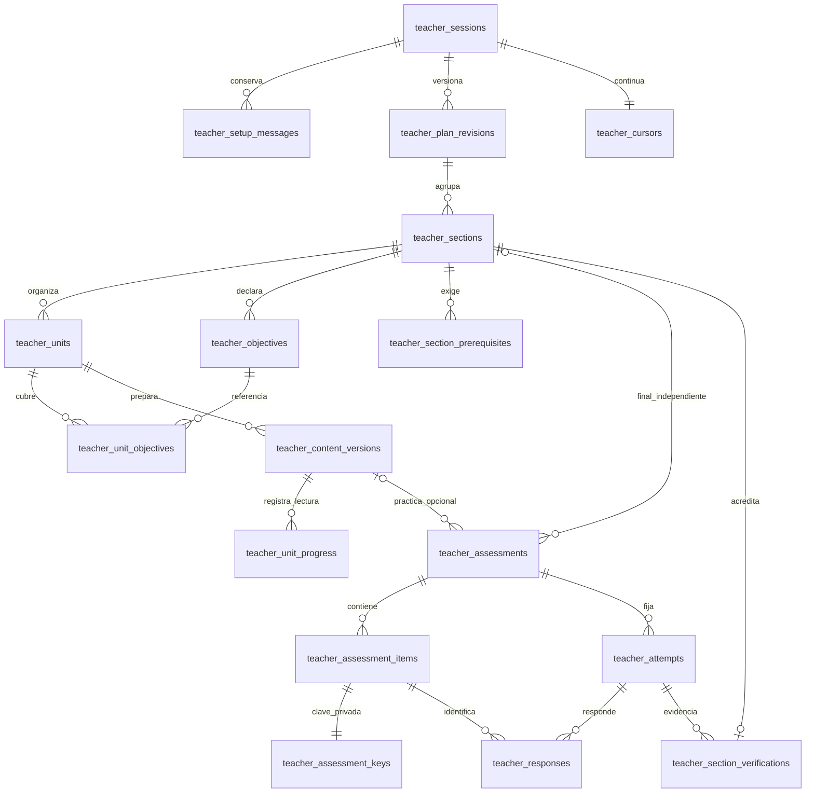
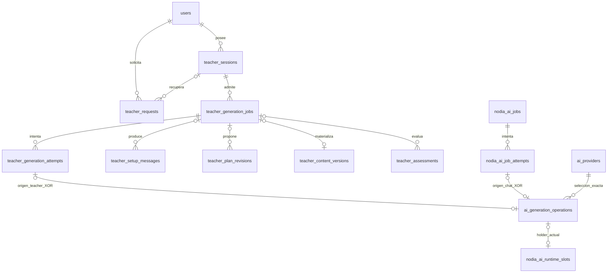

# Contratos técnicos de Nodia Teacher

> Cierre técnico del upgrade2026-11-11:55/55TU verificados para Windows y la selección API key exacta configurada.18POST reales, revisión de47ítems, QA HTTP/JWT/SQL y rendimiento comparado, correcciones y restore final comprobados. Alcance y límites en la [matriz R02](../evidence/teacher-upgrade-acceptance-20261111-r02.md) y el [recibo R02](../evidence/teacher-upgrade-local-20261111-r02.json). No adopta otros proveedores/entornos, no acredita eficacia humana ni despliega/publica o aprueba ADR/fichas.

> Puerta de calificación2026-11-11: el manifiesto compartido `teacher-generation-policy/2` incluye los hashes de todas las plantillas `teacher-text/2` y sus presupuestos. Su hash forma parte del scope API y del scope Agentic, separado de sus contratos históricos de transporte `teacher-text/1` y `teacher-agentic-text/1`. Una acreditación antigua no habilita las plantillas nuevas. El canary de setup acredita sólo transporte bajo el manifiesto vigente; no concede el propósito `contextual_reply` ni acredita calidad pedagógica. Se conservan recibos históricos y la prohibición de reenviar resultados unknown.

### Calificación explícita de aclaraciones

El runtime común comprueba una prueba separada por propósito al admitir, continuar y reclamar una aclaración; si falta, responde `teacher:adapter_unqualified` antes de inferir. El [manifiesto](../../nodia-server/src/ai-generation/teacher-qualification-policy.ts) y la [migración179365](../../nodia-server/src/migrations/1793650000000-TeacherPurposeQualification.ts) vinculan esta prueba con selección exacta, configuración/epoch, scope del transporte, operación original y hashes de respuesta/evidencia. No se cambian modelos ni se extiende una aceptación histórica al helper nuevo.

El camino de operador [qualify-teacher-text.mjs](../../nodia-server/scripts/qualify-teacher-text.mjs), sin endpoint HTTP/tool, admite `--purpose=contextual_reply --thread-id=<UUID>` junto a los identificadores explícitos del propietario, sesión autenticada y sesión Teacher. Requiere transporte ya calificado con la política actual, una sesión propia activa destinada al laboratorio y un hilo real todavía sin eventos/trabajos, con versión, bloque y selección exactos. No crea autenticaciones, busca perfiles alternativos ni fabrica contenido para saltar requisitos. La invocación es explícita y no se ejecutó contra proveedores/BD operativos durante esta entrega.

El protocolo acotado pide eco literal de la selección en el esquema estricto del helper. Usa la misma cola, presupuesto, reserva, owner/fences, publicación anclada y cierre/ACK de una aclaración normal; bloquea propietario ajeno, pausa, archivo y final activa. Sólo la coincidencia con manifiesto, plantilla y ancla originales permite persistir el scope separado `contextual_reply`. El eco verifica formato y vínculo con el pasaje; no demuestra que una explicación sea correcta o útil. El recibo declara `pedagogical_quality_verified:false`. La revisión semántica con muestras reales conserva su alcance propio de91/92.

La pérdida de recibo/ACK se concilia exclusivamente con `--purpose=contextual_reply --complete-job-id=<UUID original>`, sin `--thread-id` ni nuevo envío. Exige el canary original autorizado, operación cerrada, respuesta publicada y ancla exacta; una política histórica puede conciliarse sin promover elegibilidad actual. Un hilo ya usado no admite otra prueba. Flags desconocidos, duplicados o incompatibles fallan antes de inicializar BD/transporte. El rollback se niega si existen pruebas que preservar.

La [suite aislada](../../nodia-server/test/teacher-purpose-qualification.integration.mjs) verificó13garantías con PostgreSQL real desechable y exactamente3POST HTTP sintéticos, incluida pérdida de recibo, conciliación histórica sin promoción y restauración lógica exacta de todas las tablas con prueba por propósito poblada. Las regresiones atómicas cubren manifiesto/ancla y parser CLI. Estas pruebas no califican ningún proveedor real ni acreditan eficacia pedagógica. Los puertos sintéticos de otras suites tampoco conceden disponibilidad operativa.

> Implementación local del upgrade101/102 — 2026-11-11: el usuario autoriza ahora todas las fases. El contrato añadido al final registra código, migraciones y comprobaciones locales/aisladas; acredita sólo QA técnico/visual acotado en laboratorio, sin proveedor real, adopción o cierre V1. Los avisos inferiores de entrega exclusivamente documental conservan su corte anterior. Fichas draft/partial/unregistered, sin aprobación/publicación.

> Corte documental histórico previo a implementación, 2026-11-11: [plan101](101-nodia-teacher-adaptive-upgrade-plan.md) y [ADR098](../architecture/decisions/ADR-098-teacher-learning-evidence-and-adaptive-progression.md) separan contenido, evidencia y verificación, con adaptación explicable y snapshot. Sus campos/endpoints/DDL deben concretarse en las puertas de cada etapa antes de una implementación futura. Esta entrega sólo documenta: no cambia DTOs, versiones, presupuestos, claves privadas, finales, retención o recuperación definidos aquí; no habilita funciones del upgrade ni aprueba el ADR.

> Seguimiento de implementación local2026-11-01: código Teacher/rutas implementado y verificado localmente por capas. [Plan96 §21](96-nodia-teacher-implementation-plan.md#21-implementación-local-y-evidencia) y [recibo](../evidence/teacher-local-implementation-20261101-r01.json) separan hechos, calificación y pendientes. Los cortes documentales inferiores mantienen su fecha/estado; este seguimiento no aprueba/publica fichas ni adopta VM.

> R02, 2026-11-01. Solicitud de iniciar ahora con `/nodia-teacher`, módulo independiente y migración transversal de rutas/BD según [98](98-nodia-teacher-start-handoff.md#solicitud-vigente-para-comenzar-ahora). Diseño técnico en revisión, sin implementación o comprobación operativa. El usuario confirmó que una final con 90% exacto aprueba; los demás valores técnicos y políticas son propuestas V1.

Este documento concreta el diseño de TH-01 del [plan96 R05](96-nodia-teacher-implementation-plan.md) y el [mensaje de inicio98](98-nodia-teacher-start-handoff.md). La [especificación95 R06](95-studies-adaptive-learning.md), [ADR089](../architecture/decisions/ADR-089-versioned-study-plans-and-content.md), [autoridad89](89-module-access-and-user-data-scope.md) y [contratos de ejecución92](92-nodia-ai-api-chat-parity.md) mantienen sus alcances. El implementador traduce estos contratos a DTOs, entidades, migraciones y unidades comprobables; no debe rediseñar el producto ni fabricar una conversación NodiaAI para Teacher.

## 1. Baseline contrastado en código

| Fuente | Contrato existente relevante |
|---|---|
| [User](../../nodia-server/src/user/entities/user.entity.ts) | users.id es bigint y se representa como string en Node/JSON; no es UUID |
| [AuthSession](../../nodia-server/src/auth/entities/auth-session.entity.ts) | auth_sessions.id es bigint; public_id es UUID único; la identidad autenticada usa ese public_id, no el ID interno |
| [AiProvider](../../nodia-server/src/ai-provider/entities/ai-provider.entity.ts) | ai_providers.id es bigint; modelos/configuración dinámicos por conexión y modo |
| [Persistencia de conversación](../../nodia-server/src/migrations/1792200000000-CreateNodiaAiConversationPersistence.ts) | jobs/runs/attempts UUID; slots por resource_key text, con vínculo job_id/conversation_id; actor_id bigint |
| [API runtime](../../nodia-server/src/migrations/1793310000000-AddNodiaAiApiChatRuntime.ts) | nodia_ai_api_dispatches depende por FK del intento de chat; acceptances se ligan a la selección/epoch |
| [Armado](../../nodia-server/src/nodia-ai-runtime/use-case/checkpoint-nodia-ai-job.use-case.ts) y [exchanges API](../../nodia-server/src/nodia-ai-adapter/api-nodia-ai-runtime.service.ts) | El primer POST consume presupuesto al armar; los siguientes lo consumen en reserveExchange. No duplicar la reserva inicial |
| [Worker](../../nodia-server/src/nodia-ai-runtime/use-case/run-nodia-ai-worker.use-case.ts) | Alterna etapas de chat y ejecución; no es hoy una cola Teacher |
| [Puerta de cola](../../nodia-server/src/nodia-ai-runtime/queue-lock.ts) | Existe una barrera transaccional de admisión; no se mantiene durante red |

Se contrastó código fuente, no el esquema desplegado ni cuentas/proveedores. La implementación debe comprobar ese baseline antes de aplicar una migración. Ventas de NodiaAI conserva sólo lecturas/reportes de [94 R17](94-business-point-of-sale-and-product-refactor.md#26-nodiaai-ventas-y-reportes-de-solo-lectura--r17-2026-10-30).

## 2. Decisiones y límites V1

Una sesión Teacher pertenece a un usuario y contiene un plan, sus revisiones y su estudio. No equivale a auth_sessions, a una visita ni a nodia_ai_conversations. El módulo key nodia_teacher tiene enlace /nodia-teacher y aparece en el selector de URLs del mantenedor. Estudios es una agrupación inicial de navegación, modificable sin cambiar URL, carpeta o autoridad. El alta reutiliza identidades existentes contrastadas y no asigna el módulo masivamente. Client tiene /nodia-teacher y /nodia-teacher/:sessionId; filesystem propio en nodia-client/src/modules/teacher y nodia-server/src/teacher. No se crea una ruta administrativa de Teacher.

Los siguientes valores son límites propios del producto, mantenidos en una política versionada teacher-text/1; no representan cuotas, tokens ni capacidades del proveedor. Los snapshots ya aceptados no cambian al editar la configuración de un release.

| Dato o recurso | Valor V1 |
|---|---|
| Tema y objetivo | Requeridos; tema 1–240 caracteres, objetivo 1–2000; título opcional 1–120; se recortan extremos, sin modificar el contenido interior |
| Contexto y base declarada | Opcionales, máximo 4000 caracteres cada uno; ausente/null significa sin declarar, no nivel cero |
| Idioma de explicación | Campo visible; valor inicial de la preferencia de idioma validada de la UI; si falta, es; código BCP47 admitido de 2–35 caracteres, sin deducir nivel lingüístico |
| Organización | teacher_suggests inicial; alternativas days/topics. days exige day_count entero 1–365 al aceptar; topics exige null. No se inventa una cantidad al guardar el draft |
| Contorno del plan | 1–24 secciones, 1–12 objetivos por sección, 1–60 unidades en total; cada unidad 1–12 objetivos de su sección; títulos 1–160 y descripciones hasta 2000 |
| Mensajes de definición | Texto 1–4000 caracteres/8 KiB; máximo 100 mensajes por sesión. Contexto ensamblado usa resumen versionado y hasta los 12 últimos pertinentes, no todo el historial |
| JSON HTTP Teacher | 256 KiB antes de parsear; endpoints de texto limitan además caracteres y bytes; UTF-8 válido, sin campos desconocidos |
| Contexto/resultado de generación | Prompt máximo 128 KiB; respuesta textual máximo 32 KiB, además del menor límite vigente del transporte; profundidad JSON 12 y colección 128 elementos |
| Material por unidad | Hasta 16 bloques, cada uno hasta 3000 caracteres; JSON público más evaluación/clave debe caber en el límite de respuesta. Si no cabe, fallar conocido; no truncar ni encadenar inferencias |
| Respuesta del alumno | Texto hasta 2000 caracteres/8 KiB; selección es un option_id del ítem; no adjuntos ni HTML ejecutable |
| Listado | page=1, limit=10; permitidos 10/20/50, máximo 50; orden updated_at DESC,id DESC; búsqueda q hasta 120 caracteres, título/tema; archived=false inicial y estados opcionales por allowlist |
| Capacidad Teacher | Una generación activa por sesión y por actor; hasta dos pendientes por actor. Perfil/conexión y capacidad global se comparten con chat, sin ampliar sus límites por sumar Teacher |
| Presupuesto Teacher | Un dispatch por job; techo inicial 200 dispatches por sesión, mostrado antes de generar. El POST incierto consume. Sin ampliación automática ni rotación/fallback. Leer, guardar y corregir determinísticamente no consumen inferencias |
| Tiempos propios | Cola 300 s y job 600 s. Envío máximo 300 s para `learning_packet`, `assessment_only`, `setup_reply`, `plan_outline` y `plan_adjustment`; 120 s para `written_feedback`. Heartbeat 5 s, lease 30 s. Se aplica siempre el menor plazo autorizado del runtime. Lease/fin de espera no prueban cierre remoto |
| Reintento | Cero reenvíos de inferencia tras armado o incertidumbre; transporte no reintenta. Antes del armado, el mismo job puede esperar capacidad dentro de su plazo; salida inválida requiere intención nueva si se vuelve a generar |
| Consulta de estado | retry_after_ms=2000 para trabajos activos; 5000 cuando espera capacidad. Sólo GET mientras visible; detener polling al ocultar, pausar o quedar terminal. Botón de actualizar manual siempre disponible; unknown requiere consulta/conciliación manual, no polling generativo |

La ampliación a 300 s exclusivamente para material (`learning_packet`) y evaluaciones (`assessment_only`) recibió autorización explícita del usuario el 2026-11-03 tras probar el proceso real en la VM. Ese corte conservaba 120 s en los demás propósitos. El 2026-11-04 el usuario autorizó explícitamente ampliar también `setup_reply`, `plan_outline` y `plan_adjustment` a 300 s; `written_feedback` conserva 120 s. La adopción y pruebas del corte nuevo se registran en [96 §29](96-nodia-teacher-implementation-plan.md#29-mensaje-persistente-y-alta-en-página--2026-11-04). Es un presupuesto máximo por propósito: no extiende el deadline original del job ni del caller, no añade POST, retries o fallback, y no convierte un timeout anterior en éxito. Permite ocupar el slot/perfil hasta 300 s para esos recursos; heartbeat, lease y recuperación de la identidad original mantienen su contrato. Implementación local y adopción VM se acreditan por separado en [96 §26](96-nodia-teacher-implementation-plan.md#26-recorrido-directo-vm--2026-11-03); al aprobar el plazo no se aprueba íntegramente este documento.

La teoría se puede recorrer libremente; practicar no es requisito para seguir leyéndola. Una final directa sólo exige los prerrequisitos explícitos de su sección. La versión aceptada presenta esos requisitos antes de evaluar. El servidor deriva allowed_actions; Client no reproduce una segunda política de autoridad/avance.

## 3. Convenciones de persistencia

Todos los nuevos IDs de recursos son UUID generados por Server; referencias a users/ai_providers/ai_api_keys son bigint transportados como strings decimales exactos. IDs bigint aceptan 1..9223372036854775807, nunca Number. Fechas nuevas son timestamptz y JSON ISO8601 UTC. Revisiones son integer positivo, con rechazo por overflow. Hashes SHA-256 son char(64) hexadecimal minúsculo. No se cambian los tipos ni fechas de entidades históricas.

Las tablas Teacher tienen created_at/updated_at cuando son mutables; los registros inmutables tienen created_at. Las FKs de dominio son ON DELETE RESTRICT en V1. No hay purga ni DELETE público. La relación circular sesión→revisión actual se resuelve con FK DEFERRABLE INITIALLY DEFERRED. Usar Relation<T> en relaciones TypeORM y comprobar el arranque ESM compilado.

Todo hijo incluye session_id. Las referencias entre recursos usan FKs compuestas que incluyen session_id y, donde corresponde, plan_revision_id; comprobar sólo UUIDs separados no impide mezclar sesiones. Las tablas referenciadas declaran los UNIQUE necesarios para esas FKs. El actor se deriva de request.auth o de una admisión durable validada, nunca de campos de Client/modelo.

### 3.1 Sesión, definición y plan

| Tabla | Campos y claves |
|---|---|
| teacher_sessions | id UUID PK; owner_user_id bigint FK users; title/topic/objective; declared_base/context text nullable; explanation_language; requested_organization; requested_day_count nullable; selection jsonb nullable; setup_draft_text text NOT NULL default vacío y setup_draft_revision integer NOT NULL default0; state draft/active/paused/completed/archived; resume_state nullable; revision integer; current_plan_revision_id UUID nullable; dispatch_limit=200 y dispatches_used=0; created_by_actor_id bigint FK users |
| teacher_setup_messages | id UUID PK; session_id FK; seq bigint positivo; role user/assistant; actor_id bigint FK nullable sólo para assistant; text; generation_job_id UUID nullable; UNIQUE(session_id,seq), UNIQUE(generation_job_id) donde no null |
| teacher_plan_revisions | id UUID PK; session_id FK; revision_no integer; base_revision_id UUID nullable con FK a misma sesión; state draft/candidate/accepted/superseded/discarded; origin manual/ai; outline jsonb tipado; private_guide jsonb; assessment_policy jsonb; content_hash; base_hash nullable; generation_job_id nullable; created_by_actor_id; UNIQUE(session_id,id), UNIQUE(session_id,revision_no) |
| teacher_sections | session_id,plan_revision_id,id UUID; PK(plan_revision_id,id), UNIQUE(session_id,plan_revision_id,id); FK a revisión; title; ordinal positivo; required boolean inicial true; semantic_hash; UNIQUE(plan_revision_id,ordinal) |
| teacher_objectives | session_id,plan_revision_id,section_id,id UUID; PK(plan_revision_id,id); UNIQUE(session_id,plan_revision_id,section_id,id); FK compuesta a sección; ordinal; description; UNIQUE(plan_revision_id,section_id,ordinal) |
| teacher_units | session_id,plan_revision_id,section_id,id UUID; PK(plan_revision_id,id); UNIQUE(session_id,plan_revision_id,id) y (session_id,plan_revision_id,section_id,id); FK a sección; title; ordinal; day_start/day_end nullable; semantic_hash; UNIQUE(plan_revision_id,section_id,ordinal) |
| teacher_unit_objectives | session_id,plan_revision_id,section_id,unit_id,objective_id; PK(plan_revision_id,unit_id,objective_id); FKs compuestas a unidad y objetivo de la misma sección |
| teacher_section_prerequisites | session_id,plan_revision_id,section_id,required_section_id; PK(plan_revision_id,section_id,required_section_id); dos FKs a secciones de la misma revisión; CHECK(section_id<>required_section_id) |

El outline es la fuente estructurada de una revisión propuesta. Guardar manualmente crea otra revisión, sin inferencia; no modifica el JSON de una revisión anterior. Al aceptar, sus proyecciones normalizadas se insertan en la misma transacción. Mantener IDs semánticos de secciones/unidades/objetivos si siguen representando lo mismo; nuevas piezas reciben UUIDs Server. PATCH de creación puede usar client_ref local hasta 64 caracteres; Server devuelve el mapa a IDs, sin aceptar IDs de otra sesión como piezas nuevas.

Validar aciclicidad por recorrido completo del grafo acotado. Cada objetivo debe aparecer en al menos una unidad de su sección y aceptar el plan exige al menos una sección required=true; un borrador incompleto puede guardarse, pero nunca aceptarse con el conjunto requerido vacío. days requiere 1<=day_start<=day_end<=day_count; topics requiere ambos null. Una unidad puede ocupar un intervalo de jornadas y varias unidades pueden compartir jornada. La secuencia de ordinales es explícita y estable; no ordenar según la respuesta casual del proveedor.

Índices: sesiones(owner_user_id,state,updated_at DESC,id DESC), mensajes(session_id,seq), revisiones(session_id,revision_no DESC), unidades(plan_revision_id,section_id,ordinal), inverso de prerrequisitos(plan_revision_id,required_section_id). Añadir UNIQUE parcial de revisión accepted por sesión. No añadir búsqueda trigram/full-text en V1 sin medir; q usa ILIKE parametrizado y los listados siguen acotados.

### 3.2 Material y evaluaciones

| Tabla | Campos y claves |
|---|---|
| teacher_content_versions | id UUID PK; session_id,plan_revision_id,unit_id con FK compuesta; version_no; generation_job_id UNIQUE; context_hash; public_blocks jsonb; content_hash; publication_state current/superseded; UNIQUE(session_id,id), UNIQUE(session_id,plan_revision_id,unit_id,id), UNIQUE(plan_revision_id,unit_id,version_no); índice único parcial de current por revisión/unidad |
| teacher_assessments | id UUID PK; session_id; plan_revision_id nullable sólo para diagnostic; section_id/unit_id/content_version_id nullable según scope; scope unit_practice/section_final/diagnostic; version_no; policy_version; policy_snapshot jsonb; coverage jsonb; coverage_hash; generation_job_id; status ready/withdrawn; UNIQUE(session_id,id); FK compuesta al destino y al material cuando existe |
| teacher_assessment_items | id UUID PK; session_id,assessment_id con FK compuesta; ordinal; kind single_choice/completion/short_text; objective_ids UUID[] como proyección validada de coverage; public_question jsonb; max_points integer; item_fingerprint; variant_group; UNIQUE(session_id,assessment_id,id), UNIQUE(assessment_id,ordinal) |
| teacher_assessment_keys | item_id UUID PK; session_id,assessment_id con FK compuesta al ítem; private_key jsonb; expected_explanation text; key_hash; campos nunca seleccionados en queries públicas ni serialización ORM directa |

CHECK de assessment: unit_practice exige revisión/unidad/material presentes y sección coherente; section_final exige revisión/sección y unit_id/content_version_id null; diagnostic exige sección/unidad/material null y un snapshot de objetivos diagnósticos propios, pudiendo existir antes del plan. Una final no tiene FK a contenido de lecciones. coverage contiene exclusivamente objetivos del destino; se valida junto con las FKs y antes de publicar. Añadir UNIQUE(session_id,id,scope) y FK(session_id,assessment_id,scope) desde intento para que el scope no pueda contradecir su evaluación.

Los ítems tienen exactamente una clave privada y explicación no vacía para ready. La publicación transaccional inserta paquete, evaluación, ítems, claves y resultado/recibo durable del job. El ACK de admisión original no se reemplaza por otro cuerpo: su job_id permite consultar el resultado actual. Las claves de selección incluyen option_id correcto; completar incluye alternativas y normalización; short_text contiene tres criterios con anclas 0/1/2. Puede existir una pista privada revisada, hasta1000 caracteres, que nunca contiene la solución literal. Las preguntas publicadas son inmutables: withdrawn invalida uso futuro, no borra intentos ni cambia denominadores históricos.

La lista de objective_ids del ítem es una proyección del coverage validado, no una relación que permita consultar recursos ajenos. V1 asigna cada ítem a un objetivo del assessment. Las mutaciones sólo se realizan mediante el publicador transaccional, que valida que todos los IDs pertenezcan al destino. No exponer un CRUD genérico de ítems/claves.

### 3.3 Intentos, respuestas y continuidad

| Tabla | Campos y claves |
|---|---|
| teacher_attempts | id UUID PK; session_id,assessment_id con FK compuesta; scope unit_practice/section_final/diagnostic; plan_revision_id/section_id/unit_id según assessment; attempt_no; entry_route direct/after_study/practice/diagnostic; state in_progress/submitted/grading_pending/graded; is_active boolean=true; closed_at/closure_reason nullable; result pending/passed/not_passed/not_independent sólo section_final y null en otros scopes; revision; denominator_points>0; earned_points nullable; threshold_percent=90 sólo section_final; assisted boolean=false; policy_snapshot/hash; submitted_at/graded_at nullable; UNIQUE(session_id,id), UNIQUE(session_id,id,assessment_id), UNIQUE(session_id,assessment_id,attempt_no) |
| teacher_responses | id UUID PK; session_id,attempt_id,assessment_id,item_id; FKs compuestas a intento y pregunta; revision; draft_answer jsonb nullable; frozen_answer jsonb nullable; submitted_at nullable; grade_state unsubmitted/pending/graded/needs_review; earned_points nullable; feedback jsonb nullable; explanation_state ready/pending; assistance jsonb; UNIQUE(attempt_id,item_id) |
| teacher_cursors | session_id UUID PK/FK; revision; plan_revision_id/section_id/unit_id/content_version_id/attempt_id/item_id nullable con referencias compuestas; phase setup/theory/practice/final/review; block_id nullable; updated_by_actor_id; validación del ancla sobre el bloque/versionado fijado |
| teacher_unit_progress | session_id,plan_revision_id,unit_id,content_version_id con FK compuesta; PK(plan_revision_id,unit_id,content_version_id); revision; state not_started/in_progress/completed; visited_block_ids jsonb acotado y validated; completed_at nullable; no implica aprobación de sección |
| teacher_section_verifications | id UUID PK; session_id,plan_revision_id,section_id FK compuesta; semantic_hash; source_attempt_id UUID FK al intento de la misma sesión; source_verification_id nullable FK misma sesión; verified_at; UNIQUE(session_id,plan_revision_id,section_id) |

Un solo intento activo por destino/sesión: UNIQUE(session_id,plan_revision_id,unit_id) WHERE is_active AND scope='unit_practice'; UNIQUE(session_id,plan_revision_id,section_id) WHERE is_active AND scope='section_final'; UNIQUE(session_id) WHERE is_active AND scope='diagnostic'. Así una práctica y una final no colisionan. attempt_no aumenta bajo lock del destino, incluso al cambiar assessment: añadir los tres índices equivalentes incluyendo attempt_no, sin filtro is_active, para ordenar la historia por unidad/sección/diagnóstico. graded siempre tiene is_active=false y closed_at; las otras fases pueden cerrarse explícitamente sin fingir que quedaron corregidas. No crear dos finales activas de la misma sección mientras existe una en curso o pendiente de corrección.

Las respuestas referencian el mismo assessment que el intento: un questionId válido de otra prueba no sirve. draft_answer y frozen_answer usan unión cerrada: {kind:single_choice,option_id}, {kind:completion,text}, {kind:short_text,text} o {kind:dont_know}. null/ausencia es incompleto; dont_know es respuesta explícita de cero puntos. CHECK de puntuación: enteros, 0<=earned_points<=max_points de la pregunta, comprobado al corregir bajo lock; suma y denominador se verifican con filas reales.

La asistencia se registra por servidor y es monotónica; no aceptar assisted=false desde Client. Pedir ayuda durante una final marca el intento como asistido antes de revelar una pista revisada. Antes de la acción, la UI muestra «Continuar como práctica con ayuda; esta prueba no acredita la sección» en ES/EN y el DTO reconoce expresamente ese efecto; no revela claves/correcciones antes de entregar. Conserva su nota, pero result=not_independent y no crea verificación, aunque alcance90%. Si falta una pista apta, help_unavailable sin inferencia oculta ni cambio de asistencia. GET de teoría existente permanece disponible; el sistema no promete detectar fuentes externas ni toda ayuda fuera de la aplicación.

Proyección de refuerzo focal R05: `attempt.reinforcement` es null salvo para una final `section_final` totalmente corregida, `graded/not_passed`, con evidencia completa y coherente. El DTO público contiene `{plan_revision_id,section_id,navigation,objectives:[{objective_id,description,earned_points,possible_points,units:[{unit_id,title}]}]}`. Las sumas deben coincidir con el intento completo y todos los objetivos tener cobertura. Incluye sólo objetivos con earned_points<possible_points; conserva cero real y no impone90% por objetivo ni certifica dominio. Las unidades pertenecen al outline congelado y mantienen su orden canónico, sin claves/respuestas.

`navigation=current_plan` habilita enlaces explícitos; `history_only` describe el intento anterior sin dirigir al plan actual. Client consulta disponibilidad real del material y confirma el PATCH del cursor antes de abrir la vista; no genera material, marca lectura o cambia notas por navegar. Ausencia de material conserva la preparación explícita. Pausa, cambio de plan/actor y desmontaje descartan aperturas tardías; fallo conserva resultado/foco y usa conciliación existente si el recibo del cursor quedó incierto. No hay nueva inferencia, migración o privilegio. Implementación R05 adoptada en VM: la final50% proyectó sólo el objetivo0/20 y su segunda unidad canónica; consulta/cursor/retorno guardados sin generación. No se extiende esa muestra a otros planes.

Índices: intentos(session_id,created_at DESC,id), respuestas(attempt_id,item_id), verificaciones(plan_revision_id,section_id), progreso(session_id,plan_revision_id,unit_id). La nota y verificación se calculan por conjuntos, no con una consulta por pregunta.

### 3.4 Jobs y recibos

| Tabla | Campos y claves |
|---|---|
| teacher_generation_jobs | id UUID PK; session_id FK; actor_id bigint FK; auth_session_public_id UUID nullable FK auth_sessions(public_id) ON DELETE SET NULL; purpose setup_reply/plan_outline/plan_adjustment/learning_packet/assessment_only/written_feedback; plan_revision_id/unit_id/section_id/attempt_id nullable y scoped por FKs; replaces_job_id nullable con FK a job de misma sesión; state queued/blocked_paused/running/ready/failed_known/unknown/cancelled_before_dispatch; blocks_duplicate boolean=true; semantic_key char(64); input_snapshot jsonb privado; prompt_snapshot text privado; template_ref/version/hash; input_hash; selection/configuration/session_generation snapshots; dispatch_limit=1, dispatches_used=0; deadline_at; available_at; lease_owner/lease_until; fence bigint>=0; error_code nullable; result_ref jsonb mínimo; created_at/updated_at |
| teacher_generation_attempts | id UUID PK; session_id,job_id con FK compuesta; attempt_no>0; worker_id UUID; fence bigint>0; phase claimed/dispatch_armed/transport_open/terminal; started_at/ended_at; UNIQUE(job_id,attempt_no), UNIQUE(job_id,fence), UNIQUE(session_id,job_id,id) |
| teacher_requests | actor_id bigint FK users, request_key UUID; PK(actor_id,request_key); operation text allowlist; session_id nullable FK; payload_hash; http_status; receipt jsonb mínimo; completed_at; created_at; UNIQUE actor+key cubre el alta antes de existir session_id |

Un índice único parcial de jobs(session_id,semantic_key) WHERE blocks_duplicate impide duplicados incluso con request_keys distintos. semantic_key incorpora propósito, revisión, destino, variante y hash del contexto/política fijados. No incluye datos secretos ni la clave idempotente. Un job ready y material vigente se recuperan antes de reservar otro. unknown mantiene la exclusión hasta conciliar el cierre local. Sólo el reconciliador con prueba válida puede poner blocks_duplicate=false sin alterar el estado/resultado remoto unknown; otra generación requiere además una intención nueva explícita. ready/failed_known/cancelled_before_dispatch finalizados dejan blocks_duplicate=false en su transacción de cierre. No usar el vencimiento del lease para quitar esa protección.

Cada endpoint de mutación escribe teacher_requests en la misma transacción que el cambio/ACK durable. payload_hash incluye nombre de operación, parámetros de destino y body validado: objetos con claves ordenadas recursivamente, arrays conservando orden y UTF-8, sin convertir bigint strings a Number ni alterar nombres de modelos. El recibo almacena identidad del recurso/job, revisión y resultado de admisión, no contenido mutable ni allowed_actions antiguos. Repetir la misma clave/hash devuelve ese ACK; hash distinto produce409. Revalidar acceso antes de entregar un recibo. No borrar el recibo antes de la sesión ni olvidar claves por un TTL que habilite duplicados.

Los jobs son la outbox durable de Teacher; no añadir otra tabla de outbox para la misma intención. Índices jobs(available_at,id) parcial queued, jobs(lease_until,id) parcial running, jobs(actor_id,state), intentos_generación(job_id,attempt_no). El prompt y sus variables permanecen bajo autoridad de sesión, fuera de logs, APIs públicas, ai_providers.fields y knowledge publicado.

### 3.5 Esquemas JSON mantenidos por Server

Los JSON siguientes tienen schema_version=1 y additionalProperties=false en todos los niveles; se mantienen como tipos y validadores ejecutados, no como Record<string,unknown> sin parser. Array IDs repetidos, strings fuera de límites, números no finitos y referencias no resueltas se rechazan. El JSON generado es candidato privado hasta normalizarlo y validar todos sus destinos.

| Envelope | Campos admitidos |
|---|---|
| PlanOutline | title,topic,objective,explanation_language,organization days/topics,day_count; sections:[{id,title,required,prerequisite_section_ids,objectives:[{id,description}],units:[{id,title,objective_ids,day_start,day_end}]}]; assessment_policy. IDs nuevos se asignan al normalizar; conservar los ya pertenecientes a esa sesión |
| PrivateGuide | strategy explanatory/examples_first/balanced, context_notes texto hasta2000, examples_context texto hasta2000, prerequisite_knowledge:[texto] hasta12, preferred_formats allowlist. Sus textos son datos no confiables; no sustituyen la plantilla de seguridad |
| AssessmentPolicy | version teacher-assessment/1; practice_counts/final_counts/diagnostic_counts:{single_choice,completion,short_text}; final_threshold_percent=90; coverage_per_objective=2 para final; criterion_ids fijos; política de normalización. No se acepta una fórmula libre o código |
| LearningPacket | unit_id,plan_revision_id,blocks:[{id,kind explanation/example/guided_practice/summary,title,body_markdown}]; practice_assessment. Markdown sin HTML ejecutable ni descargas automáticas. Block IDs se normalizan antes de fijarlos |
| AssessmentCandidate | scope,plan_revision_id,section_id/unit_id según destino; items:[{local_ref,objective_id,kind,prompt,options?,private_key,explanation,hint?}]. Blueprint y max_points los aporta Server, no un valor libre del modelo |
| PublicQuestion | prompt hasta2000 caracteres; options para selección con2–5 opciones, cuatro inicialmente, IDs opacos estables y label hasta500; para breve, descripciones públicas de criterios sin anclas/solución esperadas. No contiene private_key/explanation/hint |
| WrittenFeedback | responses:[{response_id,criteria:[{criterion_id,points:0/1/2,comment}],uncertain:boolean,explanation}]. Exactamente los criterios de la clave, sin inventar otros; Server calcula suma y exige todos los response_ids congelados del trabajo. uncertain=true mantiene revisión pendiente |
| AttemptReinforcement | null o plan_revision_id,section_id,navigation current_plan/history_only,objectives con puntos reales y unidades canónicas; sólo final fallida totalmente corregida; sin claves/respuestas/umbral por objetivo |
| JobView | job_id,state,purpose,target seguro,result_ref,error_code,local_closed:boolean|null,remote_outcome completed/unknown/null,retry_after_ms integer|null,allowed_actions. No incluye proof bruto, prompt, variables ni identidad privada de proceso |

Normalización acotada de pistas opcionales (corrección local2026-11-03): una pista con forma/tamaño válidos que el detector conservador considere sospechosa de contener la solución literal se omite por completo antes de publicar. No se sustituye su texto ni se relajan claves, rúbricas, cobertura, tipos o puntuación; una pista malformada continúa rechazándose. Una pista apta se conserva. La omisión puede dejar `help_unavailable` aunque la sospecha fuese un falso positivo; el detector no constituye certificación semántica. La falta de pista se comprueba antes de marcar asistencia (§3.3). El caso sintético comprobado de substring con una clave corta es independiente del primer rechazo Gemini cuyo payload ya fue retirado tras ACK; no prueba su causa histórica. Implementación local verificada y ServerR04 adoptado; una final Gemini posterior publicó evaluación válida. Ese resultado no identifica la causa del rechazo histórico.

Los fallos de publicación registran únicamente componente allowlist, posición línea/columna y código enum. No guardar body, claves/respuestas, mensajes de excepción ni stack completo. Conservar el resultado failed_known y los recibos de cierre/ACK; el diagnóstico nuevo no reconstruye payloads ya retirados ni habilita replay.

Los datos de plantilla/política no se inyectan como instrucciones del usuario. Cada purpose tiene una plantilla mantenida y versionada en código; los planes guardan su guía validada y los jobs el snapshot efectivo, hash y versión. Seleccionar otra plantilla o cambiar una guía genera una revisión/intención posterior, sin reescribir prompts históricos.

### 3.6 Relaciones del dominio y de la ejecución

Los siguientes dos diagramas representan las20 tablas Teacher y su puente de ejecución; las columnas y FKs compuestas concretas son las de las tablas anteriores. Las aristas de procedencia son opcionales cuando una revisión/material se crea sin generar. No representan SQL ejecutado ni nuevas tablas ya instaladas.

El XOR de origen es una constraint real propuesta, no una elección libre del modelo. Las dos relaciones opcionales hacia la operación neutral no permiten ausencia de ambos orígenes ni presencia simultánea. El índice único de verificación es por sección y revisión, no por título.

## 4. Política de evaluación concreta

La política teacher-assessment/1 es mantenida por Server y se fija al aceptar cada plan. La IA debe cumplir el blueprint calculado; no elige umbral, puntos ni pesos. El usuario puede editar las cantidades en la propuesta antes de aceptarla dentro de estos límites. Un cambio posterior crea otra revisión.

| Propiedad | Política V1 |
|---|---|
| single_choice/completion | Un criterio de 0 o 2 puntos; sin crédito parcial implícito |
| short_text | Tres criterios, cada uno entero 0/1/2: cumplimiento del objetivo, exactitud y claridad. Anclas específicas fijadas antes de responder. Máximo 6 puntos; en temas de idiomas, errores lingüísticos cuentan sólo si el objetivo/rúbrica lo declara |
| Práctica por unidad | Inicial 5 ítems: 3 selección, 1 completar, 1 breve; configurable 3–12, al menos uno de cada formato. Sin umbral de avance ni verificación de sección |
| Final de sección | N=max(12,2×objetivos), máximo24. Iniciales: breves=ceil(N/3), completar=max(2,floor(N/6)), selección=resto. Para N=12: 6/2/4. Configurable 10–24 con al menos uno de cada formato y >=2 ítems por objetivo; conservar cobertura y dificultad prevista en nuevos intentos |
| Asignación a objetivos | Server distribuye de forma estable por ordinal, dos ítems mínimos por objetivo en final; resto equilibrado por cantidad. Blueprint guarda tipo/objetivo/max_points/criterios por slot antes de generar |
| Diagnóstico | Inicial 8 ítems: 4 selección/2 completar/2 breve; configurable 3–12 y los tres formatos presentes. Perfil de evidencia escrita, sin passed/not_passed ni traducción automática a MCER |
| Corrección de completar | Unicode NFC, trim y colapso de espacios; case_sensitive=true salvo alternativa explícita de la clave. No eliminar acentos/puntuación ni aceptar coincidencia aproximada no declarada. Si es ambiguo: needs_review, no cero automático |
| Nota final | denominator_points=sum(max_points) fijado al iniciar. Con todas las correcciones válidas: earned_points entero y passed cuando earned_points×100>=denominator_points×90, assisted=false y cobertura íntegra. Nada de redondeo al comparar |

La distribución 6/2/4 suma40 puntos; 36/40 es90% y aprueba. El cálculo general también debe rechazar89,6% aunque la UI muestre un porcentaje redondeado; probar la regla con enteros sintéticos que representen esa fracción. No sumar ni promediar intentos. Una evaluación con grading_pending/needs_review tiene result=pending y earned_points/percentage final null; explanation_pending por sí solo no retrasa ni cambia una nota ya válida.

Al repetir una final, crear otro assessment/variante, conservar el mismo blueprint de cobertura/puntos y excluir fingerprints de ítems ya vistos por esa persona en la sección. Cambiar sólo opciones/orden no es variante. Normalizar el contenido semántico y conservar además el grupo de variantes; la deduplicación automática no demuestra equivalencia psicométrica. Si no hay contenido apto, informar assessment_unavailable o generar uno mediante intención presupuestada. No bajar dificultad/cobertura para conseguir aprobación.

Las secciones requeridas tienen prerrequisitos explícitos acíclicos. Una final está habilitada si cada required_section_id tiene verificación vigente de esa revisión; no exige lecciones/prácticas. Todas las required=true verificadas completan el plan únicamente si ese conjunto tiene al menos una sección; los errores del intento aprobado siguen como repaso recomendado y no exigen100%. No marcar teoría como recorrida por aprobar.

semantic_hash de sección incluye objetivos, requisitos semánticos de sus prerrequisitos, asignación unidades→objetivos y política/blueprint de final. Cambios de título, explicación visual u organización days/topics no lo alteran. Al aceptar una revisión posterior, se puede crear una verificación derivada sólo si coincide el hash y se conserva la validez de dependencias; referencia el intento/verificación original. Cambio semántico deja esa sección pendiente únicamente en la revisión nueva, sin borrar ni recalificar historia. No trasladar resultados por nombre parecido.

## 5. Transiciones, locks y CAS

Orden de locks: barrera de autoridad existente → puerta común de admisión → teacher_session → revisión/destino → intento/respuesta o job → operación IA → slot. Los cambios de permisos/sesión deben usar la frontera existente; no mantener locks mientras se espera al proveedor o al alumno. READ COMMITTED y revalidación tras ganar el lock. Plazo SQL de transacción 5 s y lock timeout2 s como límites propios, no garantía total HTTP.

| Recurso | Transiciones y precondiciones |
|---|---|
| Sesión | draft→active al aceptar; draft/active/completed→paused al pausar, conservando exactamente resume_state, incluido draft durante definición; paused→resume_state al reanudar; cualquier no archivada→archived conservando estado anterior. Recuperación archived→estado anterior mediante unarchive. completed se deriva de verificaciones; no se envía desde Client |
| Revisión | draft/candidate→accepted por versión/hash observados; aceptación anterior pasa superseded. Candidate no se aplica automáticamente. Descartar sólo candidata no usada; contenido de revisiones inmutable. Aceptar el plan inicial y activar una revisión futura son comandos distintos; el segundo exige además la revisión vigente esperada |
| Job | queued→running por claim con lease/fence; queued→blocked_paused al pausar; blocked_paused→queued sólo continue-before-dispatch explícito, vigente y nunca armado; running→ready/failed_known/unknown. queued sin armar→cancelled_before_dispatch. Unknown no vuelve a queued |
| Intento | in_progress→submitted al congelar entrega completa; submitted→graded si todo determinista, o grading_pending si hay abiertos; grading_pending→graded sólo tras feedback válido. submitted puede ser estado transitorio observable, no permiso de editar. needs_review mantiene grading_pending/result=pending |
| Respuesta de práctica | draft editable→frozen al enviar esa pregunta; determinista queda graded o abierta pending. Autoguardado tardío sobre frozen es409. Avanzar teoría no exige corregirla |
| Final | Durante in_progress todas las preguntas admiten borradores/revisión; submit exige respuesta o dont_know en cada ítem. Congelar todas, recibo y agenda de corrección en una transacción. Después no se modifica frozen_answer |

expected_session_revision, expected_cursor_revision, expected_attempt_revision y expected_response_revision son precondiciones diferentes. No subir session_revision por cada tecla; respuestas/cursor tienen revisiones propias. Los PATCH usan su revisión específica. Pause incluye cambios locales de cursor/respuestas con sus revisiones y persiste todo más estado paused atómicamente; conflicto conserva el estado Server y devuelve409 sin sobrescribir borradores.

Practice corrige por pregunta; final prohíbe ese endpoint con final_requires_full_submit. Los jobs de written_feedback corrigen respuestas congeladas mediante assessment/key/rúbrica y registran puntos/feedback en una transacción; no pueden modificar claves ni progreso arbitrario. En final un solo job agrupa hasta ocho respuestas breves, dentro del límite de contexto; si el JSON completo no cabe, fallo conocido visible, sin crear llamadas ocultas.

La incertidumbre irrecuperable del feedback no debe bloquear para siempre un destino. Si el job queda unknown, se concilia primero la propiedad/cierre local y se comprueba que no existe un resultado válido recuperable. Después close-pending, con CAS/recibo, fija is_active=false, closed_at y closure_reason=feedback_unknown_unrecoverable, manteniendo state=grading_pending, result=pending y nota final null; el job/remote_outcome original siguen unknown. Un fallo conocido/ítem ambiguo sin corrección apta permite cierre equivalente con motivo explícito feedback_failed/needs_review. No cerrar sólo porque vence un timer ni porque el usuario reenvía.

La respuesta de cierre ofrece una final nueva: otra intención, assessment y preguntas/variantes distintas, misma cobertura/política. No recalificar mediante replay las mismas respuestas cuyo feedback quedó incierto. Mantener borradores/respuestas, correcciones parciales e historial del intento cerrado; no sumar sus puntos al nuevo. La misma salida existe para práctica/diagnóstico pendientes y no bloquea leer teoría. Un callback tardío puede archivarse técnicamente, pero no reabre el intento ni publica nota/verificación después de ese cierre sin una revisión explícita futura.

Pausa impide armar bajo el mismo lock. Un envío ya armado puede terminar y guardar la versión original sin despausar ni encadenar otra unidad. Un resultado de revisión obsoleta conserva recibo/procedencia y se marca no vigente; no reemplaza material actual. Revocación impide publicación/lectura, aunque el recuperador técnico deba conservar un recibo mínimo de cierre. Desconectar/cerrar pestaña no es entrega ni cancelación.

## 6. DTOs y rutas HTTP

Prefijo real /api/v1. Todas las rutas siguientes son nuevas propuestas, protegidas explícitamente por módulo /nodia-teacher y por autoridad de sesión. No exigir el módulo NodiaAI ni Proveedores de IA para usar Teacher; sus enlaces también migran al quitar prefijos de sección, sin cambiar esta separación de autoridad. Añadir familia teacher a la política HTTP; ausencia de política deniega. Super_admin activo conserva89 y atribución real; no aceptar owner_user_id en CreateSession.

Todas las mutaciones requieren Idempotency-Key UUID y DTO real con class-validator; request_key es esa misma identidad en recibos, no un segundo valor independiente en body. Strict additionalProperties=false en esquemas de response/comandos. PATCH ausente conserva, null sólo limpia campos declarados nullable; cadena vacía no sustituye null silenciosamente. Ningún DTO público acepta prompt_snapshot, claves, earned_points, passed, authority, owner_type, scope arbitrario o instrucciones ejecutables.

SelectionDto exige connection_id decimal string exacto, mode agentic/api_key, model_id no vacío hasta1024 bytes UTF-8 y effort_id null o string no vacío hasta256 bytes; además debe pertenecer a la observación/configuración de esa selección. No normalizar el nombre del modelo ni convertir una opción histórica en disponibilidad. La key API se resuelve sólo en Server y queda fijada por ID/epoch privado al trabajo, sin elegir otra silenciosamente.

| DTO | Campos literales |
|---|---|
| CreateSessionDto | topic,objective; title?,declared_base?,context?,explanation_language,organization=teacher_suggests,day_count=null; selection? exacta y start_plan? boolean=false. start_plan=true crea sesión+jobplan_outline atómicamente. Límites§2 |
| PatchSessionDto | expected_session_revision; mismos campos editables salvo owner/state; selection?={connection_id,mode,model_id,effort_id}; cambios de selección no reescriben jobs ni resultados |
| PatchSetupDraftDto | expected_draft_revision>=0,text0–4000 caracteres/8KiB; CAS propio, sin subir session_revision ni generar |
| SetupMessageDto | expected_session_revision,text,generate_reply:boolean inicial true; expected_draft_revision? permite limpiar sólo el borrador correspondiente. false guarda sin inferencia |
| ProposePlanDto | expected_session_revision; base_proposal_id/base_hash opcionales ambos o ninguno; adjustment_text opcional sólo con base; organization/day_count; selection debe estar persistida, no introducir otra por endpoint oculto |
| PatchProposalDto | expected_session_revision,expected_proposal_hash; outline tipado y campos editables de guía/política permitidos; no ID de candidata como payload libre |
| ApplyCandidateDto | candidate_id,expected_base_revision_id,expected_base_hash,expected_session_revision |
| AcceptPlanDto | expected_session_revision,proposal_revision_id,proposal_hash; sin prepare_material implícito |
| ActivateRevisionDto | expected_session_revision,expected_current_plan_revision_id,proposal_revision_id,proposal_hash; cambia sólo estructura/material futuro. Mantiene intentos activos fijados a la revisión original |
| PrepareMaterialDto | plan_revision_id,expected_session_revision,variant=new/current; current inicial; new requiere reemplazo explícito y no cambia intentos existentes |
| StartAttemptDto | plan_revision_id cuando aplica; entry_route; expected_session_revision; new_attempt:boolean=false. scope lo fija la ruta, no Client |
| PatchResponsesDto | expected_attempt_revision,responses:[{question_id,expected_response_revision,answer}] con1–24 filas; operación atómica, sin corregir |
| SubmitPracticeAnswerDto | expected_attempt_revision,expected_response_revision,answer; una pregunta; no disponible en final |
| SubmitAttemptDto | expected_attempt_revision; respuestas deben estar guardadas. No cambiar respuestas en el mismo submit final; faltantes dan incomplete_assessment |
| ClosePendingAttemptDto | expected_attempt_revision; motivo feedback_unknown_unrecoverable/feedback_failed/needs_review; Server acredita condiciones y cierre local. No aceptar un proof/cierre remitido por Client |
| RequestHelpDto | expected_attempt_revision,question_id,accept_assisted_attempt=true; Client muestra previamente que pasa a práctica con ayuda y no acredita. No es una concesión de herramientas |
| PatchCursorDto | expected_cursor_revision,plan_revision_id,phase y anclas válidas según fase; sin cambiar nota/estado de intento |
| PauseDto | expected_session_revision,expected_cursor_revision,cursor; pending_responses opcionales con revisiones; revisión de intento cuando hay cambios; hasta24 filas |
| SessionStateDto | expected_session_revision para resume/archive/unarchive; resume no continúa inferencias retenidas |
| ContinueJobDto | expected_job_fence,expected_session_revision; sólo previo al armado y dentro del deadline original; no extenderlo silenciosamente |
| NewGenerationDto | expected_job_fence,expected_session_revision; sólo learning_packet/assessment_only failed_known o unknown ya conciliado/local_closed=true; intención, variant_id y presupuesto nuevos. No admite written_feedback incierto sobre las mismas respuestas |

| Ruta | Éxito y semántica |
|---|---|
| GET /teacher/connections | Opciones públicas dinámicas, labels/máscaras y selección; sin secrets ni inferencia |
| GET /teacher/connections/:id/eligibility?mode=&model_id=&effort_id= | Observación exacta, checked_at/reason y capacidad Teacher; unknown distinto de disponible |
| GET/POST /teacher/sessions | Lista paginada; create201 con session_id/revision sin generación por defecto; start_plan=true devuelve202/session_id/job_id tras creación+admisión atómicas |
| GET/PATCH /teacher/sessions/:id | Detalle200/edit200; detalle incluye plan/cursor, setup_draft_text/setup_draft_revision y allowed_actions |
| PATCH /teacher/sessions/:id/setup-draft | 200 con session_id/setup_draft_text/setup_draft_revision; mismo owner, draft CAS independiente, sin inferencia ni session_revision |
| GET/POST /teacher/sessions/:id/messages | Lista paginada; POST201 sin reply o202 con job para reply, mensaje guardado una vez |
| POST /teacher/sessions/:id/plan-proposals | 202 job; salida crea candidata, no aceptación automática |
| GET/PATCH /teacher/sessions/:id/plan-proposals/:proposalId | Detalle200 o nueva revisión200 sin inferencia |
| POST /teacher/sessions/:id/plan-proposals/:proposalId/apply-candidate | Nueva revisión200; conflicto si base cambió |
| POST /teacher/sessions/:id/plan-proposals/:proposalId/accept | 201 plan inicial o200 recuperación semántica de la misma revisión; guardar posible con proveedor caído |
| POST /teacher/sessions/:id/plan-revisions/:proposalId/activate | 200 revisión futura aceptada, CAS sobre revisión vigente; conserva versiones/intentos y aplica la regla de reutilización semántica§4 |
| POST /teacher/sessions/:id/units/:unitId/material | 200 material vigente,200 job existente o202 nuevo job; siempre explicitar kind=material/job y resource_id |
| GET /teacher/sessions/:id/units/:unitId?plan_revision_id= | Material público200 o disponibilidad not_prepared/preparing/unknown; sin generar al leer |
| POST /teacher/sessions/:id/units/:unitId/attempts | scope=unit_practice;201 intento o202 preparación si falta, sin verificar sección |
| POST /teacher/sessions/:id/sections/:sectionId/attempts | scope=section_final;201 intento vigente/nuevo o202 evaluación faltante; sin paquetes de lección |
| POST /teacher/sessions/:id/diagnostic-attempts | scope=diagnostic; blueprint propio;201 o202; sin nivel certificado |
| GET /teacher/sessions/:id/attempts/:attemptId | Índice público question_id/ordinal/answer_status (empty/draft/answered/dont_know/submitted, nunca correct/incorrect antes de entregar final), versión/estado/result y allowed_actions. Sin texto de preguntas futuras de práctica ni claves |
| GET /teacher/sessions/:id/attempts/:attemptId/questions/:questionId | En final, cualquier pregunta propia desde el inicio para revisión; en práctica, pregunta actual o ya enviada. Sólo proyección autorizada y borrador |
| PATCH /teacher/sessions/:id/attempts/:attemptId/responses | 200 revisiones nuevas; guardar no corrige |
| POST /teacher/sessions/:id/attempts/:attemptId/responses/:questionId/submit | Práctica:200 corregida o202 feedback_pending; final en curso:409 sin feedback |
| POST /teacher/sessions/:id/attempts/:attemptId/submit | 200 resultado completo o202 grading_pending con recibo; congela una sola vez |
| POST /teacher/sessions/:id/attempts/:attemptId/close-pending | 200 cierre de condición activa sin nota inventada; exige CAS, motivo y condiciones probadas. Habilita intención nueva con otra evaluación, no replay del feedback |
| POST /teacher/sessions/:id/attempts/:attemptId/help | 200 pista revisada tras guardar asistencia; no clave ni corrección anticipada.409 help_unavailable si no existe una apta |
| PATCH /teacher/sessions/:id/cursor | 200 cursor/revisión confirmados |
| POST /teacher/sessions/:id/pause, /resume, /archive, /unarchive | 200 estado/revisiones confirmados; archive no borra |
| GET /teacher/jobs/:jobId | Estado seguro200, result_ref, error_code, retry_after_ms y allowed_actions; no prompt/proof privado |
| POST /teacher/jobs/:jobId/continue-before-dispatch | 202 mismo job reactivado si apto; sin inferencia incierta repetida |
| POST /teacher/jobs/:jobId/new-generation | 202 job nuevo de material/evaluación con replaces_job_id y variante nueva; sólo acción explícita tras cierre local comprobado y condiciones actuales. No cambia el remote_outcome original ni reevalúa respuestas inciertas |
| GET /teacher/requests/:requestKey | Recibo200 por actor actual+key;404 si no existe o no tiene autoridad; no dispara trabajo |

Cuando StartAttempt responde202 porque falta una evaluación, su job publica assessment e intento in_progress juntos si siguen vigentes autoridad/revisión/prerrequisitos; job.result_ref devuelve el attempt_id. Si ya existe un intento concurrente apto, lo recupera en lugar de insertar otro. No exigir reenviar el mismo POST para avanzar de evaluación lista a intento ni perder ese vínculo tras reload.

GETs devuelven Cache-Control:no-store. Listas usan {data,meta:{page,limit,total_items,total_pages}} y no admiten all=true. El detalle del intento nunca serializa entidades con relaciones de claves. Antes de entregar final, result=pending y no hay puntos obtenidos, correcciones ni explicaciones en ninguna ruta. Tras entregar, cada respuesta corregida muestra tu respuesta, solución/alternativas, puntos/criterios y explicación, aunque otros abiertos sigan pendientes; la nota agregada permanece null hasta completar.

### 6.1 Acciones y errores para Client

allowed_actions es un objeto de valores {enabled:boolean,reason_code:string|null,consequence?:{assisted:true,grants_verification:false,notice_key:string}}, calculado con estado y autoridad actuales; habilitar no reserva capacidad ni sustituye revalidar la mutación. Claves cerradas por recurso: sesión edit/propose_plan/accept_plan/activate_revision/prepare_unit/start_section_final/start_diagnostic/pause/resume/archive/unarchive; unidad read_theory/prepare_material/start_practice; sección start_final/review_results/retry_final; intento save_answers/submit_question/submit_attempt/view_feedback/new_attempt/request_help/close_pending; job refresh/continue_before_dispatch/request_new_generation. request_help sobre final incluye siempre la consequence y su notice_key ES/EN antes de ejecutar; no sorprender después con una nota>=90 y ausencia de acreditación. close_pending requiere cierre local demostrado y ausencia de resultado recuperable; new_attempt se habilita después de cerrar la condición activa. Un job de feedback unknown nunca habilita request_new_generation sobre esas respuestas. Nunca devolver execute_tool/administer_provider.

attempt.result se calcula sólo en section_final: pending mientras falta nota válida; not_independent cuando completo con asistencia, sin importar nota; passed/not_passed sólo final independiente corregida. En práctica/diagnóstico result=null en todos sus estados, con result_applicability=not_applicable; state/grade_state comunican la corrección pendiente o completa sin fingir aprobación/fallo ni dejarlos pending después de graded. Añadir section_verification_state separado para no confundir esa evidencia con estado genérico del intento. Respaldar con CHECK(scope='section_final' OR result IS NULL) y CHECK(scope<>'section_final' OR result IS NOT NULL).

Los errores tienen {code,message,details?,request_key?,resource_revision?}; message se resuelve ES/EN sin volcar proveedor/SQL/stack. Códigos mínimos: invalid_input400, incomplete_assessment400, not_found404, revision_conflict409, idempotency_conflict409, proposal_obsolete409, prerequisite_not_verified409, final_requires_full_submit409, response_already_submitted409, job_not_resumable409, configuration_changed409, no_model409, session_paused409, session_archived409, assessment_unavailable409, budget_exhausted429, capacity_unavailable429 con Retry-After real de saturación local, adapter_unqualified503, provider_unavailable503, invalid_generated_content422. El job unknown se consulta como estado200, no como un error que invite al cliente a repetir POST. Fallo del GET no cambia estado del job.

No hay retries automáticos de mutaciones en Axios/TanStack Query; retry=false en cada comando. Ante incertidumbre consultar recibo/job. Autosave usa intención nueva para cada versión del borrador y no reenvía de fondo sin confirmación. La UI distingue guardado confirmado, cambios locales pendientes y error; refresh no sobrescribe cambios locales. Toasts, formularios conservados y estados Client siguen AGENTS.

## 7. Frontera IA común y ownership concreto

Crear internamente AiGenerationPort con measure/observe/verify/execute/reconcile/acknowledge y un contexto de ejecución ya admitido. Extraer un tipo AiSelection igual al contrato actual connection_id/mode/model_id/effort_id; NodiaAiSelection conserva compatibilidad mediante alias. Propósito teacher-text/1 exige tools=[], attachments=[], sin function calls ni herramientas nativas; no se entrega ToolGateway, credenciales ni prompts arbitrarios por una API pública. Es un requisito de la lane, no una capacidad demostrada por un flag: si el adaptador no puede imponer y comprobar las restricciones nativas, queda adapter_unqualified para Teacher. Mantener el gate de cualificación por selección/época y no sustituirlo por una instrucción de prompt.

AiGenerationExecutionContext lleva operation_id, owner_kind, actor validado, selección/configuración/epoch, resource_key, deadline, límites, prompt_hash, callbacks arm/reserveExchange/checkLease/finish. owner_kind se deriva del handler registrado chat/teacher, nunca del cliente. El transporte valida la forma, pero la autoridad y persistencia permanecen en un owner store específico. No implementar un framework genérico de plugins.

### 7.1 Tabla neutral y slot canónico

Añadir ai_generation_operations con id UUID PK, owner_kind chat/teacher, chat_attempt_id/chat_job_id/chat_conversation_id UUID nullable, teacher_attempt_id/teacher_job_id/teacher_session_id UUID nullable, actor_id bigint FK users, auth_session_public_id UUID nullable FK auth_sessions(public_id) ON DELETE SET NULL, connection_id bigint FK ai_providers, selected_key_id bigint nullable FK ai_api_keys, selection_snapshot, configuration_generation, session_generation, resource_key, worker_id, owner_fence bigint, runtime_fence bigint, phase reserved/dispatch_armed/transport_open/closed, request_hash, reserved_exchanges integer, started_exchanges integer, exchange_limit integer, terminal_proof jsonb nullable, remote_outcome completed/unknown nullable, response_hash nullable, api_owner_identity jsonb nullable, acknowledged_at nullable y timestamps. No guardar ciphertext ni secretos en esta tabla; si el historial requiere retirar una key, conservar su identidad en el snapshot no secreto y usar FK ON DELETE SET NULL sólo para selected_key_id.

CHECK XOR: chat exige todos sus tres vínculos y todos los Teacher null; teacher exige sus tres vínculos y todos los chat null. CHECK(id=chat_attempt_id o id=teacher_attempt_id según origen) conserva attemptId de proof. FK(chat_attempt_id,chat_job_id) a UNIQUE(id,job_id) añadido a nodia_ai_job_attempts; FK(chat_job_id,chat_conversation_id) a jobs ya existente. Las referencias de origen chat usan ON DELETE CASCADE para no bloquear su retención vigente: sólo la limpieza de chat ya autorizada y conciliada las elimina, nunca un endpoint Teacher. El FK del slot activo a la operación sigue RESTRICT, impidiendo borrar un holder sin liberarlo. Teacher usa FK(teacher_session_id,teacher_job_id,teacher_attempt_id) RESTRICT a su intento real y conserva su propia política. Añadir UNIQUE(id,resource_key), UNIQUE por cada attempt no null; 0<=started_exchanges<=reserved_exchanges<=exchange_limit. proofs/identidades se limitan a8192/4096 bytes como en el runtime API existente; no contienen prompts ni claves.

Extender nodia_ai_runtime_slots, sin crear otro catálogo/lock de perfiles: generation_operation_id UUID nullable con FK(generation_operation_id,resource_key) a la operación. Conservar columnas y FKs históricas job_id/conversation_id para chat. En slots held/unknown nuevos la operación es obligatoria; Teacher deja ambas columnas históricas null y usa el vínculo real de la operación. Chat conserva las dos. CHECK free exige además generation_operation_id null. El owner store valida bajo lock que el slot, operación, job/attempt, worker y fences coinciden; la FK al resource_key impide enlazar otra capacidad.

Un solo punto adquiere/reconcilia/libera el slot. No liberar sólo por vencimiento de lease: pasar a unknown y conciliar cierre. Evitar que un holder viejo publique después del cambio de fence. teacher_session/job no recibe una fila inventada en nodia_ai_runs ni nodia_ai_conversations.

### 7.2 Reserva y ejecución

1. Admisión transaccional: autoridad Teacher vigente, revisión y destino válidos, snapshot/blueprint y job/recibo. Claim con SKIP LOCKED obtiene intento/fence; revalida actor/auth_session y módulo, incluso tras esperar, comprobando auth_sessions.public_id y user_id=actor_id. Una sesión autenticada revocada/expirada no habilita envíos tardíos.
2. Observar/medir sin inferencia, resolver selección exacta y comparar configuración. Crear operación reserved para el intento real y adquirir/enlazar su slot común en una transacción; si no hay capacidad, revertir esa reserva y mantener espera acotada. Las llamadas de observación a servicios privados no se confunden con POSTs de inferencia facturables.
3. armDispatch reserva el primer dispatch de forma atómica con el owner: en chat incrementa su run como ahora; en Teacher incrementa job.dispatches_used y session.dispatches_used respetando ambos límites. Persiste reserved_exchanges=1, fase y descriptor de recuperación antes del envío. Una respuesta perdida del COMMIT obliga a conciliar; jamás inferir que no armó.
4. beforeExchange(1) verifica propiedad/configuración/lease y consume la reserva inicial sin incrementar otra vez el presupuesto. Registra started_exchanges=1 antes de transmitir. Una llamada duplicada al mismo ordinal se rechaza; nunca autoriza un segundo POST. Chat con herramientas reserva cada ordinal posterior en la misma transacción que incrementa run; Teacher sólo admite ordinal1.
5. Transmitir fuera de SQL con deadline/AbortSignal y sin retries. API conserva identidad local de proceso/boot/instancia. Agentic conserva journal, sandbox/capacidades y protocolo de prueba; una promesa en el prompt no demuestra deshabilitación nativa.
6. Tras respuesta completa, cerrar lectores/callbacks, persistir proof/response_hash y validar el contenido. Publicación de dominio y recibo se vinculan a esa operación; una salida inválida con proof completo es failed_known, no unknown. Unknown remoto puede quedar con cierre local demostrado, sin afirmar cancelación remota.
7. ACK y liberación usan identidad/fence/proof exactos. Reconciliar tras crash consulta estado local/journal/receipt; no llama de nuevo a inferencia. Mantener separados transporte cerrado, resultado remoto y resultado de dominio.

La contabilización por exchange describe los POST HTTP API que controla Server. Agentic reserva un arranque/turno nativo autorizado y conserva su protocolo; las llamadas internas del SDK/CLI no son una cifra de coste/cuota observada por Teacher. Los POST técnicos al microservicio/journal no se presentan como nuevas inferencias ni como consumo monetario conocido.

Conservar ApiNodiaAiRuntimeService como wrapper chat sobre el owner store común para operaciones nuevas. Históricos de nodia_ai_api_dispatches siguen consultables por el reconciliador legacy; no reescribir sus proofs/hashes. API metadata nueva puede residir en api_owner_identity/terminal_proof de la operación neutral, conservando las mismas comprobaciones de identidad de proceso y cierre. No consultar un registro legacy de otro attempt como fallback de identidad.

El mismo proceso worker vigente puede añadir Teacher como tercera fuente de trabajo con turno justo entre chat, efectos y Teacher; no crear un segundo supervisor de perfiles. Capacidad y active_per_owner se cuentan en la puerta común para ambos orígenes. Actualizar todos los lectores/recuperadores de slots: job_id/conversation_id null con generation_operation_id presente es un holder Teacher, nunca un slot libre o huérfano que se pueda limpiar. Mantener mantenimiento/retención del chat separados del ciclo de sesiones Teacher. El arranque sólo atiende jobs admitidos; no inventa ni genera planes.

## 8. Migración y compatibilidad

Implementar en dos incrementos locales comprobables, con flags de activación Teacher deshabilitados hasta cerrar las garantías:

1. Añadir tablas Teacher, UNIQUE compuestos de soporte, tabla neutral y columna/FK de slot inicialmente nullable. Mantener contratos HTTP y reconciliación actuales de chat. El backfill no crea operaciones ficticias para históricos.
2. Preparar wrappers comunes y handler Teacher. En un cambio coordinado drenar los workers y exigir slots free, cero dispatches locales abiertos y ningún intento armado sin conciliación. Si existe held/unknown, detener el corte y reconciliar sin replay; no borrar ni declarar cerrado para cumplir el requisito. Jobs predispatch pendientes y recibos históricos se conservan.
3. Activar los writers comunes y después fortalecer CHECKs de ownership para nuevos holders. Los jobs de chat pendientes crean operación neutral al armar por primera vez; los históricos siguen su lector legacy. No ejecutar simultáneamente un worker viejo que ignore generation_operation_id y Teacher habilitado. La configuración de versión/capacidades del worker debe rechazar esa mezcla.
4. Verificar presupuesto inicial y continuaciones, locks, proofs/ACK y HTTP del chat, además de los casos Teacher. R17 debe conservar dos lecturas/cero escritores de ventas y rechazo de propuestas antiguas.

Rollback de un release que ya ejecutó operaciones neutrales requiere conservar el lector/recuperador nuevo o reconciliar primero; no down destructivo automático. El rollback de tablas se rechaza si hay sesiones/resultados/operaciones. No ejecutar migración, reinicio, DDL ni despliegue por redactar este documento.

## 9. Conservación y frontera operativa

V1 ofrece archivo reversible y ninguna eliminación ni purga automática. Material, respuestas, evaluaciones, versiones y recibos se conservan mientras exista la sesión, incluidos los planes archivados. Prompts/guías/snapshots privados siguen esa misma autoridad; excluir secretos, keys, tokens y contenido de otras sesiones. No copiar retención de90 días del chat ni prometer uso offline.

Limitar crecimiento operativo sin borrar historia: máximo100 sesiones no archivadas por owner, snapshots/contextos acotados,200 dispatches por sesión y política de capacidad. Alcanzar un límite conserva lecturas/archivo/progreso y rechaza nueva admisión con razón explícita; no inventa una nueva sesión para eludir el presupuesto. El archivo no reinicia contadores. La estrategia de purga/exportación definitiva y sus backups es una ampliación posterior; no bloquea desarrollar/verificar localmente esta V1.

Antes de habilitar un entorno de uso sostenido debe confirmarse capacidad de almacenamiento, respaldos/restauración y política comunicada de conservación por sesión. Es un gate operativo, no una aprobación documental implícita ni una excusa para dejar los contratos de implementación sin definir.

## 10. Comprobación para implementar y entregar

TH-01 materializa este contrato en schemas/DTOs/ERD y actualiza ADR/índices; puede corregir un desajuste comprobado del baseline, registrándolo. No exige una nueva ronda de preguntas para elegir nombres, defaults o mecanismos ya fijados aquí. Una contradicción de producto sustantiva sí se señala antes de construirla.

Pruebas mínimas: actor bigint/auth public UUID; relaciones cruzadas rechazadas; dos intenciones concurrentes recuperan un solo job/material; receipt post-COMMIT perdido; nueva revisión conserva historia e invalida sólo reutilización semántica afectada; rechazo de aceptación sin ninguna sección required=true y ausencia de completed por conjunto vacío; final directa sin lecciones y prerrequisitos explícitos; índice/navegación de final sin fugas; claves0/2 y criterios0/1/2;90 exacto pasa y89,6 no; grade_pending distinto de explanation_pending; final asistida no verifica; dos pestañas/autosave tardío; draft→paused→draft conservando formulario/chat sin generar, además de pausa contra armado; cierre local/API unknown sin replay; competencia chat/Teacher; primer POST no doble cobrado y continuaciones de chat limitadas.

Añadir un recorrido aislado Inglés por jornadas y otra materia por tópicos, con práctica mixta y finales mixtas. No reducir el alcance a selección múltiple para evitar la corrección abierta. Mantener pruebas atómicas junto a su unidad y usar PostgreSQL/HTTP/DI aislados para transacciones, constraints y coordinación. Probar datos ausentes, configuración histórica, proveedor caído y salida completa inválida. La [matriz91](91-ai-provider-onboarding-verification.md) y92 rigen la cualificación real por proveedor/conexión/modelo/modo/esfuerzo/entorno; catálogo o key no bastan.

Esta entrega documental exige UTF-8/LF, enlaces existentes, coherencia con95/96 y comprobación de que no se escribió otro archivo en este ámbito. No acredita compilación de Teacher, migración, contenido pedagógico válido, inferencia, funcionamiento de UI ni disponibilidad operativa.

### Ajustes técnicos contrastados durante la implementación local

`teacher_cursors.assessment_id` es una columna técnica derivada exclusivamente por Server para respaldar la FK compuesta cursor→intento→pregunta de la misma evaluación. No amplía el DTO de cursor con un scope libre. Las referencias assessment/intento también fijan destino/revisión/ámbito conjuntamente.

La migración neutral179358 es aditiva: conserva lectores legacy y enlaza nuevos intentos de chat/Teacher con XOR/FKs reales. Un trigger libera únicamente el vínculo neutral de un holder chat al ejecutar su release existente ya verificado, preservando pruebas/identidades históricas. Teacher usa cierre y release propios sobre el mismo slot. La ausencia del bridge mantiene el lector legacy y no habilita Teacher. El corte operacional exige workers compatibles y conciliación; no se ha adoptado VM.

Client guarda sólo metadatos técnicos de recuperación de una petición incierta en sessionStorage, aislados por identidad/sesión: UUID de intención y ruta/método. No persiste respuestas, contenido, credenciales ni payloads; no hace replay ni ofrece offline.

En creación, edición, selección y ayuda abiertas como diálogo, el control de recuperación se renderiza dentro de ese diálogo, accesible con su foco atrapado. Un bloqueo por petición incierta no puede ocultar o deshabilitar la consulta GET del recibo; resolverla no reenvía la mutación. El modal conserva datos ante error y se cierra sólo con resultado confirmado. Esta ubicación corrige accesibilidad del recorrido existente, sin nueva capacidad o permiso de Teacher.

`teacher_sessions.archived_state` (migración incremental179359) conserva el estado inmediato previo a archivar, separado del `resume_state` de la pausa. Así archivar una sesión pausada y recuperarla vuelve primero a paused y después a su estado original, sin inferencias.179357/179358 ya aplicadas no se reescribieron.

El autoguardado Client espera1500ms sin cambios y usa CAS de la respuesta; no reintenta automáticamente un fallo ni una intención incierta. Una respuesta HTTP tardía no reemplaza el texto nuevo ni remonta el input. Un409 actualiza la versión remota para comparar y conserva la edición local; bloquea la pausa que pudiera sobrescribirla hasta resolver el conflicto explícitamente. La pausa previa al temporizador incluye el borrador pendiente en su misma transacción. Vaciar texto, incluso con espacios Unicode, conserva una respuesta vacía y no cuenta como «No lo sé»; entregar una final incompleta se rechaza antes de congelar respuestas.

El resultado seguro del job de definición conserva un `setup_summary` versionado con brief, preguntas y opciones de organización ya generados. Los snapshots posteriores incluyen ese resumen y los últimos12 mensajes con identidad/orden, sin repetir la inferencia para recuperar contexto anterior. Es persistencia técnica de Teacher, no una nueva capacidad del chat comercial.

La proyección neutral de chat sigue su retención vigente: antes de desvincular/eliminar la conversación, la limpieza autorizada retira sólo sus operaciones neutrales, conserva el slot fenced/unknown y el diario operativo legacy para conciliación por prueba original. No libera capacidad por TTL ni toca sesiones Teacher. El preparador de restauración específico de chat rechaza una BD Teacher poblada antes de mutar: adoptar restauraciones mixtas exige conciliación de sus owners; no se permite que un snapshot antiguo reenvíe jobsTeacher.

La calificación Teacher es un comando interno explícito (`qualification:teacher:text`), no un endpoint o herramienta. Desde `nodia-server`, sus argumentos son `--session-id=<draft-uuid> --user-id=<owner-id> --auth-session-public-id=<actual-session-uuid>`: usa `=` y sustituye los marcadores por referencias autorizadas reales. Requiere un draft propio dedicado, selección persistida exacta y su identidad autenticada vigente; un único POST consume presupuesto y publica prueba/recibo en sus tablas reales. No crea usuarios/sesiones auth, no selecciona otra conexión y no reenvía unknown.

El guard de modo operativo/quarantine se ejecuta antes de abrir la BD; su rechazo no se elude para intentar la canary. La operación requiere drenar/conciliar los workers compatibles y detener nueva admisión antes de calificar o adoptar procesos; comprobar dispatches/slots abiertos, held o unknown y conservar la autoridad/cola/fences comunes. Un timeout o lease vencido no cierra por sí mismo un transporte ni permite mezclar workers incompatibles.

Los seis POST del cierre inicial de [96 §21](96-nodia-teacher-implementation-plan.md#21-implementación-local-y-evidencia) usaron owners y resultados descartables, sin transferir acceptances al entorno de trabajo. La [ampliación operativa de96 §22](96-nodia-teacher-implementation-plan.md#22-activación-local-por-operador) registra otra canary local explícita sobre un draft técnico creado mediante DTOs/casos de uso bajo la sesión real existente del owner autorizado. Su prueba no equivale a login OAuth/navegador real ni califica otras selecciones o Agentic; aprobación y publicación siguen separadas.

### Ampliación Agentic autorizada para VM

El [ADR093 propuesto](../architecture/decisions/ADR-093-teacher-agentic-text-runtimes.md) concreta la restricción de §8 sin habilitar I/O o herramientas comerciales: Codex recibe una política literal de herramientas vacía en Core; Antigravity admite únicamente `finish` como control puro de terminación estructurada, con denegación previa universal para cualquier herramienta distinta, recibos obligatorios y MCP/skills/slash/subagentes deshabilitados. No describir el catálogo literal de Antigravity como vacío; sus capacidades ejecutables de archivos/shell/red/negocio permanecen vacías.

`teacher-agentic-text/1` vincula operación/sesión/job/intento/actor/conexión, selección exacta, configuración, sesión nativa, runtime/política y hash de petición. La observación y conciliación nativas se realizan fuera de transacciones SQL; el descriptor se persiste antes del presupuesto/envío. Un reader HTTP cerrado no demuestra cierre nativo. Sólo una prueba del owner exacto o exclusión de dispatch demostrada permite liberar el slot. El ACK nativo ocurre después del COMMIT SQL y se recupera con la misma identidad, sin generar otra inferencia.179360 añade descriptor/ACK y calificaciones Agentic sin reescribir las migraciones aplicadas, contratos API o pruebas firmadas históricas.

La implementación y calificación de ambos carriles están en curso en [96 §23](96-nodia-teacher-implementation-plan.md#23-adopción-vm-y-ambos-proveedores-agentic-en-curso); no se hereda disponibilidad de catálogo, login o calificación API local.

### Borrador de definición y alta desde página — solicitud del 2026-11-04

El mensaje escrito y aún no enviado se guarda privadamente en Server mediante setup_draft_text/setup_draft_revision. La migración aditiva179361 agrega ambas columnas con valores vacíos/0 para filas existentes y límites4000 caracteres/8KiB/revisión no negativa. Down se rechaza si alguna fila utilizó el borrador/revisión, evitando pérdida de información. No se modifica evidencia histórica ni se guarda contenido/payload en storage del navegador.

Client autoguarda tras1500ms sin cambios con una intención/CAS por versión, sin reintento automático de error o incertidumbre. GETsesión restaura el último texto confirmado tras recargar. Una recarga con texto pendiente o guardado en vuelo activa el aviso nativo de salida; no se promete persistencia antes del COMMIT ni funcionamiento offline. Un409 conserva el texto local y muestra la versión remota para revisión antes de guardar explícitamente. PATCHdraft no cambia session_revision y sólo revalida la sesión afectada, sin releer catálogos, trabajos, mensajes o evaluaciones.

Pause.pending_setup_draft?={expected_draft_revision,text} guarda el texto pendiente antes del debounce en la misma transacción de pausa/cursor/respuestas. El conflicto revierte la pausa completa; el estado pausado/archivado no admite nuevas escrituras de borrador. Enviar mensaje usa texto explícito y expected_draft_revision opcional: sólo limpia el borrador Server si revisión y texto corresponden a lo enviado. Otra edición concurrente permanece; el acuse no borra cambios locales posteriores. La persistencia del mensaje, limpieza correspondiente y admisión de respuesta son una transacción; un fallo de admisión revierte todo. El borrador no enviado se excluye del snapshot de generación.

La ruta Client /nodia-teacher/new conserva la autoridad del destino canónico /nodia-teacher y reemplaza el modal de alta, con campos/validación reutilizados de la edición. Crear plan envía una sola intención con start_plan=true y selección explícita elegible: sesión, cursor y jobplan_outline se confirman juntos, o ninguno si falla. El presupuesto se reserva por el Worker antes del dispatch existente, no por llenar el formulario. El recibo202 identifica sesión y trabajo; no acepta el plan automáticamente ni garantiza un resultado del proveedor. Guardar borrador conserva el contrato201 sin inferencia ni exigencia de disponibilidad IA.

teacher_suggests y una organización days sin cantidad explícita se transmiten como solicitudes de propuesta: el proveedor propone days/topics y, cuando corresponde, una cantidad1–365 para revisión. No se inventa una duración ni se sustituye el proveedor/modelo/esfuerzo. La publicación valida el outline estricto y la aceptación sigue siendo humana. La misma resolución admite borradores heredados en ProposePlanDto. Fuente y verificación: [96 §29](96-nodia-teacher-implementation-plan.md#29-mensaje-persistente-y-alta-en-página--2026-11-04).

La renovación de una sesión ya validada conserva la misma vista montada únicamente dentro del mismo actor/sessionVersion y mientras exista la credencial actual, con el árbol inerte y nuevas mutaciones Teacher bloqueadas mientras la sesión esté inactiva. No admite recuperación inicial por caché ni permite llamadas sin validación. Retirar la credencial, cambiar actor/versión, cerrar sesión o perder el acceso al módulo elimina la vista anterior. El retry401 existente conserva la misma intención/idempotencia; no se añade otro transporte ni un replay Teacher. Así, el acuse posterior a la renovación llega al mismo propietario React y no se interpreta como una intención huérfana al remontar el formulario.

### Nuevas versiones de material y guía revisada — 2026-11-04

La corrección de un paquete vigente solicita explícitamente PrepareMaterialDto.variant=new por la misma ruta de material, con plan_revision_id y expected_session_revision. No modifica una versión publicada ni los intentos/respuestas asociados. El publisher marca la versión anterior superseded e inserta contenido y evaluación nuevos en su transacción existente; un intento activo conserva su assessment/material y Startpractice lo retoma hasta su cierre normal.

Client confirma el reemplazo y mantiene el contexto exacto capturado al abrir. Un cambio de CAS sin envío bloquea confirmar hasta cerrar/reabrir; no rebasea una intención enviada. Error/unknown conserva la recuperación GET original y no inicia otro envío automático. El protocolo teacher-text/1 se mantiene; sólo cambia el template_hash de learning_packet con la guía general de ejemplos completos y no sensibles. No se añaden reparaciones de texto posthoc, herramientas, validadores semánticos supuestos o defaults de modelo. Fuente y estado: [96§30](96-nodia-teacher-implementation-plan.md#30-corrección-de-ejemplos-y-continuación-de-práctica--2026-11-04).

### Definición y proyección de estado — 2026-11-05

Guardar borrador no publica teacher_setup_messages ni llama al proveedor. Enviar mensaje y Proponer mantienen sus DTOs actuales; Proponer usa el objetivo y hasta12mensajes enviados, nunca setup_draft_text. Client avisa y bloquea Proponer si existe texto pendiente de enviar, incluso con autoguardado confirmado. No convierte guardar o proponer en un envío implícito. El indicador de preparación se deriva de Job.state queued/running, no del sondeo HTTP isFetching. Error de consulta y resultado terminal mantienen significados separados; códigos desconocidos reciben explicación genérica, sin exponer cuerpos de excepción. [96§31](96-nodia-teacher-implementation-plan.md#31-definición-clara-y-estado-de-preparación-estable--2026-11-05) conserva diagnóstico, pruebas y adopción.

La admisión Native Teacher puede esperar a una observación activa del mismo perfil mediante un turno acotado, antes de armar y sin enviar al proveedor. Consume el preflight18s y el deadline firmado existentes, sin extenderlos; revalida identidad/selección y generación después de esperar. Un dueño exclusivo, cuarentena o falta de capacidad conserva rechazo; cancelar el turno no cancela al dueño ni libera su lease. No añade retry de inferencia ni cambia el tratamiento de unknown. [Excepción de ADR071](../architecture/decisions/ADR-071-bounded-agentic-profile-observations.md#ampliación-solicitada-admisión-teacher-frente-a-observaciones--2026-11-05).

ClientR16 deriva la preparación de definición desde active_jobs queued/running. Enviar, Proponer y ajustar bloquean tanto el control como su handler; guardar el borrador y pausar mantienen su disponibilidad propia. JobPanel notifica una vez por job los terminales sin publicación para refrescar la sesión y retirar una proyección activa obsoleta; READY conserva su procesamiento existente. No se bloquea indiscriminadamente por unknown: active_jobs también puede contener históricos cerrados. No hay cambios de DTO, capacidad simultánea, TTL, admisión o presupuesto Server. El rechazo429 conserva Retry-After y el reintento GET explícito; no autoriza replay de mutaciones o inferencias. Ver [96§32](96-nodia-teacher-implementation-plan.md#32-qa-final-solicitado-y-prevención-de-intenciones-superpuestas--2026-11-05).

## Conversación de definición y editor compartido — 2026-11-05

Esta solicitud modifica la presentación Client del contrato de definición existente; no cambia los DTOs, el protocolo Teacher, la selección persistida, las cuotas o los plazos de generación. El editor común vive en `nodia-client/src/components/MessageComposer/`; Teacher no importa componentes del dominio NodiaAI ni ejecuta sus hooks de catálogo, adjuntos, cargas o admisión multimedia. NodiaAI mantiene esas operaciones en su wrapper de ChatComposer, junto a la recuperación de su propio envío. Los slots del editor son composición visual del propietario, nunca permisos o contexto del modelo.

`scopeKey`, `text`, `onTextChange`, `onSend`, `maxBytes` y las etiquetas pertenecen al propietario del formulario; `maxLength` agrega el límite UTF-16 cuando su contrato lo requiere. Teacher fija4000unidades UTF-16 y8192bytes UTF-8 conforme al borrador Server. El texto que excede un límite permanece editable y el envío se bloquea; no se recorta para fingir validez. Enter envía únicamente si los guards del propietario y del editor lo admiten. Shift+Enter crea una línea; IME/isComposing, keyCode229 y Enter repetido no crean una intención. Un botón de recuperación explícita puede permanecer disponible con el campo bloqueado y Enter deshabilitado, sin repetir el envío original.

El hook compartido `useVoiceDictation` usa SpeechRecognition/webkitSpeechRecognition y la captura de micrófono del navegador existentes, sólo tras una acción humana. El resultado es texto revisable, no un archivo ni una llamada a IA Nodia. Scope, generación y captura tienen un único dueño; cancelar, revocar interacción, cambiar scope o desmontar retira callbacks y libera los tracks propios. Un permiso o resultado tardío no modifica otro contexto. Parar conserva los últimos resultados válidos; un timeout no se presenta como cancelación remota del servicio de reconocimiento. La actividad visual observa el stream sin grabarlo ni conectarlo al altavoz. Su soporte y errores proceden de las APIs reales, sin fallback a un proveedor o subida de audio.

La definición conserva `setup_draft_text/setup_draft_revision`, el debounce1500ms y el CAS independiente del contrato de borrador. El guardado habitual es automático, con estado confirmado visible; el reintento explícito se ofrece tras fallo. No hay un botón Guardar mensaje permanente ni persistencia del texto en browserstorage. Enviar conserva la secuencia de guardado y la limpieza sólo del snapshot reconocido; no incorpora un borrador no enviado a Proponer. Errores, conflictos, renovación del mismo actor y recuperación GET mantienen su política anterior.

El pie usa el mismo SelectionPanel con presentación composer: instancia, modo, modelo y esfuerzo dinámicos. Informa al propietario `dirty/ready`; ready exige elegibilidad ligada a la selección exacta, lectura correcta y ausencia de guardado pendiente. Una selección local sin confirmar no permite enviar/proponer. Guardar sigue pasando por el PATCH/CAS/idempotencia/recibo de la sesión; no se reemplaza silenciosamente la configuración ni se reintenta una selección incierta. Durante dictado, preparación o mutación, el propietario bloquea la edición pertinente del pie. No monta simultáneamente el panel independiente de selección para esta definición.

Abrir Proponer captura el contexto local de confirmación: scope, revisión/selección de sesión, página e identidades del historial y texto del borrador. Cambiar ese contexto invalida confirmar; no se rebasea la intención. El diálogo conserva su apertura ante un resultado no confirmado y permite cancelar conforme a la política del formulario. Un guard síncrono evita confirmaciones simultáneas. Sólo el acuse exitoso de la intención original permite cerrarla automáticamente como confirmada; la cancelación explícita no declara éxito. Ni abrir ni confirmar aceptan una revisión de plan. La propuesta sigue disponible para revisión manual, conversación o ajuste posterior antes de la aceptación expresa por revisión/hash. Planes aceptados y sus revisiones futuras conservan historia y resultados como ya exige el dominio.

La ayuda de esas acciones pasa a un tooltip de información, con acceso por foco; el historial usa roles/autorías, lectura cronológica y burbujas Teacher izquierda/persona derecha. El cambio no concede herramientas ni nuevas modalidades. Estado de esta revisión: ClientR19/R20 adoptados y composición comprobada en escritorio/320px conforme96§34. El autoguardado del borrador se aplaza durante dictado, sin deshabilitar su control Stop; al terminar guarda el último texto. Esto conserva el pending snapshot para pausar. El micrófono real no se grabó durante la comprobación. ADR/fichas continúan con sus estados documentales; no hay aprobación o publicación implícita.

### Estado integrado y mensajes propios guardados — 2026-11-05

Esta ampliación sustituye sólo la presentación anterior de la definición: JobPanel se compone dentro del chat, inmediatamente bajo la cabecera, mediante chip de estado y control compacto de actualización GET; no se monta además la sección independiente «Trabajo de Teacher». La misma consulta, polling y pausa vigentes y callbacks de READY/terminal permanecen. La variante conserva errores de lectura, último estado conocido, explicación de fallo/unknown, carga estable y acciones autorizadas de continuar o solicitar otra generación. Actualizar no es reenviar; una recuperación incierta conserva el recibo/intención original. El slot permanece montado al ocultar la conversación para estudiar o reabrirla para revisar; fuera del chat se muestra compacto y sin el antiguo encabezado/tarjeta independiente, conservando su consulta y los callbacks.

La cabecera visible pasa a «Define tu plan con Nodia Teacher»,22px/700 y capitalización normal. «Implementar plan» cambia únicamente la etiqueta UI de proponer: conserva el ConfirmDialog y su snapshot/guard, el mismo comando de propuesta y su presupuesto. Ni ese botón ni su confirmación aceptan la propuesta, preparan material o inician el curso. Revisar, conversar, ajustar y aceptar por revisión/hash siguen siendo pasos separados. La creación desde /new y los DTOs de propuesta/aceptación no cambian por esta etiqueta.

El check success al extremo derecho de la autoría «Tú» se deriva exclusivamente de un item role=user con ID recibido del GET /sessions/:id/messages, respaldado por teacher_setup_messages. messageSchema no expone una marca de entrega/lectura ni exige ampliarla: id/role/text bastan para indicar persistencia del mensaje recuperado. Tooltip y nombre accesible explican «Mensaje guardado». No se deriva de setup_draft_text/setup_draft_revision, draft.status, un envío optimista, una respuesta IA o Job.state. Los trabajos queued/running/failed_known/unknown conservan su significado aunque el mensaje propio persistido ya muestre check; no prueban que Teacher lo haya leído o respondido.

Se oculta únicamente el caption habitual de éxito del borrador bajo el editor. Se mantienen pendiente/guardando, error con reintento explícito, validación, conflicto/texto remoto, guards de pérdida, autoguardado1500ms, CAS y limpieza del snapshot enviado. Un guardado privado exitoso nunca crea una burbuja/check ni incorpora texto no enviado a la propuesta. Ante resultado incierto, el bloqueo de comandos y la consulta del recibo preceden a cualquier nueva intención; el control de reintento no permite replay.

Estado de esta ampliación: ClientR21 adoptado,73pruebas focales/6suites, tipos/lint/build y CUA escritorio/320px comprobados. La [evidencia](../evidence/teacher-inline-status-20261105-r01.json) separa pruebas sintéticas, lectura UI y el runtime conservado. No se generó contenido ni se grabó audio para esta revisión. No cambia Server, esquemas/DTOs, runtime IA, modelos, autenticación, plazos o inferencias. La ficha de contexto se actualiza por la interpretación del check y del botón; no se crean herramientas ni se publica conocimiento draft.

### Agrupación visual de variantes Gemini y selección exacta — 2026-11-05

Teacher conserva el contrato ejecutable connection_id/mode/model_id/effort_id. Client incorpora provider_key de la respuesta existente de conexiones para limitar la agrupación a gemini/agentic; no lo infiere de la etiqueta de conexión o modelo. `modelOptions.ts` organiza léxicamente opciones ya reportadas: etiqueta con intensidad final entre paréntesis, una única preferencia de esfuerzo concordante y sufijo de model_id exacto para esa intensidad. El grupo exige al menos dos variantes observadas, esfuerzos distintos y ninguna colisión con otra etiqueta base/grupo. Esta concordancia sólo justifica presentación compacta; no demuestra familia semántica, soporte o capacidad del proveedor. No hay nueva metadata autoritativa de capacidades ni cambios de discovery Server.

La opción agrupada utiliza uno de los IDs reales como valor de UI y conserva la lista reversible de variantes originales. No se persiste/envía un ID base inventado. Una selección original válida, incluida high/high, sigue siendo la misma tupla; no se cambia por montar, buscar o revalidar el selector. Si la selección histórica cruza el sufijo de variante con otro esfuerzo no nulo, el grupo se descarta y sus opciones quedan literales. IDs/labels/preferencias ausentes, grupos unitarios o colisiones mantienen la lista plana. API key, Codex y provider_key ausente/diferente siguen sin agrupación.

Elegir explícitamente intensidad en el grupo resuelve sólo a la variante real que ese grupo contiene y actualiza juntos model_id/effort_id. Un grupo nuevo sin combinación completa no habilita selección ni elegibilidad. La preferencia persistida exacta puede restaurarse al elegir su mismo grupo si es completa, conforme al comportamiento de selección existente; no se elige otra configuración por defecto. El Client vuelve a comprobar elegibilidad para la tupla resultante y exige Aplicar/guardar por el mismo CAS/recibo. Hasta confirmarse, dirty/no-ready bloquean Enviar/Implementar. Una calificación para otra variante/esfuerzo, aunque comparta etiqueta visual, nunca permite ejecutar.

ClientR24 adoptado con28pruebas focales/2suites, tipos/lint/build y CUA escritorio/320px correctos en [96§38](96-nodia-teacher-implementation-plan.md#38-modelo-gemini-e-intensidad-separados-en-teacher--2026-11-05) y la [evidencia](../evidence/teacher-model-effort-20261105-r01.json). Server, DTOs, SDK/runtime, DB, defaults, presupuestos, inferencias y pruebas firmadas históricas conservan sus contratos. No se añade fallback, se transfiere evidencia o se publica conocimiento draft por agrupar opciones.

### Proyección de generación en el listado Teacher — 2026-11-06

GET /teacher/sessions conserva su contrato de consulta, límites10/20/50 y filtro de sesiones propio autorizado, y añade latest_job nullable por fila. El nombre significa «trabajo activo más reciente, si lo hay; en otro caso el último»: prioridad state IN(queued,running), created_at DESC e id DESC determinista. Su objeto contiene únicamente job_id, state y purpose de los estados/propósitos existentes. No devuelve contenido, result_ref, prompts, selección o credenciales. Un batch WHERE session_id=ANY(ids autorizados de la página) y DISTINCT ON(session_id) evita N+1; página vacía no consulta jobs, cardinalidad máxima50. Se reutiliza el índice cuyo prefijo es session_id; sin migración, nueva admisión o dispatch.

El esquema Client admite latest_job ausente para compatibilidad con el servidor anterior y no supone que exista una generación. Valida los siete estados queued/blocked_paused/running/ready/failed_known/unknown/cancelled_before_dispatch y los propósitos Teacher existentes. El chip de trabajo no reemplaza state de sesión. blocked_paused/unknown no son «generando», y ready no acepta un plan ni completa la sesión.

useTeacherSessions mantiene caché por actor/versión de sesión y parámetros. Sondea sólo GET sessions cada5000ms como política local mientras la página visible contenga queued/running; detiene al ocultarse, ante error/resultado inválido o al desaparecer actividad. Refetch conserva datos; error etiqueta el estado previo como último confirmado y ofrece reintento GET sin replay. El desmontaje retira listener/intervalo y aborta la lectura pendiente; no manda cancelar el job ni cambia el propietario Worker. El enlace «Mis planes» permite volver voluntariamente tras admisión, sin redirección automática o aceptación implícita.

StudyJourney es composición de navegación del plan existente: IDs y callbacks/CAS/acciones permitidas conservados, selección visible sin progreso inventado y acordeones accesibles por sección/objetivos. La excepción móvil de Actualizar disponibilidad de material es sólo estilo contained/ancho ajustado/centrado. ClientR26/ServerR09 adoptados; [96§40](96-nodia-teacher-implementation-plan.md#40-recorrido-compacto-y-generación-visible-en-mis-planes--2026-11-06) y [evidencia](../evidence/teacher-study-journey-20261106-r01.json) distinguen pruebas locales, SQL aislado, adopción y muestra UI comprobados. No cambia contratos de ejecución, cancelación, modelos o inferencia ni publica fichas.

## Upgrade101/102 — contratos locales de evidencia y ampliaciones

Los contratos funcionales de esta sección se conservan con las ampliaciones R02 descritas en los informes de CORE/ENRICH/UI. Las cifras y notas de QA parcial inferiores describen el corte inicial; el cierre vigente55/55 del alcance exacto está en la matriz R02 enlazada al inicio.

### Estado y compatibilidad

La implementación sigue [101](101-nodia-teacher-adaptive-upgrade-plan.md) y la construcción continua/QA final de [102](102-nodia-teacher-phased-implementation-and-final-qa.md). La [evidencia local consolidada](../evidence/teacher-upgrade-local-20261111-r01.json) distingue comprobaciones técnicas e integración descartable de proveedor, navegador y despliegue. Las55TU siguen siendo criterios de aceptación por alcance, no55resultados pasados. Los fallos V1 de96§32 no se reclasifican por estas pruebas.

Tres migraciones aditivas, [179363](../../nodia-server/src/migrations/1793630000000-TeacherLearningEvidence.ts), [179364](../../nodia-server/src/migrations/1793640000000-TeacherLearningEnrichment.ts) y [179365](../../nodia-server/src/migrations/1793650000000-TeacherPurposeQualification.ts), conservan respuestas/planes históricos y rechazan rollback con datos nuevos. La primera añade metadatos opcionales de respuesta, evidencia append-only, blueprints/mapeos e interacciones. La segunda añade estado CAS, registros y eventos de enriquecimiento; la tercera conserva las pruebas explícitas por propósito. No se aplicaron a una base operativa por esta entrega. Fechas/calificaciones históricas, retención, archivo reversible y final≥90% mantienen su autoridad anterior.

### Rutas Teacher de aprendizaje

Todas las rutas nuevas pasan por TeacherService.scope/command, destino canónico `/nodia-teacher` y autoridad por sesión; los POST usan Idempotency-Key. Un resultado recuperado conserva el recibo y no repite efectos. No son herramientas NodiaAI publicadas. [Controlador](../../nodia-server/src/teacher/teacher-learning.controller.ts), [DTOs](../../nodia-server/src/teacher/dto/teacher-learning.dto.ts) y [caso de uso](../../nodia-server/src/teacher/use-case/teacher-learning.use-case.ts) concretan validación y límites.

| Ruta | Entrada y salida locales |
|---|---|
| GET `/teacher/sessions/:id/learning` | schema_version1, revisión de sesión, policy_version teacher-learning/1, objetivos, observaciones, recomendaciones, blueprint público nullable, mapeos e interacciones. No devuelve claves del banco |
| POST `…/learning/response-metadata` | expected_session_revision, response_id, expected_response_revision, self_explanation opcional/null de hasta2000caracteres y confidence opcional/null entero0–100. Sólo respuesta no enviada de intento activo; incrementa respuesta/sesión, devuelve response_revision y recibo |
| POST `…/learning/diagnostic-blueprints` | Revisión esperada, título1–160,1–4dimensiones con UUID/descripción y1–12ítems con cobertura de cada dimensión. Selección/completar y claves privadas validadas. reviewed es declaración explícita del actor; no calibración psicométrica |
| POST `…/learning/diagnostic-mappings` | Revisión esperada, blueprint/dimensión y revisión/objetivo de un plan propio válido draft/candidate/accepted. No hace equivalencia por nombre ni exige que la propuesta ya esté aceptada |
| POST `…/learning/interactions` | Revisión esperada, versión de material/bloque, prediction o check y texto1–2000. Guarda declaración del alumno; no nota ni verificación. Nuevo flujo bloqueado durante final activa |

La confianza intacta conserva null y cero elegido sigue siendo cero. Guardar explicación/confianza nunca cambia la corrección. Las observaciones enlazan respuesta/ítem/intento, dimensión/objetivo, revisión y asistencia; su observed_at procede de submitted_at, no del momento de releer. La corrección pendiente y la posterior válida son eventos distintos, deduplicados por respuesta/objetivo/estado. La proyección selecciona el estado pertinente sin sobrescribir el origen.

El diagnóstico existente ahora utiliza el último banco explícitamente revisado de la sesión; si no existe, informa no disponible y conserva la creación del plan sin diagnóstico. Se reutiliza el intento activo; una intención nueva crea otro assessment con origen de banco. generation_job_id sólo puede ser null para diagnóstico con blueprint válido: no hay job ficticio ni POST al proveedor. Las respuestas a un banco cuya solución conoce su autor se marcan asistidas, sin acreditar aplicación independiente o sección.

### Evidencia, personalización y lecciones

[learningSnapshot y learningGenerationContext](../../nodia-server/src/teacher/use-case/teacher-learning-persistence.ts) recuperan objetivos aceptados o de la candidata pertinente y mappings explícitos. Consultas acotadas: hasta128objetivos,100observaciones,40interacciones/128mapeos en la proyección; contexto generativo con hasta12observaciones pertinentes,6detalles de respuesta/error y4interacciones de lección con su bloque visible. La misma sesión/revisión o un mapeo explícito justifican pertinencia; una revisión antigua no pasa a actual por compartir título.

El contexto guarda policy_version, IDs/versiones, fechas ISO y hash; se congela en input_snapshot al admitir. Incluye target_focus por unidad, motivo/modo de práctica y respuesta concreta/feedback, sin claves como salida pública. La política recomienda reinforce, independent_check, retrieval o insufficient_evidence; el modo es recall/discrimination/composition. No calcula un porcentaje global de dominio ni modifica requisitos de la final.

La plantilla nueva es teacher-text/2, separada del protocolo de transporte/calificación teacher-text/1. Consumo de evidencia/fuentes y nuevo helper no acredita aceptación semántica de un proveedor histórico. Las plantillas exigen reparación del error y contexto distinto para transferencia; su cumplimiento pedagógico requiere revisión de muestras reales, no sólo compilación.

PublicBlock añade los kinds prediction/check y citations opcional `{source_id,content_hash,page,quote}`. Se mantienen límites de paquete y prohibición de HTML/medios externos ejecutables. La [validación](../../nodia-server/src/teacher/policies/teacher-validation.ts) verifica forma y el [publicador](../../nodia-server/src/teacher/use-case/publish-teacher.use-case.ts) comprueba que cada cita coincide con fuente privada, hash, página y texto exacto. No completar citas ausentes por suposición. Abrir material existente no genera otra inferencia.

Las opciones se ordenan determinísticamente por intento/ítem e IDs. Referencias posicionales, opciones numéricas u órdenes semánticos detectados conservan el orden original; recargar no reordena ni cambia la clave privada. No se promete detectar todos los casos semánticos sin revisión de ítems.

### Enriquecimiento: comandos y consultas

[Controlador](../../nodia-server/src/teacher/teacher-enrichment.controller.ts), [DTO](../../nodia-server/src/teacher/dto/teacher-enrichment.dto.ts) y [caso de uso](../../nodia-server/src/teacher/use-case/teacher-enrichment.use-case.ts) añaden GET `/teacher/sessions/:id/enrichment?page=N`, GET de `threads/:threadId` y `sources/:sourceId`, y POST `…/enrichment/commands`. El comando recibe expected_revision del estado de enriquecimiento, operation allowlist y payload estricto por operación. Esta revisión es independiente de session.revision; el recibo contiene la revisión de enriquecimiento para el siguiente CAS.

El dashboard tiene páginas de20registros por tipo, has_more y hasta500registros por tipo/sesión. Se revalida autoridad/actividad al escribir y se conservan referencias exactas. Los comandos no habilitan importación masiva, borrado o permisos externos.

| Operación | Comportamiento local y límites |
|---|---|
| card_create / review_rate | Tarjetas de autoría manual, objetivo opcional y zona IANA explícita. Política propia teacher-intervals/1; no es FSRS. Rating1 repite en10minutos reales;2 agenda1día;3/4 usan intervalos crecientes limitados a365días, a mediodía local. Sólo vencidas pueden calificarse; CAS/recibo aplican un evento una vez. No retención garantizada, cambios automáticos de zona o aprobación de sección |
| thread_create / thread_message | Ancla exacta de versión/bloque/selección; historia propia acotada. contextual_reply usa runtime común, una generación presupuestada y deadline máximo120s. Publicación vuelve a comprobar ancla/final y registra ayuda relevante; no equivale a comprensión. Nuevo ayudante bloqueado Server en final activa |
| source_create | Texto UTF-8 o PDF textual pequeño, snapshot privado de texto/páginas/hash. No OCR, audio, acceso al host o navegación por URLs. Conversión fuera de transacción y autorización revalidada al guardar; deduplicación por título/hash |
| activity_create / activity_respond | Registro interno ordering/classification/error_location/completion con esquema y solución de autoría manual. La corrección registra observación y revela solución al responder; siempre assisted=true/independent=false por user_authored_solution. No acredita sección ni prueba transferencia independiente |
| concept_create / equivalence_set | Conceptos manuales con condiciones/objetivo opcional; equivalencias proposed/accepted/rejected y CAS para revisión/reversión entre planes del mismo propietario, incluido el límite para administradores. No transferencia de notas/verificaciones |
| visual_create | Datos declarativos bar_chart/timeline con alternativa textual; sin HTML/JS generado, código de alumno o red libre. No simulaciones arbitrarias ni aprendizaje deducido de mover controles |

El lector PDF usa pdfjs instalado en un worker terminado al acabar/fallar: archivo máximo98304bytes, base64 máximo131072caracteres, hasta12páginas y32000caracteres/131072bytes de texto extraído,5s y recursos V8 acotados. Sólo una conversión por proceso; no es una cuota distribuida ni garantía universal de memoria nativa. Páginas sin texto producen avisos y un PDF totalmente sin texto se rechaza. Se almacena el texto/páginas, no se promete conservar el PDF original ni que se leyó visualmente una fórmula/imagen.

enrichmentGenerationContext aporta fuentes/conceptos/equivalencias pertinentes a las generaciones incluidas. Una equivalencia aceptada y referencias de objetivo aptas permiten consultar evidencia de origen con procedencia; no fusiona identidades ni copias de verificación. Los nuevos registros no son un grafo automático de dominio y el mapa no revoca lectura de planes archivados autorizados.

### Client y alcance verificado

[AdaptiveWorkspace](../../nodia-client/src/modules/teacher/components/AdaptiveWorkspace/AdaptiveWorkspace.tsx) carga paneles por intención: evidencia/diagnóstico, repaso, fuentes, actividades/visuales, conceptos y aclaraciones. Los contratos Zod de aprendizaje/enriquecimiento validan respuestas. Metadatos opcionales de respuesta y herramientas de bloque conservan el flujo normal; ES/EN, errores y estados se implementan con componentes Nodia. La evidencia registra revisión visual acotada de paneles con transporte sintético; no acredita accesibilidad completa o inferencia real.

El corte local comunicado en la evidencia consolida tipado de producción,133pruebas/25suites Teacher+ai-generation y ensayos SQL aislados:8checks core,10checks enrichment y14garantías históricas de dominio más HTTP. Son comprobaciones técnicas por capa; los números no son objetivo de cobertura ni55TU pasados. Banco/preguntas generadas, feedback y helper real, UI responsive integral, recuperación del entorno operativo y aceptación productiva mantienen sus comprobaciones pendientes. No hubo nueva publicación de herramientas o conocimiento, aplicación de migraciones operativas ni despliegue por este trabajo.
